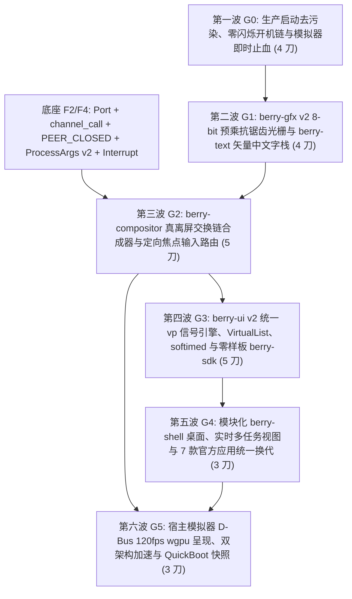

# BerryOS GUI、SDK、开机桌面与模拟器彻底重构计划（六波二十四刀）

Type: plan
Status: active
Updated: 2026-11-18

一句话说明：将 [GUI 合成与 SDK 终态标准](../../docs/GUI合成与SDK终态标准-v2.0.md)、[iOS 视觉与流体交互复刻标准](../../docs/iOS视觉与流体交互复刻标准-v1.0.md) 与四大模块总体设计（[compositor](compositor/design.md)、[ui-sdk](ui-sdk/design.md)、[desktop-boot](desktop-boot/design.md)、[emulator](emulator/design.md)）拆解为拓扑正序、与底座 [莓核五波十六刀演进实施计划](2026-11-18-莓核五波十六刀演进实施计划.md) 精确咬合的六大波次共二十四把原子手术刀（G0–G5），彻底清偿 [GUI 与 SDK 及启动模拟器全栈深研](../research/2026-11-18-GUI与SDK及启动模拟器全栈深研.md) 锁定的全部 36 项缺陷并一比一兑现 iOS 18 / iPadOS 18 旗舰质感。

## 背景

依据 [图形合成与 SDK 及模拟器终态架构裁决](../notes/proposed/2026-11-18-图形合成与SDK及模拟器终态架构裁决.md) 与 [全面复刻 iOS 18 视觉与流体交互范式裁决](../notes/proposed/2026-11-18-全面复刻iOS18视觉与流体交互范式裁决.md)，本重构拒绝在共享单通道、单帧缓冲带裁剪、安卓/三方混搭拼盘与空壳道具应用上继续堆叠补丁，采取「纯算法 `*face` 与宿主机 iOS 18 视觉高保真画廊先行 → 超椭圆与增艳毛玻璃渲染核先行 → 合成器与会话协议合流 → 纯正 UIKit/SwiftUI 等价控件与零样板 SDK 换代 → 灵动岛/流体桌面与 iPadOS 连续体落地 → Xcode Simulator 级 120fps 宿主外框与亚秒级快照收官」的正向演进序列。其中第一波（G0）与第二波（G1）零内核新原语依赖，可与底座线并行推进；第三波（G2）在底座线 `Port`、`channel_call`、`SIGNAL_PEER_CLOSED`、`ProcessArgs v2` 与 `Interrupt` 就位节点精准合流。

## 步骤

### 第一波：生产启动去污染、零闪烁开机链与模拟器即时止血（G0 族 · 4 刀 · 零内核新号依赖）

1. **G0-1 生产启动去自检污染与桌面自动翻页剥离刀（清偿 D-BOOT-03 部分 / D-DESK-01）**
   - **动作**：为 [frameloop.rs](../../user/bins/berry-launcher/src/frameloop.rs) 的 `Selftest` 自动滑动翻页状态机补齐 `if self.smoke` 严格门控，确保正常开机桌面首帧呈现后稳驻第 0 页零自动乱翻；将 `guifbd` 启动期 `FBW` 清屏写 `"AB\nCD"` 自验与 `berry-term` 启动预派生一次性子 shell 自检迁入显式冒烟门控；接通导航栏返回键优先发送 `OP_WM_BACK`（复用 `gui-wmd` 已在位的 500ms 超时兜底机制）。
   - **可观察验证**：正常模式启动桌面全程零自动翻页、零测试字符闪现；`just gui8-smoke` 与 `just smoke-image` 冒烟门禁全绿。

2. **G0-2 `berryboot` 动态内存图优选原生 GOP 与无闪烁局部增量 Splash 刀（清偿 D-BOOT-01 / D-BOOT-02）**
   - **动作**：升级 [berryboot/lib.rs](../../bootloader/berryboot/app/src/lib.rs) 按 UEFI `GetMemoryMap` 动态选址解除 128MiB 硬窗，在 `ExitBootServices` 前按目标配置优选原生 32bpp GOP 分辨率并居中绘制首帧抗锯齿品牌徽标写入 `BerryHandoff`；移除 [splash.rs](../../kernel/src/splash.rs) 的假 8 步空循环与全屏 `clear_screen`，立起早期用户态 `bootsplashd` 原位承接帧缓冲并仅对胶囊进度条变化区间执行 60Hz 局部增量重绘。
   - **可观察验证**：256MiB / 1GiB 内存配置正常引导；录制启动全程视频帧逐帧比对零全屏黑闪、胶囊进度单调平滑爬升直至桌面揭幕。

3. **G0-3 宿主模拟器 `RamSource` 零漏检映射、1:1 开窗与完整工具栏修复刀（清偿 D-EMU-02 / D-EMU-03 / D-EMU-04 部分）**
   - **动作**：重写 [ram.rs](../../tools/berry/src/display/ram.rs) 用只读 `mmap` + 64 位整字分块快速脏行检测替换 8.29MB `pread` 系统调用与 4,050 像素稀疏采样（彻底根除光标与单字符吞帧）；移除 [window.rs](../../tools/berry/src/window.rs) 的 `0.55/0.9` 历史缩放因子兑现逻辑 1:1 开窗，替换 15 字母残缺 `glyph()` 为完整 ASCII 抗锯齿字模消除菜单缺字乱码；为 `spawn_kernel` 补齐 `fwcfg_plan` 单源注入并在 `berry` 内嵌纯 Rust FAT12 自动初始化器。
   - **可观察验证**：`berry run --accel hvf` 直启零 FPSR 崩溃；无预置盘空目录执行 `berry shell` 自动造盘启动，Profile 菜单全字母清晰，终端 1px 光标闪烁 100 次 100% 上屏无漏帧。

4. **G0-4 `berry-gfx` 行级 Span 填充与无除法双线性采样提速刀（清偿 D-DISP-06 前半）**
   - **动作**：重构 [raster.rs](../../user/berry-gfx/src/raster.rs) 的 `fill_rect`、`fill_rect_rounded` 与 `argb_blit`，消除已裁剪区间内的逐像素 `put_px` 6 重边界检查，改为单行 `u32` 切片批量填充与行指针顺序推进；重写 `smooth_argb_blit` 采用预计算定点步长替代内层循环 `i64` 除法。
   - **可观察验证**：宿主机微基准测试 1080p 全屏矩形与圆角卡片填充吞吐提升 `>= 10x`，既有 43 格画廊像素对拍 100% 精确一致。

---

### 第二波：`berry-gfx` v2 8-bit 预乘抗锯齿光栅与 `berry-text` 矢量中文字栈（G1 族 · 4 刀 · 纯库先行）

5. **G1-1 `berry-gfx` v2 预乘 `SrcOver` 混合核与 AArch64 NEON / x86 SSE2 向量化刀（清偿 D-DISP-05 前半 / D-DISP-06 后半）**
   - **动作**：按照 [ui-sdk 总体设计](ui-sdk/design.md) 第二节，确立小端预乘 `BGRA8888 / RGBA8888` 标准色彩模型；实装标量基准与 AArch64 NEON / x86_64 SSE2 四像素并行 `SrcOver` Span 混合器、`PushLayer(opacity)` 组合成及线性/径向渐变画刷；升级图标容器至保留完整 8-bit Alpha 的 `BYI2` 编解码器。
   - **可观察验证**：宿主机百万随机颜色与透明度组合下 SIMD 核与标量参考核误差 `<= 1 LSB`；半透明彩色 PNG 图标叠加任意背景边缘平滑零杂色环。

6. **G1-2 $G^2$ 连续曲率超椭圆（Continuous Squircle）抗锯齿与 iOS 双轨海拔阴影刀（清偿 D-DISP-05 后半）**
   - **动作**：按照 [iOS 视觉与流体交互复刻标准](../../docs/iOS视觉与流体交互复刻标准-v1.0.md) 第一、二节，实装 $n = 4.0 / 4.5$ 超椭圆 SDF 解析覆盖率 `FillSquircle`（含同心圆角推导、`0.5pt` 微晶内高光描边与 `PushClipSquircle` 圆角裁剪栈）及单遍误差函数高斯 `DrawBoxShadow`（Light 双层柔和投影 / Dark 零外阴影纯灰度抬升），彻底废除传统正圆弧、`TRUE_CORNERS` 进程级原子开关与双实心矩形假阴影。
   - **可观察验证**：宿主机导出 1080p iOS 18 材质与超椭圆对比样张，验证任意半径超椭圆切点平滑连续零曲率折角、零阶梯锯齿。

7. **G1-3 `berry-text` 纯 Rust TrueType/OpenType 轮廓光栅与 LRU 灰度图集刀（清偿 D-SDK-05 前半）**
   - **动作**：新建 `#![no_std]` + `alloc` 纯库 `user/berry-text`，实现 TTF `cmap`/`glyf`/`hmtx` 解析、二次贝塞尔扫描线 8-bit 面积覆盖率抗锯齿光栅器及有界 `GlyphCache` 页式 LRU 图集；接入 `berry-gfx` `DrawGlyphMask` 着色管线；在系统只读镜像集成开源中英文无衬线精简字库 VMO。
   - **可观察验证**：宿主机测试覆盖 ASCII、扩展拉丁、常用符号与 3,500+ 常用汉字在 `10px..96px` 任意字号下的轮廓光栅零崩溃、图集满载千轮淘汰零泄漏。

8. **G1-4 Unicode UTF-8 多行排版、标点避头尾与双向光标映射刀（清偿 D-SDK-05 后半）**
   - **动作**：在 `berry-text` 实现 `TextLayout` 段落引擎（UTF-8 解码、英文词边界与 CJK 字边界混合折行、中文标点避头尾、省略号截断 `Ellipsis`、行高与对齐、字节索引 ↔ 视觉坐标双向二分查询）。
   - **可观察验证**：宿主机性质测试随机中英混排长文本折行零越界、光标点击命中与键盘左右移动逐字符精确对齐。

---

### 第三波：`berry-compositor` 真离屏交换链合成器与定向焦点输入路由（G2 族 · 5 刀 · 合流底座 F2/F4）

9. **G2-1 `berry-compface` 场景图、遮挡剔除、脏区包络与命中路由纯核刀**
   - **动作**：按照 [compositor 总体设计](compositor/design.md) 第一、四、五节，新建零系统调用纯核 `berry-compface`，实现六层 Z 序 `SceneGraph`、四边动态 `Insets` 推导、自顶向下不透明区遮挡剔除（`Opaque Occlusion Culling`）、2D 缩放平移逆变换命中测试、指针粘滞捕获与系统边缘手势状态机。
   - **可观察验证**：宿主机 100% 分支覆盖测试（含全屏应用完全遮挡底层壁纸时底层可见域恒为空、缩放动画途中点击坐标精确反算、边缘手势接管自动派发 `Cancel`）。

10. **G2-2 `berry-guiproto` v2 独立会话协议与双/三缓冲 `Swapchain + Fence` 刀（清偿 D-IPC-01 / D-IPC-04 / D-IPC-05 / D-DISP-02..04）**
    - **动作**：立起 `user/bins/berry-compositor` 单一守护进程（合流替代旧 `gui-wmd` 中继与 `guifbd`），基于内核 `Port` 实装 `PA_COMP_APP` / `PA_COMP_IME` / `PA_COMP_SHELL` 三级独立会话通道（彻底终结 `WMD_CLI_DUP` 共享互截与 `relay` 300s 阻塞）；实装按窗口实际尺寸分配的 2–3 槽 `Swapchain`、合成器侧持久 `UserRo` 只读映射（废除 16KB `bounce` `vmo_read`）与显式 `release_event` 同步栅栏，对接 `SIGNAL_PEER_CLOSED` 断连瞬时清窗自愈。
    - **可观察验证**：8 个独立客户端进程高频并发提交不同尺寸窗口帧与查询状态 30 分钟零互截、零撕裂；随机 `kill` 任意客户端后孤儿窗口 1 帧内清除且物理页零泄漏。

11. **G2-3 场景图 SIMD 混合执行器、`1.8x` 增艳四阶 Vibrancy 毛玻璃与 Splash 交叉溶解刀（清偿 D-DISP-01）**
    - **动作**：在 `berry-compositor` 接入两遍脏区增量合成器（NEON 预乘 Alpha 混合 + `55pt/38pt/34pt` 超椭圆遮罩 + 1/4 降采样 Dual-Kawase 叠加 `1.8x` 饱和度矩阵与五档 `UltraThin..ChromeMaterial` 光学毛玻璃 + `Sheet` 升起时父窗 `0.92x` 纵深微缩）与双后备扫描缓冲；接入 `virtio-gpu` 异步批刷新与 `cursorq` 硬件光标面；打通 `bootsplashd` 末帧至桌面首帧的 `250ms` 交叉溶解揭幕交接。
    - **可观察验证**：`RegularMaterial` 控制中心与 Dock 在高饱和彩色壁纸上拖动通透鲜活零死灰浑浊、帧率达 60/120fps；全屏不透明应用局部刷新时壁纸零重绘。

12. **G2-4 中断驱动零轮询输入源并入与焦点/手势严格定向分发刀（清偿 D-IPC-02）**
    - **动作**：对接底座 `devmgr` 授予的 `virtio-input` GIC SPI `Interrupt` 对象挂入 `compositor` 主 `Port`（废除 1ms/100ms 睡眠轮询）；激活三级输入路由：系统边缘手势喂 `berry-shell`、普通指针经逆变换单向投递捕获窗口、键盘与 IME 事件严格单向投递唯一 `focused_surface`。
    - **可观察验证**：空载稳态输入轮询唤醒计数为 `0`；前台应用打开时点击或敲击键盘，后台桌面进程收到 `0` 条窃听/误投事件。

13. **G2-5 动态分辨率/旋转热切换与高刷 `latch-at-vsync` 锁拍闭环刀（清偿 D-DISP-07..09）**
    - **动作**：依托底座高精度 Tickless 定时器兑现 `compositor` 亚毫秒级 `latch-at-vsync` 锁拍与 VRR 仲裁执行；消费 `virtio-gpu` 配置变更中断与控制指令，广播 `DisplayMetricsChanged`（含权威 `density_q8` 与四边 `Insets`）实现免重启横竖屏平滑旋转与分辨率热切档。
    - **可观察验证**：运行中切换 `1080×1920 ↔ 1920×1080` 全系统免重启 `< 150ms` 完成重排；120Hz 档拍点间隔误差 p99 达标。

---

### 第四波：`berry-ui` v2 统一 `vp` 信号引擎、`VirtualList`、`imed` 与零样板 `berry-sdk`（G3 族 · 5 刀）

14. **G3-1 `berry-ui` v2 动态 Arena、`Signal<T>` 细粒度响应核与统一 `vp` 主题系统刀（清偿 D-SDK-01 / D-SDK-02 前半）**
    - **动作**：重构 `berry-ui` 存储层为受控可扩展页块池与 `SharedStr` UTF-8 文本（解除 `512` 节点/`64B` 文本/`8` 输入框硬帽）；实装 `Signal<T>` / `Computed<T>` 属性级自动标脏；彻底废除 1x 物理像素内建常量，全量统一至 `vp` 逻辑坐标与三层语义 `ThemeTokens`（Light/Dark/高对比）。
    - **可观察验证**：宿主机测试验证单 `Ui` 承载 4,000+ 节点与长段落中文零溢出，切换 `density`（`1.0x / 2.0x / 3.0x`）与亮暗主题无需重建树即时精确重排换肤。

15. **G3-2 完整 Flexbox/Grid/`SafeArea` 约束布局与三档响应式断点刀（清偿 D-SDK-03）**
    - **动作**：重写 `berry-layout` 完整支持 `flex_grow`、`flex_shrink`、`flex_basis`、`flex_wrap`、对齐分布、网格轨道及自动消费合成器四边 `Insets` 的 `SafeArea` 容器；内置 `Compact / Medium / Expanded` 窗口尺寸类断点。
    - **可观察验证**：`Spacer` 自动均分主轴余量（消灭手工定宽假容器），同一测试视图在竖屏手机与横屏平板尺寸下自动在底部导航栏与侧边导航轨间无损切换。

16. **G3-3 纯正 UIKit/SwiftUI 等价控件库、UIKit 流体滚动物理与 `VirtualList` 刀（清偿 D-SDK-02 后半 / D-SDK-04 / D-SDK-07）**
    - **动作**：开放一等 `Widget` 扩展接口，一比一按 [iOS 视觉与流体交互复刻标准](../../docs/iOS视觉与流体交互复刻标准-v1.0.md) 第三、五节重铸标准组件（双态滚动折叠 `34pt` 大标题 `UINavigationBar`、`0.33pt` 缩进细线 `InsetGroupedList`、按压弹性拉伸 `51×31pt` `UISwitch`、`ChromeMaterial` `UITabBar`、层叠 `UISheet`、背景模糊浮出 `UIContextMenu` 与宽屏 `UISplitView`，彻底清除安卓 `56dp` 顶栏与旧双轨制）；实装 `0.55` 对数橡皮筋越界、`0.998` 指数衰减惯性、松手终点投射与十万行级 `VirtualList`；在宿主端建立全控件 iOS 18 视觉回归画廊。
    - **可观察验证**：宿主机高分屏画廊人工与像素双重审校确认大标题折叠、开关拉伸与分组列表与 iOS 18 零观感落差；100,000 行中文列表快速抛滑活跃节点 `< 80`、全程 120fps。

17. **G3-4 `imed` iOS 质感拼音软键盘与按键放大气泡闭环刀（清偿 D-SDK-06）**
    - **动作**：新建 `user/bins/imed`（持 `PA_COMP_IME` 挂载 `Layer::InputMethod` 表面），复刻 iOS 系统键盘（`ThickMaterial` 底座、微阴影圆角键帽、按下弹出放大预览气泡 Key Callout、双拼/全拼 `ChromeMaterial` 候选词横栏与系统蓝确认键），打通 `TextInput` 获焦唤起、`Preedit` 下划线组合串与 `SafeArea` `ime_inset` 弹簧避让。
    - **可观察验证**：触控点击备忘录输入框丝滑顶起软键盘、按键实时弹出预览气泡、连续输入中文选词上屏零卡顿。

18. **G3-5 零样板 `berry-sdk`（`Port` 统一异步 `AppLoop` + `#[berry_sdk::app]`）与打包工具链革新刀（清偿 D-IPC-03 客户端面 / D-SDK-08 / D-SDK-09）**
    - **动作**：构建基于内核 `Port` 与 `ProcessArgs v2` 的 `berry-sdk`（支持多路自定义 Channel、Timer、后台异步文件/网络任务与子进程管道同环驱动，自动处理交换链握手、`OP_WM_BACK` 导航栈回退与墓碑状态容器序列化）；落地剪贴板与 Picker 受限句柄服务；将 `mkapp.py` 升级为纯 Rust `berry app` 子命令，支持源码 `manifest.toml` 带注释编译出规范签名 `.bap`。
    - **可观察验证**：50 行以内零 `unsafe`、零手工 RPC/VMO 代码即可编译打包带注释 `manifest.toml` 的完整签名应用并在桌面流畅运行与墓碑复活。

---

### 第五波：iOS 18 灵动岛桌面、iPadOS 台前调度连续体与六款旗舰真应用（G4 族 · 3 刀）

19. **G4-1 iOS 18 `berry-shell`（灵动岛状态栏 + 模块化毛玻璃控制中心 + Spotlight + 双模底栏与 Dock）刀（清偿 D-DESK-02）**
    - **动作**：按照 [desktop-boot 总体设计](desktop-boot/design.md) 第三节与 [iOS 视觉与流体交互复刻标准](../../docs/iOS视觉与流体交互复刻标准-v1.0.md) 第四节重构桌面壳层，剥离删除原 Launcher 内置重复设置页；实装自适应反色透明状态栏与 **灵动岛（Dynamic Island）实时活动胶囊**、右上下拉 iOS 18 圆角模块化毛玻璃控制中心（含弹性过冲拉伸亮度/音量柱）、主屏下滑 **Spotlight 搜索**、`Jiggle Mode` 编辑网格、`34pt` 四槽毛玻璃 Dock，以及默认 `134×5pt` Home 横条配设置页可选「经典三键导航」热切换开关。
    - **可观察验证**：计时器启动后灵动岛实时弹簧生长读数；右上下拉控制中心 `1.9x` 增艳毛玻璃通透跟手；设置中切换 Home 横条与 SF 矢量经典三键即时生效零重启。

20. **G4-2 抛物弧线弹簧开合（Hero Morph）、弧形叠卡 `AppSwitcher`、预测性侧滑返回与 iPadOS 连续体刀（清偿 D-DESK-03）**
    - **动作**：实装点击图标瞬发 `StartingSurface` 与携带松手二维速度向量的 `Icon-to-Window` 弧线弹簧开合（伴随壁纸 `0.93x` 景深微缩）；实装左侧弧形叠卡 `AppSwitcher`（零拷贝引用实时窗口与墓碑缩略图，上滑甩卡清退）与全屏左边缘视差侧滑返回；实装 `>= 600pt` 自动切换 **iPadOS 浮动扩充 Dock、`Split View` 分屏与 `Stage Manager` 台前调度自由圆角多窗**。
    - **可观察验证**：连续打开 8 个应用进入叠卡切换器流畅翻阅与墓碑无感还原；将窗口旋转/拉宽至平板桌面尺寸自动无损切入 iPadOS 台前调度多窗口并排运行。

21. **G4-3 砍除伪装空壳双胞胎目录，首发六款 100% 真功能 iOS 18 质感系统应用刀**
    - **动作**：彻底清理合并 `user/bins/` 下 7 对分裂目录并将无后端假相机/假短信等半成品移出主屏，基于 `berry-sdk` + `berry-ui` v2 精雕细琢六款真精品应用：**设置**（头像概览卡 + 彩色圆角图标 `InsetGroupedList` + 导航方式/显示/壁纸/存储真控制）、**文件**（底部毛玻璃双标签 + 列表/网格 + QuickLook 即时预览）、**备忘录**（UTF-8 中文富排印 + 联动 `imed` 拼音键盘）、**相册**（网格至全屏跟手捏合缩放 Hero 过渡）、**时钟与计算器**（经典圆键计算器 + 实时驱动顶部灵动岛倒计时的计时器）、**终端与活动监视器**（暗黑毛玻璃多标签终端 + 微内核实时进程/能力/帧率曲线监视器）。
    - **可观察验证**：六款首发应用每一页字距、圆角、毛玻璃、分割线与弹性手感通过 iOS 18 视觉对标审校，中英文、深浅色、iPhone/iPadOS 断点与墓碑恢复全绿。

---

### 第六波：Xcode Simulator 同款钛金属外框、D-Bus 120fps `wgpu` 呈现与亚秒级速启（G5 族 · 3 刀）

22. **G5-1 Xcode Simulator 同款超椭圆钛金属外框、D-Bus 零拷贝收帧与 `wgpu` 120fps 合成刀（清偿 D-EMU-01 / D-EMU-03 余项）**
    - **动作**：按照 [emulator 总体设计](emulator/design.md) 第一、二节，在 `tools/berry` 落地 `-display dbus,p2p=on` 零拷贝 `ScanoutMap + UpdateMap` 收帧与 `wgpu` 增量纹理合成；将模拟器窗口升级为无系统标题栏透明异形画布，抗锯齿渲染等宽钛金属超椭圆设备外框（Bezel，屏幕按 `55pt` 同心超椭圆硬件裁切）、右上侧极简悬浮控制胶囊、开发者脏区/FPS HUD 与 60fps Web 远程流。
    - **可观察验证**：Apple Silicon HVF 下呈现纯正 Xcode Simulator 外观与 60/120fps 满帧触控板双指惯性滑动，静默停帧 2 秒后 QEMU + `berry` 总 CPU 占用 `< 2%`。

23. **G5-2 双架构同构硬件加速（`x86_64` KVM/WHPX）、拓扑强校验器与全平台控制台刀（清偿 D-EMU-04 / D-EMU-05）**
    - **动作**：依托底座双架构同源镜像，在 x86_64 Linux/Windows 宿主自动启用原生 `x86_64` + KVM/WHPX 硬件加速；实装启动前 `TopologyValidator` 静态拦截一切缺件/错序参数；打通 Windows 双向串口控制台。
    - **可观察验证**：Linux KVM 与 Windows WHPX 宿主冷启动进入桌面耗时从分钟级压降至 `< 1.5s`；macOS/Linux/Windows 三端 `berry console` / `berry doctor --json` 全绿一致。

24. **G5-3 Golden Snapshot 亚秒级速启（QuickBoot）与剪贴板/文件拖放/音频桥接刀（清偿 D-EMU-06 / D-EMU-07）**
    - **动作**：实装基于镜像哈希校验的自动基准快照保存与 `< 500ms` 秒级恢复（含恢复后挂钟 `rtc` 即时同步）；新增轻量客机代理 `berry-guestd`，打通宿客双向剪贴板、拖拽 `.bap`/文件入窗直装直传、触控板连续像素滚动映射与 `virtio-snd` 音频输出；同步更新 `docs/` 相关指南与归档前期过渡计划。
    - **可观察验证**：日常 `berry shell` 窗口亮屏可交互耗时 `< 500ms`；宿主复制中文粘贴进客机终端/备忘录、拖入 `.bap` 即刻安装启动与音频播放端到端验收全绿，`check-docs --strict` 与 `docs_guard.py` 零告警收官。

## 未完成事项

- [x] G0-1（自测门控半）：`berry-launcher` 开机自动翻页门控落地（2026-11-19 止血刀——rtc 键缺席臂：smoke 形态照打标记、真实桌面不再抢输入；返回键 `OP_WM_BACK` 归 G0-1 余项）
- [ ] G0-2：`berryboot` 动态内存图装载、原生 GOP 优选首帧徽标与 `bootsplashd` 60Hz 局部增量无闪烁进度
- [x] G0-3（止血版）：宿主窗口点击复活+完整工具栏+wgpu 呈现修通+两段式采集（2026-11-19 止血刀——last_fit 死分支/overlay 白烧/通道序/每帧 15MB 分配/QMP 点击/RamSource 两段读；零拷贝 mmap 脏行与 FAT12 自动造盘归余项）
- [x] G0-4（止血版）：`berry-gfx` 行级 Span 填充落地+除法外提（2026-11-19 止血刀——定点无除法双线性与 NEON 归 G1-1 族余项；性能倍数待 telem 实测）
- [ ] G1-1：`berry-gfx` v2 预乘 `SrcOver` 混合核、NEON/SSE2 向量化与 `BYI2` 8-bit Alpha 图标容器
- [ ] G1-2：$G^2$ 连续曲率超椭圆（Continuous Squircle）抗锯齿、同心圆角裁剪栈与 iOS 双轨海拔阴影
- [ ] G1-3：`berry-text` 纯 Rust TrueType/OpenType 轮廓光栅器、LRU 灰度图集与共享中文字库 VMO
- [ ] G1-4：UTF-8 多行折行排版、SF 11 档负字距/`tnum` 等宽数字、中文标点避头尾与双向光标查询
- [ ] G2-1：`berry-compface` 六层场景图、自顶向下不透明遮挡剔除、脏区包络与逆变换命中纯核
- [ ] G2-2：`berry-compositor` 合流守护、每客独立会话鉴权、按需尺寸 `Swapchain + Fence` 与 `PEER_CLOSED` 自愈
- [ ] G2-3：场景图 SIMD 混合执行器、`1.8x` 增艳四阶 Vibrancy 毛玻璃、层叠 `Sheet` 纵深微缩与 Splash 交叉溶解揭幕
- [ ] G2-4：中断驱动零轮询输入采集、系统边缘手势竞技场与唯一焦点严格定向分发
- [ ] G2-5：动态分辨率/横竖屏免重启热切换、权威 `Insets` 广播与 120Hz `latch-at-vsync` 锁拍闭环
- [ ] G3-1：`berry-ui` v2 动态 Arena、`Signal<T>` 细粒度响应核与 iOS 18 Light/Dark 语义调色盘
- [ ] G3-2：完整 Flexbox/Grid/`SafeArea` 约束布局与 iPhone/iPadOS 响应式宽度断点
- [ ] G3-3：纯正 UIKit/SwiftUI 等价控件库（折叠大标题/`InsetGroupedList`/弹性 `UISwitch`）、UIKit 橡皮筋惯性物理与 `VirtualList`
- [ ] G3-4：`imed` iOS 风格拼音软键盘（含按键放大气泡与毛玻璃候选词栏）及 `Preedit/Commit` 弹簧避让闭环
- [ ] G3-5：零样板 `berry-sdk`（`Port` 统一异步 `AppLoop` + `#[berry_sdk::app]`）、剪贴板/Picker 与带注释 `manifest.toml` 编译链
- [ ] G4-1：iOS 18 `berry-shell`（灵动岛状态栏 + 模块化毛玻璃控制中心 + Spotlight + 默认 Home 横条配可选经典三键）
- [ ] G4-2：抛物弧线弹簧开合、左侧弧形叠卡 `AppSwitcher`、全屏左边缘视差返回与 iPadOS 台前调度多窗连续体
- [ ] G4-3：砍除伪装空壳双胞胎目录，首发六款 100% 真功能 iOS 18 质感系统应用（设置/文件/备忘录/相册/时钟计算器/终端监视器）
- [ ] G5-1：Xcode Simulator 同款 `55pt` 超椭圆钛金属外框、D-Bus 零拷贝收帧、`wgpu` 120fps 合成与 60fps Web 流
- [ ] G5-2：x86_64 Linux/Windows 原生 KVM/WHPX 双架构同构加速、`TopologyValidator` 强校验与全平台双向控制台
- [ ] G5-3：Golden Snapshot `< 500ms` 亚秒级速启与 `berry-guestd` 剪贴板/文件拖放/`virtio-snd` 音频桥接收官
