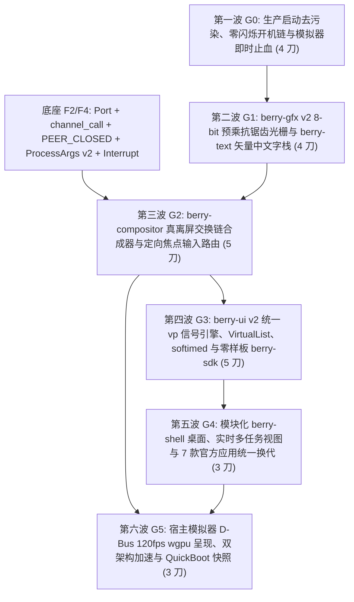

# BerryOS GUI、SDK、开机桌面与模拟器彻底重构计划（六波二十四刀）

Type: plan
Status: active
Updated: 2026-11-18

一句话说明：将 [GUI 合成与 SDK 终态标准](../../docs/GUI合成与SDK终态标准-v2.0.md) 与四大模块总体设计（[compositor](compositor/design.md)、[ui-sdk](ui-sdk/design.md)、[desktop-boot](desktop-boot/design.md)、[emulator](emulator/design.md)）拆解为拓扑正序、与底座 [全栈底座彻底重构计划](2026-11-18-全栈底座彻底重构计划.md)（F0–F5 二十刀）精确咬合的六大波次共二十四把原子手术刀（G0–G5），彻底清偿 [GUI 与 SDK 及启动模拟器全栈深研](../research/2026-11-18-GUI与SDK及启动模拟器全栈深研.md) 锁定的全部 36 项缺陷。

## 背景

依据 [图形合成与 SDK 及模拟器终态架构裁决](../notes/proposed/2026-11-18-图形合成与SDK及模拟器终态架构裁决.md)，本重构拒绝在共享单通道、单帧缓冲带裁剪与 1x/3x 割裂控件树上继续堆叠临时补丁，采取「纯算法 `*face` 宿主机测试先行 → 渲染与文字底座先行 → 合成器与会话协议合流 → UI 引擎与零样板 SDK 换代 → 无缝开机与微壳层桌面落地 → 120fps 宿主模拟器与亚秒级快照收官」的正向演进序列。其中第一波（G0）与第二波前半（G1）零内核新原语依赖，可与底座线第一至第二波完全并行推进；第三波（G2）在底座线第三波（`Port`、`channel_call`、`SIGNAL_PEER_CLOSED`）与第五波（`ProcessArgs v2`、`devmgr` 中断直通）就位节点精准合流。

## 步骤

### 第一波：生产启动去污染、零闪烁开机链与模拟器即时止血（G0 族 · 4 刀 · 零内核新号依赖）

1. **G0-1 生产启动去自检污染与桌面自动翻页剥离刀（清偿 D-BOOT-03 部分 / D-DESK-01）**
   - **动作**：为 [frameloop.rs](../../user/bins/berry-launcher/src/frameloop.rs) 的 `Selftest` 自动滑动翻页状态机补齐 `if self.smoke` 严格门控，确保正常开机桌面首帧呈现后稳驻第 0 页零自动乱翻；将 `guifbd` 启动期 `FBW` 清屏写 `"AB\nCD"` 自验与 `berry-term` 启动预派生一次性子 shell 自检迁入显式冒烟门控；接通导航栏返回键优先发送 `OP_WM_BACK`（复用 `gui-wmd` 已在位的 500ms 超时兜底机制）。
   - **可观察验证**：正常模式启动桌面全程零自动翻页、零测试字符闪现；`just gui8-smoke` 与 `just smoke-image` 冒烟门禁全绿。

2. **G0-2 `berryboot` 动态内存图优选原生 GOP 与无闪烁局部增量 Splash 刀（清偿 D-BOOT-01 / D-BOOT-02）**
   - **动作**：升级 [berryboot/lib.rs](../../bootloader/berryboot/app/src/lib.rs) 按 UEFI `GetMemoryMap` 动态选址解除 128MiB 硬窗，在 `ExitBootServices` 前按目标配置优选原生 32bpp GOP 分辨率并居中绘制首帧抗锯齿品牌徽标写入 `BerryHandoff`；移除 [splash.rs](../../kernel/src/splash.rs) 的假 8 步空循环与全屏 `clear_screen`，立起早期用户态 `bootsplashd` 原位承接帧缓冲并仅对胶囊进度条变化区间执行 60Hz 局部增量重绘。
   - **可观察验证**：256MiB / 1GiB 内存配置正常引导；录制启动全程视频帧逐帧比对零全屏黑闪、胶囊进度单调平滑爬升直至桌面揭幕。

3. **G0-3 宿主模拟器 `RamSource` 零漏检映射、1:1 开窗与完整工具栏修复刀（清偿 D-EMU-02 / D-EMU-03 / D-EMU-04 部分）**
   - **动作**：重写 [ram.rs](../../tools/berry/src/display/ram.rs) 用只读 `mmap` + 64 位整字分块快速脏行检测替换 8.29MB `pread` 系统调用与 4,050 像素稀疏采样（彻底根除光标与单字符吞帧）；移除 [window.rs](../../tools/berry/src/window.rs) 的 `0.55/0.9` 历史缩放因子兑现逻辑 1:1 开窗，替换 15 字母残缺 `glyph()` 为完整 ASCII 抗锯齿字模消除菜单缺字乱码；为 `spawn_kernel` 补齐 `fwcfg_plan` 单源注入并在 `berry` 内嵌纯 Rust FAT12 自动初始化器。
   - **可观察验证**：`berry run --accel hvf` 直启零 FPSR 崩溃；无预置盘空目录执行 `berry shell` 自动造盘启动，Profile 菜单全字母清晰，终端 1px 光标闪烁 100 次 100% 上屏无漏帧。

4. **G0-4 `berry-gfx` 行级 Span 填充与无除法双线性采样提速刀（清偿 D-DISP-06 前半）**
   - **动作**：重构 [raster.rs](../../user/berry-gfx/src/raster.rs) 的 `fill_rect`、`fill_rect_rounded` 与 `argb_blit`，消除已裁剪区间内的逐像素 `put_px` 6 重边界检查，改为单行 `u32` 切片批量填充与行指针顺序推进；重写 `smooth_argb_blit` 采用预计算定点步长替代内层循环 `i64` 除法。
   - **可观察验证**：宿主机微基准测试 1080p 全屏矩形与圆角卡片填充吞吐提升 `>= 10x`，既有 43 格画廊像素对拍 100% 精确一致。

---

### 第二波：`berry-gfx` v2 8-bit 预乘抗锯齿光栅与 `berry-text` 矢量中文字栈（G1 族 · 4 刀 · 纯库先行）

5. **G1-1 `berry-gfx` v2 预乘 `SrcOver` 混合核与 AArch64 NEON / x86 SSE2 向量化刀（清偿 D-DISP-05 前半 / D-DISP-06 后半）**
   - **动作**：按照 [ui-sdk 总体设计](ui-sdk/design.md) 第二节，确立小端预乘 `BGRA8888 / RGBA8888` 标准色彩模型；实装标量基准与 AArch64 NEON / x86_64 SSE2 四像素并行 `SrcOver` Span 混合器、`PushLayer(opacity)` 组合成及线性/径向渐变画刷；升级图标容器至保留完整 8-bit Alpha 的 `BYI2` 编解码器。
   - **可观察验证**：宿主机百万随机颜色与透明度组合下 SIMD 核与标量参考核误差 `<= 1 LSB`；半透明彩色 PNG 图标叠加任意背景边缘平滑零杂色环。

6. **G1-2 SDF 解析覆盖率抗锯齿圆角与单遍解析高斯盒阴影刀（清偿 D-DISP-05 后半）**
   - **动作**：实装四角独立半径抗锯齿 `FillRRect`（含描边环与 `PushClipRRect` 圆角裁剪栈）及基于误差函数多项式近似的单遍 `DrawBoxShadow`，彻底废除 `TRUE_CORNERS` 进程级原子开关与双实心矩形假阴影。
   - **可观察验证**：宿主机与 1080p 离屏画廊验证任意半径圆角、描边按钮与多层海拔卡片阴影平滑连续零阶梯锯齿。

7. **G1-3 `berry-text` 纯 Rust TrueType/OpenType 轮廓光栅与 LRU 灰度图集刀（清偿 D-SDK-05 前半）**
   - **动作**：新建 `#![no_std]` + `alloc` 纯库 `user/berry-text`，实现 TTF `cmap`/`glyf`/`hmtx` 解析、二次贝塞尔扫描线 8-bit 面积覆盖率抗锯齿光栅器及有界 `GlyphCache` 页式 LRU 图集；接入 `berry-gfx` `DrawGlyphMask` 着色管线；在系统只读镜像集成开源中英文无衬线精简字库 VMO。
   - **可观察验证**：宿主机测试覆盖 ASCII、扩展拉丁、常用符号与 3,500+ 常用汉字在 `10px..96px` 任意字号下的轮廓光栅零崩溃、图集满载千轮淘汰零泄漏。

8. **G1-4 Unicode UTF-8 多行排版、标点避头尾与双向光标映射刀（清偿 D-SDK-05 后半）**
   - **动作**：在 `berry-text` 实现 `TextLayout` 段落引擎（UTF-8 解码、英文词边界与 CJK 字边界混合折行、中文标点避头尾、省略号截断 `Ellipsis`、行高与对齐、字节索引 ↔ 视觉坐标双向二分查询）。
   - **可观察验证**：宿主机性质测试随机中英混排长文本折行零越界、光标点击命中与键盘左右移动逐字符精确对齐。

---

### 第三波：`berry-compositor` 真离屏交换链合成器与定向焦点输入路由（G2 族 · 5 刀 · 合流底座 F2/F4）

9. **G2-1 `berry-compface` 场景图、遮挡剔除、脏区包络与命中路由纯核刀**
   - **动作**：按照 [compositor 总体设计](compositor/design.md) 第一、四、五节，新建零系统调用纯核 `berry-compface`，实现六层 Z 序 `SceneGraph`、四边动态 `Insets` 推导、自顶向下不透明区遮挡剔除（`Opaque Occlusion Culling`）、2D 缩放平移逆变换命中测试、指针粘滞捕获与系统边缘手势状态机。
   - **可观察验证**：宿主机 100% 分支覆盖测试（含全屏应用完全遮挡底层壁纸时底层可见域恒为空、缩放动画途中点击坐标精确反算、边缘手势接管自动派发 `Cancel`）。

10. **G2-2 `berry-guiproto` v2 独立会话协议与双/三缓冲 `Swapchain + Fence` 刀（清偿 D-IPC-01 / D-IPC-04 / D-IPC-05 / D-DISP-02..04）**
    - **动作**：立起 `user/bins/berry-compositor` 单一守护进程（合流替代旧 `gui-wmd` 中继与 `guifbd`），基于内核 `Port` 实装 `PA_COMP_APP` / `PA_COMP_IME` / `PA_COMP_SHELL` 三级独立会话通道（彻底终结 `WMD_CLI_DUP` 共享互截与 `relay` 300s 阻塞）；实装按窗口实际尺寸分配的 2–3 槽 `Swapchain`、合成器侧持久 `UserRo` 只读映射（废除 16KB `bounce` `vmo_read`）与显式 `release_event` 同步栅栏，对接 `SIGNAL_PEER_CLOSED` 断连瞬时清窗自愈。
    - **可观察验证**：8 个独立客户端进程高频并发提交不同尺寸窗口帧与查询状态 30 分钟零互截、零撕裂；随机 `kill` 任意客户端后孤儿窗口 1 帧内清除且物理页零泄漏。

11. **G2-3 场景图 SIMD 混合执行器、Dual-Kawase 实时背景模糊与 Splash 交叉溶解刀（清偿 D-DISP-01）**
    - **动作**：在 `berry-compositor` 接入两遍脏区增量合成器（NEON 预乘 Alpha 混合 + 圆角遮罩 + 2-pass 半分辨率 Dual-Kawase 毛玻璃模糊）与双后备扫描缓冲；接入 `virtio-gpu` 异步批刷新与 `cursorq` 硬件光标面；打通 `bootsplashd` 末帧至桌面首帧的 `250ms` 交叉溶解揭幕交接。
    - **可观察验证**：半透明毛玻璃浮窗在桌面图标上平滑拖动达 60/120fps；全屏不透明应用局部刷新时壁纸零重绘；开机至桌面过渡丝滑无缝。

12. **G2-4 中断驱动零轮询输入源并入与焦点/手势严格定向分发刀（清偿 D-IPC-02）**
    - **动作**：对接底座 `devmgr` 授予的 `virtio-input` GIC SPI `Interrupt` 对象挂入 `compositor` 主 `Port`（废除 1ms/100ms 睡眠轮询）；激活三级输入路由：系统边缘手势喂 `berry-shell`、普通指针经逆变换单向投递捕获窗口、键盘与 IME 事件严格单向投递唯一 `focused_surface`。
    - **可观察验证**：空载稳态输入轮询唤醒计数为 `0`；前台应用打开时点击或敲击键盘，后台桌面进程收到 `0` 条窃听/误投事件。

13. **G2-5 动态分辨率/旋转热切换与高刷 `latch-at-vsync` 锁拍闭环刀（清偿 D-DISP-07..09）**
    - **动作**：依托底座高精度 Tickless 定时器兑现 `compositor` 亚毫秒级 `latch-at-vsync` 锁拍与 VRR 仲裁执行；消费 `virtio-gpu` 配置变更中断与控制指令，广播 `DisplayMetricsChanged`（含权威 `density_q8` 与四边 `Insets`）实现免重启横竖屏平滑旋转与分辨率热切档。
    - **可观察验证**：运行中切换 `1080×1920 ↔ 1920×1080` 全系统免重启 `< 150ms` 完成重排；120Hz 档拍点间隔误差 p99 达标。

---

### 第四波：`berry-ui` v2 统一 `vp` 信号引擎、`VirtualList`、`softimed` 与零样板 `berry-sdk`（G3 族 · 5 刀）

14. **G3-1 `berry-ui` v2 动态 Arena、`Signal<T>` 细粒度响应核与统一 `vp` 主题系统刀（清偿 D-SDK-01 / D-SDK-02 前半）**
    - **动作**：重构 `berry-ui` 存储层为受控可扩展页块池与 `SharedStr` UTF-8 文本（解除 `512` 节点/`64B` 文本/`8` 输入框硬帽）；实装 `Signal<T>` / `Computed<T>` 属性级自动标脏；彻底废除 1x 物理像素内建常量，全量统一至 `vp` 逻辑坐标与三层语义 `ThemeTokens`（Light/Dark/高对比）。
    - **可观察验证**：宿主机测试验证单 `Ui` 承载 4,000+ 节点与长段落中文零溢出，切换 `density`（`1.0x / 2.0x / 3.0x`）与亮暗主题无需重建树即时精确重排换肤。

15. **G3-2 完整 Flexbox/Grid/`SafeArea` 约束布局与三档响应式断点刀（清偿 D-SDK-03）**
    - **动作**：重写 `berry-layout` 完整支持 `flex_grow`、`flex_shrink`、`flex_basis`、`flex_wrap`、对齐分布、网格轨道及自动消费合成器四边 `Insets` 的 `SafeArea` 容器；内置 `Compact / Medium / Expanded` 窗口尺寸类断点。
    - **可观察验证**：`Spacer` 自动均分主轴余量（消灭手工定宽假容器），同一测试视图在竖屏手机与横屏平板尺寸下自动在底部导航栏与侧边导航轨间无损切换。

16. **G3-3 开放 `Widget` Trait、标准 `vp` 组件库、全手势与 `VirtualList` 惯性滚动刀（清偿 D-SDK-02 后半 / D-SDK-04 / D-SDK-07）**
    - **动作**：开放一等 `Widget` 扩展接口，以 `vp` + `berry-text` + SDF 抗锯齿原语重铸全套标准组件（终结旧 `ViewKind` 与 `pattern.rs` 双轨制）；在手势核补齐 `LongPress`、`DoubleTap`、`Pinch` 与物理摩擦惯性 `Fling` + 边界弹簧回弹；实装槽位循环复用的 `VirtualList`。
    - **可观察验证**：第三方自定义图表/画布控件零改引擎源码直接挂载运行；100,000 行中文列表快速抛滑活跃节点 `< 80`、全程 120fps 零掉帧。

17. **G3-4 `softimed` 中英文输入法守护进程与组合文本闭环刀（清偿 D-SDK-06）**
    - **动作**：新建 `user/bins/softimed`（持 `PA_COMP_IME` 挂载 `Layer::InputMethod` 表面），实现 QWERTY 符号盘、双拼/全拼词库检索与候选词栏，打通 `TextInput` 获焦自动唤起、`Preedit` 下划线组合串、光标跟随与 `Commit` UTF-8 上屏及 `SafeArea` `ime_inset` 弹簧避让。
    - **可观察验证**：在无硬件键盘触控模式下点击输入框平滑升起软键盘，连续输入中文词组选词上屏，点击返回键优先平滑收起软键盘。

18. **G3-5 零样板 `berry-sdk`（`Port` 统一异步 `AppLoop` + `#[berry_sdk::app]`）与打包工具链革新刀（清偿 D-IPC-03 客户端面 / D-SDK-08 / D-SDK-09）**
    - **动作**：构建基于内核 `Port` 与 `ProcessArgs v2` 的 `berry-sdk`（支持多路自定义 Channel、Timer、后台异步文件/网络任务与子进程管道同环驱动，自动处理交换链握手、`OP_WM_BACK` 导航栈回退与墓碑状态容器序列化）；落地剪贴板与 Picker 受限句柄服务；将 `mkapp.py` 升级为纯 Rust `berry app` 子命令，支持源码 `manifest.toml` 带注释编译出规范签名 `.bap`。
    - **可观察验证**：50 行以内零 `unsafe`、零手工 RPC/VMO 代码即可编译打包带注释 `manifest.toml` 的完整签名应用并在桌面流畅运行与墓碑复活。

---

### 第五波：模块化 `berry-shell` 桌面、实时多任务视图与 7 款官方应用统一换代（G4 族 · 3 刀）

19. **G4-1 模块化 `berry-shell`（自适应反色状态栏 + 毛玻璃控制中心 + 视差桌面与 Dock）刀（清偿 D-DESK-02）**
    - **动作**：按照 [desktop-boot 总体设计](desktop-boot/design.md) 第三节重构桌面壳层，剥离删除原 Launcher 内置重复设置页；实装底层亮度感知自动黑白反色的透明状态栏、下拉毛玻璃通知/快捷控制中心、支持长按拖拽编辑持久化的多页图标网格与毛玻璃 `SmartDock`。
    - **可观察验证**：切换深色壁纸与浅色全屏应用时状态栏字色自动丝滑反转；下拉控制中心实时毛玻璃模糊并可真实调节亮度、主题与旋转锁。

20. **G4-2 图标到窗口连续弹簧形变（Hero Morph）、实时多任务卡片视图与预测性返回刀（清偿 D-DESK-03）**
    - **动作**：实装点击图标瞬发 `StartingSurface` 与可中断 `Icon-to-Window` 弹簧展开转场；实装对接 `compositor` 表面纹理与 `appd` 墓碑缩略图的 `RecentsOverview` 多任务卡片栈（支持滑卡切换、上滑清退与手势横滑快切）；全面贯通四级侧滑预测性返回手势。
    - **可观察验证**：连续打开 8 个应用进入多任务视图流畅翻阅切换、墓碑应用点击无感还原；启动展开途中反向手势抓回连续无跳变。

21. **G4-3 清扫双胞胎应用目录与 7 款预置系统应用全量 `berry-sdk` 现代化刀**
    - **动作**：彻底清理合并 `user/bins/` 下 `settings`/`settings-app`、`files`/`files-app` 等 7 对分裂目录，基于 `berry-sdk` + `berry-ui` v2 重构统一官方套件：**设置**（完整分类导航与系统配置中心）、**文件**（真实 `$appdata` 与挂载卷浏览/重命名/预览）、**终端 `berry-term`**（UTF-8/ANSI 色彩 + `Port` 多路管道直驱子 `bsh`）、**通讯录**（`VirtualList` 搜索 + 二级详情页 + Picker 提供方）、**相册**（网格至全屏沉浸缩放翻阅）、**相机**与**浏览器**。
    - **可观察验证**：全部预置应用支持中英文显示、深浅色实时跟随、横竖屏自适应断点、预测性返回与后台墓碑状态恢复，全套 BCTS 与桌面交互验收全绿。

---

### 第六波：宿主模拟器 D-Bus 120fps `wgpu` 呈现、双架构加速与 QuickBoot 快照（G5 族 · 3 刀）

22. **G5-1 宿主 D-Bus p2p 共享图纯 Damage 收帧器与 `wgpu` 120fps 合成呈现刀（清偿 D-EMU-01 / D-EMU-03 余项）**
    - **动作**：按照 [emulator 总体设计](emulator/design.md) 第一、二节，在 `tools/berry` 落地 `-display dbus,p2p=on` 零拷贝 `ScanoutMap + UpdateMap` 收帧通道与 `wgpu` 增量纹理上传呈现，彻底突破 33fps 限制并消除静默空载轮询；升级外置高分屏矢量悬浮工具栏、开发者脏区/FPS HUD 与 60fps 增量 Web 远程桌面流。
    - **可观察验证**：Apple Silicon HVF 下桌面与列表滑动宿主实测满帧 60/120fps，静默停帧 2 秒后 QEMU + `berry` 总 CPU 占用 `< 2%`。

23. **G5-2 双架构同构硬件加速（`x86_64` KVM/WHPX）、拓扑强校验器与全平台控制台刀（清偿 D-EMU-04 / D-EMU-05）**
    - **动作**：依托底座双架构同源镜像，在 x86_64 Linux/Windows 宿主自动启用原生 `x86_64` + KVM/WHPX 硬件加速；实装启动前 `TopologyValidator` 静态拦截一切缺件/错序参数；打通 Windows 双向串口控制台。
    - **可观察验证**：Linux KVM 与 Windows WHPX 宿主冷启动进入桌面耗时从分钟级压降至 `< 1.5s`；macOS/Linux/Windows 三端 `berry console` / `berry doctor --json` 全绿一致。

24. **G5-3 Golden Snapshot 亚秒级速启（QuickBoot）与剪贴板/文件拖放/音频桥接刀（清偿 D-EMU-06 / D-EMU-07）**
    - **动作**：实装基于镜像哈希校验的自动基准快照保存与 `< 500ms` 秒级恢复（含恢复后挂钟 `rtc` 即时同步）；新增轻量客机代理 `berry-guestd`，打通宿客双向剪贴板、拖拽 `.bap`/文件入窗直装直传、触控板连续像素滚动映射与 `virtio-snd` 音频输出；同步更新 `docs/` 相关指南与归档前期过渡计划。
    - **可观察验证**：日常 `berry shell` 窗口亮屏可交互耗时 `< 500ms`；宿主复制中文粘贴进客机终端/备忘录、拖入 `.bap` 即刻安装启动与音频播放端到端验收全绿，`check-docs --strict` 与 `docs_guard.py` 零告警收官。

## 未完成事项

- [ ] G0-1：生产启动去自检污染、`berry-launcher` 自动翻页补 `smoke` 门控与返回键切换 `OP_WM_BACK`
- [ ] G0-2：`berryboot` 动态内存图装载、原生 GOP 优选首帧徽标与 `bootsplashd` 60Hz 局部增量无闪烁进度
- [ ] G0-3：`RamSource` 零拷贝脏行检测根治吞帧、逻辑 1:1 开窗、完整字模工具栏与内置纯 Rust FAT12 自动造盘
- [ ] G0-4：`berry-gfx` 行级 Span 填充与定点无除法双线性采样提速
- [ ] G1-1：`berry-gfx` v2 预乘 `SrcOver` 混合核、NEON/SSE2 向量化与 `BYI2` 8-bit Alpha 图标容器
- [ ] G1-2：SDF 亚像素覆盖率抗锯齿圆角、圆角裁剪栈与单遍解析高斯盒阴影
- [ ] G1-3：`berry-text` 纯 Rust TrueType/OpenType 轮廓光栅器、LRU 灰度图集与共享中文字库 VMO
- [ ] G1-4：UTF-8 多行折行排版、中文标点避头尾与字节↔视觉坐标双向查询
- [ ] G2-1：`berry-compface` 六层场景图、自顶向下不透明遮挡剔除、脏区包络与逆变换命中纯核
- [ ] G2-2：`berry-compositor` 合流守护、每客独立会话鉴权、按需尺寸 `Swapchain + Fence` 与 `PEER_CLOSED` 自愈
- [ ] G2-3：场景图 SIMD 混合执行器、Dual-Kawase 实时毛玻璃、硬件光标与 Splash 交叉溶解揭幕
- [ ] G2-4：中断驱动零轮询输入采集、系统边缘手势竞技场与唯一焦点严格定向分发
- [ ] G2-5：动态分辨率/横竖屏免重启热切换、权威 `Insets` 广播与 120Hz `latch-at-vsync` 锁拍闭环
- [ ] G3-1：`berry-ui` v2 动态 Arena、`Signal<T>` 细粒度响应核与全 `vp` 三层语义主题系统
- [ ] G3-2：完整 Flexbox/Grid/`SafeArea` 约束布局与 `Compact/Medium/Expanded` 三档响应式断点
- [ ] G3-3：开放 `Widget` Trait、重铸标准 `vp` 控件库、全手势识别与十万行级 `VirtualList` 惯性滚动
- [ ] G3-4：`softimed` 中英文拼音软键盘守护进程与 `Preedit/Commit` 组合文本避让闭环
- [ ] G3-5：零样板 `berry-sdk`（`Port` 统一异步 `AppLoop` + `#[berry_sdk::app]`）、剪贴板/Picker 与带注释 `manifest.toml` 编译链
- [ ] G4-1：模块化 `berry-shell`（自适应反色透明状态栏 + 毛玻璃通知控制中心 + 视差网格与 `SmartDock`）
- [ ] G4-2：可中断 `Icon-to-Window` 弹簧展开转场、实时缩略图 `RecentsOverview` 多任务视图与四级预测性返回
- [ ] G4-3：清理 7 对双胞胎应用目录并以 `berry-sdk` + `berry-ui` v2 完成全部 7 款预置系统应用现代化换代
- [ ] G5-1：宿主模拟器 D-Bus p2p 共享图纯 Damage 收帧、`wgpu` 120fps 合成、外置矢量工具栏/HUD 与 60fps Web 流
- [ ] G5-2：x86_64 Linux/Windows 原生 KVM/WHPX 双架构同构加速、`TopologyValidator` 强校验与全平台双向控制台
- [ ] G5-3：Golden Snapshot `< 500ms` 亚秒级速启与 `berry-guestd` 剪贴板/文件拖放/`virtio-snd` 音频桥接收官
