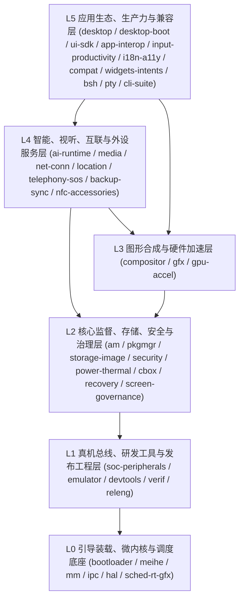

# 全系统 40 模块终态合龙总纲与 ABI v2 号段总表

Type: spec
Status: active
Updated: 2026-11-18
Version: 3.0.0

一句话说明：本规格是 BerryOS 全栈 **40 份模块总体设计（`plans/*/design.md`）** 与 **全部分域演进计划** 的最高架构合龙枢纽——锁定全系统无环分层拓扑、ABI v2 全量无碰撞系统调用/权利位/信号位预分配总表、统一存储路径层级与命名空间、合成器双模表面统一协议以及跨计划里程碑握手矩阵。

## 背景

[全栈 25 模块跨界接缝与深水区六盲点复核审计](../research/2026-11-18-全栈25模块跨界接缝与深水区六盲点复核审计.md) 证实：随着 BerryOS 架构版图扩展至完整的 40 个子系统（含引导装载、POSIX/Linux 兼容、灵动岛与微视图、外设硬件钱包、屏幕与企业双域治理、发布工程以及终端 CLI 矩阵），各分域规格间若缺乏统一的内核 ABI 号位单源分配表、硬件 `W^X` 与动态代码生成的安全边界裁定、图形双模通道主从关系以及跨轨道里程碑握手点，落码期将产生编号撞车与守护进程职责摩擦。本规格确立全系统单一顶层合龙契约。

## 范围

- **覆盖**：全仓 40 个模块总体设计的六层归属矩阵与职责边界索引；`BERRY_PLATFORM_LEVEL = 2` 新增系统调用（`0x07..0x8A`，含受限态、虚拟化及追踪号段）、句柄权利位（`1<<12..14`）与等待信号位（`1<<4..7`）单一权威无碰撞预分配表；全局统一存储路径层级规范；`berry-compositor` 下 `SceneStream` 与 `Swapchain` 双模表面融合契约与系统守护进程唯一标准命名；全栈实施计划跨轨里程碑前置握手矩阵。
- **不覆盖**：单个子系统内部的数据结构与状态机细则（由下表所列各自 `plans/<模块>/design.md` 唯一承载，遵从一事实一归属原则）。

## 契约

### 一、BerryOS 全栈六层 40 模块总体设计全景矩阵

| 层级 | 模块目录与唯一总体规格入口 | 契约版本 | 核心常驻载体 / 纯核库 | 一句话权威职责边界 |
| :--- | :--- | :--- | :--- | :--- |
| **L0 微内核与调度** | [bootloader](./bootloader/design.md) | `1.0.0` | `berryboot.efi`、`BerryBootControl` | A/B 槽位仲裁与防降级、Verified Boot 签名校验延伸、`BerryHandoff v2` 零拷贝帧传递与 16KiB Ramoops 持久区 |
| **L0 微内核与调度** | [meihe](./meihe/design.md) | `2.0.0` | `berry-kernel` | 16 核零大锁并发、八秩细锁、`PinnedObj` 安全基元与 `unsafe ≤ 3%` 铁律 |
| **L0 微内核与调度** | [mm](./mm/design.md) | `2.0.0` | `berry-mm`、`asidface`、`vmarface` | 分代钉死 ASID、硬件 W^X/PAN、区间树 `Vmar`、基数页账本 CoW 与退出全回收 |
| **L0 微内核与调度** | [ipc](./ipc/design.md) | `2.0.0` | `berry-ipc`、`portface`、`jobface` | 一等 `Port` 聚合、`channel_call/reply` 定向让片、`Job` 配额树、内联 `Badge` 与跨核增量 PI |
| **L0 微内核与调度** | [hal](./hal/design.md) | `2.0.0` | `berry-hal`（AArch64 / x86_64） | 五窄口架构抽象、GICv2/v3 Split-EOI `Interrupt`、SMMUv3 设备域与 16KiB `ramoops` |
| **L0 微内核与调度** | [sched-rt-gfx](./sched-rt-gfx/design.md) | `2.0.0` | `berry-sched`、`berry-rbtree`、`berry-minheap` | $O(\log n)$ 增强红黑树运行队列、单拍 VSync `FrameToken` EDF 保帧与掉帧闭环调频 |
| **L1 硬件外设与工具** | [soc-peripherals](./soc-peripherals/design.md) | `1.0.0` | `devmgr`、`pcied`、`xhcid`、`sensord`、`hapticsd` | DTB/ACPI 枚举、SMMU 隔离用户态高速驱动、传感器融合、帧同步线性马达与 S3 深睡树 |
| **L1 硬件外设与工具** | [emulator](./emulator/design.md) | `2.0.0` | 宿主 `berry` | 原生 120fps `wgpu` 呈现、`< 500ms` QuickBoot 快照速启、热重载与确定性自动化测试壳 |
| **L1 硬件外设与工具** | [devtools](./devtools/design.md) | `1.1.0` | `debugserver`、`berry-unwind`、`traced` | 纯能力 LLDB/GDB 源码断点与观察点、`.eh_frame` 零分配展开、PMU 火焰图与 UI 检视器 |
| **L1 硬件外设与工具** | [verif](./verif/design.md) | `1.0.0` | `fuzz/`、`berry-syzfuzz`、`torn-arena` | 四层攻防金字塔：纯核 `proptest`/`loom`、解析器与 ABI Fuzzing、断电撕裂竞技场与混沌长跑 |
| **L1 硬件外设与工具** | [releng](./releng/design.md) | `1.0.0` | `releng-tool`、`cyclonedx` | 位对位确定性可复现构建（`SOURCE_DATE_EPOCH`）、SLSA Level 3/4 SBOM 物料清单与镜像签名硬预算 |
| **L2 监督存储与安全** | [am](./am/design.md) | `2.0.0` | `appd`、`berry-amproto` | 多核失焦 3 秒冰封、实证租约豁免、LZ4 压缩换出与 `BerryFS` 加密持久墓碑五级梯度 |
| **L2 监督存储与安全** | [pkgmgr](./pkgmgr/design.md) | `1.0.0` | `pkgmgr`、`berry-cas`、`berry-delta` | 流式 Merkle 验签安装、内容寻址去重、前台零打断热更、按需资产包与五方零残留卸载 |
| **L2 监督存储与安全** | [storage-image](./storage-image/design.md) | `2.0.0` | `BerryROFS`、`BerryFS`、`berry-xtask` | GPT A/B 双槽回滚、4KiB Merkle 按需只读根卷、CoW B+Tree 崩溃原子文件系统与统一构建图 |
| **L2 监督存储与安全** | [security](./security/design.md) | `1.0.0` | 内核 CSPRNG、`keystored`、`biometricd`、`Keyguard` | 多源硬件喂熵随机数、DE/CE 双级文件静态加密、三档安全后端密钥库与锁屏多用户隔离 |
| **L2 监督存储与安全** | [power-thermal](./power-thermal/design.md) | `1.0.0` | `powerd`、`thermald` | 五阶段 1 秒优雅关机重启、每应用 `mAh` 能耗归因账本、旁路护电池与六级 PID 热保护 |
| **L2 监督存储与安全** | [cbox](./cbox/design.md) | `2.0.0` | `cbox`、`berry crash-log` | 贯通 EL0 崩溃、EL1 跨重启遗言与跨进程 ANR 死锁全线程抓栈、内联符号化及责任定界 |
| **L2 监督存储与安全** | [recovery](./recovery/design.md) | `1.0.0` | `BerryRecovery`、`berry-cit` | `< 4MiB` 物理隔离图形救援环境、保数据联网/USB 救砖、`100ms` 毁钥恢复出厂与产线封签 |
| **L2 监督存储与安全** | [screen-governance](./screen-governance/design.md) | `1.0.0` | `governanced` | 专注模式多场景流体过滤、屏幕使用时间本地防篡改记账、企业双域（Personal/Work）隔离与 DLP 剪贴板守卫 |
| **L3 图形与硬件加速** | [gfx](./gfx/design.md) | `2.0.0` | `berry-gfx`、`berry-gfxface` | 预乘色彩空间、紧凑 `SceneIR`、16×16 瓦片分箱 NEON 混合、SDF 超椭圆/阴影与毛玻璃算子 |
| **L3 图形与硬件加速** | [gpu-accel](./gpu-accel/design.md) | `2.0.0` | `berry-paravirt-gfx`、`berry-vkproto` | `SceneStream` 零位图保留模式 + 宿主 `wgpu` Uber-Shader / Virtio-GPU 3D / 原生 Vulkan 三阶卸载与 60ms TDR 自愈 |
| **L3 图形与硬件加速** | [compositor](./compositor/design.md) | `2.0.0` | `berry-compositor`、`berry-compface` | 每客独占会话、双模表面（`SceneStream` + `Swapchain`）、遮挡剔除、多屏独立 VSync 与手势焦点路由 |
| **L4 智能视听与互联** | [ai-runtime](./ai-runtime/design.md) | `1.0.0` | `airtd`、`berry-tensor`、`berry-vault` | `.bmod` 全局单份按需共享权重池、三阶异构张量核、Paged KV-Cache、语法约束解码与本地加密记忆库 |
| **L4 智能视听与互联** | [media](./media/design.md) | `1.0.0` | `audiod`、`mediad`、`camerad` | 无锁零分配 EDF 硬实时音频混音与闪避、零拷贝 YUV 硬解上屏及顶栏隐私指示灯物理互锁 |
| **L4 智能视听与互联** | [net-conn](./net-conn/design.md) | `1.0.0` | `netd`、`berry-netsec`、`wifid`、`btd`、`berry-link` | 共享环双栈网络、能力防火墙、纯 Rust TLS 1.3/QUIC、WPA3/BLE 无线栈与跨端分布式软总线 |
| **L4 智能视听与互联** | [location](./location/design.md) | `1.0.0` | `locationd`、`berry-navface` | 双频 GNSS + 离线 Wi-Fi 瓦片 + IMU 航位推算融合、5km 网格粗定位反追踪隔离与低功耗围栏 |
| **L4 智能视听与互联** | [telephony-sos](./telephony-sos/design.md) | `1.0.0` | `callmgr`、`sosd` | 蜂窝与加密 VoIP 统一通话中枢、双端提示防偷录护栏、跌倒/车祸检测自动呼救与锁屏医疗卡 |
| **L4 智能视听与互联** | [backup-sync](./backup-sync/design.md) | `1.0.0` | `backupd`、`berry-pack`、`berry-crdt` | 基于 `BerryFS` CoW 瞬时快照的零知识加密增量备份、升级连数据回退、扫码克隆与多端 CRDT 同步 |
| **L4 智能视听与互联** | [nfc-accessories](./nfc-accessories/design.md) | `1.0.0` | `walletd`、`accessoryd` | eSE 金融安全芯片交互、快捷交通卡低电断电保刷 5 小时、主动笔 `<4ms` 轨迹预测与 UWB 厘米级空间感知 |
| **L5 桌面与生产力** | [desktop](./desktop/design.md) | `2.0.0` | `berry-shell` | 五层沉浸式空间表面、可打断 `Spring2D` 手势形变、四端自适应断点与零 OCR 能力受控 AI 语义场景总线 |
| **L5 桌面与生产力** | [desktop-boot](./desktop-boot/design.md) | `2.0.0` | `bootsplashd`、`berry-shell` | 零黑屏跨核启动交接、壁纸直通玻璃拟态壳、控制中心与实时多任务视图 |
| **L5 桌面与生产力** | [ui-sdk](./ui-sdk/design.md) | `2.0.0` | `berry-ui`、`berry-appshell`、`berry-async` | 零虚拟 DOM 细粒度 `Signal` 响应式、`Port` 原生异步执行器、10 万行虚拟列表与动态 `Vmar` 堆 |
| **L5 桌面与生产力** | [app-interop](./app-interop/design.md) | `1.1.0` | `intentd`、`notifyd`、`workmgr`、`aotd`、`berry-wasm`、`berry-webview` | 合成器零偷窥 `PasteButton`、Picker 单句柄授权、合并后台经纪、进程外 `W^X` 安全编译与 Web/Wasm 双引擎 |
| **L5 桌面与生产力** | [input-productivity](./input-productivity/design.md) | `1.0.0` | `imed`、`searchd`、`printd` | 100% 物理断网防偷传输入法与密码安全键盘、一线连多屏扩展桌面、10ms 聚焦秒搜与矢量 PDF 免驱打印 |
| **L5 桌面与生产力** | [i18n-a11y](./i18n-a11y/design.md) | `1.1.0` | `timed`、`berry-i18n`、`a11yd` | RTC+NTS 防篡改授时与共享 `tzdb.vmo`、`.blp` 免重启语言热切换、BiDi 自动 RTL 镜像与 AI 读屏无障碍 |
| **L5 桌面与生产力** | [compat](./compat/design.md) | `1.0.0` | `linux_runner`、`vmm` | 三级兼容架构（musl 源码兼容、受限态 Starnix 二进制仿真、EL2 轻量微虚机）、Wayland 零感注入桌面 |
| **L5 桌面与生产力** | [widgets-intents](./widgets-intents/design.md) | `1.0.0` | `widgetd`、`intentd` | 声明式轻量 `SceneIR` 时间线小组件、灵动岛（Dynamic Island）四态流体弹簧切换与系统自动化意图引擎 |
| **L5 桌面与生产力** | [bsh](./bsh/design.md) | `1.0.0` | `bsh` | 原生交互式终端 Shell、AST 语法树解析、流式管道重定向与 Job 进程作业控制 |
| **L5 桌面与生产力** | [pty](./pty/design.md) | `1.0.0` | `ptyd` | POSIX 兼容虚拟伪终端主从对、VT100/xterm 转义序列驱动与窗口尺寸 `TIOCSWINSZ` 信号广播 |
| **L5 桌面与生产力** | [cli-suite](./cli-suite/design.md) | `1.0.0` | `ls`、`cat`、`grep`、`bmux` | 核心极简 CLI 命令行工具套件、ANSI 彩色高亮、多路终端复用器 `bmux` 与统一错误码契约 |

---

### 二、ABI v2 全量新增系统调用、权利位与信号位单一权威预分配总表

所有模块向 [abi.toml](../../tools/abi.toml)（`BERRY_PLATFORM_LEVEL = 2`）落码扩号时，**必须严格按本表锁定的唯一号位登记，严禁私自改号或复用既有号位**：

#### 1. 新增句柄权利位（`[[right]]`）与内核派生信号位（`[[signal]]`）

| 类别 | 名称 | 位表达式 | 权威消费模块与门控语义 |
| :--- | :--- | :--- | :--- |
| `right` | `DEBUG` | `1 << 12` | `devtools` / `cbox`：允许绑定目标进程/线程异常通道、读写寄存器/硬件断点及 CoW 软件断点页 |
| `right` | `SIGNAL_PEER` | `1 << 13` | `ipc`：允许向 `Channel` / `EventPair` 对端对象投递用户信号位 |
| `right` | `PIN_DMA` | `1 << 14` | `hal` / `soc-peripherals`：允许将 `Vmo` 物理页钉入 SMMUv3 `BtiCap` IO 页表 |
| `signal` | `PEER_CLOSED` | `1 << 4` | `ipc`：`Channel` 对端句柄全部关闭（服务端崩溃或断连即时零死等唤醒） |
| `signal` | `TIMER_SIGNALED` | `1 << 5` | `hal` / `ipc`：`Timer` 内核定时器到期置位 |
| `signal` | `IRQ_TRIGGERED` | `1 << 6` | `hal`：`Interrupt` 硬件中断线触发（GIC Split-EOI 已屏蔽等待用户态驱动处理） |
| `signal` | `EXCEPTION_PENDING` | `1 << 7` | `devtools`：被调试线程命中断点/观察点/同步异常已冻结待检 |

#### 2. 新增与激活系统调用总表（`0x07..0x8A`，零碰撞全覆盖）

| 号位 | 符号名 | 参数签名（≤6 参） | 门控权利 / 资源券 | 归属规格 |
| :--- | :--- | :--- | :--- | :--- |
| `0x07` | `berry_object_get_info` | `(handle, topic, buf, cap, *actual)` | `INSPECT`（激活在册 v2 号） | `meihe` / `ipc` |
| `0x08` | `berry_handle_mint` | `(src, rights, badge, epoch, *out)` | `DUPLICATE`（铸 `badge` 另需 `SET_POLICY`） | `ipc` |
| `0x09` | `berry_epoch_create` | `(options, *out)` | 受所属 `Job` 配额约束 | `ipc` |
| `0x0A` | `berry_epoch_revoke` | `(epoch)` | `MANAGE`（O(1) 吊销全部关联孙代句柄） | `ipc` |
| `0x1C` | `berry_vmo_create_child` | `(parent, options, offset, size, *out)` | `DUPLICATE \| READ`（CoW 切片子 VMO） | `mm` / `ipc` |
| `0x1D` | `berry_vmo_cache_op` | `(vmo, op, offset, len)` | `READ`（Clean/SyncICache）或 `WRITE`（Invalidate） | `hal` / `app-interop` |
| `0x1E` | `berry_vmo_seal` | `(vmo, seal_flags)` | `MANAGE`（永久不可逆剥离写/扩容，支撑 `aotd` `W^X`） | `mm` / `app-interop` |
| `0x1F` | `berry_vmar_query` | `(vmar, va, *out_info)` | `INSPECT` | `mm` |
| `0x22` | `berry_pager_op_range` | `(pager_vmo, op, offset, len)` | `SET_POLICY`（激活在册 v3 号：Evict / Fail） | `mm` / `am` |
| `0x25` | `berry_pager_create` | `(port, key, options, *out_pager)` | `port`: `WRITE`（每 VMO 独立异步 Pager 对象） | `mm` |
| `0x30` | `berry_job_create` | `(parent_job, options, *out_job)` | `parent_job`: `MANAGE`（≤8 层层级沙箱） | `ipc` |
| `0x41` | `berry_debug_bind_exception_channel` | `(target, options, *out_ch)` | `DEBUG`（激活在册 `0x41` 异常调试通道） | `devtools` / `cbox` |
| `0x43` | `berry_job_set_quota` | `(job, max_procs, max_ram_bytes)` | `SET_POLICY \| MANAGE` | `ipc` / `am` |
| `0x44` | `berry_job_kill` | `(job)` | `MANAGE` | `ipc` / `am` |
| `0x45` | `berry_thread_read_state` | `(thread, kind, buf, cap, *out_len)` | `DEBUG` | `devtools` / `cbox` |
| `0x46` | `berry_thread_write_state` | `(thread, kind, buf, len)` | `DEBUG` | `devtools` |
| `0x47` | `berry_process_vm_rw` | `(proc, op, va, buf, len, *actual)` | `DEBUG`（含 CoW 影子断点页补丁） | `devtools` |
| `0x48` | `berry_pmu_sample_open` | `(perf_res, cfg_ptr, *out_ring_vmo)` | `PerfResourceCap` | `devtools` |
| `0x49` | `berry_syscall_trace_open` | `(trace_res, mask, *out_ring_vmo)` | `TraceResourceCap`（内核级全量系统调用快速追踪） | `devtools` |
| `0x4A` | `berry_restricted_enter` | `(flags, state_vmo, *out_reason)` | `MANAGE`（受限态上下文切入，支撑 Tier 2 Linux 仿真） | `compat` |
| `0x4B` | `berry_restricted_kick` | `(target_thread)` | `MANAGE`（强制打断受限态密集死循环） | `compat` |
| `0x55` | `berry_futex_wait` | `(addr, expected, deadline)` | 当前用户地址空间（激活在册 v2 号） | `ipc` |
| `0x56` | `berry_futex_wake` | `(addr, count)` | 当前用户地址空间（激活在册 v2 号） | `ipc` |
| `0x57` | `berry_channel_call` | `(ch, args_ptr, deadline, *act_b, *act_h)` | `SEND \| RECV`（同带定向让片 + 跨核增量 PI） | `ipc` |
| `0x58` | `berry_port_create` | `(options, *out_port)` | 受所属 `Job` 配额约束 | `ipc` |
| `0x59` | `berry_object_wait_async` | `(handle, port, key, signals, options)` | `port`: `WRITE` | `ipc` |
| `0x5A` | `berry_port_wait` | `(port, deadline, *out_pkt)` | `port`: `READ` | `ipc` |
| `0x5B` | `berry_channel_reply` | `(reply_token, bytes_ptr, n_b, hdls_ptr, n_h)` | 一次性事务 `ReplyToken` | `ipc` |
| `0x62` | `berry_timer_create` | `(options, clock_id, *out_timer)` | 受所属 `Job` 配额约束（激活在册 v2 号） | `hal` |
| `0x63` | `berry_timer_set` | `(timer, deadline, slack)` | `WRITE`（激活在册 v2 号） | `hal` / `sched-rt-gfx` |
| `0x64` | `berry_clock_adjust` | `(time_res, offset_ns, slew_ppm_q16, flags)` | `TimeResourceCap`（仅 `timed` 独占校准壁钟） | `i18n-a11y` |
| `0x71` | `berry_interrupt_create` | `(irq_res, intid, flags, *out_irq)` | `IrqResourceCap`（激活在册 v2 号） | `hal` |
| `0x72` | `berry_interrupt_ack` | `(irq_h)` | `SIGNAL`（Split-EOI Deactivate + Unmask） | `hal` |
| `0x73` | `berry_map_device_memory` | `(mmio_res, pa_off, size, cache_pol, *out_vmo)` | `MmioResourceCap`（激活在册 v2 号） | `hal` |
| `0x74` | `berry_bti_create` | `(iommu_res, stream_id, *out_bti)` | `IommuResourceCap`（建 SMMUv3 隔离域） | `hal` / `soc-peripherals` |
| `0x75` | `berry_bti_pin` | `(bti, vmo, offset, size, perms, *out_iova, *out_pmt)` | `bti`: `MANAGE`；`vmo`: `PIN_DMA` | `hal` / `soc-peripherals` |
| `0x76` | `berry_resource_create` | `(parent_res, kind, base, len, *out_res)` | `parent_res`: `MANAGE`（子区间硬件资源派生） | `meihe` / `soc-peripherals` |
| `0x77` | `berry_guest_create` | `(hyp_res, flags, *out_guest)` | `HypResourceCap`（EL2 硬件加速客机虚拟化容器） | `compat` / `hal` |
| `0x78` | `berry_vcpu_create` | `(guest, vcpu_id, *out_vcpu)` | `guest`: `MANAGE` | `compat` / `hal` |
| `0x79` | `berry_vcpu_run` | `(vcpu, exit_state_vmo)` | `vcpu`: `EXECUTE` | `compat` / `hal` |
| `0x85` | `berry_attest` | `(chal_ptr, chal_len, buf, cap, *out_len)` | 激活在册 `0x85` 号，对接硬件度量与 `keystored` | `security` |
| `0x88` | `berry_power_off` | `(power_res)` | 收紧门控为 `PowerResourceCap`（仅 `powerd` 持有） | `power-thermal` |
| `0x89` | `berry_cprng_draw` | `(buf, len)` | 零句柄（每核 ChaCha20 硬件喂熵 CSPRNG，单次 ≤ 4096B） | `security` |
| `0x8A` | `berry_system_suspend` | `(power_res, mode, boot_reason)` | `PowerResourceCap`（S3 深睡 / 正常重启 / 进 Recovery） | `power-thermal` / `recovery` |

---

### 三、全系统统一存储路径层级与命名空间规范

全系统统一标准路径拓扑如下，杜绝任何模块私设未受管路径：

| 绝对路径前缀 | 挂载文件系统 / 卷属性 | 加密与访问边界 | 归属子系统与核心用途 |
| :--- | :--- | :--- | :--- |
| `/` | `BerryROFS` 只读根镜像 | dm-verity 散列树保护，只读 | 系统静态二进制与基础配置（`/bin`、`/lib`、`/etc`） |
| `/data/` | `BerryFS` 读写持久卷 | 分区级物理认证加密 | 用户数据与系统可变数据总根目录 |
| `/data/system_de/` | `BerryFS` 设备级加密 (DE) | 开机上电即解密，锁屏可读写 | 系统常驻守护进程全局缓存（`models/`、`cbox/` 崩溃日志、`pkgmgr/cas/`） |
| `/data/system_ce/<uid>/` | `BerryFS` 凭据级加密 (CE) | 仅用户解锁锁屏后挂载可读 | 用户个人系统级私密数据（`screentime.db`、`walletd` 凭据、`tombstones/`） |
| `/data/pkg/cas/` | `BerryFS` 内容寻址存储库 | 只读 hardlink 引用，DE 保护 | 安装包全局资产去重存储池（多版本共享只读 chunk） |
| `/data/user/<uid>/` | `BerryFS` CE 用户主目录 | 用户 UID 强隔离 | 用户个人空间，包含照片、文档、下载及各应用私有子目录 |
| `/app/data/<id>/` | 沙箱专属虚拟挂载点 | 沙箱细粒度 Capability 隔离 | 应用自身唯一私有读写根目录（底层透明重定向至 `/data/user/<uid>/app/<id>`） |
| `/userdata/home/` | 交互式 Shell 家目录 | 用户交互环境隔离 | `bsh` 交互式终端与开发者命令行工作区专属挂载 |

---

### 四、合成器双模表面与守护进程命名单一裁决

1. **`SceneStream` 与 `Swapchain` 同属 `berry-compositor` 双模表面协议**：
   - **默认模式 `SurfaceMode::SceneStream`（零客户端像素缓冲）**：所有常规 `ui-sdk` 原生应用、`berry-shell` 系统栏/桌面、`imed` 软键盘、`widgets-intents` 桌面小组件及 `berry-webview` 普通文档页均以不足数十 KB 的结构化 `SceneIR` 增量流提交给合成器，由合成器单点驱动 [gpu-accel 总体设计](./gpu-accel/design.md)（宿主 `wgpu` Uber-Shader / Virtio-GPU 3D / 原生 Vulkan，故障时 60ms 内无感降级 `gfx` 16×16 瓦片 NEON 软核）统一光栅上屏，节省 90% 客户端内存并天然支持 `berry-link` 矢量跨屏流转与 `printd` 矢量 PDF 导出；
   - **直渲模式 `SurfaceMode::Swapchain`（显式 Fence 缓冲轮转）**：面向 `mediad` 硬件解码视频层、`camerad` 实时预览层、3D Vulkan 游戏、[compat](./compat/design.md) Wayland 桥接层及像素级绘画画布，走 [compositor 总体设计](./compositor/design.md) 的 2–3 槽共享 `Vmo`/`GpuSurface` 交换链，在合成器同一棵六层场景图内作为 `ExternalTexture` 图元单遍混合。
2. **核心守护进程唯一标准命名**：
   - 根资源总管：`rootmgr`
   - 设备总线总管：`devmgr`
   - 应用生命周期中枢：`appd`
   - 包安装管理中枢：`pkgmgr`
   - 合成器：`berry-compositor`
   - 桌面壳程序：`berry-shell`
   - 输入法守护：`imed`
   - 终端伪终端服务：`ptyd`
   - 硬件钱包中枢：`walletd`
   - 外设手写笔守护：`accessoryd`
   - 行为与屏幕治理：`governanced`
   - 自动化意图与小组件守护：`intentd`、`widgetd`
   - 兼容层仿真伴随进程：`linux_runner`、`vmm`

---

### 五、跨计划里程碑全局握手矩阵

全仓分域实施计划按以下 **五大全局同步锚点（Sync Gates）** 协同推进，杜绝跨轨抢跑：

1. **锚点 M-Alpha（微内核 2.0 窄腰与引导交接就绪）**：完成 `bootloader`（`BerryHandoff v2`）、[莓核五波十六刀演进实施计划](./2026-11-18-莓核五波十六刀演进实施计划.md) 与 [全栈底座彻底重构计划](./2026-11-18-全栈底座彻底重构计划.md) 的 `Port`、`channel_call/reply`、`Job`、分代 ASID、严格 `W^X`、`Interrupt` 及本文预登记的 ABI v2 生成管线 → **解锁全部用户态新守护进程并发会话化改造**。
2. **锚点 M-Beta（存储、安全根、构建发布与图形双核就绪）**：完成 [渲染与桌面 SDK 及存储镜像全栈彻底升级计划](./2026-11-18-渲染与桌面SDK及存储镜像全栈彻底升级计划.md) 的 `BerryROFS`/`BerryFS`、`gfx` 2.0、`gpu-accel`、`sched-rt-gfx` 红黑树、`releng` 可复现构建链，以及 [整机十维补全终态实施总计划](./2026-11-18-整机十维补全终态实施总计划.md) Wave E0（CSPRNG、FBE、`keystored`、`berry debug/perf`）与 [GUI 与 SDK 及模拟器彻底重构计划](./2026-11-18-GUI与SDK及模拟器彻底重构计划.md) 的 `berry-compositor` + `ui-sdk` 2.0 → **解锁亮屏 120fps GPU 桌面与加密落盘**。
3. **锚点 M-Gamma（视听互联、跨应用生态与 AI 无障碍就绪）**：完成十维计划 Wave E1–E4（`netd` 2.0 + TLS 1.3/QUIC、`berry-link`、`audiod`/`mediad`/`camerad`、零偷窥剪贴板、`berry-wasm`/`berry-webview` + 进程外 `aotd`、`airtd` + `berry-vault`、`timed`/`berry-i18n`/`a11yd`） → **解锁完整主力机联网、音视频、浏览与本地 AI 体验**。
4. **锚点 M-Delta（外设扩展、微视图意图与终端矩阵就绪）**：完成 `nfc-accessories`（`walletd` + 主动笔低延时管线）、`widgets-intents`（灵动岛四态流体与时间线小组件）、`screen-governance`（专注模式与企业 DLP 剪贴板隔离）、`bsh` + `pty` + `cli-suite` 交互终端套件，以及 `compat` 受限态仿真打通 → **解锁完整专业移动生产力与开源生态扩展**。
5. **锚点 M-Omega（深水区生产力、真机救砖与混沌终验）**：完成十维计划 Wave E5 与 [深水区六维补完与跨模块接缝收口实施计划](./2026-11-18-深水区六维补完与跨模块接缝收口实施计划.md)（`pkgmgr`、`locationd`、`imed`/双屏桌面/`searchd`/`printd`、`powerd` 优雅关机与功耗账本、`callmgr`/`sosd`、`BerryRecovery`、`backupd` 时间机器及 `verif` 断电撕裂与 Fuzzing 全绿） → **达成商业量产级全栈收官**。

## 验收标准

1. **ABI 单源零冲突门禁**：按本规格第二章更新 `tools/abi.toml` 后运行 `just abi-gen && just abi-check`，全量常量、编号、权利位与信号位零重复，且所有涉句柄系统调用 100% 标注门控权利位。
2. **文档全树完整性门禁**：全仓 40 份 `plans/*/design.md` 均处于 `Status: active`、`Version >= 1.0.0`（无残留 `0.5.x` 过渡态），`node .agents/tools/check-docs.mjs --strict` 与 `python3 tools/docs_guard.py` 保持 **0 告警**。

## 适用边界

- 后续任何模块确需新增系统调用或全局守护进程，必须先在本合龙总纲登记号位与层级归属，再修改分域 `design.md` 与 `tools/abi.toml`。
