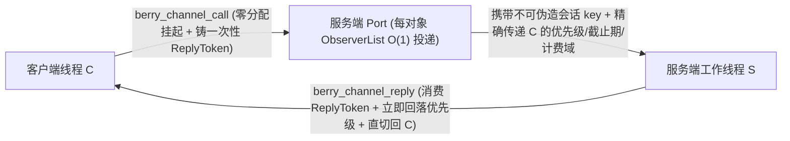

# BerryOS 微内核与全栈底座彻底重构规格（Meihe v2 基座契约）

Type: spec
Status: active
Updated: 2026-11-18
Version: 1.0.0

一句话说明：定义 Meihe 微内核、正交加权调度器与能力会话化用户态的零妥协终态架构契约，从根源上取代早期单核过渡假设并根治全栈 53 项设计与实现缺陷。

## 背景

[全栈架构与代码缺陷深研](../research/2026-11-18-全栈架构与代码缺陷深研.md) 证明：现役系统在硬件隔离、地址空间销毁、多路复用 IPC、EEVDF/CBS 调度数学以及用户态服务拓扑上存在结构性断层，局部打补丁无法闭合安全与并发不变量。本规格遵循 [架构综合纲领](../../docs/架构综合纲领.md)「机制进内核、策略可插拔、硬件信任边界与纯能力句柄」的顶层极点，吸收 seL4、Zircon/Fuchsia 与 Stoica EEVDF 的正统设计，立定 Meihe v2 全栈基座契约。取舍因果见 [全栈底座彻底重构架构裁决](../notes/proposed/2026-11-18-全栈底座彻底重构架构裁决.md)，实施波次见 [全栈底座彻底重构实施计划](2026-11-18-全栈底座彻底重构计划.md)。

## 范围

- **覆盖**：ARMv8-A 页表/ASID/缓存/异常硬件契约；`AddressSpace` 与 `Vmar` 分离及确定性销毁；根能力（`Job` + `Resource`）、无环 `ChannelShared`、一等 `Port` 多路聚合、同步 `channel_call/reply` 与每 VMO 独立 `Pager`；五层正交调度类、加权 EEVDF $(w_i, r_i)$ 双参数模型、CBS 到达与 Tickless 唤醒律、锁与抑制位分离、四槽作用域 RCU 与金丝雀收益晋升判据；用户态 `rootmgr` / `devmgr` / `appd` 三权分立、每客户端独立会话通道、安全连续 DMA 与中断驱动模型；线程安全 `berry-libc` 与标准 PIE ELF（段级 W^X + ASLR）装载契约。
- **不覆盖**：GUI 视觉主题与组件排版细节（归 [显示与加速体系设计](../../docs/显示与加速体系设计-v1.1.md)）；现代 CoW 文件系统盘上块分配算法（归 [文件系统设计](../../docs/文件系统设计-v1.0.md) v4）；设备端神经网络训练管线。

## 契约

### 契约一：ARMv8-A 硬件隔离、分代钉死 ASID 与缓存/异常同步

1. **硬件 ASID 位宽与位域唯一律**：启动期读取 `ID_AA64MMFR0_EL1.ASIDBits`；当取值为 `0b0010`（16 位）时必须在写 `TCR_EL1` 前置位 `TCR_EL1.AS`（bit 36 = 1），否则保持 `TCR_EL1.AS = 0`（8 位）。无论 8 位或 16 位模式，`TTBR0_EL1` 与 `TLBI ASIDE1IS` 的 ASID 移位量恒定为 **bit 48**（8 位模式下 `[63:56]` 严格置 `0`）。`activate_ttbr0_regs` 必须在 `msr ttbr0_el1` 与 `msr contextidr_el1` **全部写完之后**执行 `isb`。
2. **分代位图钉死 ASID 分配器（`berry-asidface`）**：每个 `AddressSpace` 持有 `atomic_asid: AtomicU64 = (gen << 16) | hw_asid`（`gen >= 1`，`hw_asid = 0` 永久保留给内核空表）。全局分配器维护 `current_gen: AtomicU64`、`active_asid: [AtomicU64; MAX_CPUS]`、空闲位图 `free_bitmap` 与回绕保留集：
   - 切换快路径：`aspace.gen == current_gen` 时零锁 O(1) 直写寄存器并保留 TLB。
   - 回绕慢路径：位图耗尽时持 `ASID_LOCK` 递增 `current_gen`、重置位图，扫描各在线核 `active_asid[cpu]` 将在跑地址空间的 `hw_asid` 直接钉入新位图已占集并原子刷新其世代号，随后发一次全核 `tlbi vmalle1is` 同步屏障——**在跑守护进程的活跃 ASID 永不被新进程撞号复用**。
3. **严格硬件 W^X 与内核直映区 `PXN`**：
   - 用户态页权限枚举为四态：`None`、`UserRo`（`AP=0b11, UXN=1, PXN=1`）、`UserRw`（`AP=0b01, UXN=1, PXN=1`）、`UserRx`（`AP=0b11, UXN=0, PXN=1`）。`vmar_map` 与 `vmar_protect` 对同时含 `RIGHT_WRITE | RIGHT_EXECUTE` 的请求一律硬拒 `-EINVAL`。
   - `TTBR1` 内核高半映射除内核 `.text` 段为只读可执行（`AP=0b10, PXN=0, UXN=1`）外，`.rodata`、`.data/.bss`、堆与全部物理 RAM 直映区一律置 **`PXN=1, UXN=1`**，硬件阻断 EL1 执行任何直映物理页。
   - 新用户线程首次进入 EL0 前（`user_entry_trampoline`），必须清零除入口参外的全部通用寄存器（`x2..x18, x29, x30`）与 `SPSR` 条件码，严禁泄露内核地址。
4. **`DCZID_EL0` 零化契约与代码页 PoU 缓存同步铁律**：
   - `zero_page_4k` 必须读取 **`DCZID_EL0`**：仅当 `(dczid >> 4) & 1 == 0`（`DZP == 0`）且块长 `bs = 4usize << (dczid & 0xF)` 整除 `PAGE_SIZE` 时才启用 `dc zva`，严禁读取 `CTR_EL0` 替代。
   - 凡建立或填充带 `UserRx` 权限页面的路径（`vmar_map`、`vmar_protect` 升 `EXECUTE`、`pager_supply_*`），必须严格遵守四步发布序：**① 经内核直映写满物理帧内容 → ② 按 `CTR_EL0.DminLine` 逐行执行 `dc cvau` + `dsb ish` → ③ 按 `CTR_EL0.IminLine` 逐行执行 `ic ivau`（或 `ic ialluis`）+ `dsb ish` → ④ 最后写入有效 L3 页表项**。严禁先暴露全零有效 PTE 后拷贝代码字节。
5. **异常与中断状态守恒守卫 + 无死锁跨核 TLB Shootdown**：
   - 废除无条件开中断的 `klock_exit()`；一切可在异常、故障或嵌套上下文调用的锁必须返回保存进入前 `DAIF` 的 RAII `IrqSaveGuard`，析构时精确写回原 `DAIF`，保证 EL0 同步异常从入口至 `eret`（或故障杀链 `context_switch`）全程 `PSTATE.I = 1`。
   - `tlbshoot::wait_pending()` 在 `PSTATE.I = 1` 自旋等待对核回执期间，每轮必须轮询本核挂起请求槽；若对核亦向本核发起了 shootdown，则在自旋环内当场执行本地 `tlbi` + `dsb ish` 并置位回执，从机制上根绝多核对飞死锁。一切调页快路径（含 ZFOD）置挂起闩后必须在返回 EL0 前完成回执消费。

---

### 契约二：`AddressSpace` / `Vmar` 解耦、独立分配器锁与两阶段确定性销毁

1. **独立第 5 层 `ALLOC_LOCK` 与禁裸 `&'static mut` 借用**：物理帧分配器 `Buddy` 与内核堆 `SlabHeap` 收归独立自旋锁 `ALLOC_LOCK`（lockdep rank 5，独立于 `KERN_LOCK`），对外仅暴露闭包接口 `mm::with_frames(|fa| ...)`，编译期根绝跨堆扩容重入产生的双 `&mut` 别名 UB。
2. **`AddressSpace` 与 `Vmar` 职责正交拆分**：
   - `AddressSpace` 独占 `l1_pa`、`atomic_asid`、`pt_lock: SpinLock<()>`（锁跟随对象而非全局 65536 槽数组）、页表物理帧链表及按需调页根注册身份。
   - `Vmar` 持有 `Arc<AddressSpace>` 与管辖区间 `[base, base + len)` 的区间树（BTree / 有序区间表，支持子区间 `unmap` 与 `protect`）。子 `Vmar` 析构（`Drop`）时自动解映射自身残余子区间并从父 `Vmar` 移除 `Reserved` 占位。
3. **进程退出两阶段确定性回收（废除 `leak = true` 与父进程手工 `unmap` 义务）**：
   - **第一阶段（地址空间拆解）**：当进程 `live_threads` 归零（全部线程已永久脱离 EL0 执行且不再被调度）时，内核自动调 `aspace.teardown()`——注销调页根并取消在途缺页请求，持 `pt_lock` 遍历全部映射区间执行清叶、`vmo.untrack_map()` / `untrack_demand()`，执行**单次按 ASID 跨核 TLB 失效屏障**，最后自底向上将全部 L3、L2、L1 页表物理帧归还 `Buddy` 并释放 ASID。
   - **第二阶段（能力表排空）**：在 `aspace.teardown()` 完成后执行 `HandleTable::drain()`。此时本进程对私有 VMO（含动态 `mmap` 堆、`pthread` 线程栈、图形缓冲与代码段）的映射计数必已归零，**彻底删除 `leak = true` 整对象泄漏分支**，引用归零即触发 `Vmo::Drop` 100% 归还物理页。
   - **有界排队与创建侧内联助推**：异步回收队列 `DRAINQ` 除在 `idle` 批处理外，当 `sys_process_create` 检测到 `PROCESS_LIVE >= PROCESS_MAX` 且 `DRAINQ` 非空时，当场内联消费 1 个已退进程槽位，根绝后台忙核下的假性 `-ENOMEM` 死锁。

---

### 契约三：纯对象能力根（`Job` + `Resource`）、无环通道、一等 `Port` 与同步 `Call/Reply`

1. **根能力双树（消灭一切零句柄环境特权）**：
   - **`Job`（`ObjType::Job`）**：全系统进程组成严格单根树（`root_job` 由内核仅授予 `rootmgr`）。`Job` 承载四项硬契约：① `process_create(job_h, ...)` 必须校验 `job_h` 为具备 `RIGHT_MANAGE` 的 `Job`（废除 `job = 0` 无门控创建）；② 层级资源账本（子树最大进程数、物理内存页配额、通道配额、Deadline 带宽池）；③ 策略天花板（子树允许声明的最高 `intent` 档位与 RT 准入位）；④ `job_kill(job_h)` 原子终止整棵子树并回收全部资源。
   - **`Resource`（`ObjType::Resource`）**：细分为不可伪造的子域能力——`SystemResource::Power`（门控 `power_off`）、`SystemResource::Policy`（门控 `policy_bind`，彻底废除拿任意 `Process` 句柄即可改全局调度表的漏洞，且 `STATUS` 仅回传单调整数 `koid` 严禁泄露内核指针）、`SystemResource::Telemetry`（门控 `telemetry_open` 与 `cbox_drain`）、区间受限 `MmioResource[pa_base, len)`、中断号受限 `IrqResource[spi]` 与 DMA 总线事务 `BtiResource`。
2. **无环 `ChannelShared` + `SIGNAL_PEER_CLOSED` + 在途句柄完备析构**：
   - 通道对内部共享单一 `ChannelShared`（含双向环形消息槽与 `open_ends: [AtomicU32; 2]`），`ChannelEnd` 不再互相 `retain` `ObjRef`。
   - `Message` 实现 `Drop`：通道任意一端最后句柄关闭时，立即递减 `open_ends[side]` 至 `0`，清空本端未读消息队列并逐个 `ObjRef::release` 消息携带的在途句柄，同时在对端置位 **`SIGNAL_PEER_CLOSED`（`1 << 4`）** 并唤醒对端全部等待者；两端计数皆归零时释放 `ChannelShared`。
3. **每对象侵入式 `ObserverList` + 一等 `Port`（彻底废除 `WAIT_ANY` 全局哨兵）**：
   - 所有可等待内核对象内嵌侵入式 `ObserverList`。`object_wait_many` 使用内核栈预置的定长观察节点精准挂入目标对象的 `ObserverList`，**全局删除 `WAIT_ANY` 哨兵**，使点对点 IPC fastpath 在任意数量多路服务共存时 100% 保持有效，消除全局惊群。
   - 新增一等 `Port` 对象（`port_create`、`object_wait_async(obj, port, key, signals, opts)`、`port_wait(port, out_pkts, cap, deadline)`）：对象信号触发时以预置节点零分配向 `Port` 投递 `PortPacket { key: u64, signals: u64, koid: u64 }`。服务端以不可伪造的 `key` 直接索引客户端会话上下文，单线程 `Port` 可 O(1) 承载数千独立客户端通道。
4. **同步 `channel_call` + 一次性 `ReplyToken`（闭合多跳跨核 PI 与精确代工计费）**：
   - 新增原子往返原语 `channel_call` 与 `channel_reply(reply_tok, ...)`：客户端调用 `channel_call` 时阻塞于自身 TCB 内嵌的零分配 `ReplySlot`，向服务端投递携带一次性 `ReplyToken` 的请求消息。
   - **精确跨核多跳 PI 树**：服务端 `recv` / `port_wait` 领走请求时，内核在 `ServerTask.serving_reply` 与 `ClientTask.blocked_on` 之间建立精确有向边，跨双核全运行队列传播捐赠优先级、EDF 截止期与 `intent_effective`；若服务端继续向下游驱动发 `channel_call`，有向链自动延伸（上限 8 跳防环）。
   - **即时回落与每任务精确计费**：计费状态 `serving_domain: u64` 存于 **`Task` 结构体**（废除按核全局槽 `BILLING_RECV_DOMAIN[cpu]`），仅在该服务端线程实际占用 CPU 的上下文切换/tick 点累加真实执行周期；服务端调用 `channel_reply` 瞬间立即解除 PI 提权与借入 `intent`，并向更高优客户端执行直切返回。
5. **每 VMO 独立 `Pager` 对象（取代全局静态 `EREQ[32]`）**：
   - 新增 `pager_create(port)` 与 `pager_create_vmo(pager, key, size, opts)`：缺页线程阻塞在自身 TCB 缺页槽并向所属 `Pager` 绑定的 `Port` 发送 `PagerPacket`，不同 pager（如系统 `rootpager` 与文件系统 `fsmgr` pager）完全隔离，恶意进程自造未供给 demand VMO 仅阻塞自身线程，零全局槽耗尽面。

---

### 契约四：五层正交调度类、真加权 EEVDF、完备 CBS/EDF 与收益驱动策略

1. **五层严格正交类链与双旋钮公平映射**：
   - 核内选核严格遵循五层全序：`Stop/Migration > RT > Deadline (物理绝对截止期 EDF) > Fair (统一加权 EEVDF) > Idle`。
   - **彻底解耦策略权重与严格优先级层**：`Fair` 层内所有任务共享同一调度层，严禁任何策略、nice 或 `intent` 修改跨层抢占级。`IntentProfile` 与 AI `policy_bind` 仅驱动 EEVDF 的两个正交数学参数：
     - **份额权重 $w_i \in [16, 8192]$**：由 `Intent` 基线权重（`LC = 2048`、`INTERACTIVE = 1024`、`UTILITY = 256`、`BACKGROUND = 64`；未授权的 `0x00 UNSPECIFIED` 入核一律归一化为 `UTILITY = 256`，声明 `LC` 必须经所属 `Job` 天花板校验）乘以策略微调因子并在 `[weight_floor, weight_ceiling]` 内夹紧，且 `vruntime` 推进严格按任务自身 $w_i$ 折算（$\Delta v_i = \Delta t \cdot w_0 / w_i$，PI 临时提权期间不改 $w_i$ 记账率）。
     - **请求量子 $r_i$（`slice_ns`）**：决定虚拟截止期 $d_i = v_i + r_i / w_i$（`LC = 1ms`、`INTERACTIVE = 3ms`、`UTILITY = 10ms`、`BACKGROUND = 20ms`），使高交互任务在 $\text{lag}_i \ge 0$ 时天然获得亚毫秒级抢占响应，同时后台任务永享 $w_{\text{bg}} / \sum w$ 严格正下界带宽，**数学上 100% 根绝饥饿**。
   - **宏观带级 CBS 包络（可选省电/热限流阀门）**：仅对需限流的后台带配置真实宏观 `(quota_ns, period_ns)`（满足 $0 < \text{quota} < \text{period}$，严禁混用 `quantum` 与 `latency_target`）；记账顺序固定为**先拆分计入当前周期 `consume`、到期再在单把原子状态锁/CAS 赢家内翻转新周期**；默认启用 **Idle Loan**（全核无非限流就绪任务时不空转 CPU，仅热硬限模式强制停泊）。
2. **EEVDF 加权虚拟时钟 $V(t)$ 与跨核零偏置迁移（`berry-eevdf`）**：
   - 每个 `Runqueue` 维护在环总权重 $W = \sum w_i$ 与加权虚拟时间基准 $V(t)$，资格判据严格满足 $\sum_{i \in \text{runnable}} w_i (V(t) - v_i) = 0 \iff v_i \le V(t)$。
   - **睡眠衰减与跨核归一化**：任务出环时计算有界滞后量 $\ell_i = \text{clamp}(w_i (V_{\text{src}} - v_i), -r_i, +r_i)$ 并修正 $V_{\text{src}}$；睡眠时长 $\Delta t_{\text{sleep}}$ 期间按指数半衰期衰减正负 $\ell_i$；唤醒入环或跨核 `try_steal_one` 迁入目标核时，按目标核当前 $V_{\text{dst}}$ 重建 $v_i' = V_{\text{dst}} - \ell_i / w_i$，彻底消除跨核时钟漂移导致的霸核或饿死。`thread_yield` 放弃当前剩余量子时同步推进 $v_i$ 并重算 $d_i = v_i + r_i / w_i$，保持 $d_i > v_i$ 不变量。
3. **完备 CBS/EDF 实时契约与 Tickless 硬件对齐**：
   - `Deadline` 任务在环内纯按物理 `deadline_vct` 最小优先（EDF）出选；准入预算挂 `Job` 与全局 `DL_TOTAL_UTIL_Q12`，在**线程创建/改参时预扣（更新参数先退旧值再核新值）、线程销毁时必退**，禁止 `Process` 默认属性绕过准入账。
   - **CBS 唤醒到达律**：Deadline 任务在时刻 $t$ 唤醒时，若 $c_{\text{rem}} \cdot (d - t) > Q \cdot P$ 或 $t \ge d$，立即重置 $d \leftarrow t + P, c_{\text{rem}} \leftarrow Q$；周期重充采用追赶式推进（$d \leftarrow d + \lfloor (t - d)/P + 1 \rfloor P$），严禁睡眠攒账连续霸核。
   - **Tickless 唤醒完备性**：每核维护被限流 Deadline 任务最早重充时刻 `min_throttled_dl_vct`，`nearest_deadline()` 取 `min(sleepq_head, band_wake, min_throttled_dl_vct)` 编程 `CNTV_CVAL_EL0`，确保深睡核准时自醒。
4. **锁位与抑制位物理分离 + 同步跨核冻结 + 四槽作用域 RCU 与金丝雀晋升**：
   - **字段分离**：`Task::held_locks: u8` 仅存本执行流持有的自旋锁位；冻结与限流迁入独立的 `Task::inhibit_flags: AtomicU8`（`INHIBIT_FROZEN | INHIBIT_THROTTLED`）；在环任务的调度时间字段改用原子读写消除跨核 `ring_check` 撕裂。
   - **全序加锁与同步冻结屏障**：`process_suspend`、令牌 `handle_replace` 与退出 `auto-thaw` 严格按 `SQ -> RQ0 -> RQ1` 锁序加锁；若目标线程正在对核处于 `Running` 态，立即发 `SGI_RESCHEDULE` 并等待对核确认该线程已切出 EL0（微秒级有界等待），保证 `process_suspend` 返回 `0` 时目标进程在全系统物理停稳。
   - **四槽 RAII `PolicyReadGuard` 与按代惰性刷新**：策略快照槽扩为 `4` 槽（`MAX_CPUS + 2`），读者经 `PolicyReadGuard` 在析构时自动清 `HAZARD[cpu] = SLOT_NONE`，`unbind()` 纳入 `POLICY_LOCK` 串行；选核扫描时若见 `task.policy_gen != snap.gen` 当场 O(1) 刷新任务权重，防止低权任务换表提权后饿死在旧值。
   - **收益驱动金丝雀晋升与看门狗自动回滚**：废弃「`divergence < 0.1` 自动转正」规则；`divergence` 仅作观测指标。新增 `CANARY` 评估窗与表有效期 `ttl_ns`：候选表在评估窗内若出现 `deadline_miss > 0`、饥饿等待超帽、唤醒延迟 `CpuHdr` p99 恶化超阈值或策略服务超时未续期，内核看门狗自动将 `ACTIVE` 回滚至上一稳定快照或空表。

---

### 契约五：微内核用户态三权分立、每客能力会话与安全中断驱动

1. **拆解单体 `svcmgr` 为三颗故障隔离守护进程**：
   - **`rootmgr`**（精简自 `svcmgr`，代码量压至 `< 1500` 行）：仅负责早期引导、根 `Job`/`Resource` 分发、`rootpager` 只读根镜像供给、L2 核心服务监督重启与 `/svc` 服务目录路由。**全进程严禁因客户端参数或子进程异常调用 `trap()` 自杀**。
   - **`devmgr`**：枚举 DTB 设备树，按单设备粒度切分独立 4KiB 页对齐 `MmioResource`（废除 32 槽整窗共享），绑定 GIC SPI 至内核 `Interrupt` 对象（`0x71/0x72`）使 `vblk`、`vnet`、`gui-inputd` **全面转为中断事件驱动（零 1ms 轮询）**；当驱动进程退出或崩溃时，`MmioResource` / `BtiResource` 内核析构钩子自动写 VirtIO `STATUS = 0` 复位总线主控，切断回收页 DMA UAF。
   - **`appd`**：独立承载 `.bap` 验签门禁（**默认强制拒载一切验签失败、缺 `.sig` 或公钥长度不符的包**；开发态放行须显式受引导度量参数门控）、manifest 能力翻译、每应用私有 `Job` 创建及 [am 总体设计](../plans/am/design.md) 五级内存压力闭环执行。
2. **`ProcessArgs v2` 类型化启动句柄表**：废除 4 槽无洞 `extra_gifts` 位置数组，改由只读启动 VMO + 类型化描述符表 `HandleEntry { kind: u16, arg: u16, handle: u32 }`（支持 `PA_STDOUT`、`PA_SVC_DIR`、`PA_FS_ROOT`、`PA_WM_CONN`、`PA_LIFECYCLE`、`PA_STATE_VMO` 等，上限 32 项）传递初始能力。
3. **全系统服务每客户端独立会话化（消灭共享客户端端点）**：
   - 严禁向两个不同进程分发同一客户端 `Channel` 端点的 `SEND | RECV` 副本。
   - **`fsmgr` 会话与结构化目录沙箱**：每个客户端（或每次目录打开/派生）持有独立 `Channel` 绑定至 `fsmgr` 的 `Port`；会话状态维护 `{ root_node, rights, open_files }`，路径解析遇到 `..` 在 `root_node` 硬止步，使应用持有的 `$appdata` 句柄在数学上不可逃逸；写缓存按打开文件实例隔离（废除全局单槽 `staging`），FAT 目录属性按位掩码 `attr & 0x10 != 0` / `attr & 0x08 != 0` 判定。
   - **`gui-wmd` 会话鉴权**：每应用独立 `wm` 通道挂 `Port`（解除 16 句柄截断上限），窗口表项强绑定 `owner_session`，非属主销毁/改窗一律拒 `-EACCES`，`WM_LAYER_SYSTEM` 仅限持系统桌面能力者创建。
   - **`vnet` 连续安全 DMA 与多路异步协议栈**：内核提供 `VMO_OPT_CONTIGUOUS | VMO_OPT_PINNED` 与 `vmo_cache_op(Clean/Invalidate)`，确保多页 RX/TX 环物理连续且每个描述符严格界内校验（立即消除 `RX_BUF_PAGE` 越界 DMA 写穿）；TCP 协议栈改为挂 `Port` 的非阻塞多会话 PCB 表，废除单全局 `session-0` 与 60s 同步阻塞泵。

---

### 契约六：线程安全 `berry-libc` 与标准 PIE ELF（段级 W^X + ASLR）装载

1. **`berry-libc` 多线程内存安全与 POSIX 一致性**：`errno` 迁入 `TPIDR_EL0` 线程局部存储（TLS）；`FDT` 文件表、预读缓冲与 Socket 表由细粒度读写锁/每描述符锁保护；`stat()` 的 `st_ino` 由服务端文件唯一标识或规范化路径确定性哈希生成（废除 `INO_SEQ` 递增）；`pthread_key_create` 签名修正为 `Option<unsafe extern "C" fn(*mut c_void)>`；线程控制块采用原子状态机防并发双 `join` UAF，分离线程退出经内核栈自清跳板或惰性回收池自动退还 2MiB 栈 VMO 与虚拟地址槽位。
2. **标准 `ET_DYN` PIE ELF 装载器（退役 `elf2flat`）**：`berry-loader` 与 `berry-exec` 直接装载标准 `aarch64` PIE ELF，按 `PT_LOAD` 标志分别映射 `.text`（`UserRx`）、`.rodata`（`UserRo`）、`.data/.bss`（`UserRw`），执行 `R_AARCH64_RELATIVE` 基址重定位并启用随机化装载基址（ASLR），彻底解除 160KiB 平铺镜像容量墙与全进程 RWX 风险。

---

### 契约七：平台 ABI v2 演进与 `*face` 纯判定律先行纪律

1. **平台等级升级**：上述新增系统调用（`port_*`、`channel_call/reply`、`pager_*`、`job_*`、`vmo_cache_op`）与补齐根 `Resource`/`Job` 门控的系统管理原语统一纳入 [abi.toml](../../tools/abi.toml) `BERRY_PLATFORM_LEVEL = 2`，同步自动生成内核派发表、`berry-sys`、C 头文件原型与参数宽度校验（消灭手写双镜像分裂）。
2. **`*face` 先行铁律**：本规格涉及的每一项纯算法与状态机（分代 ASID 位图 `asidface`、区间树 `vmarface`、观察者与端口投递 `portface`、加权 EEVDF 与滞后量守恒 `eevdf`、CBS 到达与追赶律 `cbsface`、金丝雀护栏判据 `canaryface`）必须 100% 先在宿主机纯 `no_std` crate 通过边界与性质测试（Property-based Testing），随后方可接入内核指针/锁机械层。

## 验收标准

1. **硬件与隔离门禁**：QEMU Cortex-A72（TCG 16 位 ASID）、Apple Silicon HVF（8 位 ASID + 真硬件缓存语义）双环境连续派生并回收 `> 2000` 个含动态 `mmap` 堆与 `pthread` 线程的子进程，跨进程内存金丝雀零串表、物理空闲帧数与内核堆水位在首轮预热后**严格零净减（0 页泄漏）**；用户态尝试写 `.text`/`.rodata` 或执行栈/堆页 100% 触发权限异常被杀；双核 16 线程并发 `map/unmap/protect` 压测 30 分钟零 `tlbshoot` 超时、零 lockdep 违例。
2. **能力与 IPC 门禁**：非持证沙箱进程调用 `power_off`、`policy_bind`、`telemetry_open`、`cbox_drain`、`process_create(0, ...)` 100% 返回 `-EBADF` / `-EACCES`；20 个常驻 `Port` 服务在线时点对点 `channel_send` fastpath 命中率保持 `> 99%`；三跳跨核 `Client -> ServiceA(Port) -> ServiceB(Port)` 场景下高优客户端阻塞延迟满足跨核全链 PI 上界，服务端 `channel_reply` 后 1 个调度点内优先级精确回落，崩溃杀掉任一服务端后全体客户端立即收到 `SIGNAL_PEER_CLOSED` 零死等。
3. **调度与策略门禁**：高权 `LC`、常规 `INTERACTIVE` 与低权 `BACKGROUND` 加上 AI `+64` 满偏置混跑双核满载 30 分钟，`BACKGROUND` 实得 CPU 份额严格落在理论权重比 $\pm 5\%$ 内（**饥饿计数恒为 0**），跨核偷取前后任务虚拟滞后量误差有界；单核/双核孤立 Deadline 任务在 Tickless 深睡下唤醒抖动与周期重充严格守时、长睡唤醒后零突发超额霸核、线程反复生灭后 `DL_TOTAL_UTIL_Q12` 归零；双核高频并发 `policy_bind` 10 万次零 Panic，注入故意劣化延迟的坏策略表在 1 个金丝雀窗口内被内核看门狗自动回滚。
4. **用户态与驱动门禁**：`vnet` 100 并发大包 TCP burst 压测零越界 DMA、零丢包楔死；多进程并发读写删同名/异名文件零串包、零会话毒死、零半成品覆写；应用篡改 1 字节或剥离 `.sig` 100% 被 `appd` 拒载；内存压力触发下真实桌面后台应用完成 `L0 -> L2 冻结 -> L3 墓碑` 且物理内存真实回升。

## 适用边界

- 本规格生效期间作为全栈底座重构的权威目标契约；各分域旧版文档（[内存管理设计](../../docs/内存管理设计-v1.1.md)、[IPC 设计](../../docs/IPC设计-v1.0.md)、[系统调用 ABI 设计](../../docs/系统调用ABI设计-v1.0.md)、[调度器设计](../../docs/调度器设计-v1.2.md)、[调度彻底计划](../../docs/调度彻底计划-v1.2.md)）中与本规格冲突的 v1 过渡条款，随 [全栈底座彻底重构实施计划](2026-11-18-全栈底座彻底重构计划.md) 各波次落码同步原地升版并合入 [架构决策](../../docs/架构决策.md) 新 ADR 号段。
- 机器检查仅核验文档链接与头块；数学守恒律由 `*face` 宿主机性质测试保证，并发与硬件内存序由 `lockdep`、双核 soak 及 HVF/真机实测共同把关。
