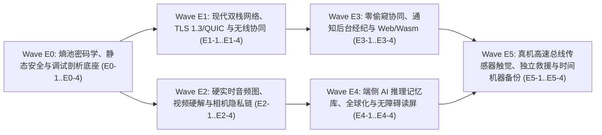

# 整机十维补全终态实施总计划

Type: plan
Status: active
Updated: 2026-11-18

一句话说明：承接新立项的十大整机核心子系统总体设计（密码学安全与锁屏、现代安全网络与跨端总线、开发者调试剖析工具链、实时音视频与相机、跨应用协同与 Web/Wasm、端侧 AI 推理与记忆库、全球化与无障碍、真机高速外设与传感器触觉、独立救砖恢复、CoW 零知识备份同步），按严格底层依赖划分为六波二十四刀推进全栈落地。

## 背景

[整机生态十维盲区全景审计](../research/2026-11-18-整机生态十维盲区全景审计.md) 与 [整机十维缺失拼图全栈终态架构裁决](../notes/proposed/2026-11-18-整机十维缺失拼图全栈终态架构裁决.md) 已将 BerryOS 此前尚未覆盖的十块主力操作系统核心版图全部固化为模块 `design.md` 契约。为确保实施过程零返工且每一步均具备自动化端到端门禁，本计划按「先随机数与密码学信任根 → 再安全网络与开发者调试 → 再视听感官与应用互通 → 再端侧 AI 与全球化无障碍 → 再真机总线外设 → 终局救砖与时间机器备份」定序排刀，与 [渲染与桌面 SDK 及存储镜像全栈彻底升级计划](./2026-11-18-渲染与桌面SDK及存储镜像全栈彻底升级计划.md) 正交咬合推进。

## 步骤

### Wave E0：密码学信任根、静态安全与全栈调试底座（[security](./security/design.md) + [devtools](./devtools/design.md)）

一切 TLS 握手、磁盘加密与高效开发排障均以此波为前置地基：

1. **刀 E0-1（内核多源 CSPRNG 与现代对称/密钥交换密码学原语扩编）**：内核实装硬件 `RNDRRS` / `virtio-rng` / 抖动熵汇聚与每核无锁 ChaCha20 快速随机源 `berry_cprng_draw`（打通 `berry-libc` `getrandom`）；在 `berry-crypto` 补齐常时 `X25519`、`ChaCha20-Poly1305`、`AES-256-GCM/XTS`（含 ARMv8 Crypto 硬件指令路径）与 `HKDF`，全过 Wycheproof 与 NIST 测试向量门。
2. **刀 E0-2（`BerryFS` DE/CE 双级文件静态加密与 `keystored` 真身落地）**：在 `BerryFS` 接入目录与 Extent 级 FBE 加密（支持未解锁 Direct Boot DE 层与凭证级 CE 层）；落地 `keystored` 服务承接 `berry-ksproto` 三档安全后端并打通 `0x85 attest` 与防回滚单调计数器。
3. **刀 E0-3（`Keyguard` 最高优锁屏层、`HardwareAuthToken` 与多用户隔离）**：在合成器最高安全层实装 `Keyguard` 锁屏界面、锁屏通知正文自动脱敏、`biometricd` 签名认证令牌校验及访客/隐私分身子卷隔离（锁屏/注销即刻擦除内存 CE 密钥槽）。
4. **刀 E0-4（纯能力调试通道 `berry debug`、`.eh_frame` 展开与 `berry perf` / `traced`）**：内核实装 `RIGHT_DEBUG` `DebugExceptionChannel` 与硬件断点/观察点支持，落地设备端 `debugserver` 对接宿主 LLDB/GDB；实装零分配 `berry-unwind`、ARM PMU 采样火焰图 `berry perf`、常驻 Perfetto 追踪服务 `traced` 与实时 `berry ui-inspect`。

### Wave E1：现代双栈网络、TLS 1.3/QUIC 与跨端无线软总线（[net-conn](./net-conn/design.md) + [i18n-a11y](./i18n-a11y/design.md) 校时）

5. **刀 E1-1（`netd` 2.0 共享环零拷贝双栈协议栈与能力防火墙）**：升级 `netd` 支持 IPv4/IPv6 双栈（SLAAC/DHCPv6/Happy Eyeballs v2）、SACK/BBR 拥塞控制、每会话共享 `IoRing VMO` 高吞吐数据面，以及三级 `NetCap` 域名/局域网能力防火墙与 `TunCap` VPN 槽位。
6. **刀 E1-2（纯 Rust `berry-netsec` TLS 1.3、系统根证书库与 `berry-http` H2/QUIC）**：实装零 C 依赖 TLS 1.3 客户端/服务端状态机、只读映射根 CA 库 `certs.vmo`、DoH/DoT 加密解析与 HTTP/1.1/2/3（QUIC）库，并通过 `timed` 实装 RTC + NTS 安全网络校时与共享 `tzdb.vmo` 时区底座。
7. **刀 E1-3（Wi-Fi WPA3 `wifid` 与蓝牙 5.4 / BLE `btd` 协议栈）**：基于 `mac80211_hwsim` / Virtio-BT 模拟器靶场与真机 HCI/SDIO 抽象，落地 WPA3-SAE 无线连接管理、随机化 MAC 防追踪及 BLE GATT / HID / LE Audio 服务栈。
8. **刀 E1-4（`berry-link` 零配置跨端分布式协同软总线）**：实装同账号 BLE 加密滚动信标近场发现与局域网/Wi-Fi Direct 双向 mTLS QUIC 直连通道，打通双模拟器实例间的键鼠穿越、隔空投送与远程 `SceneStream` 矢量窗口流转。

### Wave E2：实时音频图、硬编解码与相机隐私媒体管线（[media](./media/design.md)）

9. **刀 E2-1（`audiod` 无锁 EDF 硬实时混音引擎与 `virtio-snd` 宿主声学桥接）**：实装零锁零堆分配实时音频图线程（接入 `sched-rt-gfx` 周期 EDF 预算）、多相重采样、音频焦点状态机与自动闪避（Ducking），打通 QEMU `virtio-snd` 至宿主 CoreAudio/PipeWire/WASAPI 低延迟发声与录音。
10. **刀 E2-2（息屏深缓冲省电音频卸载与媒体资源证据联动）**：实装后台音乐播放 100ms+ 大缓冲自适应节拍切换，与 `am` 进程生命周期管理建立真实音频流活跃度资源证据绑定（静音超时自动撤证冰封）。
11. **刀 E2-3（零拷贝沙箱编解码 `mediad` 与 PTS 音画同步上屏）**：在零权限沙箱进程池内实装容器解复用、Opus/FLAC 音频编解码及 `virtio-video` / 软硬一体视频解码，输出 `NV12`/`P010` `GpuSurface` 零 CPU 拷贝直交合成器 Uber-Shader 按音频主时钟精准呈现，焕新 `photos-app` 视频回放。
12. **刀 E2-4（`camerad` 相机帧流管线与顶栏物理隐私指示灯硬互锁）**：打通宿主 UVC / `virtio-camera` 实时预览与拍照编码落盘，在驱动与合成器之间实装不可绕过的隐私指示租约门禁与全局一键闭麦/闭镜物理断流开关，焕新真功能 `camera-app`。

### Wave E3：零偷窥应用互通、通知后台经纪与双核现代生态（[app-interop](./app-interop/design.md)）

13. **刀 E3-1（合成器安全 `PasteButton` 零偷窥剪贴板、跨窗拖拽与系统 Picker）**：在合成器与 `ui-sdk` 内建手势验证单次只读 VMO 剪贴板派发、60 秒敏感口令自动销毁、跨窗口实时拖拽预览及免权限弹窗单句柄系统文件/相册选择器。
14. **刀 E3-2（结构化路由 `intentd`、三档投稿通知中心 `notifyd` 与后台经纪 `workmgr`）**：落地 App Links 跨应用意图路由与系统分享面板、桌面下拉结构化通知中心与胶囊实时活动、以及合并后台同步窗口与硬件 RTC 精确闹钟唤醒的 `workmgr`。
15. **刀 E3-3（`berry-wasm` WASI 0.2 组件模型 AOT 与极速沙箱运行时）**：实装纯 Rust WebAssembly Component Model 加载器、安装期机器码 AOT 编译器及 WIT 能力绑定（对接 `ui-sdk`、`netd` 与文件系统受限目录句柄），达成跨语言组件 `< 5ms` 安全冷启动。
16. **刀 E3-4（站点隔离沙箱网页引擎 `berry-webview` 与真实 `browser-app` 升级）**：按「主控进程 + 零句柄每站点渲染沙箱 + 绘制直出 `gfx` `SceneStream`」架构实装现代 HTML5/CSS Flexbox·Grid/ES 标准网页渲染核，使内置浏览器真正浏览现代 HTTPS 互联网。

### Wave E4：端侧 AI 推理记忆库、全球化双向排版与无障碍读屏（[ai-runtime](./ai-runtime/design.md) + [i18n-a11y](./i18n-a11y/design.md)）

17. **刀 E4-1（`.bmod` 只读共享权重池与 `berry-tensor` CPU SIMD + 宿主 `wgpu` Compute 双后端）**：实装页对齐 `.bmod` 模型验签按需映射池（冷层可随内存水位自动驱逐）、ARM64 `dotprod`/`i8mm` 量化算子软核及模拟器半虚拟化 `berry-paravirt-npu` 宿主 GPU Compute 张量加速通道。
18. **刀 E4-2（`airtd` 分页 KV-Cache、JSON 语法约束解码与 `berry-vault` 加密记忆库）**：实装共享系统提示词前缀的 Paged KV-Cache、100% 合法结构化输出的有限自动机采样器、流式端侧 ASR/TTS 管道及域能力门控的本地 HNSW 语义记忆库，与桌面语义场景总线全链合龙。
19. **刀 E4-3（`.blp` 零拷贝多语言热切换、UAX #9 BiDi 与全套 UI 自动 RTL 镜像）**：在 `berry-xtask` 与 `berry-i18n` 实装编译期强校验 `.blp` 资源包映射、CLDR 复数日期格式化、阿拉伯/希伯来语双向文本连字整形及 `ui-sdk` `InlineStart`/`InlineEnd` 单帧免重启热切换镜像。
20. **刀 E4-4（`a11yd` 触摸探索读屏器、全局实时字幕与合成器视觉辅助滤镜）**：实装直通启动层可用的 `BerryVoice` 读屏状态机（联动 `airtd` 微缩自然语音 TTS `< 40ms` 播报与无标签图标视觉补述）、系统音频环回实时双语字幕条，以及合成器单遍色觉矫正矩阵与视口放大镜。

### Wave E5：真机高速总线外设、独立救砖恢复与时间机器备份（[soc-peripherals](./soc-peripherals/design.md) + [recovery](./recovery/design.md) + [backup-sync](./backup-sync/design.md)）

21. **刀 E5-1（`devmgr` 2.0 DTB/ACPI 拓扑枚举、SMMUv3 DMA 隔离与 PCIe/NVMe/xHCI 驱动族）**：实装内核 SMMUv3/VT-d `BtiCap` 页表隔离门卫，落地纯用户态 PCIe ECAM + MSI-X、NVMe 多队列块驱动与 USB xHCI 主从协议栈（含 USB Gadget `berryctl` 有线直连），打通纯 PCIe 标准虚拟机与 PC 硬件启动。
22. **刀 E5-2（`sensord` 传感器融合、`hapticsd` 帧同步触觉引擎与真机 PMIC/S3 深睡树）**：落地 6 轴姿态四元数自动旋转/抬腕亮屏、环境光自适应曲线、与 `Spring2D` 动画同 VSync 拍触发的线性马达瞬态波形协议，以及电源时钟引用计数树与 S3 逆序挂起恢复状态机。
23. **刀 E5-3（`< 4MiB` 独立救援微系统 `BerryRecovery`、受控刷机与产线 CIT/封签）**：构建全内存自包含图形救援镜像，实装双槽损毁自动切入、`berry rescue` USB/Wi-Fi 签名保数据重刷、100ms 密码学销毁密钥恢复出厂、「解锁必擦除数据」硬件铁律及工厂 CIT 自检套件。
24. **刀 E5-4（`backupd` CoW 瞬时快照零知识加密备份、扫码换机克隆与 `berry-crdt` 同步）**：基于 `BerryFS` 代数快照与差量树实装无停顿 FastCDC 去重 + XChaCha20-Poly1305 零知识对象存储备份、系统升级前自动时间机器锚点、双机 `berry-link` 1:1 极速克隆及跨端无冲突 CRDT 实时状态同步。

## 未完成事项

- [ ] Wave E0：完成 `E0-1`..`E0-4`（内核 CSPRNG、对称/密钥交换原语、`BerryFS` DE/CE FBE、`keystored`、`Keyguard` 锁屏与纯能力 `berry debug` / `berry perf` / `traced` 工具链）
- [ ] Wave E1：完成 `E1-1`..`E1-4`（`netd` 2.0 双栈零拷贝环、纯 Rust TLS 1.3 + HTTP/2/3 QUIC、NTS 安全授时、WPA3 Wi-Fi / BLE 栈与 `berry-link` 跨端软总线）
- [ ] Wave E2：完成 `E2-1`..`E2-4`（`audiod` 硬实时无锁混音与焦点闪避、深缓冲省电音频、零拷贝 `mediad` 视频硬解音画同步与 `camerad` 物理隐私互锁）
- [ ] Wave E3：完成 `E3-1`..`E3-4`（合成器零偷窥 `PasteButton` 剪贴板与 Picker、`intentd`/`notifyd`/`workmgr`、`berry-wasm` WASI 0.2 运行时与沙箱 `berry-webview`）
- [ ] Wave E4：完成 `E4-1`..`E4-4`（`.bmod` 共享权重池与异构 `berry-tensor`、`airtd` 约束解码与 `berry-vault` 加密记忆库、`.blp` 热切换 RTL 镜像与 `a11yd` 读屏辅助）
- [ ] Wave E5：完成 `E5-1`..`E5-4`（SMMU 隔离 PCIe/NVMe/USB xHCI 用户态驱动、`sensord`/`hapticsd`/S3 深睡树、`< 4MiB` `BerryRecovery` 救砖产线套件与 `backupd` CoW 零知识备份克隆）
