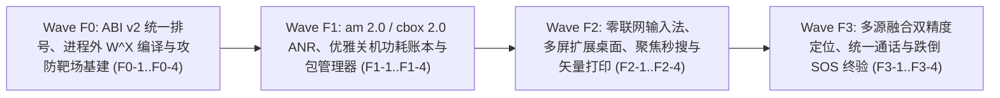

# 深水区六维补完与跨模块接缝收口实施计划

Type: plan
Status: active
Updated: 2026-11-18

一句话说明：承接 [全系统 31 模块终态合龙总纲与 ABI v2 号段总表](./2026-11-18-全系统31模块终态合龙总纲与ABI号段总表.md) 及新立项的六大深水区模块规格（`pkgmgr`、`location`、`input-productivity`、`power-thermal`、`telephony-sos`、`verif`）与升格版 `am` 2.0 / `cbox` 2.0，分四波十六刀完成跨模块接缝闭环与商业化终验。

## 背景

[全栈 25 模块跨界接缝与深水区六盲点复核审计](../research/2026-11-18-全栈25模块跨界接缝与深水区六盲点复核审计.md) 揪出了全系统最后 5 处跨模块接口接缝（ABI v2 排号与 `0x64 clock_adjust`、进程外 `aotd` `W^X` 安全编译、`am`/`cbox` 2.0 升格与 ANR 抓栈、双模合成与 `imed` 定名、术语表归一）以及 6 块深水区核心业务子系统。本计划作为既有五路计划的收官拼图，确保每一项增补能力按确定性刀序落地并纳入混沌验证靶场。

## 步骤

### Wave F0：ABI v2 单源合龙、进程外 `W^X` 编译与自动化攻防基建（[合龙总纲](./2026-11-18-全系统31模块终态合龙总纲与ABI号段总表.md) + [verif](./verif/design.md)）

1. **刀 F0-1（`tools/abi.toml` Level 2 全号段一次性登记与原型双向代码生成）**：按合龙总纲第二章将 `0x07..0x8A` 新系统调用、`RIGHT_DEBUG`/`SIGNAL_PEER`/`PIN_DMA` 及 `PEER_CLOSED..EXCEPTION_PENDING` 信号位录入 `abi.toml`，升级 `tools/gen_abi.py` 同时自动生成 Rust `berry-sys` 强类型包装、C 头文件原型与 `abi.syz` 描述。
2. **刀 F0-2（`0x64 berry_clock_adjust`、`0x1D vmo_cache_op`、`0x1E vmo_seal` 与进程外 `aotd` 落地）**：内核实装受 `TimeResourceCap` 门控的壁钟偏移与斜率微调原语、四步 PoU 指令缓存同步与 VMO 不可逆写密封；落地零网络独立编译服务 `aotd`，跑通硬件严格 `W^X` 下的安全代码页移交。
3. **刀 F0-3（解析器 `cargo-fuzz` 门禁库与 `berry-syzfuzz` 多核状态机轰炸器）**：搭建工作区 `fuzz/` 常驻靶场，首批接入全部 `berry-*proto`、`berry-crypto`、`berry-manifest` 与 ELF/字体解析器，并打通 `abi.syz` 编译生成多核句柄竞态模糊测试器。
4. **刀 F0-4（`torn-arena` 块设备乱序断电撕裂竞技场与 `ui-monkey` 混沌框架）**：实装虚拟块驱动 `CACHE_FLUSH` 屏障间任意写子集分叉断电重放器（供 `BerryFS` 与 `pkgmgr` 逐刀自证零损盘），并在宿主 `berry` CLI 实装确定性种子驱动的 `berry verify chaos`。

### Wave F1：`am` 2.0 / `cbox` 2.0 ANR 升格、优雅关机功耗账本与包管理器（[am](./am/design.md) + [cbox](./cbox/design.md) + [power-thermal](./power-thermal/design.md) + [pkgmgr](./pkgmgr/design.md)）

5. **刀 F1-1（`cbox` 2.0：合流 `ramoops`、`BerryFS` 并发诊断仓与跨进程 ANR 死锁全栈抓栈）**：废除旧 FAT12 三窗排液锁，实装合成器 5 秒输入超时与 `appd` 生命周期超时触发的全线程 `.eh_frame` 展开及沿 `PiEdge` 最多 4 跳跨进程死锁追查，升级 `berry crash-log` 支持 ASLR 基址扣减、内联帧还原与责任自动定界。
6. **刀 F1-2（`am` 2.0：16 核原子冰封、LZ4 压缩换出池与 `BerryFS` 无限槽加密墓碑）**：对接 `0x22 pager_op_range` 实装冻结态脏匿名页压缩换出，将墓碑表迁入 `/data/system_ce/<uid>/tombstones/` 突破 8 槽限制，并实装音频/定位/后台窗口真实活跃度租约核验（猎杀静音假保活）。
7. **刀 F1-3（`powerd` 2.0 五阶段 1 秒优雅关机、每应用 `mAh` 能耗账本与 `thermald` 六级温控）**：收紧 `0x88`/`0x8A` 归 `powerd` 独占，落地关机刷盘与熵种子滚存编排；实装 CPU/GPU/OLED/射频/传感器五维应用耗电归因、80% 旁路护电池模式及六级平滑热降级闭环。
8. **刀 F1-4（`pkgmgr` 流式 Merkle 安装、`/data/pkg/cas/` 去重热更与五方零残留原子卸载）**：落地零双倍占盘边下边验安装、跨包与多用户块级去重、前台运行零打断差分热更新（含新包连崩自动回退）、90 天冷应用保数据卸包瘦身及跨五服务两阶段干净卸载（经 `torn-arena` 断电验证）。

### Wave F2：零联网隐私输入法、多屏 PC 工作台、全局秒搜与免驱打印（[input-productivity](./input-productivity/design.md)）

9. **刀 F2-1（标准 `imed` 物理断网输入法沙箱、端侧 `airtd` 联想听写与密码 `SecureKeypad`）**：统一输入法服务为无 `NetCap` 的 `imed`，实装全拼/双拼/多语种输入与光标跟随候选条，并在焦点进入密码/PIN 框时由合成器硬件级旁路切入防截屏内置安全键盘。
10. **刀 F2-2（多显示器独立 VSync 合成与手机一线连 Desktop Mode 扩展工作台）**：升级 `berry-compositor` 支持最多 4 路异构 DPI/刷新率输出、物理尺度平滑跨屏光标与拖拽半窗裁剪，打通外接 4K 大屏自动激活多窗口 Dock 桌面模式。
11. **刀 F2-3（`searchd` 全局 `< 10ms` 倒排与向量混合聚焦秒搜 `BerrySpot`）**：实装 `Cmd+Space` / 桌面下拉悬浮搜索，毫秒级直达应用、三级系统设置开关、实时表达式计算、本地文档与 `berry-vault` 语义记忆。
12. **刀 F2-4（`gfx` 原生矢量 `PdfBackend` 与 `printd` IPP Everywhere 免驱打印 / eSCL 扫描）**：在 `berry-gfx` 实装 `SceneIR -> PDF 1.7` 矢量可搜索文档后端，在 `printd` 打通 mDNS 自动发现与局域网/USB 免驱动标准打印及无驱扫描。

### Wave F3：双精度隐私定位、统一实时通话与 SOS 生命线收官（[location](./location/design.md) + [telephony-sos](./telephony-sos/design.md)）

13. **刀 F3-1（`berry-navface` 多源 EKF 融合定位与宿主 `berry location` GPX 轨迹仿真）**：实装 GNSS + 本地匿名 Wi-Fi 瓦片 + 6 轴 IMU/气压计隧道航位推算纯核滤波，并在宿主模拟器打通选点与倍速轨迹回放注入。
14. **刀 F3-2（`LocationCoarseCap` S2 球面网格稳定模糊隔离与低功耗硬件地理围栏）**：落地「5km 大致位置（防三角采样反推住址）vs 米级精确位置」双轨句柄授权、顶栏定位箭头外显及零应用驻留地理围栏唤醒。
15. **刀 F3-3（`callmgr` 蜂窝与加密 VoIP 统一通话中枢及防偷录双端提示音护栏）**：实装锁屏全屏接听卡片、灵动胶囊、蓝牙耳机按键接挂联动、不出端 `airtd` 骚扰代接字幕，以及开启通话录音强制双端注入提示音的硬件混音合规门。
16. **刀 F3-4（`sosd` 跌倒/车祸运动学检测、5 连击电源键免解锁呼救与锁屏医疗急救卡终验）**：实装高量程冲击+静止姿态识别、15 秒强声光触觉倒计时、离线 TTS 自动播报精确经纬度、DE 直通层只读医疗急救卡展示及全栈 31 模块 24 小时混沌浸泡收官验收。

## 未完成事项

- [ ] Wave F0：完成 `F0-1`..`F0-4`（`abi.toml` Level 2 全号段生成、`0x64 clock_adjust` 与进程外 `aotd` `W^X` 安全编译、全解析器 `cargo-fuzz`/`berry-syzfuzz` 及 `torn-arena` 断电竞技场）
- [ ] Wave F1：完成 `F1-1`..`F1-4`（`cbox` 2.0 跨进程 ANR 抓栈、`am` 2.0 多核冰封与持久加密墓碑、`powerd` 1 秒优雅关机与每应用 `mAh` 功耗账本、`pkgmgr` 内容寻址热更与零残留卸载）
- [ ] Wave F2：完成 `F2-1`..`F2-4`（物理断网 `imed` 与密码安全键盘、多屏异构 DPI 扩展桌面、`BerrySpot` 10ms 全局秒搜、`SceneIR` 矢量 PDF 与 IPP 免驱打印）
- [ ] Wave F3：完成 `F3-1`..`F3-4`（GNSS/IMU 融合与 5km 网格粗定位隐私隔离、`callmgr` 统一通话与防偷录提示门、`sosd` 跌倒车祸 SOS 呼救与全栈 24 小时混沌终验）
