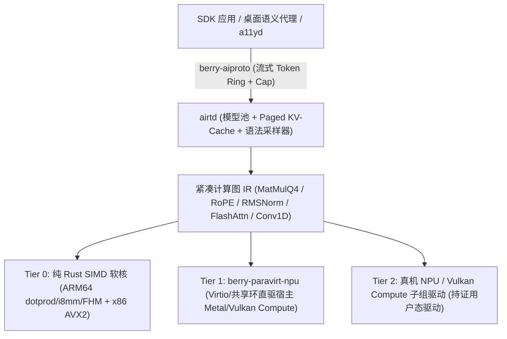

# ai-runtime（端侧 AI 原生推理引擎与加密语义记忆库）总体设计

Type: spec
Status: active
Updated: 2026-11-22
Version: 1.0.0

一句话说明：`ai-runtime`（由系统推理守护进程 `airtd`、纯算子核 `berry-tensor`、协议库 `berry-aiproto` 与个人语义记忆库 `berry-vault` 组成）是 BerryOS 的端侧智能算力与长期记忆中枢——以「只读按需映射跨进程共享模型池 + 三阶异构张量硬件卸载 + 分页 KV-Cache + 能力门控不出端加密记忆库」让 AI 原生操作系统具备真正的本地大脑。

## 背景

[整机生态十维盲区全景审计](../../research/2026-11-18-整机生态十维盲区全景审计.md) 指出：BerryOS 虽已建立内核级策略注入（[AI 调度设计](../../../docs/AI调度设计-v1.0.md)）、权限审批（[AI 同意面设计](../../../docs/AI同意面设计-v1.0.md)）及零 OCR 桌面语义场景总线（[desktop 总体设计](../desktop/design.md)），但全系统缺少端侧模型加载、量化张量计算、语音识别/合成（ASR/TTS）、多模态嵌入（Embedding）以及跨应用个人语义记忆底座。若放任每个应用私自静态链接推理库并重复加载数百 MB 权重，128MiB–4GiB 终端内存将瞬间枯竭。本规格依据 [整机十维缺失拼图全栈终态架构裁决](../../notes/proposed/2026-11-18-整机十维缺失拼图全栈终态架构裁决.md)，定义系统统一托管的端侧 AI 运行时长期契约。

## 范围

- **覆盖**：统一安全模型打包格式 `.bmod`（对齐 4KiB 页边界的量化张量归档）；`airtd` 全局只读按需调页权重 VMO 池与多会话 Paged KV-Cache 内存水位联动；三阶异构算子加速后端（Tier 0 CPU SIMD 量化核、Tier 1 宿主 `wgpu` Compute 半虚拟化加速、Tier 2 真机 NPU 硬件命令环）；系统标准 AI 原语 API（流式 Token 生成、结构化语法约束解码、端侧低延迟流式 ASR/TTS、文本/图像多模态 Embedding）；能力门控加密语义记忆库 `berry-vault`。
- **不覆盖**：内核调度策略表注入（归 [AI 调度设计](../../../docs/AI调度设计-v1.0.md) 与 [sched-rt-gfx 总体设计](../sched-rt-gfx/design.md)）；桌面 UI 语义树导出与代操作光圈（归 [desktop 总体设计](../desktop/design.md)）；云端大模型网关外发联网（归 [net-conn 总体设计](../net-conn/design.md)，且须经 [AI 同意面设计](../../../docs/AI同意面设计-v1.0.md) 显式外发授权）。

## 契约

### 一、页对齐安全模型容器（`.bmod`）与零拷贝权重池契约

1. **零反序列化直接映射格式 `.bmod`**：模型文件存储在 [storage-image 总体设计](../storage-image/design.md) 的只读系统卷 `/system/models/` 或按需下载的加密扩展卷 `/data/models/`，文件头包含 Ed25519 模型签名、超参数有界 TLV 表（拒绝任意 Pickle/可执行脚本格式，根绝反序列化代码执行漏洞）及 4096B 页对齐的只读张量数据段（支持 `Q4_0`、`Q4_K_M`、`Q8_0`、`FP16`、`BF16`）。
2. **全局唯一物理驻留与冷层驱逐**：`airtd` 通过 `BerryROFS` / `BerryFS` 按需调页 VMO 映射 `.bmod` 张量页并标记 `VMO_OP_DISCARDABLE_COLD`。无论多少个系统服务或第三方应用并发请求同一基础模型（如系统 1.5B/3B 语言模型、轻量 Whisper ASR、神经网络 TTS 或 384 维 Embedding 模型），物理内存中永远只驻留一份只读权重页；当 [am 总体设计](../am/design.md) 发出内存紧缺信号时，内核无需写盘即可直接回收未活跃模型页，下次推理自动按需缺页重装。

建造清单（DAG 节验收面——全勾才配双戳）：

- [x] 条款 1 `.bmod` 格式件：`user/berry-aiproto` 纯函数解析器（BMOD v1 二进制布局单源：Ed25519 签名域/页 0 闭合有界 TLV 超参数表/4096B 页对齐张量段表五量化格式枚举，全接口零拷贝、畸形输入零 panic、loud 拒十四律）——host 19 测绿（`just test-host` berry-aiproto 腿，2026-11-22）；R20 补签名校验胶接面 [`Bmod::verify_signature`]（原语 = berry-crypto ed25519〔wycheproof 在册〕、覆盖域单源仍 signed_span，host 20 测）；R21 补写面 [`BmodBuilder`]（TLV/段表/签名落槽一次成件——读写单源镜像，build→parse→verify 全链 roundtrip，host 22 测）；airtd 消费接线随后续刀
- [ ] 条款 2 全局单份驻留与冷层驱逐：`airtd` 按需调页 VMO 池 + `VMO_OP_DISCARDABLE_COLD` 标记 + am 紧缺信号回收联动（涉内核 mm/svcmgr 面——无人轮默认路径边界外，边界声明到位后继续）

### 二、三阶异构张量计算架构（`berry-tensor`）契约

1. **Tier 0（确定性全平台量化软核）**：纯 Rust `no_std` 编写的无堆分配算子核，利用 ARMv8.2+ `SDOT`/`UDOT`、`SMMLA`（`i8mm`）与 `FMLAL` 指令实现 4-bit/8-bit 分组量化矩阵乘与 FlashAttention-2 分块在线 Softmax，确保无独立加速器的小型穿戴或基础虚拟机环境可用。
2. **Tier 1（模拟器半虚拟化宿主算力直通 `berry-paravirt-npu`）**：在 `berry` 宿主模拟器下，通过共享物理页帧（`.bmod` 权重页零拷贝映射至宿主 `wgpu::Buffer`）将算子图卸载至宿主机 Apple Silicon Metal / 桌面级 GPU Compute Shader 执行，在开发机上获得百 Token/s 级原生端侧大模型实测速度。
3. **Tier 2（真机 NPU / GPU Compute 硬件加速）**：面向移动端与 PC SoC，以持证用户态驱动封装专用 NPU 编译产物缓存与 Vulkan Compute Subgroup 管线，超时看门狗（单次算子批次 > 100ms）触发硬复位并透明降级至 Tier 0/1。

### 三、Paged KV-Cache、结构化约束解码与优先级抢占契约

1. **块级分页 KV-Cache**：`airtd` 将上下文键值缓存划分为固定 16 Token 一块的 `KvBlock` 池；系统提示词（System Prompt）与常用工具定义前缀跨会话共享只读 `KvBlock`（Copy-on-Write 前缀缓存），将首次响应延迟（TTFT）缩短 70% 以上。
2. **零语法错误有限状态机约束（CFG / JSON Schema Masking）**：当桌面代理或第三方应用请求工具调用（Tool Call）或结构化输出时，`airtd` 在 Logits 采样阶段按编译后的字节级有限自动机即时掩蔽非法 Token，从数学上保证 100% 输出合法协议结构，杜绝解析崩溃。
3. **硬实时让路与分级抢占**：`airtd` 工作线程默认运行于受控算力带（`SCHED_INTENT_COMPUTE`），并按单层 Transformer 解码步（< 5ms）设置抢占检查点：
   - 交互级请求（如无障碍 `a11yd` 实时读屏 TTS、输入法语音转写、用户主动唤起桌面助手）享有高优队列，可在单层边界立即抢占后台记忆索引构建任务；
   - 当 [sched-rt-gfx 总体设计](../sched-rt-gfx/design.md) 检测到连续两拍合成帧超时或热管理 `berry-thermal` 进入温控限流档时，`airtd` 自动缩减批大小并下调推理线程并发度，严禁抢占 GUI 主线程与实时音频线程。

### 四、能力门控个人语义记忆库（`berry-vault`）契约

1. **不出端加密存储**：`berry-vault` 驻留于用户凭证级加密目录 `/data/user/<uid>/vault/`（受 [security 总体设计](../security/design.md) 的 FBE CE 密钥保护，锁屏态拒绝写入敏感明文查询），内部融合 `BerryFS` 事务表与轻量分层可导航小世界图（HNSW 定点量化向量索引）。
2. **细粒度域能力隔离**：记忆条目按来源应用与数据域（`calendar`、`messages`、`notes`、`browsing`）打标；任何第三方应用或 AI 技能欲检索跨应用记忆，必须持有用户经由 [AI 同意面设计](../../../docs/AI同意面设计-v1.0.md) 授予的对应域带时效只读 `VaultQueryCap` 句柄，且每次检索命中记录自动写入不可篡改审计账本。

## 验收标准

1. **零重复物理驻留验证**：在 QEMU / 模拟器中同时拉起 4 个并发调用同一 64MiB 测试模型的客户端进程，内核 VMO 物理账本证明权重物理占用恒定为单份（增量仅来自各会话独立 `KvBlock`），触发内存回收压力后冷模型页可被干净驱逐并在下次请求时无损重载。
2. **算子精度与结构化解码门禁**：`berry-tensor` Tier 0 与 Tier 1 后端在同一组 `Q4_0`/`FP16` 基准张量图上的余弦相似度 $\ge 0.999$；1000 次随机模糊提示词在 JSON Schema 约束解码下合法解析率达 100%。
3. **GUI 与音频零干扰验证**：后台满载运行连续流式推理期间，桌面 120Hz 滑动掉帧增量 = 0，[media 总体设计](../media/design.md) 实时音频环欠载（Underrun）计数 = 0。
4. **越权零泄露验证**：未持有 `VaultQueryCap(messages)` 的进程尝试发起跨应用向量近似最近邻搜索时，`berry-vault` 在句柄校验层硬拒绝且耗时恒定（防侧信道探测）。

## 适用边界

- 端侧模型训练与全参数微调不在终端设备职责范围内；终端仅承担只读量化推理、轻量 LoRA 适配器挂载与增量向量索引维护。
- 32MiB 极小内存穿戴裁剪档仅启用轻量语音唤醒/命令词、微缩 TTS 与定点数嵌入模型，不常驻十亿参数级大语言模型。
