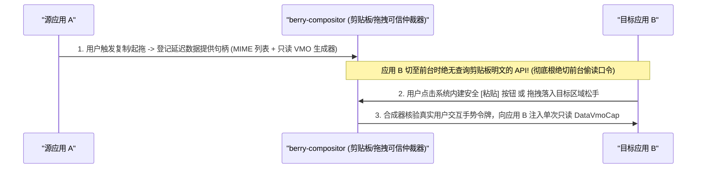

# app-interop（零偷窥跨应用协同、通知后台经纪、Web 内核与 Wasm 生态）总体设计

Type: spec
Status: active
Updated: 2026-11-18
Version: 1.0.0

一句话说明：`app-interop`（由零偷窥剪贴板与拖拽仲裁器、结构化意图与系统选择器 `intentd`、统一通知中心 `notifyd`、后台任务与定时唤醒经纪人 `workmgr`、沙箱化 Web 引擎 `berry-webview` 及 WASI 0.2 组件运行时 `berry-wasm` 组成）是打破应用孤岛并快速繁荣生态的核心枢纽——在严守纯 Capability 零越权底线的同时提供丝滑的跨应用流转与跨语言应用运行能力。

## 背景

[整机生态十维盲区全景审计](../../research/2026-11-18-整机生态十维盲区全景审计.md) 表明：尽管 [应用规范](../../../docs/应用规范-v1.0.md) 确立了「picker 即权限」与「通知三档投稿」的高标准立法原则，但全系统尚缺支撑应用间数据交换的剪贴板/拖拽服务、Intent 路由与分享面板、通知守护进程、统一后台定时调度器，且缺乏真实网页渲染引擎与低门槛跨语言轻量运行时。传统操作系统（如早期 Android/桌面系统）允许任意前台甚至后台应用静默读取全局剪贴板、随意注册广播自启动常驻耗电，造成了灾难性的隐私泄露与续航崩塌。本规格依据 [整机十维缺失拼图全栈终态架构裁决](../../notes/proposed/2026-11-18-整机十维缺失拼图全栈终态架构裁决.md)，定义安全、省电、高互通的应用协同与双引擎生态契约。

## 范围

- **覆盖**：合成器级零偷窥能力剪贴板与跨窗口拖拽（Clipboard & Drag-and-Drop）；类型安全结构化意图路由、深度链接（Deep Link）、系统级文件/媒体/联系人选择器（System Picker）与分享面板（Share Sheet）；统一通知中心守护进程 `notifyd`；持久化后台工作与硬件 RTC 闹钟经纪人 `workmgr`；多进程沙箱隔离现代网页引擎 `berry-webview`；基于 WebAssembly Component Model（WASI 0.2）的原生能力绑定快应用与插件运行时 `berry-wasm`。
- **不覆盖**：应用进程自身的冻结与墓碑回收底层机制（归 [am 总体设计](../am/design.md)）；跨物理设备的无线传输通道（归 [net-conn 总体设计](../net-conn/design.md) `berry-link`，剪贴板经其实现跨端同步）。

## 契约

### 一、零偷窥能力剪贴板与跨窗口拖拽契约

1. **物理杜绝静默读取**：SDK **不提供**任何无用户手势背书的 `get_clipboard_text()` 轮询接口。应用只能使用 `ui-sdk` 内建并由合成器直接绘制与命中校验的安全粘贴控件 `PasteButton`（或系统输入法键盘顶栏粘贴候选条、系统快捷键 `Cmd/Ctrl+V` 硬件键事件直绑）。唯有合成器亲自确认真实用户输入命中粘贴动作或拖拽释放瞬间，才将当前剪贴板的只读 VMO 句柄单次投递给焦点窗口，无需烦人弹窗询问即可 100% 根除偷读剪贴板乱象。
2. **多格式延迟物化与自动过期**：剪贴板支持同时提供多种 MIME 表述（如 `text/plain`、`text/markdown`、`image/png`、文件只读句柄引用），仅当目标应用实际选定消费某格式时才触发物化传输；标记为 `Sensitive`（如密码管理器复制的口令）的条目不在输入法历史记录留痕，并在 60 秒后由合成器自动擦除归零。

### 二、结构化 Intent 路由、Share Sheet 与「Picker 即权限」契约

1. **零隐式广播唤醒风暴**：废除传统全局隐式广播自启动；跨应用拉起统一经 `intentd` 按编译期静态登记的动作契约（如 `berry.action.VIEW_URL`、`berry.action.EDIT_IMAGE`、`berry.action.SHARE`）与域名所有权校验（App Links `.well-known` 签名绑定）精确路由。
2. **Picker 单对象句柄直授（零权限弹窗打扰）**：当笔记或社交应用需要插入照片、文档或联系人时，无需申请广域存储或通讯录权限，只需发起 `PickMedia` / `OpenDocument` 请求；系统以独立安全图层弹出系统级 Picker（应用进程看不见 Picker 内的其余文件列表），用户点选确认后，系统仅将该**单个被选文件的只读（或读写）`FileCap` 句柄**直接移交请求应用，用户体验零中断且最小权限绝对成立。

### 三、结构化通知守护进程（`notifyd`）与后台任务经纪（`workmgr`）契约

1. **三档投稿制通知中心（`notifyd`）**：完整落地 [应用规范](../../../docs/应用规范-v1.0.md) 通知分级——仅即时通讯、日程闹钟、实时进行中任务（如导航/外卖/录音计时胶囊 Live Capsule）可默认发声横幅，营销推送强制静默归入摘要折叠箱；通知载荷采用纯声明式模板（标题、正文、缩略图 VMO、进度条、快捷回复与动作按钮 IntentToken），由桌面统一渲染以防应用伪造系统界面，锁屏态受 [security 总体设计](../security/design.md) 管控自动隐藏敏感正文。
2. **杜绝私自保活的统一后台经纪（`workmgr`）**：应用进入后台无实时媒体/导航证据 3 秒即被冻结，任何延迟或周期性同步需求必须向 `workmgr` 提交声明式任务契约（约束条件：`RequireUnmeteredNetwork`、`RequireCharging`、`DeviceIdle`、时间窗 `[earliest, latest]`）：
   - `workmgr` 将全系统数十个应用的零散后台唤醒对齐合并至同一维护时间窗批处理执行，使 SoC 空闲深睡时长最大化；
   - 唯有时钟闹钟、日历提醒与医疗健康监测可申请精确硬件 RTC `AlarmWakeup` 能力，在 S3 深睡态准点唤醒系统。

### 四、双核现代生态引擎（`berry-webview` + `berry-wasm` WASI 0.2）契约

1. **多进程隔离轻量 Web 引擎（`berry-webview`）**：采用「浏览器主控进程 + 每站点独立零特权渲染沙箱进程（Site Isolation）+ 网络委托 `netd` + 绘制直出 `gfx` `SceneStream`」四层隔离架构：
   - 渲染子进程不持有任何文件系统、网络或设备句柄，即使遭遇恶意网页 JS/排版内存漏洞亦被死死困在空句柄沙箱内；
   - DOM/CSS 排版输出直接编译为 `gfx` 2.0 硬件加速 `SceneStream` 原语（共享系统字体图集与 GPU 着色管线），支撑 [browser](../../../user/bins/browser) 打开真实现代网页及混合开发界面。
2. **WASI 0.2 WebAssembly 组件模型一等公民运行时（`berry-wasm`）**：
   - WebAssembly Component Model（WIT 接口定义 + WASI 0.2）采用与 BerryOS 微内核完全同构的**纯句柄无全局命名空间 Capability 模型**；
   - 内置纯 Rust 编写的 AOT（安装期由系统编译服务提前编译为受边界保护的原生机器码并签名缓存至 `/data/dalvik-equiv-aot/`）与极速解释器双模引擎：使 Rust、C/C++、Go、Zig、TypeScript/AssemblyScript 编写的跨平台命令行工具、AI Agent 技能插件与轻量小程序无需重写系统底层适配即可在 `< 3ms` 内冷启动运行，并通过 WIT 强类型绑定直接消费 `ui-sdk`、`netd` 与 `airtd` 能力。

## 验收标准

1. **剪贴板反偷窥验证**：恶意测试应用切至前台并尝试在无真实用户点击 `PasteButton` 的情况下获取剪贴板数据，100% 拿不到任何句柄；用户点击 `PasteButton` 后目标应用精确收到单次只读数据且 60 秒敏感自动擦除生效。
2. **后台唤醒归零验证**：安装 20 个注册了后台周期同步的测试应用并切入息屏待机，在非统一维护窗口期内应用引发的 CPU 定时器唤醒次数 = 0；到达 RTC 精确闹钟时刻系统误差 $\le 500\text{ms}$ 准时唤醒响铃。
3. **Web 站点隔离与 Wasm 组件验收**：`browser-app` 在隔离渲染沙箱内成功加载渲染包含现代 Flex/Grid CSS 与 HTTPS 请求的网页；第三方 WIT 标准 WASI 0.2 组件经 AOT 编译在 `< 5ms` 内启动并受限于显式授予的单个目录句柄运行。

## 适用边界

- `berry-webview` 首阶段聚焦现代标准 HTML5/CSS3（Flexbox/Grid）、ES2023 与 Fetch/Canvas 核心集，不背负 WebRTC 旧版复杂 P2P 遗留栈、WebSQL、Flash/NPAPI 等历史包袱。
