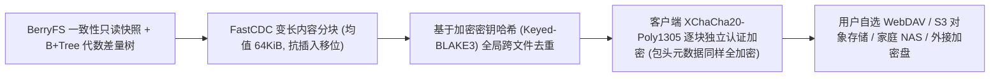

# backup-sync（基于 CoW 瞬时快照的零知识端到端加密备份、换机克隆与多端状态同步）总体设计

Type: spec
Status: active
Updated: 2026-11-18
Version: 1.0.0

一句话说明：`backup-sync`（由快照备份守护进程 `backupd`、内容定义分块去重加密库 `berry-pack` 与无冲突状态同步引擎 `berry-crdt` 组成）将 `BerryFS` 写时复制底座转化为旗舰级用户体验——实现「前台零停顿毫秒级整机快照、云端零明文增量备份、新机扫码 1:1 无缝克隆与跨端实时接力」。

## 背景

[整机生态十维盲区全景审计](../../research/2026-11-18-整机生态十维盲区全景审计.md) 指出：[storage-image 总体设计](../storage-image/design.md) 已经为 BerryOS 规划了现代写时复制（CoW B+Tree）文件系统 `BerryFS`，但尚未设计面向用户的系统级备份恢复、大版本升级连带数据回退、新旧设备换机迁移以及多设备间应用状态同步架构。传统移动系统备份往往需要逐文件扫描应用运行期正在读写的目录，不仅耗时漫长、容易抓出半写不一致的损坏数据库，而且若云端持有解密密钥还会带来云侧数据泄露风险。本规格依据 [整机十维缺失拼图全栈终态架构裁决](../../notes/proposed/2026-11-18-整机十维缺失拼图全栈终态架构裁决.md)，充分释放 CoW 存储与微内核墓碑机制的天然协同优势。

## 范围

- **覆盖**：基于 `BerryFS` 只读代数快照（Generation Snapshot）的整机与单应用一致性时间点冻结；内容定义分块（FastCDC）、BLAKE3/SHA-512 全局去重与客户端零知识端到端加密（Zero-Knowledge E2EE）增量备份流（对接任意标准 S3/WebDAV 对象存储、本地 NAS 或外接 USB 盘）；基于 [net-conn 总体设计](../net-conn/design.md) `berry-link` 点对点直连的新旧设备 1:1 极速克隆迁移；系统升级前自动本地快照与连带用户数据的「时间机器」一键回退；面向笔记、待办、设置与书签的端到端加密 CRDT 多端实时状态同步框架。
- **不覆盖**：底层磁盘块分配与 CoW B+Tree 超级块双槽提交本身（归 [storage-image 总体设计](../storage-image/design.md)）。

## 契约

### 一、零停顿 $O(1)$ 一致性快照捕获契约

1. **应用静默刷盘与毫秒级打点**：`backupd` 在发起备份快照前，协同 [am 总体设计](../am/design.md) 令后台已冻结应用保持静止，并向当前活跃的唯一前台应用下发轻量检查点通知（限时 50ms 刷空应用层 SQLite/事务缓冲），随即调用 `BerryFS` `CREATE_RO_SNAPSHOT(gen_id)`——仅需在超级块钉住当前 B+Tree 根节点引用计数（耗时 $< 1\text{ms}$），前台应用即可立即恢复满速写入新 CoW 页，而 `backupd` 在后台从容遍历这棵**绝对静止、数学上时间点完全一致**的只读快照树。
2. **本地系统升级安全网（OS + Data 联合时间机器）**：每次执行跨主版本系统 OTA 升级前，`backupd` 自动钉住一个本地 72 小时保留快照锚点；若新版本系统升级后应用数据迁移异常或用户不满意，不仅系统槽可切回旧槽，连用户应用沙箱数据也能在 1 秒内原子回指升级前根快照（过期后后台自动释放不再引用的历史 CoW 差量块）。

### 二、客户端零知识端到端加密（E2EE）增量备份契约

1. **不扫全盘的代数差量加速（Send/Receive Diff）**：由于 `BerryFS` 每个 B+Tree 节点携带事务代数 `txg_id`，增量备份无需遍历未改动的数万个历史文件——直接沿 `txg_id > last_backup_txg` 剪枝下钻，秒级精准定位自上次备份以来发生修改的文件 Extent。
2. **严格零知识边界（服务端零信任）**：备份根密钥由用户在 [security 总体设计](../security/design.md) `keystored` 内生成的 256-bit 恢复主密钥（展示为 24 词标准助记词或高熵恢复码，并可由硬件 Passkey 托管）派生；文件内容块、目录结构树、应用清单乃至文件名长度填充**全部在设备本地完成 `XChaCha20-Poly1305` 加密后才离开网卡**。任何对象存储服务商、企业管理员或中间人即使拿走全部备份桶数据，也无法获知用户安装了哪些应用或存了多少张照片。
3. **沙箱排除纪律**：应用目录下的 `/app/cache/<id>`（临时可再生缓存）与显式绑定单机硬件不可导出属性的设备私钥自动排除在远程备份流外；密码学密钥按应用策略经备份包装密钥安全重封装迁出。

### 三、近场扫码 1:1 极速克隆换机契约

1. **双机靠近扫码直连**：新机首次开机向导靠近旧机，通过 BLE 近场校验 + 屏幕动态高密度视觉校验码完成双向零中间人认证，建立 `berry-link` Wi-Fi Direct / USB-C 线缆直连满速通道（USB 3.x 有线直连可达 $> 400\text{MB/s}$）。
2. **连桌面布局与墓碑现场原样复刻**：不仅完整迁移用户照片、文件、Wi-Fi 密码与全部应用数据沙箱，连 [desktop 总体设计](../desktop/design.md) 的桌面图标编排、系统偏好乃至应用的序列化墓碑状态（Tombstone）一并恢复——换机重启后点开最近任务卡片即可无缝接着旧机刚才阅读的滚动位置继续使用。

### 四、多端无冲突状态实时同步（`berry-crdt`）契约

1. **离线优先、自动收敛**：针对需要在穿戴、手机与 PC 间高频实时同步的结构化小数据（系统设置项、日程待办、备忘录富文本、浏览器标签页与密码库），SDK 提供统一内置的轻量无冲突复制数据类型库 `berry-crdt`（涵盖 LWW-Element-Set、OR-Set 与文本 RGA/Yata 序列）。多台设备各自离线编辑后一旦经 `berry-link` 局域网相遇或经加密中继交换差量操作日志（Op-Log），无需中心服务器裁决即可在数学上保证 100% 强最终一致收敛，永不产生「冲突副本 (1)」垃圾文件。

## 验收标准

1. **高并发写入下快照一致性门禁**：在测试应用以 50MB/s 持续随机改写并交叉校验多文件哈希的同时触发 50 次连续 `backupd` 快照增量备份，将任一时间点备份恢复至全新空盘后，全量文件内部事务不变量 100% 完整自洽，前台写入吞吐抖动 $\le 3\%$。
2. **零知识密文不可区分性验证**：抓包审查上传至模拟 S3/WebDAV 靶机端的全部对象与请求头，除密文块随机 ID 与块大小桶外不含任何明文路径、应用包名或时间戳特征；篡改云端任意 1 比特密文在恢复流式校验阶段 100% 被 Poly1305 认证标签即时拦截终止。
3. **双机克隆与 CRDT 收敛门禁**：双模拟器实例各自断网并发增删改同一份 1000 行结构化文档后恢复连接，`berry-crdt` 在 100ms 内完成双向合并且双端字节级哈希完全相等。

## 适用边界

- 备份服务仅提供标准开放存储协议客户端（S3 兼容 API、WebDAV、局域网 SMB/BerryLink 与本地块设备），不绑定任何单一商业闭源云盘厂商锁死用户。
