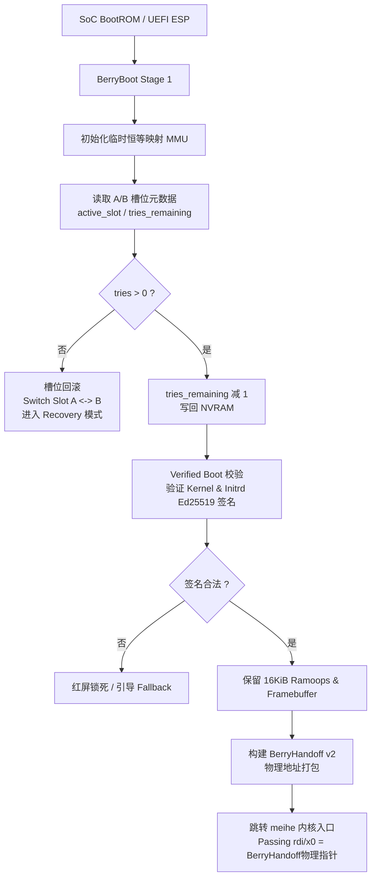

# bootloader（引导装载与固件交接体系 BerryBoot 2.0）总体设计

Type: spec
Status: active
Updated: 2026-11-18
Version: 1.0.0

## 1. 模块定位与职责边界

BerryBoot 是 BerryOS 微内核架构的零级引导装载器与可信链起点。位于 SoC 固件（UEFI / U-Boot / Coreboot / iBoot 契约层）之上、微内核 `meihe` 之前。它不负责多用户权限、不运行图形界面引擎，专精于安全度量、A/B 槽位仲裁、硬件基底勘测与结构化上下文交接。

```
+-------------------------------------------------------------------------+
|                              SoC BootROM                                |
+-------------------------------------------------------------------------+
                                    |
                                    v
+-------------------------------------------------------------------------+
|                  BerryBoot (Stage 1 & Stage 2 / efi)                    |
|   +-------------------+  +-------------------+  +-------------------+   |
|   | Verified Boot 度量 |  | A/B 槽位仲裁状态机 |  | 硬件探测与内存切片 |   |
|   +-------------------+  +-------------------+  +-------------------+   |
+-------------------------------------------------------------------------+
                                    |
            BerryHandoff v2 协议帧   | (零拷贝物理内存直传)
                                    v
+-------------------------------------------------------------------------+
|                        微内核 meihe 入口 (Kernel Main)                   |
+-------------------------------------------------------------------------+
```

### 职责边界划分
- **归属 BerryBoot 的职责**：
  1. 硬件平台探测与抽象：解析 ACPI 5.0+ 表或 Flattened Device Tree (FDT/DTB)，勘测物理内存连续区段，构建内核页表所需的早期物理内存布局（Physical Memory Map）。
  2. A/B 槽位决策与回滚计数：读取外部非易失性存储（NVRAM / eMMC Boot Partition / ESP 变量区）中的引导元数据，执行 A/B 槽位切换与尝试计数器递减。
  3. 可信链度量延伸（Verified Boot）：验证内核镜像、初始化镜像（Initrd/Ramdisk）及 BerryROFS dm-verity 根公钥的 Ed25519 签名；向 TPM 2.0 / TEE 扩展 PCR-0/PCR-4 度量值。
  4. 启动帧交接（`BerryHandoff v2`）：将显示帧缓冲区基址、硬件随机数种子、Ramoops/pstore 崩溃保留区、控制台串口、时钟基准等打包并映射至物理连续地址交付内核。
  5. 崩溃逃生机制：检测硬件看门狗复位或内核 Panic 标记，维护连续 Panic 计数，触发 Safe Mode 或直接引导 `recovery` 恢复分区。
- **严禁越界的范围**：
  1. 严禁加载任何动态共享库（`.so`）或解释性脚本；全链静态编译且内存 footprint 控制在 2MiB 以内。
  2. 严禁介入 VFS 或完整用户态命名空间挂载；仅支持极简只读 ESP (FAT32) 与原始分区（Raw Extent）读取。
  3. 严禁自行实现多任务调度器；全过程保持单核阻塞式轮询或同步等待。

## 2. 核心架构与数据流



### 2.1 A/B 槽位仲裁状态机
A/B 元数据常驻在 ESP 分区的 `berry_boot.dat` 或硬件专用保护扇区中，采用双副本 + CRC32 保护：

```c
struct BerrySlotInfo {
    uint8_t  slot_id;          // 0: Slot A, 1: Slot B
    uint8_t  priority;         // 0..15 (15 最高优先)
    uint8_t  tries_remaining;  // 0..3 (连续失败 3 次触发切换)
    uint8_t  successful;       // 1: 已经过用户态 am/pkgmgr 校验正常；0: 试用期
    uint32_t rollback_version; // 防降级版本号 (Anti-rollback Index)
    uint8_t  reserved[8];
};

struct BerryBootControl {
    uint32_t magic;            // 'BRYC' (0x42525943)
    uint32_t version;          // 2
    struct BerrySlotInfo slots[2];
    uint32_t recovery_trigger; // 非零表示强制进 Recovery
    uint32_t crc32;
};
```

1. **正常启动**：`tries_remaining > 0` 且 `priority` 最高。BerryBoot 将 `tries_remaining` 减 1 后引导内核。
2. **确认成功**：用户态 [pkgmgr](../pkgmgr/design.md) 在关键服务正常运行 60 秒后，通过 Syscall 调用硬件抽象层，将当前槽位的 `successful` 置 1，`tries_remaining` 重置为 3。
3. **连续崩溃逃生**：若系统启动失败导致硬看门狗超时，再次上电时 `tries_remaining` 为 0，BerryBoot 自动将当前槽位 `priority` 降为 0，启用对侧槽位；若双槽皆空，则引导 `recovery` 独立内核镜像。

## 3. 接口契约与 BerryHandoff v2

BerryBoot 结束时，必须关停所有 Boot Services，关闭中断，设置恒等页表映射，并将唯一的参数寄存器（x86-64 `rdi`，AArch64 `x0`，RISC-V `a0`）指向 4KiB 对齐的 `struct BerryHandoff` 物理地址：

```c
#define BERRY_HANDOFF_MAGIC 0x48414E444F464632ULL // "HANDOFF2"

enum BerryBootReason : uint32_t {
    BOOT_REASON_COLD_POWER_ON = 0,
    BOOT_REASON_WARM_REBOOT   = 1,
    BOOT_REASON_KERNEL_PANIC  = 2,
    BOOT_REASON_WATCHDOG      = 3,
    BOOT_REASON_RECOVERY_OTA  = 4,
};

struct BerryHandoffMemRegion {
    uint64_t base;
    uint64_t size;
    uint32_t type;     // 1: 常用可用 RAM, 2: ACPI 保留, 3: MMIO, 4: 内核载荷, 5: Ramoops
    uint32_t flags;    // BIT(0): 可执行, BIT(1): 只读
};

struct BerryHandoffFramebuffer {
    uint64_t paddr;
    uint32_t width;
    uint32_t height;
    uint32_t pitch;
    uint32_t format;   // 0: B8G8R8A8, 1: R8G8B8A8
    uint32_t flags;
};

struct BerryHandoff {
    uint64_t magic;              // BERRY_HANDOFF_MAGIC
    uint32_t version;            // 0x00020000 (v2.0)
    uint32_t boot_reason;        // BerryBootReason
    uint64_t fdt_paddr;          // Flattened Device Tree 物理地址 (若无为 0)
    uint64_t acpi_rsdp_paddr;    // ACPI RSDP 物理指针 (若无为 0)
    uint64_t ramoops_paddr;      // 预留 16KiB 崩溃保留区物理地址
    uint32_t ramoops_size;       // 0x4000 (16KiB)
    uint32_t slot_active;        // 0: Slot A, 1: Slot B
    
    // 早期物理内存切片表 (最多 64 段)
    uint32_t mem_region_count;
    uint32_t reserved1;
    struct BerryHandoffMemRegion mem_regions[64];

    // 早期图形帧缓冲 (用于内核极速 Splash 与 Panic 蓝屏/红屏呈现)
    struct BerryHandoffFramebuffer fb;

    // 早期硬件真随机数种子 (32 字节，取自 TPM 2.0 / RNDR 指令)
    uint8_t  entropy_seed[32];

    // 调试串口配置
    uint64_t early_uart_paddr;
    uint32_t early_uart_baud;
    uint32_t early_uart_type;    // 0: 禁用, 1: 16550, 2: PL011
};
```

## 4. 故障模型、降级与安全边界

### 4.1 故障模型与分级自愈
1. **ESP 分区损坏或校验和失败**：
   - 切换至备份元数据区扇区；若仍损坏，重置为工厂默认 Slot A 单次尝试并记录报警。
2. **内核载荷签名篡改（Signature Mismatch）**：
   - 拒绝解压缩与跳转；清零该槽位有效性；尝试跳转备用槽位；若备用槽位亦失效，直接启动 Recovery 模式并闪烁故障 LED。
3. **显示模式不兼容（GOP Resolution Failure）**：
   - Fallback 至 1024x768 降级标准模式；若仍不可用，置 `fb.paddr = 0`，保留 `early_uart` 纯字符管道交接。
4. **16KiB Ramoops 持久性**：
   - Bootloader 必须在初始化内存控制器时标记该 16KiB 物理区为 `NO_ZERO_FILL`，确保将上次 Panic 现场完整带给微内核 `meihe` 提取。

### 4.2 安全与防御边界
- **物理签名锁**：公钥证书硬编码在 Bootloader 只读段中，支持硬件 Efuse 指纹比对（Anti-tamper）。
- **防回滚策略（Anti-Rollback）**：读取安全存储中的 `min_rollback_version`。镜像版本低于该索引时，坚决拒绝启动。
- **清除特权现场**：向内核跳转前，必须重置通用寄存器除 `arg0` 外所有残留值，清除浮点/SIMD 状态，清空堆栈，杜绝特权泄露。

## 5. 落地步骤与验收指标

### 5.1 实施落地三阶段
1. **阶段一（协议与帧对接）**：
   - 编写 `berryboot` crate 与 C 兼容头文件；
   - 改造 `meihe` 内核入口函数 `_start`，解析 `BerryHandoff v2` 帧；
   - 在 QEMU x86-64 / aarch64 上验证内存切片与 UART 正常交接。
2. **阶段二（A/B 仲裁与度量链）**：
   - 编写 ESP FAT32 只读驱动与 `BerryBootControl` 仲裁状态机；
   - 接入 Ed25519 验签模块与 SHA-256 硬件加速；
   - 跑通 Slot A 崩溃 3 次自动回滚 Slot B 的 e2e 自动化用例。
3. **阶段三（Ramoops 闭环与整机压测）**：
   - 内核 Panic 触发热重启，BerryBoot 保留 RAM，下一周期成功由 `recovery` 读出 Panic Dump；
   - 达成 1000 次断电注入无分区元数据损坏。

### 5.2 商业化验收指标 (Gates)
- **G-BOOT-1（启动耗时）**：UEFI 退出 Boot Services 到进入 `meihe` 内核代码耗时 $\le 45\text{ms}$。
- **G-BOOT-2（内存开销）**：BerryBoot 运行时物理占用 $\le 2\text{MiB}$；向内核传递的 `BerryHandoff` 结构严格单页（4KiB）。
- **G-BOOT-3（容错可靠性）**：单扇区位翻转或断电不导致变砖，A/B 切换成功率 $100\%$。
- **G-BOOT-4（安全完整度）**：篡改内核镜像任意 1 字节，Verified Boot 拦截率 $100\%$。
