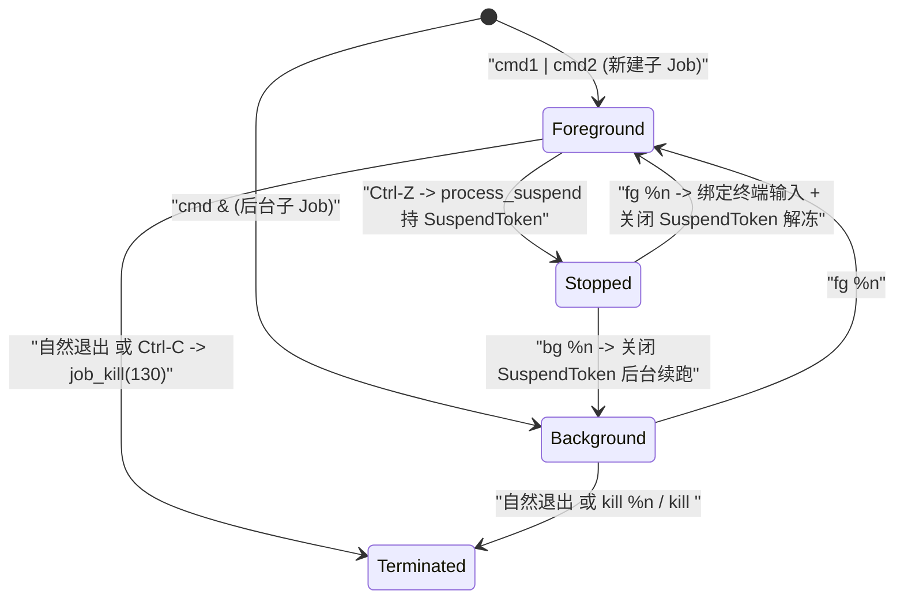

# bsh（现代能力感知交互式 Shell、脚本引擎与进程启动协议）总体设计

Type: spec
Status: active
Updated: 2026-11-18
Version: 1.1.0

一句话说明：`bsh` 3.0 是 BerryOS 的主力命令行交互外壳与系统脚本语言——以「`ProcessArgs v2` 全双工流式启动 + `berry-line` 二维 UTF-8 编辑器 + 完整词法/AST 脚本引擎 + 基于 `Job` 与 `SuspendToken` 的微内核原生作业控制 + 一行式 `sandbox` 能力裁剪」，在不引入 Unix `fork` 包袱的前提下交付超越传统 POSIX sh 的丝滑操控体验。

## 背景

[终端与命令行全栈体验深度体检报告](../../research/2026-11-18-终端与命令行全栈体验深度体检报告.md) N1–N4 与 S1–S6 指出：现役 `bsh` 外部命令无 `stdin` 且 `stdout` 必须等退出后整块打印，光标锁死行尾且历史仅 8 条，无引号/转义/`$()`/通配符与脚本控制流，内建命令不能进管道，缺少 `& / jobs / fg / bg / kill` 作业控制，且生产二进制混入逾三千行开机自测桩。依据 [终端优先全栈闭环架构六大核心裁决](../../notes/proposed/2026-11-18-终端优先全栈闭环架构六大核心裁决.md) 裁决二、三、四，本规格定义 `bsh` 3.0 与用户态标准进程启动契约。

## 范围

- **覆盖**：用户态进程启动协议 `ProcessArgs v2`（`berry-exec` v2 与 `berry-libc` 启动接力：`1MiB` 参数环境 VMO、类型化 `HandleEntry` 表、`stdin/stdout/stderr` 独立流与 `/svc` 继承）；行编辑库 `berry-line`（二维 UTF-8 光标编辑、4096 条持久化历史、`Ctrl-R` 搜索、语法高亮与上下文补全）；词法与语法引擎 `bsh-syntax`（引号、展开、重定向、混合管道、控制流、函数与脚本文件执行）；基于 `ObjType::Job` 与 `ObjType::SuspendToken` 的作业控制；能力沙箱内建命令 `sandbox`。
- **不覆盖**：底层伪终端环形缓冲与转义渲染（归 [pty 总体设计](../pty/design.md)）；外部独立生产力与诊断工具本体（归 [cli-suite 总体设计](../cli-suite/design.md)）。

## 契约

### 一、`ProcessArgs v2` 流式进程启动与三流分离契约

1. **退役 `ARGV_STR[256]` 与 `GIFT_H` 位置槽**：对齐底座重构规格，`berry-exec` 派生子进程时通过首条 `bootstrap` 消息移交只读 `ArgsVmo`（按需容量 `4KiB..=1MiB`，承载无截断 `argc/argv`、`envp` 与初始工作目录路径串）及类型化句柄表 `HandleEntry { kind: u16, arg: u16, handle: u32 }`（单次上限 32 项）：
   - `PA_FD (kind = 1, arg = fd)`：`arg = 0`（`stdin`）、`arg = 1`（`stdout`）、`arg = 2`（`stderr`）物理独立，支持任意额外打开文件描述符（`arg = 3..`）跨 `spawn` 显式传递；
   - `PA_PTY_CTL (kind = 2)`：关联终端的受限控制句柄（供 `isatty(fd)`、`tcgetattr/tcsetattr`、`ioctl(TIOCGWINSZ)` 消费）；
   - `PA_CWD_DIR (kind = 3)`：当前工作目录受控 `BerryFS` 目录会话句柄；
   - `PA_SVC_DIR (kind = 4)`：该子进程可见的 `/svc` 服务发现目录句柄；
   - `PA_SELF (kind = 5, arg = Proc | Vmar | Job)`：进程自描述句柄三件套（支撑 `pthread_create`、`mmap` 与子进程再派生）。
2. **全双工实时流式执行（根治 `run_output` 死寂与失聪）**：
   - 在交互终端直接执行外部命令（如 `bed main.sh`、`less /var/log/klog`、`ping 1.1.1.1`、`btop`）时，`bsh` 将当前终端的 `PtySlave` 读写句柄直接作为 `PA_FD(0/1/2)` 授予子进程，子进程敲键即收、产字即显，**零 `bsh` 中间拷贝、零退出前缓冲延迟**；
   - 在多段管道 `cmd1 | cmd2 | cmd3` 中，相邻段间绑定 `64KiB` 流式 `IoRing` / 通道对，全段并发启动、边产边消，上游写满自动背压睡眠；
   - **管道早退（`SIGPIPE -> 141`）与被杀 `EOF` 双向闭环**：当下游（如 `head -n 5`）读够提前退出关闭读端时，上游 `berry-libc` `write()` 收到 `BERRY_ERR_DEAD (-52)` 除设置 `errno = EPIPE` 外，若进程未显式设置 `signal(SIGPIPE, SIG_IGN)`，默认立即触发进程以退出码 `141`（`128 + SIGPIPE`）干净收敛，防止 `dmesg | head` 类上游无限空跑；反之当上游崩溃或被 `job_kill` 强杀时，内核 `Teardown-Before-Drain` 关闭写端句柄必定触发 `SIGNAL_PEER_CLOSED` 唤醒下游读者立即返回 `0 (EOF)`。
3. **相对/绝对路径直跑与跨卷 `$PATH` 搜索契约**：
   - 彻底废除旧版「命令名含 `/` 一律报 `127 not found` 且只查 `rootfs.cpio` `bin/`」的限制：凡首词含 `/`（如 `./build.sh`、`../tools/check`、`/userdata/home/bin/my_cli`），直接基于 `PA_CWD_DIR` 或根挂载视图解析目标文件并校验可执行位；
   - 不含 `/` 的外部命令依次检索函数表 → 内建表 → 按 `:` 分隔遍历环境变量 `$PATH`（默认 `/userdata/home/bin:/bin`），无缝跨越可写持久化 `BerryFS` 与只读 `BerryROFS` 拉起 ELF 二进制或 `#! /bin/bsh` 脚本。

### 二、`berry-line`：现代 UTF-8 多行交互编辑器与智能补全契约

1. **全光标与多行编辑**：复用 `faces/utf8width` 单源字素簇（Grapheme）宽度表（ASCII 1 列、CJK 宽字符 2 列，与 `berry-vt` 逐格同源对齐），提供自由光标移动（`Left/Right`、`Ctrl-Left/Right` 按词跳、`Home/Ctrl-A`、`End/Ctrl-E`）、行中插入与删除（`Backspace`、`Delete/Ctrl-D`）、剪切环（`Ctrl-K` 删至行尾、`Ctrl-U` 删至行首、`Ctrl-W` 删前词、`Ctrl-Y` 粘贴）、清屏重绘（`Ctrl-L`）、括号粘贴安全收容以及未闭合引号/管道/代码块自动折入次行续写（提示符切换 `... > `）。
2. **持久化历史与实时检索**：默认保留 `4096` 条去重历史并原子追加落盘至 `/userdata/home/.bsh_history`；输入前缀后按 `Up/Down` 自动按当前前缀过滤历史，按 `Ctrl-R` 进入交互式反向子串/模糊匹配搜索预览。
3. **实时语法提示与多维 Tab 补全**：敲击过程中实时以颜色区分合法命令/内建（绿色）、不存在的命令（红色）、字符串字面量（黄色）与选项旗标（青色）；`Tab` 补全引擎覆盖命令名（内建 + 函数 + `/bin` + `$PATH`）、文件路径（自动转义空格并补目录 `/`）、`$VAR` 环境变量名以及核心命令（`berryctl`、`sandbox`、`ip`、`bdbg`）的子命令与 `--flag` 候选网格展示。

### 三、`bsh-syntax`：词法、AST、展开与脚本语言契约

1. **严格分层管线（拒绝展开后二次语法注入）**：严格执行「词法切分（Lexer）→ 递归下降构建 AST（Parser）→ 作用域求值与安全展开（Expander）→ 流拓扑装配执行（Executor）」，变量值展开后仅作字面数据或受控分词，**永不当作语法操作符二次解析**：
   - **引用与转义**：单引号 `'...'` 全字面保留；双引号 `"..."` 允许 `$VAR`、`${...}`、`$(...)`、`$((...))` 与 `\" \\ \$` 转义且禁止分词与通配符展开；反斜杠 `\` 单字符转义。
   - **参数、命令替换与算术展开**：支持 `$?`、`$$`、`$!`、`$#`、`$@`、`$*`、`$0..$9`；支持 `${VAR:-default}`、`${VAR:=default}`、`${#VAR}`、`${VAR#prefix}`、`${VAR%suffix}`；支持嵌套 `$(cmd)` 命令替换与 64 位有符号整数 `$(( expr ))` 算术运算（四则、位运算、比较、逻辑短路）。
   - **路径通配符（Globbing）**：未加引号词段支持 `*`、`?`、`[a-z]`、`[!0-9]` 目录匹配（零命中按默认保留原字面词或受 `set -o nullglob` 控制）。
   - **完整重定向与混合管道**：支持 `< file` 输入、`> file` 覆写、`>> file` 原子追加（经 `BerryFS` `O_APPEND` 游标直写，废除旧版整文件读改写）、`2> file` 错误流分离、`2>&1` 与 `&> file` 合流、`<<< "str"` Here-String 与 `<<EOF ... EOF` Here-Doc；**内建命令、Shell 函数与子代码块 `{ ...; }` 可出现在管道任意位置**（在 Shell 内部以独立工作线程或子会话流式泵送，如 `dmesg | grep -i fault | less`、`history | tail -n 20` 原生畅通）。
2. **结构化脚本控制流与配置文件**：
   - 原生支持 `if ...; then ...; elif ...; else ...; fi`、`for x in ...; do ...; done`、`while ...; do ...; done`、`until`、`break`/`continue`、`case ... in pat) ... ;; esac`、`fn name() { ... }`（兼容 POSIX `name() { ... }`）与 `local` 局部变量、`set -euo pipefail` 严格脚本模式以及 `trap 'cleanup' EXIT INT` 退出钩子；
   - `berry-exec` 支持解析脚本首行 `#! /bin/bsh` Shebang 自动委托 `/bin/bsh` 执行；登录会话依次加载只读系统配置 `/etc/profile` 与用户持久化配置 `/userdata/home/.bshrc`。
   - 原 `bsh/src/main.rs` 内嵌的开机自测代码彻底剥离为独立 `/bin/bsh-selftest` 二进制，使生产 `bsh` 冷启动耗时降至 `< 2ms`。

### 四、微内核原生作业控制（`Job + SuspendToken`）与 `sandbox` 能力裁剪契约

1. **一管道一 `Job` 树（零孤儿泄漏）**：每次启动外部命令或管道，`bsh` 在自身会话 `Job` 下创建一枚专属子 `Job`（`job_create`），管道内所有进程及它们继续派生的孙进程天然受该子 `Job` 统辖：
   - **`Ctrl-C` 瞬时净杀**：前台等待收到 `PtyEvent::Intr` 时，对当前前台 `Job` 调用 `job_kill(130)`，内核原子清剿整棵管道进程树与孙进程，零残留后台野进程；
   - **`Ctrl-Z` 零信号挂起恢复**：收到 `PtyEvent::Susp` 时，对前台 `Job` 内进程获取 `SuspendToken`（`0x3E`），目标全部线程在内核同步停稳后 `bsh` 立即收回终端控制权并打印 `[1]+ Stopped   cmd`；执行 `fg %1` 或 `bg %1` 时仅需关闭 `SuspendToken` 句柄，目标作业零上下文破坏瞬间恢复执行；
   - 配套完整内建：`jobs [-l]`、`fg [%n]`、`bg [%n]`、`wait [%n | jid]`、`kill [-9 | -TERM] <%n | pid | jid>`。
2. **微内核独门武器：`sandbox` 内建能力裁剪器**：
   - 语法：`sandbox [--no-net] [--allow-svc proc,fs] [--ro <dir>] [--rw <dir>] [--mem <MiB>] [--procs <N>] -- <cmd> [args...]`；
   - 机制：无需 root 权限、无需复杂 Linux Namespace/Seccomp 配置，`bsh` 直接在用户态创建受 `job_set_policy(ram_quota, max_procs)` 硬配额约束的子 `Job`，并向子进程的 `PA_SVC_DIR` 与 `PA_CWD_DIR` 仅注入白名单内的只读/读写子目录能力句柄（未列出的 `/svc/net` 等物理缺席），在命令行上用一行命令实现数学级不可逃逸沙箱执行。

## 验收标准

1. **流式交互与大参数门禁**：在 `bsh>` 下直接运行交互式程序（实时回显按键并持续每秒刷新输出），首字节显示延迟 `< 5ms`；单条命令传递 `1,000` 个参数（总长 `64KiB`）给外部命令完整无截断；`dmesg | grep boot | wc -l` 等内建与外部混合三段管道 100% 通过。
2. **词法语法与脚本完备门禁**：宿主机 `bsh-syntax` 纯核测试套件覆盖 300+ 条引号嵌套、参数展开、算术、重定向、函数递归、`set -euo pipefail` 与畸形语法负例 100% 全绿，且展开值内含 `| ; && > $(...)` 字符时 `0%` 语法注入执行。
3. **作业控制与零泄漏压测门禁**：在 `bsh` 脚本中循环执行 `1,000` 次「三段管道启动 + `Ctrl-Z` 挂起 + `bg` 恢复 + `kill` 终止」，全程空闲物理帧与内核句柄数在首轮后严格零净减（`0` 泄漏）。
4. **`sandbox` 最小特权执法门禁**：执行 `sandbox --no-net --mem 8M --ro /userdata/work -- sh test.sh`，脚本内尝试发起网络连接返回 `-ENOENT / -EACCES`、尝试写入 `/userdata/work` 返回 `-EROFS`、尝试分配 `16MiB` 内存立即被内核 `Job` 硬配额拦截返回 `-ENOMEM` 而宿主 `bsh` 毫发无损。

## 适用边界

- `bsh` 3.0 兼容高频 POSIX sh 核心语法习惯以复用开发者肌肉记忆，但明文不实现 Bash 历史糟粕特性（如动态作用域关联数组 `declare -A`、进程替换 `<(...)` 的 `/dev/fd` 魔术路径及依赖 `fork` 写时复制隐式共享局部状态的冷门边角）。
