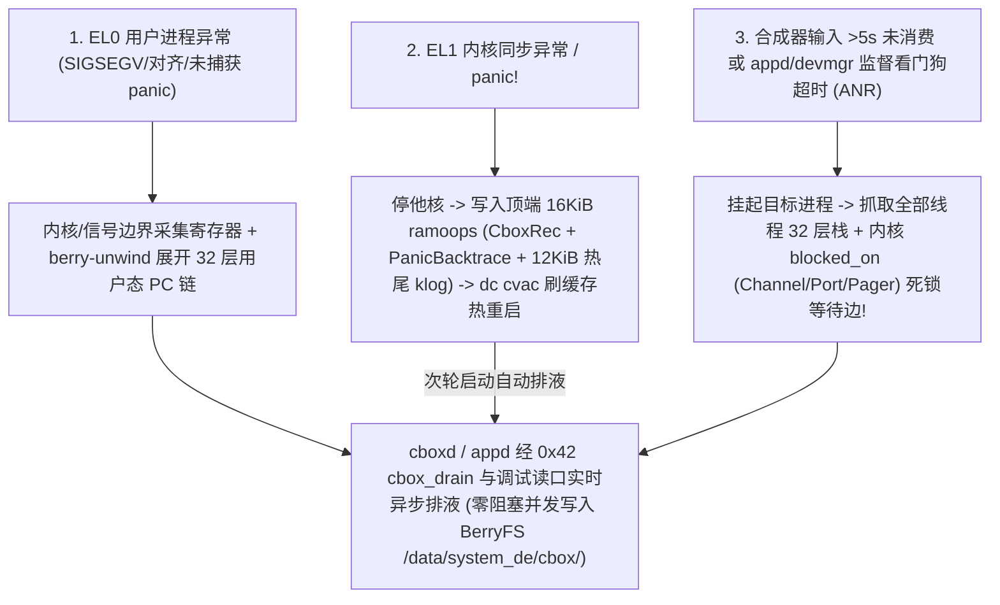

# cbox（全栈崩溃黑匣子、跨热重启内核遗言与 ANR 死锁取证账本）总体设计

Type: spec
Status: active
Updated: 2026-11-18
Version: 2.0.0

一句话说明：`cbox`（由内核无锁异常记录与 16KiB `ramoops` 持久内存区、用户态诊断聚合守护模块、`.eh_frame` 符号化栈展开链及宿主 `berry crash-log` 分析套件组成）是 BerryOS 的故障法医中枢——全面打通「EL0 应用崩溃 + EL1 内核 Panic 跨重启存活 + 应用/服务 ANR 无响应死锁全栈抓栈」三大现场，彻底告别早期 FAT12 单客户端串行写文件妥协。

## 背景

本模块 v0.5.1 阶段已落地 `0x42 cbox_drain` 快照排液口、104B `CboxRec` 记录头与基础 `berry crash-log` 工具。但如 [全栈 25 模块跨界接缝与深水区六盲点复核审计](../../research/2026-11-18-全栈25模块跨界接缝与深水区六盲点复核审计.md) 所示，v0.5 版存在四大历史局限：① 持久化层受困于旧 FAT12 单会话串行协议，不得不依赖「最后一个应用退出才敢写 `CBOX.LOG`」的脆弱窗口锁；② 仅存单层 `PC + LR` 寄存器，缺乏多层调用栈与内联函数还原；③ EL1 内核 Panic 掉入停机后无法落盘留存；④ **完全缺失 ANR（Application Not Responding，主线程卡死/跨进程死锁）自动调用栈抓取能力**。本 2.0.0 版合流 [hal 总体设计](../hal/design.md) `ramoops`、[storage-image 总体设计](../storage-image/design.md) `BerryFS` 与 [devtools 总体设计](../devtools/design.md) `berry-unwind`，确立终态全栈故障取证契约。

## 范围

- **覆盖**：内核 `ramoops` 16KiB 物理保留区双模记录（EL0 进程同步异常崩溃 + EL1 内核 Panic 32 层栈回溯与热尾内核日志跨热重启存活）；**UI 主线程与关键服务 ANR（无响应/死锁）实时全线程 `.eh_frame` 调用栈与 IPC `PiEdge` 等待链无锁快照**；基于 `BerryFS` 独立并发会话的结构化防篡改诊断仓 `/data/system_de/cbox/`（彻底废除 FAT12 三窗互斥锁）；基于 Build-ID 与 `.bsym` 调试符号包的离线/宿主精确内联帧符号化、故障指纹聚类与责任定界（应用代码 vs SDK vs 系统服务 vs 内核）。
- **不覆盖**：开发态挂载交互式断点单步修改变量（归 [devtools 总体设计](../devtools/design.md) `berry debug`）。

## 契约

### 一、三类全覆盖故障捕获源（EL0 Crash / EL1 Panic / ANR Freeze）契约

1. **升级版崩溃记录结构（`CboxRec v2`，向后兼容 `0x42 cbox_drain` 头部探测）**：在原 104B 核心寄存器集（`pc`、`lr`、`sp`、`far`、`esr`、`x19..x21`、`vct`、`task`）尾部扩展携带：`build_id: [u8; 16]`（精确匹配编译产物 ELF）、`aslr_load_bias: u64`（PIE 随机化基址偏移，供离线符号化精准扣减还原静态虚拟地址！）、`fault_kind: u8`（`EL0_FAULT = 1`、`EL1_PANIC = 2`、`ANR_INPUT_TIMEOUT = 3`、`ANR_LIFECYCLE_TIMEOUT = 4`、`WATCHDOG_SVC_HANG = 5`）以及最多 `32` 层紧凑调用栈返回地址数组 `frames: [u64; 32]`。
2. **ANR（无响应与跨进程死锁）精准解剖机制**：
   - **触发器**：当 [compositor 总体设计](../compositor/design.md) 向焦点窗口派发按键/触控事件后 **5.0 秒**未收到消费回执（或窗口弹出系统「等待 / 关闭应用」提示框），或 `appd` 生命周期指令超时；
   - **跨进程顺藤摸瓜抓真凶**：监督器瞬时冻结目标进程，利用 `berry-unwind` 读取其主线程与全部工作线程的 `.eh_frame` 调用栈；**更进一步，若主线程正阻塞于 `channel_call(svc_A)`，内核沿 [ipc 总体设计](../ipc/design.md) 的 `blocked_on: PiEdge` 等待链自动追加被等待服务端 `svc_A` 执行线程的当前调用栈（最多追查 4 跳）**——一眼看穿到底是应用自己死循环，还是底层某个系统服务卡死连累了应用！

### 二、`BerryFS` 多会话并发持久化与隐私脱敏契约

1. **彻底淘汰 FAT12 单客户端排液妥协**：由于 `BerryFS` 原生支持多客户端独立 `Port` 会话与崩溃原子提交，任何时刻发生崩溃或 ANR，`appd` 诊断协程立即以追加只写句柄落盘至设备级直通加密目录 `/data/system_de/cbox/yyyy-mm-dd-<seq>-<fingerprint>.cbox`（驻留 DE 层确保即使开机锁屏前发生系统服务崩溃也能完整落盘，且受 [recovery 总体设计](../recovery/design.md) 救援模式导出支持）。
2. **环形空间配额与零隐私泄露**：诊断仓总体积硬帽设为 `16MiB`（单报告压缩后约 `2–8KiB`，可存数千份历史现场，超帽自动按时间与低频优先淘汰，同指纹高频重复崩溃仅递增计数与更新首末时间戳并保留首份与最新份详单）；报告严格只采指令指针 `PC`、偏移量、内核错误码与锁等待拓扑，**绝不转储用户堆内存中的明文字符串、密钥或聊天内容**。

### 三、Build-ID 精确内联符号化与智能归因（`berry crash-log` v2）契约

1. **PIE 重定位与内联函数全展开**：构建系统 `berry-xtask` 编译任何内核、服务或 `.bap` 应用时嵌入唯一 128-bit `GNU Build-ID`，并将未剥离完整 DWARF 符号归档至宿主符号库 `.berry-syms/<build-id>.bsym`。执行 `berry crash-log` 时，工具自动执行 `static_pc = rec.pc - rec.aslr_load_bias` 并匹配对应 `Build-ID` 符号表，将每一层地址精确还原为含多层 `#[inline]` 内联展开的 `crate::module::function (src/foo.rs:128:17)`。
2. **自动责任定界（Fault Blame Attribution）**：解析器自栈顶向下扫描首个非 `berry-libc::abort/panic` 帧，自动给每起故障打上权威归属标签：`Blame::AppCode(<pkg_id>)`、`Blame::SdkFramework(berry-ui)`、`Blame::SystemService(<svc_name>)` 或 `Blame::KernelMeihe`，直接生成结构化 JSON 与可读 Markdown 诊断单。

## 验收标准

1. **PIE ASLR + 内联符号化 100% 还原门禁**：开启随机化基址装载（ASLR）编译一个三层 `#[inline(always)]` 嵌套后故意解引用空指针的测试应用，触发崩溃后执行 `berry crash-log`，100% 准确输出最内层内联函数名与精确源码行号。
2. **跨进程死锁 ANR 顺藤摸瓜验证**：构造测试应用主线程调用模拟慢服务 B，而服务 B 故意死锁在内部互斥量上；5 秒后触发 ANR 报告，验证生成的 `.cbox` 报告同时包含测试应用主线程栈与服务 B 死锁持锁线程栈，并正确将责任定界为 `Blame::SystemService(mock_svc_b)`。
3. **高并发崩溃风暴零丢单门禁**：10 个测试子进程在同一毫秒并发触发异常退出同时后台另一应用正在满速读写 `BerryFS` 文件，10 条崩溃记录 100% 独立落盘成功、零串包、零损坏在写用户文件。

## 适用边界

- 完整数十 MB 用户态核心内存转储（Full Core Dump）默认关闭以保护闪存寿命与用户隐私；仅对本地开发态标记 `debuggable = true` 的应用可通过 `berry debug --coredump` 显式按需拉取至开发宿主机内存。
