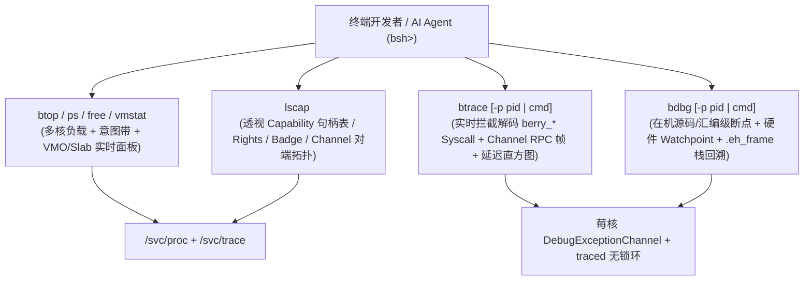

# cli-suite（终端生产力套件、微内核内省诊断与网络命令行工具链）总体设计

Type: spec
Status: active
Updated: 2026-11-18
Version: 1.2.0

一句话说明：`cli-suite` 定义 BerryOS 在纯命令行环境下的完整自给工具链——涵盖 `/svc` 能力服务发现与虚拟挂载层级、全屏编辑器 `bed` 与零拷贝分页器 `less`、微内核独有能力/IPC/源码级在机调试套件（`btop / lscap / btrace / bdbg / cboxctl`）、网络与免重启传文件套件（`ip / ping / dig / nc / curl / bscp / bsshd`）以及全工具统一的 `--json` 机器可读输出契约。

## 背景

[终端与命令行全栈体验深度体检报告](../../research/2026-11-18-终端与命令行全栈体验深度体检报告.md) N2、N5 与 U1–U5 揭示：现役系统因缺少 `/svc` 服务发现使 `ps` 与 `berryctl` 在交互终端手敲即报 `no svcmgr gift` 失败；系统内既无全屏编辑器与分页器，也无 `free / top / lscap / btrace / bdbg` 在机观测与现场断点排障工具，更缺日常网络诊断与主客机直传文件命令。依据 [终端优先全栈闭环架构六大核心裁决](../../notes/proposed/2026-11-18-终端优先全栈闭环架构六大核心裁决.md) 裁决三、五、六，本规格定义让用户在纯终端下「能写、能管、能联网、能调试一切」的完整命令行生态契约。

## 范围

- **覆盖**：`/svc` 能力服务目录路由协议（`berry-svc`）与标准虚拟文件系统挂载树（`/`、`/bin`、`/etc`、`/tmp`、`/userdata`、`/dev`）；终端生产力工具（全屏编辑器 `bed`、零拷贝分页器 `less`、主客机文件收发 `bscp`）；系统管理与微内核内省诊断套件（`ps`、`btop`、`free`、`vmstat`、`iostat`、`df`、`mount`、`sync`、`lscap`、`btrace`、`bdbg`、`dmesg`、`cboxctl`、`berryctl` v2）；网络与远程会话套件（`ip`、`ping`、`dig`、`nc`、`curl`、`bsshd`）；全命令统一的退出码与 `--json` 结构化契约。
- **不覆盖**：宿主机侧 GUI 检视器与宿主机侧重型 DWARF 火焰图生成（归 [devtools 总体设计](../devtools/design.md)，本模块 `bdbg / btrace` 与其共享内核 `DebugExceptionChannel`、`berry-unwind` 与 `traced` 底座）；底层 `BerryROFS / BerryFS` 盘上树结构（归 [storage-image 总体设计](../storage-image/design.md)）；底层 TLS 1.3 与双栈协议引擎（归 [net-conn 总体设计](../net-conn/design.md)）。

## 契约

### 一、`/svc` 能力服务发现与统一文件系统视图契约

1. **`ServiceDir` 能力寻址（根治 `no svcmgr gift`）**：
   - `rootmgr` 维护只读受控能力目录 `/svc`，交互式登录会话默认经 `PA_SVC_DIR` 获得标准交互服务集句柄；任何客户端调用 `berry_svc::connect("/svc/<name>")` 发送 `SVC_OPEN(name, flags)`，目标守护进程当场创建一枚**每客户端独占会话 `Channel`**（绑定至服务端 `Port`）交回客户端，彻底消灭多进程抢同一共享客户端端点的竞态与一次性 `gift` 断链：
   - 标准服务注册表：`/svc/proc`（进程/Job/内存/能力快照查询与管理）、`/svc/fs`（VFS 根挂载会话）、`/svc/net`（`netd` 套接字工厂）、`/svc/pty`（`ptyd` 伪终端分配）、`/svc/trace`（`traced` 追踪环与 `klog` 实时订阅）、`/svc/power`（电源状态、重启与 `PSCI` 关机）、`/svc/cbox`（崩溃账本与 `ramoops` 读取）、`/svc/debug`（受 `dev` 解锁或 `debuggable` 门控的 `ProcessDebugCap` 签发口）。
2. **清晰统一的终端目录树契约（对齐全系统存储总纲）**：
   - `/` 与 `/bin`、`/etc`、`/lib`：挂载只读按需调页 `BerryROFS`；
   - `/data/system_de/log/`：挂载写时复制崩溃原子 `BerryFS` 设备级加密（DE）系统持久日志目录；
   - `/userdata/home`（默认交互 `$HOME`）：挂载 `BerryFS` 命令行工作区，配置文件（`.bshrc`）、历史记录（`.bsh_history`）、个人可执行目录（`bin/`）与编辑器崩溃恢复目录（`.cache/bed/`）跨掉电重启持久留存；
   - `/tmp` 与 `/run`：挂载弹性可回收 `tmpfs`；
   - `/dev`：用户态虚拟设备节点——`/dev/null`、`/dev/zero`、`/dev/urandom`（对接硬件 CSPRNG）、`/dev/tty`（当前进程 `PA_PTY_CTL` 投影）、`/dev/kmsg`（只读内核日志流）。

### 二、终端生产力三件套（`bed`、`less`、`bscp`）契约

1. **`bed`：轻量全屏 UTF-8 文本与代码编辑器**：
   - 基于 [pty 总体设计](../pty/design.md) 的 `berry-vt` 网格、共享 `faces/utf8width` 宽字符核与备用屏幕缓冲构建，纯 Rust 零外部 C 依赖，二进制体积 `< 120KiB`；
   - **双模友好**：默认提供直觉无模式快捷键（`Ctrl-S` 原子保存、`Ctrl-Q` 退出未存二次确认、`Ctrl-F` 增量正则查找、`Ctrl-H` 交互替换、`Ctrl-G` 跳行、`Ctrl-Z / Ctrl-Y` 无限持久撤销重做树、`Tab / Shift-Tab` 块缩进），同时支持一键开启 `--vi` 模态键位（`Normal / Insert / Visual / :w :q :s`）照顾资深系统工程师肌肉记忆；
   - **大文件与防丢稿保障**：采用 Rope / Piece-Table 内存结构，毫秒级打开 `10MiB` 源码或日志；内置 Rust、Shell（`.sh`）、TOML、JSON、C 词法着色与行号标尺；编辑期间每 5 秒将增量日志写入 `/userdata/home/.cache/bed/<hash>.swp`，即使进程被强杀或断电重启，`bed -r` 亦可零字节丢失恢复草稿；同时 `bed` 与 `bmux` 选中复制时默认同步发射 OSC 52（`\x1b]52;c;<base64>\x07`）序列，一键直通宿主机系统剪贴板。
2. **`less`：零拷贝大文件分页与实时追尾器**：
   - 对普通文件直接映射只读 VMO（无需将整份数千万行日志读入堆内存，打开耗时 `O(1)`），对管道 `stdin` 采用分块增量流式缓存；
   - 支持 `j/k/Up/Down` 逐行、`Space/b/PgDn/PgUp` 翻页、`g/G` 首尾跳转、`/pattern` 与 `?pattern` 正向反向高亮正则搜索（`n/N` 跳转）、以及 **`F` 键实时追尾模式**（等价 `tail -f`，按 `Ctrl-C` 随时退回静态翻阅而不退出分页器）。
3. **`bscp`：免重打镜像的主客机极速文件互传工具**：
   - 在网络未配通或纯串口联调场景下，支持经 `berry console` 复用帧通道（或经 TCP 网络通道）执行 `berry push local.sh /userdata/home/` 与客机内 `bscp pull/push`，内置 4KiB 分块 CRC32C 校验与断点续传，开发者在宿主机改完脚本或测试二进制 0.2 秒即可推进客机运行，无需重启虚拟机。

### 三、微内核内省、系统监控与在机交互调试套件契约

1. **资源与进程全景监控（`ps`、`btop`、`free`、`vmstat`、`iostat`、`df`）**：
   - `ps [-ef | --tree | --json]`：树状展示 `Job -> Process -> Thread` 层级、PID/TID、状态（`Run/Sleep/Frozen/Dead`）、调度意图带（`Critical/Interactive/Fair/Batch`）、CPU 占用率、物理常驻内存（RSS）与启动命令行；
   - `free [-h | --json]`：精确展示物理总帧、Buddy 空闲帧、Slab 缓存、VMO 匿名页、可丢弃缓存页（`Discardable`）与内核栈水位（由内核 `MemstatRec` 单一事实源导出）；
   - `btop`：全屏交互式监控仪，顶部绘出 16 核独立利用率条与频率/热状态、中部展示内存与块/网吞吐曲线、底部进程表支持按 CPU/内存/IPC 频率排序，并支持按 `k` 终止、`z` 冻结/解冻、`i` 直接下钻打开该进程的 `lscap` 能力详情页。
2. **微内核独有能力拓扑透视镜（`lscap`）**：
   - 传统 `lsof` 只能看文件描述符，而 `lscap [<pid> | --all | --graph] [--json]` 直接导出目标进程的微内核能力真相：槽位号、代数（`gen`）、对象类型（`Channel / Port / VMO / Vmar / Process / Thread / Job / Interrupt / SuspendToken`）、64 位 `Rights` 助记符、内联 `Badge`、内核对象 Koid 以及 **Channel 对端归属进程与队列积压深度**——排查死锁（「A 在等哪个服务回包？句柄有没有漏 `RIGHT_WRITE`？」）一眼定谳。
3. **在机实时系统调用与 IPC 协议解码器（`btrace`）**：
   - 支持 `btrace <cmd>` 或 `btrace -p <pid> [-e ipc,vm,sched] [-c]`：在纯终端内实时打印目标进程每一次 `berry_*` 系统调用名、符号化参数与错误码（如 `BERRY_ERR_DEAD (-52)`、`EACCES`），并内置 `fsproto / netdproto / svcproto / ptyproto` 消息头自动反序列化器，直接把枯燥的二进制字节流翻译成可读的 `SVC_OPEN("/svc/net") -> Ok(handle=7)`；`-c` 模式在退出时汇总打印调用次数、错误数与 p50/p99 微秒级耗时表。
4. **在机命令行交互式调试器（`bdbg`）与崩溃取证（`cboxctl`、`dmesg`）**：
   - 当手头没有宿主机 IDE/LLDB，仅连着一条串口线时，在终端直接运行 `bdbg /bin/my_srv` 或 `bdbg -p <pid>`（凭 `/svc/debug` 签发 `ProcessDebugCap`）：支持 `break <addr | sym>`（软件断点）、`watch <addr> [r|w|rw]`（硬件数据观察点，抓内存踩坏）、`step / next / continue`、`regs`（全套 `x0..x30, sp, pc, esr, far`）、`bt`（调用 `berry-unwind` 解析 `.eh_frame` + ELF `.symtab` 在机直接打印符号化调用栈！）、`x/16gx <addr>`（受控安全读目标 VMO 内存）与 `threads` 多线程切换；
   - `dmesg [-w | -c | -l warn,err | --json]`：读取并支持 `-w` 持续流式跟随内核与守护进程环形日志；
   - `cboxctl [list | show <seq> | ramoops | clear] [--json]`：在机直接读取解码 `CBOX.LOG` 历史崩溃账本与跨热复位存活的 `16KiB ramoops` 内核 Panic 遗言，结合机内轻量符号表当场定位崩溃函数偏移。

### 四、网络诊断与加密远程终端套件契约

1. **全套命令行网络瑞士军刀**：对接 [net-conn 总体设计](../net-conn/design.md) `netd` 2.0 与 `berry-netsec`：
   - `ip [addr | route | neigh | stats] [--json]`：查看与配置双栈网卡地址、路由表及丢包/重传计数；
   - `ping [-c N] [-6] <host>`：ICMPv4/v6 连通性与毫秒级 RTT 抖动统计（支持 `Ctrl-C` 实时打印汇总统计行）；
   - `dig <domain> [@server] [+doh]`：明文 DNS 与加密 DoH/DoT 解析诊断；
   - `nc [-l] [-u] [-tls] <host> <port>`：任意 TCP / UDP / TLS 1.3 端口读写探测与回显调试；
   - `curl [-I] [-L] [-X METHOD] [-d DATA] [-H HEADER] [-o file] <url>`：支持 `http://` 与真实公网 `https://`（TLS 1.3 + 系统根证书校验）流式请求与文件下载。
2. **远程加密多路终端守护进程（`bsshd`）**：
   - 以不足 2,000 行纯 Rust 基于 `berry-netsec`（双向 Ed25519 公钥认证 + TLS 1.3 / QUIC 加密流）与 `ptyd` 实现轻量安全远程 Shell 服务：支持多客户端并发登录开启独立 `bsh` 会话、窗口缩放同步、`bscp` 加密文件收发与单命令远程执行（`berry ssh root@<ip> "btop --json"`），彻底摆脱串口单线束缚。

### 五、系统服务、包管理、归档校验、外设电源与内核白盒运维套件契约

为保证纯命令行环境下不留任何系统管理盲区，补齐以下四组运维控制命令（全部支持 `--json`）：

1. **守护进程与软件包管理（`svcctl`、`pkg`）**：
   - `svcctl [list | status | start | stop | restart] [<svc>] [--json]`：经 `/svc/proc` 对接 `rootmgr` 查询各系统守护进程健康状态、重启代数、所属 `Job` 配额并执行受控启停重启；
   - `pkg [list | info | install | remove | verify] <file.bap | app_id> [--json]`：经 `/svc/pkg` 对接 [pkgmgr 总体设计](../pkgmgr/design.md)，在纯终端内直接完成 `.bap` 包流式 Merkle 验签安装、查询与零残留卸载。
2. **流式归档压缩与完整性校验（`tar`、`zstd`、`sha256sum`）**：
   - 纯 Rust 流式实现标准 USTAR/PAX 归档 `tar`（`-c / -x / -t / -z`）、高吞吐 `zstd` 压缩解压与 `sha256sum`（复用 `berry-crypto` 硬件加速摘要），支撑日志打包外传与脚本产物完整性核验。
3. **外设中断、电源能耗与时钟管理（`lsdev`、`lsirq`、`powerctl`、`timedatectl`）**：
   - `lsdev [--json]` 与 `lsirq [--json]`：对接 `devmgr` 列出已枚举的 DTB/PCIe/VirtIO/USB 设备、SMMUv3 `Bti` 隔离域状态及每条 GIC Split-EOI 中断线的触发计数与绑定驱动进程；
   - `powerctl [off | reboot | suspend | battery | energy] [--json]`：对接 [power-thermal 总体设计](../power-thermal/design.md) `powerd` 触发 1 秒五阶段优雅关机/重启、S3 深睡或查询每服务能耗账本；
   - `timedatectl [status | set-tz <zone> | sync] [--json]`：对接 `timed` 查看与校准 RTC/NTS 壁钟及共享时区。
4. **内核白盒自检与锁/内存剖析（`kctl`）**：
   - `kctl [ktest [suite] | lockstat | slabinfo | buddyinfo] [--json]`：受 `dev` 调试能力门控，支持在机按需触发内核自检套件、导出八秩 `LockRank` 持锁争用统计以及 Buddy 阶分布与 Slab 每档弹匣碎片详情。
5. **会话身份、无 SUID 提权与机内离线文档（`whoami / id / elevate / man`）**：
   - `whoami` 与 `id [--json]`：实时展示当前终端会话绑定的用户 UID、会话等级（`Operator` 或 `Standard`）、所属 `Job` 配额与可见 `/svc` 能力集摘要；
   - `elevate <cmd> [args...]`：对接 [bsh 总体设计](../bsh/design.md) 无 SUID 提权协议，验证管理员凭据后向 `rootmgr` 申请干净环境单次受控管理会话；
   - `man [<section>] <topic>`：直接流式解压读取 `/usr/share/man/`（`BerryROFS` 只读内建，涵盖全部系统命令、内建语法与 `berry_*` 系统调用速查页）并交由 `less` 彩色高亮分页展示，使开发者在断网纯串口环境下亦可零障碍查阅全套手册。

### 六、全工具统一命令行人机工程与 `--json` 契约

1. **标准旗标三件套**：仓内所有自研 CLI 工具必须统一支持 `-h / --help`（零副作用打印用法退出 `0`）、`-V / --version`（打印 `.berryver` 构建号）与 `--json`（适用于一切查询、统计与诊断类工具）。
2. **`--json` 纯净流铁律**：一旦指定 `--json`，`stdout` **只允许输出严格合法的 UTF-8 JSON 对象或每行一条 JSONL**（字段遵循 add-only 兼容演进），一切人类提示、警告与报错一律走 `stderr`，配合统一退出码（`0` 成功 / `1` 一般错误 / `2` 参数用法错 / `77` 权限或能力不足 / `124` 超时 / `130` `Ctrl-C` 中断），让 Shell 脚本管道与 AI Agent 零正则解析即可精确操控整台操作系统。

## 验收标准

1. **交互自给闭环演练门禁**：在不依赖任何宿主机重编译与 GUI 的纯串口会话中，用户依次完成：`bmux` 分两窗 → 左窗用 `bed /userdata/home/check.sh` 编写一段含循环、管道、算术与 `curl` 请求的脚本并保存 → `chmod/bsh check.sh` 流式运行 → 右窗用 `btop` 与 `lscap` 实时观测该脚本子进程树的能力句柄与内存波动 → 用 `less` 检索输出日志，全程零报错、零花屏、断电重启后脚本与历史完整在位。
2. **在机现场排障演练门禁**：在机内故意运行一个带空指针解引用或死锁隐患的测试服务，仅在 `bsh>` 终端内使用 `lscap` 查明其阻塞的 Channel 对端、用 `btrace -p` 抓出卡住的 RPC 请求帧、用 `bdbg -p` 下断点并打印符号化 `bt` 调用栈、并在崩溃后用 `cboxctl` 读出完整故障记录，无需宿主机介入即可闭环定位根因。
3. **`--json` 机器契约门禁**：自动化测试遍历 `ps`、`free`、`df`、`lscap`、`btrace -c`、`cboxctl`、`ip`、`berryctl` 全部 `--json` 输出，100% 通过严格 JSON Schema 校验且 `stderr` 混入率为 `0`。

## 适用边界

- 客机内不预装重型 C/Rust 原生编译工具链（`clang / rustc / llvm`）与包体积数十 MB 的重型文本处理器；编译构建保持在宿主机经 `berry-xtask` + `bscp` 秒级推送热跑。
