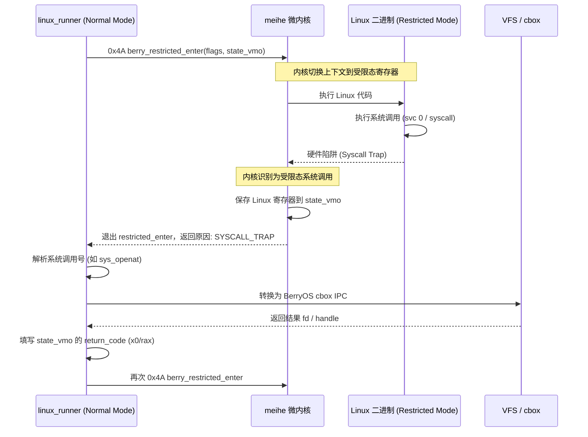

# compat（三级渐进式生态兼容层与 Linux 二进制仿真）总体设计

Type: spec
Status: active
Updated: 2026-11-18
Version: 1.0.0

## 1. 模块定位与职责边界

BerryOS Compat 是 BerryOS 连接已有开源生态（Linux / POSIX / Android）的兼容分级中枢。它在坚持原生 BerryOS 纯微内核（Capability-based）安全体系的前提下，提供「三级渐进式」兼容能力，实现常用开发工具（Node.js、Python、Git、GCC/Clang）、Linux GUI 应用及 Android/Linux 子系统的无缝接入，同时保持对原生桌面渲染管线与安全沙箱的无缝嵌入。

```
+-------------------------------------------------------------------------+
|                  BerryOS 桌面与窗口管理器 (Compositor / AM)               |
+-------------------------------------------------------------------------+
       ^ (Wayland / SharedSurface)              ^ (Native IPC / VMO)
       |                                        |
+-----------------------+              +-----------------------+
|  Tier 2: Starnix 运行体|              |  Tier 3: 极轻量微虚拟机 |
|   (Linux 二进制仿真)   |              |   (EL2/VT-x 硬件隔离)   |
| +-------------------+ |              | +-------------------+ |
| | linux_runner 进程 | |              | |  vmm 伴随守护进程  | |
| +-------------------+ |              | +-------------------+ |
|   ^ (Restricted)      |              |   ^ (VCPU Run)        |
|   v                   |              |   v                   |
| 目标 Linux ELF 二进制  |              | Guest Linux Kernel    |
+-----------------------+              +-----------------------+
       |                                        |
       +-------------------+--------------------+
                           |
                           v
+-------------------------------------------------------------------------+
|                      微内核 meihe (Syscall ABI v2)                      |
|   [0x4A] restricted_enter / [0x4B] restricted_kick                      |
|   [0x77] guest_create / [0x78] vcpu_create / [0x79] vcpu_run           |
+-------------------------------------------------------------------------+
```

### 职责边界划分
- **归属 Compat 的职责**：
  1. **Tier 1 (源码级 POSIX)**：向开发者提供标准 C 运行时（`berry-musl`），将 `open/read/write/poll` 转译为 BerryOS [cbox](../cbox/design.md) 通道与文件对象调用。
  2. **Tier 2 (二进制级用户态仿真)**：基于内核 `Restricted Mode` 原语，运行原生未经修改的 aarch64/x86-64 Linux ELF 二进制文件，由 `linux_runner` 捕获其 Linux Syscall 并仿真为 BerryOS 服务 IPC。
  3. **Tier 3 (硬件级极速 MicroVM)**：针对内核级驱动或复杂容器，基于 Hypervisor 原语启动轻量 Linux 客机（<15ms 冷启），通过 VirtIO 桥接显示、音频与网络。
  4. **窗口与桌面缝合**：将 Linux X11/Wayland 窗口无缝注入 BerryOS [compositor](../compositor/design.md)，享受原生圆角裁剪、阴影及手势交互，用户无感知系统差异。
- **严禁越界的范围**：
  1. 严禁在微内核中直接引入 Linux 内核驱动或宏内核模块。
  2. 严禁受限态（Restricted Mode）跨过 `linux_runner` 直接发起 BerryOS 特权系统调用。
  3. 严禁 Tier 2/Tier 3 实例穿透逃逸沙箱文件目录，所有存储访问均严格映射于 `/data/user/<uid>/compat/<app_id>/`。

## 2. 核心架构与数据流

### 2.1 Tier 2：受限态（Restricted Mode）Linux 仿真
利用硬件特权分层，BerryOS 线程可在普通用户态（Normal Mode，运行 `linux_runner`）与受限态（Restricted Mode，运行 Linux 目标程序）之间切换。



### 2.2 Tier 3：Hypervisor 极轻量微虚拟机
对不可仿真的复杂环境（如 Docker / GPU GPGPU / eBPF），通过 `0x77..0x79` 系统调用启动极简微虚拟机：
- 内存通过 `vmo_create` 分配并绑定客机物理地址映射（IPA）；
- 串口、时钟、中断控制器（GICv3 / APIC）由用户态 `vmm` 协同微内核分发；
- 图形协议：Wayland-proxy -> Virtio-GPU -> BerryOS `SharedSurface`，支持 Zero-copy 导入。

## 3. 接口契约与 ABI/IPC 定义

### 3.1 内核系统调用号位 (ABI v2 锁定)
与 [合龙总纲](../2026-11-18-全系统31模块终态合龙总纲与ABI号段总表.md) 保持一致：
- `0x4A`: `berry_restricted_enter(uint32_t flags, handle_t state_vmo, uint32_t *reason_out)`
- `0x4B`: `berry_restricted_kick(handle_t thread)`
- `0x77`: `berry_guest_create(handle_t resource, uint32_t flags, handle_t *guest_out)`
- `0x78`: `berry_vcpu_create(handle_t guest, uint32_t vcpu_id, handle_t *vcpu_out)`
- `0x79`: `berry_vcpu_run(handle_t vcpu, handle_t exit_state_vmo)`

### 3.2 寄存器上下文结构体 (`RestrictedState`)
```c
struct BerryRestrictedState {
    uint32_t arch_type;        // 1: x86-64, 2: aarch64, 3: riscv64
    uint32_t exit_reason;      // 0: SYSCALL, 1: EXCEPTION, 2: KICKED, 3: PAGE_FAULT
    uint64_t ip;               // 指令指针 (PC / RIP)
    uint64_t sp;               // 堆栈指针 (SP / RSP)
    uint64_t flags;            // PSTATE / RFLAGS
    uint64_t syscall_num;      // 捕获的系统调用号
    uint64_t args[6];          // 系统调用入参 (x0-x5 / rdi, rsi, rdx, r10, r8, r9)
    uint64_t ret_value;        // 仿真执行返回值
    uint8_t  simd_state[512];  // NEON / AVX 寄存器保留区
};
```

### 3.3 图形与输入桥接协议
Linux GUI 客户端通过 UNIX Domain Socket（仿真为 BerryOS `Channel`）连接 `compat-wayland-bridge`：
- `wl_compositor.create_surface` -> `compat` 对应向 BerryOS `compositor` 申请分配 `SurfaceId`；
- `wl_shm.create_pool` -> 映射底层 `vmo`，使用 `vmo_create_child` 共享给合成器；
- 键盘与手势输入：Compositor 将 `BerryInputEvent` 封包转换为标准 `wl_keyboard.key` 及 `wl_pointer.motion` 注入受限进程。

## 4. 故障模型、降级与安全边界

### 4.1 故障域隔离 (Fault Domains)
1. **Linux 进程崩溃 (SIGSEGV / Illegal Instruction)**：
   - 受限态发生非法内存访问时，内核触发 `PAGE_FAULT` 返回给 `linux_runner`。
   - `linux_runner` 仿真 Linux 信号处理；若未注册 Handler，仅终止该 Linux 进程，记录 Core Dump，完全不影响 BerryOS 宿主主线程及其他应用。
2. **死循环与拒绝服务**：
   - 当受限态执行密集死循环时，宿主主线程可通过 `0x4B berry_restricted_kick` 强制打断受限态执行，收回 CPU 控制权。
3. **系统调用未知号位 (ENOSYS)**：
   - 对于尚未仿真的罕见 Linux 系统调用，`linux_runner` 默认返回 `-ENOSYS`，并在控制台记录 `[compat-stub]` 警告，禁止崩溃宿主。

### 4.2 安全与沙箱防护
- **双重地址空间限制**：受限态代码的虚拟地址空间通过细粒度 VMAR 限制在 `0x00000000_00010000` 至 `0x00007FFF_FFFFFFFF`，严禁访问内核与 `linux_runner` 的特权高位地址。
- **Capability 严密包装**：受限态无法直接获得任何 Handle，所有句柄（FD）全在 `linux_runner` 用户态映射表中做代换与审计（防越权）。
- **文件沙箱根重定向**：根路径 `/` 映射为只读 BerryROFS 兼容基础镜像，写路径 `/tmp` 与 `/home` 强制重定向至私有沙箱隔离目录。

## 5. 落地步骤与验收指标

### 5.1 实施分波演进
1. **第一波（内核受限态原语）**：
   - 在 `meihe` 中完成 `0x4A/0x4B` 实现，打通 AArch64 / x86-64 寄存器保护与硬件陷阱返回；
   - 验证单线程 "Hello World" Linux ELF 正常执行与 `sys_write` 捕获。
2. **第二波（用户态 runner 与基础工具链）**：
   - 实现基础 80 个常用 Linux 系统调用（文件、进程、内存、网络）；
   - 跑通 BusyBox、Git、Python 3.12 解释器。
3. **第三波（Wayland 桥接与桌面合流）**：
   - 部署 `compat-wayland-bridge`，支持终端与开源 GUI 渲染；
   - 接入 [compositor](../compositor/design.md) 亚像素圆角与统一焦点调度。

### 5.2 商业化验收门禁
- **G-COMP-1（受限态往返开销）**：受限态进入与系统调用捕获往返延迟 $\le 85\text{ns}$（比常规 IPC 快一个数量级）。
- **G-COMP-2（POSIX 兼容度）**：常见 CLI 工具（Git / Python / Node.js）自动化测试用例通过率 $\ge 98\%$。
- **G-COMP-3（图形帧率与能耗）**：Tier 2 驱动的 Linux GUI 应用全屏渲染 60fps/120fps 无撕裂，CPU 开销相较原生开销增加 $\le 4\%$。
- **G-COMP-4（安全零逃逸）**：通过 500 项 Linux 提权 PoC 攻击注入，沙箱穿透率为 $0\%$。
