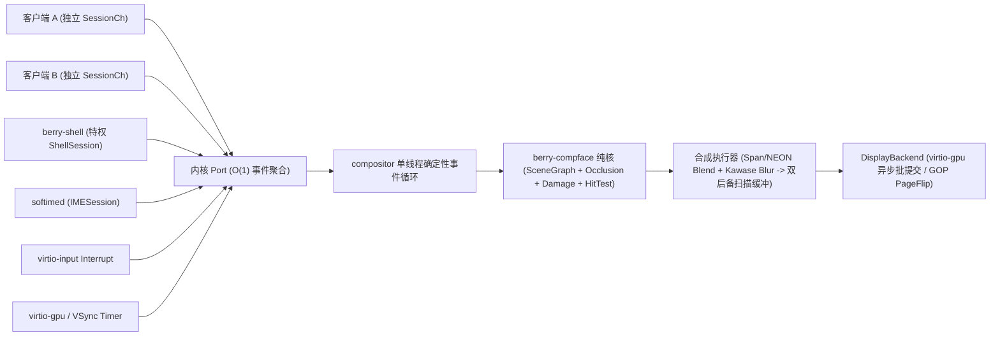

# compositor（显示服务与窗口合成器）总体设计

Type: spec
Status: active
Updated: 2026-11-18
Version: 2.0.0

一句话说明：`compositor`（`berry-compositor`）是 BerryOS 的统一显示呈现、离屏表面合成与输入焦点路由服务——合流并取代过渡期分离的 `guifbd` 与 `gui-wmd`，通过每客户端独立能力会话、双/三缓冲零拷贝交换链、8-bit 预乘 Alpha 与实时模糊场景图合成器以及内建手势/焦点路由器，兑现 60–480Hz 锁拍零撕裂多窗体验。

## 背景

如 [GUI 与 SDK 及启动模拟器全栈深研](../../research/2026-11-18-GUI与SDK及启动模拟器全栈深研.md) 所示，现役分离架构（`gui-wmd` 管几何表并单线程阻塞中继、`guifbd` 单帧缓冲直写加顶底带缓存重放）存在共享通道互截、每窗强制全屏 8.29MB 内存膨胀、无法支持浮窗移动与遮挡恢复、无窗口级转场动画、以及输入命中仅记账不路由等根本缺陷。依据 [图形合成与 SDK 及模拟器终态架构裁决](../../notes/proposed/2026-11-18-图形合成与SDK及模拟器终态架构裁决.md) 与底座 [微内核与全栈底座彻底重构规格](../2026-11-18-微内核与全栈底座彻底重构规格.md) 的 `Port` / `channel_call` / `Interrupt` 原语，本规格定义 `compositor` 的内部总体契约；跨模块公共标准见 [GUI 合成与 SDK 终态标准](../../../docs/GUI合成与SDK终态标准-v2.0.md)，刷新率仲裁与面板时序细则见 [刷新率体系规范](../../../docs/刷新率体系规范-v1.0.md)。

## 范围

- **覆盖**：`compositor` 单进程内部模块划分与纯算法 `*face` 抽离；基于内核 `Port` 的每客户端独立 `SurfaceSession` 生命周期与能力分级；每窗口 `Swapchain`（2–3 槽按需尺寸 VMO + 显式 `Acquire/Release Fence` + `UserRo` 持久映射）；六层场景图（`SceneGraph`）、2D 仿射/缩放变换、从前向后不透明区遮挡剔除、脏区增量合成、8-bit 预乘 Alpha 混合与 Dual-Kawase 背景模糊；硬件/虚拟显示后端（`virtio-gpu` 2D/Venus、线性 GOP/ramfb 回退、动态分辨率热切换与硬件光标面）；融合中断驱动输入源的命中测试、指针捕获、系统边缘手势拦截与焦点键盘/IME 路由。
- **不覆盖**：客户端进程内的控件树布局与 2D 图元光栅（归 [ui-sdk 总体设计](../ui-sdk/design.md)）；桌面图标网格、控制中心面板与多任务视图的业务 UI（归 [desktop-boot 总体设计](../desktop-boot/design.md)）；宿主机侧窗口与 `wgpu` 纹理上屏（归 [emulator 总体设计](../emulator/design.md)）。

## 契约

### 一、进程架构与无阻塞反应式主循环

1. **纯核分离纪律**：场景图拓扑、窗口避让 `Insets` 推导、从前向后遮挡剔除、脏区包络合并、输入命中与手势状态机 100% 抽入零系统调用的纯 `no_std` 库 `berry-compface`，宿主机单元测试与性质测试覆盖率达 100%；`berry-compositor` 二进制仅承载 `Port` I/O、VMO 映射、SIMD 像素合成与设备寄存器驱动。
2. **零阻塞不变量**：`compositor` 主循环仅阻塞于单一 `port_wait(main_port, next_deadline)`；严禁在处理任何客户端消息期间向任何外部进程发起同步 `channel_call` 或阻塞 `wait_one`。向客户端发送异步事件（`FrameTiming`、输入帧、`Configure`、`Back`）一律采用非阻塞发送：客户端输入/事件环满时合并最新 `Move`/`Configure` 状态位并记录遥测，对端异常滞死绝不拖慢全局 120Hz 合成拍点。

### 二、能力分级会话与异常自愈契约

1. **三类能力工厂端点**（由 `rootmgr` / `appd` 按 manifest 与组件身份经 `ProcessArgs v2` 授予，绝不共享客户端端点）：
   - `PA_COMP_APP`（普通应用会话）：调用 `CONNECT` 铸造专属 `SessionChannel` 挂入 `main_port`（`key = session_id`）。仅允许创建 `Layer::App` 及其子浮窗（`Popup`/`Subsurface`，受父窗裁剪或锚定），仅可操作自身 `owner == session_id` 的表面，越权操作一律返 `-EACCES`。
   - `PA_COMP_IME`（输入法专用会话，仅授 `softimed`）：允许创建单枚 `Layer::InputMethod` 表面，订阅当前焦点窗口的 `TextInputState` 并向当前焦点会话定向注入 `Preedit` / `Commit` 文本事件。
   - `PA_COMP_SHELL`（系统壳层特权会话，仅授 `berry-shell` 与早期 `bootsplashd`）：允许创建 `Layer::Wallpaper`、`Layer::SystemBar`、`Layer::Overlay`、`Layer::BootSplash` 表面，允许注册系统级全局手势区域，允许订阅脱敏窗口列表与只读引用窗口表面纹理（供多任务卡片实时渲染），允许驱动窗口级开闭/多任务过渡变换矩阵与发出焦点切换、`RequestBack`、`RequestClose` 指令。
2. **断连原子自愈**：任意客户端进程退出或崩溃触发内核置位 `SIGNAL_PEER_CLOSED`，`compositor` 在本拍立即解除该会话下全部窗口与交换链 `UserRo` 映射、关闭 VMO 句柄、将原窗口屏幕占区记入全局 `damage`、自动按 Z 序回退键盘焦点至下一可见顶层窗，并在配置了退出淡出动画时保留最后已提交帧执行 150ms 缩退动画后再释放物理页——全程零孤儿窗口、零句柄与内存泄漏。

### 三、按需尺寸交换链（Swapchain）与显式同步栅栏

1. **按窗口逻辑语义分配精确像素缓冲**：废除“所有客户端固定分配全屏 VMO”旧制。窗口缓冲宽高严格等于其当前 `Configure` 协商像素尺寸 `(buf_w, buf_h)`（如状态栏仅 `1080×117`、软键盘仅 `1080×720`、对话框仅 `840×540`）。
2. **双/三缓冲槽与显式 Fence 生命周期**：
   - 每个 `Surface` 关联一个最多 `3` 槽的 `Swapchain`（默认双缓冲 `N = 2`；高刷重负载应用可申请 `N = 3`）：客户端创建 VMO 后经 `ATTACH_BUFFER(slot, vmo_ro_dup, w, h, stride, format)` 注册，`compositor` 校验 `size >= stride * h` 及页对齐后，调用 `berry_vmar_map(..., UserRo)` 将其持久映射入合成器专用高区地址池（零每帧系统调用映射/解映射开销，零 `vmo_read` 弹舱拷贝）。
   - **提交与释放闭环**：客户端渲染完槽 `i` 后发送 `COMMIT { surface_id, slot: i, damage_rects, opaque_region, target_present_ns, release_event }`；`compositor` 在下一个目标 `latch` 拍点将槽 `i` 锁入当前场景树，同时将上一帧从场景树退下的旧槽 `j` 的 `release_event` 置位信号（客户端在另一槽并行渲染，无需串行空等合成结束）。
   - **后台冷内存弹性**：当窗口因全屏遮挡或切入后台进入不可见态时，`compositor` 通知客户端释放闲置备槽 VMO，并将保留快照槽标记 `VMO_OPT_DISCARDABLE`（配合 `appd` 墓碑快照），使后台静默应用的帧缓冲常驻内存压降至 `0` 字节。

### 四、六层场景图、遮挡剔除与高质量混合合成管线

1. **严格六层 Z 序模型**：由底向顶固定为 `Wallpaper(0) < App(1) < Floating(2, 含 PiP/自由小窗) < InputMethod(3) < SystemBar(4, 状态栏与手势条) < Overlay(5, 控制中心/通知横幅/系统模态框/BootSplash)`。同层内按活动栈序排列，子表面（`Popup`/`Tooltip`）严格依附父窗口层级与相对坐标。
2. **合成器侧零重绘几何变换**：每个 `SurfaceNode` 持有合成属性 `{ dst_rect, clip_rect, corner_radius_px, opacity: u8, scale_q16: (u32, u32), translate: (i32, i32), backdrop_blur_radius: u8, shadow_elevation: u8 }`。窗口打开图标展开、返回手势跟手缩小、多任务卡片排列与旋转切屏均只修改 `SurfaceNode` 合成属性，客户端无需重新光栅化内容。
3. **两遍无冗余合成算法（在每个 VSync `latch` 拍点执行）**：
   - **第一遍（自顶向下遮挡剔除与脏区求交）**：汇总本拍所有变更表面的新旧屏幕包围盒为全局 `ScreenDamage`（上限 16 矩形，超帽按最小面积增量合并）；按 Z 序从顶层向底层扫描节点，对 `opacity == 255 && scale == 1.0 && corner_radius == 0` 的窗口累加其 `opaque_region` 进入 `CoveredSet`；任何底层节点（含桌面壁纸）的可见重绘域 `vis = node_bounds ∩ ScreenDamage - CoveredSet` 若为空集则 **100% 跳过采样**（全屏不透明应用在前台时，底层桌面与壁纸合成开销恒为 `0`）。
   - **第二遍（自底向上 Span/SIMD 混合入后备扫描缓冲）**：维护双后备扫描缓冲（`ScanoutBuf[0..2]`），仅对 `ScreenDamage` 矩形集合按 Z 序自底向上执行：背景模糊节点先对底层已合成区域执行 2-pass 半分辨率 Dual-Kawase 模糊，随后绘制解析圆角阴影，最后按行 Span 执行不透明 `memcpy` 或 AArch64 NEON 四像素并行预乘 `SrcOver` Alpha 混合（`out = src + dst * (255 - src.a) / 255`）及圆角边缘 8-bit 覆盖率遮罩。
4. **原子扫描提交与动态显示热切换**：
   - `virtio-gpu` 2D 后端：将已合成的 `ScreenDamage` 矩形批编码为异步 `TRANSFER_TO_HOST_2D` + `RESOURCE_FLUSH` 门铃提交（双缓冲交替 `SET_SCANOUT` 或单主扫描面锁拍更新），启用 `cursorq (q1)` 硬件光标平面使鼠标移动零主表面合成开销；
   - 动态模式切换：监听 `virtio-gpu` 配置变更中断或宿主控制令，读取新 `pmodes`/`EDID` 重建后备扫描缓冲，向全体活跃会话广播 `Evt::DisplayMetricsChanged { disp_w, disp_h, density_q8, refresh_hz, safe_insets }`，等待顶层可见会话提交新尺寸首帧（帽 100ms 超时以等比缩放旧帧平滑过渡）后原子切换 `SET_SCANOUT`，全程**免重启**。

### 五、中断驱动输入、系统手势竞技场与焦点路由

1. **零轮询输入采集**：通过 `devmgr` 授予的 `virtio-input` MMIO 窗与 GIC SPI `Interrupt` 句柄挂入 `main_port`，彻底废除 `1ms` / `100ms` 睡眠轮询；支持绝对触控/平板、相对鼠标、高精度像素滚轮（`REL_WHEEL_HI_RES`）、多指触控槽（`ABS_MT_SLOT` 至多 10 指）与全键位物理键盘修饰态跟踪。
2. **三级确定性输入路由**：
   - **第一级（系统全局手势拦截器 System Gesture Arena）**：触控 `DOWN` 落在屏幕边缘热区（底部 `gesture_inset` 上滑回桌面/悬停进多任务、左右边缘向内滑动触发预测性返回 `PredictiveBack`、顶部状态栏下拉呼出控制中心）时，先进入 `Tentative` 观察窗（位移 `< slop` 前暂存或带可取消标记转发）；一旦越过方向斜率阈值被系统手势赢取，立即向原命中应用发送 `PointerEvent::Cancel`（确保应用按钮按压态干净复位），并将后续 `Move`/`Up` 实时喂给 `berry-shell` 驱动 120Hz 跟手窗口动画。
   - **第二级（指针命中与粘滞捕获 Pointer Capture）**：非系统手势的 `DOWN` 事件在场景图自顶向下执行圆角与裁剪区精确命中（跳过 `input_passthrough` 图层），锁定 `(pointer_id -> target_session, target_surface)`，将屏幕坐标经窗口逆变换折算为表面局部坐标投递；后续 `MOVE` 与 `UP` 严格粘滞投递至锁定表面，绝不泄露给任何后台进程。
   - **第三级（键盘与 IME 唯一焦点门控）**：全局任意时刻至多一个 `focused_surface`；物理键盘按键（系统级快捷键如音量/截屏/切换应用先由 `berry-shell` 拦截）与 `softimed` 提交的文本事件 **100% 仅投递给当前 `focused_surface` 所属会话**；当焦点表面声明 `ime_wanted = true` 时自动通知 `softimed` 升起键盘并向焦点窗口动态更新底部 `ime_inset`。

## 验收标准

1. **隔离与自愈门禁**：启动桌面并并发打开 8 个独立 GUI 应用高频提交帧与点击交互 30 分钟，零应答互截、零输入错投；随机 `kill -9` 强杀任意前台或后台 GUI 应用，其窗口在 1 帧（`≤ 16.7ms`）内干净消失且合成器内存与句柄数回到基线；非特权应用尝试销毁他窗、创建 `SystemBar` 层或窃听输入 100% 返 `-EACCES`。
2. **内存与性能门禁**：1080×1920@120Hz 下全屏不透明应用在前台更新局部 `200×80` 按钮时，底层桌面与壁纸绘制像素数为 `0`，单拍合成 CPU 耗时在 Apple Silicon HVF 下 `≤ 0.8ms`（TCG 下纯局部脏区增量拷贝）；8 个窗口（1 桌面 + 2 系统栏 + 1 软键盘 + 1 前台应用 + 3 后台冻结应用）共存时，总帧缓冲驻留物理内存 `< 28MiB`（对比旧架构 `> 70MiB` 下降逾 60%）。
3. **视觉与动态分辨率门禁**：圆角窗口、半透明浮动通知与控制中心背景模糊叠加在彩色图标上边缘平滑零锯齿、零黑边渗色；宿主或设置页动态触发横竖屏旋转（`1080×1920 ↔ 1920×1080`）与 DPI 切换，全系统不重启在 `< 150ms` 内完成重排上屏。

## 适用边界

- 本规格取代旧 `gui-wmd` 与 `guifbd` 的单帧缓冲带裁剪过渡架构；协议层升级为 `berry-guiproto` v2（基于独立会话通道与交换链 Fence），旧共享队列模式随 [GUI 与 SDK 及模拟器彻底重构计划](../2026-11-18-GUI与SDK及模拟器彻底重构计划.md) 第二波落码退役。
- 3D 游戏引擎与复杂着色器应用走未来 `virtio-gpu` Venus/Vulkan 客户端直渲交换链 VMO 路径，`compositor` 仍以同一套 `Swapchain + Fence` 契约零改动承接其最终表面合成。
