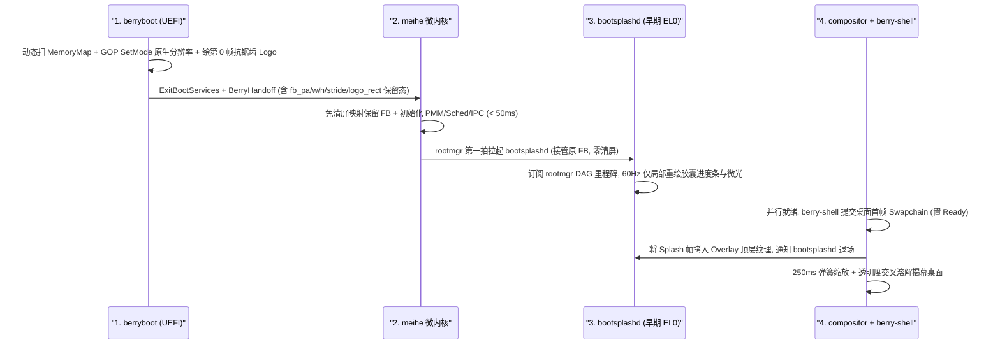

# desktop-boot（开机引导与桌面壳层）总体设计

Type: spec
Status: active
Updated: 2026-11-18
Version: 2.2.0

一句话说明：`desktop-boot` 定义 BerryOS 从电源上电（UEFI `berryboot`）、Apple 风格无闪烁胶囊开机画面（`bootsplashd`）、声明式服务并行编排（`rootmgr`）到融合 iOS 18/26/27 液态玻璃与 OpenHarmony 6.0 智慧光场的流体桌面壳层（`berry-shell`）的终态架构契约。

## 背景

如 [GUI 与 SDK 及启动模拟器全栈深研](../../research/2026-11-18-GUI与SDK及启动模拟器全栈深研.md) 第四节所示，现行开机与桌面链路存在多处断裂：`berryboot` 硬编码 128MB 内存窗且首屏不设原生高分 GOP 模式；内核 `splash.rs` 在无延迟紧循环内空转 8 次且每次 `redraw` 先全屏涂黑造成严重闪烁，多任务开启后立即 `detach` 致服务拉起阶段进度冻结；单体 `svcmgr` 混装数十项自检阻塞启动且无会话级重连自愈；`berry-launcher` 每次正常开机强制自动翻两页跑 `PAGE ok` 自测，将状态栏、桌面网格与重复的设置页硬塞进单棵 512 节点树，并以 `OP_WM_DESTROY` 强拆窗口代替返回导航、以单槽重拉代替多任务视图。依据 [图形合成与 SDK 及模拟器终态架构裁决](../../notes/proposed/2026-11-18-图形合成与SDK及模拟器终态架构裁决.md)、[全面复刻 iOS 18 视觉与流体交互范式裁决](../../notes/proposed/2026-11-18-全面复刻iOS18视觉与流体交互范式裁决.md) 与 [融合 iOS 26 至 27 液态玻璃与 OpenHarmony 6 光场一镜到底架构裁决](../../notes/proposed/2026-11-18-融合iOS26至27液态玻璃与OpenHarmony6光场一镜到底架构裁决.md)，本规格定义开机引导与桌面壳层的终态契约；视觉、材质、几何与物理公共规范严格遵循 [GUI 合成与 SDK 终态标准](../../../docs/GUI合成与SDK终态标准-v2.0.md) 与 [iOS 与鸿蒙融合液态玻璃及光场交互标准](../../../docs/iOS与鸿蒙融合液态玻璃及光场交互标准-v2.0.md)。

## 范围

- **覆盖**：`berryboot` 动态内存图装载、原生 GOP 分辨率优选与第 0 帧品牌徽标预绘；`BerryHandoff` 帧缓冲状态移交与内核脱核原则；早期用户态 `bootsplashd` 60Hz 增量局部进度渲染、Verbose 滚屏双模式及与 `compositor` 的交叉溶解（Cross-Fade）揭幕交接；生产启动零自检铁律与 `rootmgr` 声明式 DAG 并行拉起；模块化 `berry-shell` 三组件解耦（桌面与智能 Dock、状态栏与毛玻璃控制中心、实时缩略图多任务卡片视图）；应用冷热启动 `Starting Window`、图标到窗口连续弹簧形变（Hero Morph）及全栈预测性返回（Predictive Back）。
- **不覆盖**：内核 `Port` / `Job` / `AddressSpace` 内部实现（归 [meihe 总体设计](../meihe/design.md)）；`compositor` 场景图混合算法细节（归 [compositor 总体设计](../compositor/design.md)）；`appd` 验签与五级内存压力状态机（归 [am 总体设计](../am/design.md)）。

## 契约

### 一、四阶段零闪烁无缝开机链（Flicker-Free Boot Continuum）

1. **阶段一（`berryboot` 动态寻址与首屏点亮）**：
   - 废除硬编码 `[0x4000_0000, 0x4800_0000)` 128MiB 装载窗；`berryboot` 读取 UEFI `GetMemoryMap` 动态寻找满足对齐与容量的 `EfiConventionalMemory` 段装载 PIE 内核与分块 `INITRD`（支持 128MiB–64GiB 任意内存规模）。
   - 在 `ExitBootServices` 前读取 `boot-params.toml`（及 QEMU `fw_cfg` 覆盖项）：若未处于 `verbose` 模式，遍历 `EFI_GRAPHICS_OUTPUT_PROTOCOL` 全部模式优选匹配目标面板宽高（或最大可用原生 32bpp 线性帧缓冲模式）调用 `SetMode`，一次性清纯黑底并居中绘制 8-bit 抗锯齿灰度品牌徽标，将 `logo_drawn = 1` 及精确包围盒写入 `BerryHandoff`。
2. **阶段二（内核脱核交接）**：
   - 遵循微内核最小机制铁律，彻底移除内核态进度追针循环与全屏 `clear_screen`；内核仅将 `gop_fb` 物理段登记为保留设备页并封装 `MmioResource` 递交 `rootmgr`，仅当发生致命 EL1 Panic 且用户态合成器失联时，才由紧急崩溃处理器在顶层直写故障摘要。
3. **阶段三（`bootsplashd` 60Hz 增量局部动画与双模式）**：
   - `rootmgr` 在启动拓扑第 0 层（早于块设备、文件系统与网络初始化）立即拉起极简无依赖守护进程 `bootsplashd`：
     - **`splash` 默认模式**：读取 `logo_drawn == 1` 时**严禁清屏**，直接在既有徽标下方建立胶囊进度条局部脏区（仅占屏幕面积 `< 2%`），通过高精度定时器以 60Hz 执行一阶临界阻尼追针插值（根据 `rootmgr` 真实服务就绪事件推进目标值，单调不减、零跳变、零闪烁）；
     - **`verbose` 诊断模式**：订阅 `klog` 环增量流，使用 8-bit 抗锯齿等宽字体按脏行增量滚屏渲染启动日志，直至图形桌面接管。
4. **阶段四（`compositor` 交叉溶解原子揭幕）**：
   - `compositor` 与 `berry-shell` 在后台离屏后备缓冲完成首帧桌面壁纸、状态栏、图标网格与 Dock 的完整合成（此时物理扫描面仍保持 Splash 末态 100% 满格画面）；
   - 首帧就绪瞬间，`compositor` 将 Splash 末帧置为 `Layer::Overlay` 顶层节点并执行 `250ms` 透明度 `255 → 0` 叠加桌面层缩放 `0.94 → 1.00` 的锁拍过渡动画，随后通知 `bootsplashd` 退出回收全部资源——全过程 **0 黑屏帧、0 撕裂、0 静止假死段**。

### 二、生产启动零自检铁律与声明式服务 DAG

1. **生产与测试物理分流**：
   - 严禁任何生产二进制（内核默认启动路径、`rootmgr`、`compositor`、`berry-shell`、`berry-term`）在常规启动流中内联执行功能自检（如 `echo/talker/dpg` 矩阵压测、`FBW` 清屏写 `"AB\nCD"`、`berry-launcher` 自动合成滑动翻页 `PAGE ok n=2`、`berry-term` 启动预派生一次性子 shell 跑 `echo/uname/clear`）。
   - 所有集成与冒烟探针统一迁入显式测试套件（`berry-selftest` 独立运行器与 BCTS 冻结验证集），僅当引导参数显式声明 `boot.selftest = true` 时由测试编排器挂载执行。
2. **声明式并行服务编排与故障自愈**：
   - `rootmgr` 读取静态编译校验的服务拓扑表，将无依赖关系的组件并行拉起（如 `devmgr` 枚举期与 `compositor` 内存池初始化并行；`fsmgr`/`vblk` 挂载与首帧静态桌面壁纸解码并行；`vnet` 网络协商完全异步后置，绝不阻塞桌面首帧亮屏）。
   - **会话重连不变量**：废除遇错 `park()` 假活挂起反模式；任何服务异常一律以非零码退出触发 `SIGNAL_PEER_CLOSED`，由 `rootmgr` 按指数退避策略重启服务实例并通过 `/svc` 服务目录透明重连下游客户端。

### 三、融合 iOS 26/27 与 OpenHarmony 6.0 的流体桌面壳层（`berry-shell`）

将原单体 `berry-launcher` 重构为职责正交的壳层模块族，彻底清除内置重复设置页与无后端空壳应用图标：

1. **状态栏、实况胶囊与模块化控制中心（`SystemChrome`）**：
   - **顶部状态栏与实况胶囊（`Layer::SystemBar` / `Layer::Overlay`）**：安全区高 `54pt`，背景默认全屏延伸（Safe-Area Auto-Bleed，内容区域避让）；左侧显示等宽数字粗体时钟（如 `9:41`），右侧显示圆角四格信号、Wi-Fi 与电池图标，前景随底层窗口亮度 `200ms` 自动切换纯白/纯黑；正中常驻 **实况胶囊（Live Capsule，融合 iOS 27 微发光轮廓与 OpenHarmony 6.0 非侵入式实况窗，`126×37pt` 超椭圆）**，后台存在倒计时、媒体播放、录屏、文件传输或 AI 意图代操作时以微弹性弹簧平滑生长显示胶囊摘要，单击展开为 `R = 42pt` 液态玻璃控制卡片。
   - **锁屏同源通知中心与模块化控制中心（`Layer::Overlay`）**：左/中下拉展开底部叠卡式通知中心（`Notification Stack`）；右上下拉在 `LiquidGlass`（凸透镜边缘折射 + 动态高光 + `1.9x` 增艳）背景上展开模块化控制中心（圆形无线磁贴组、媒体方卡、支持越界橡皮筋弹性拉长的竖向全圆角亮度柱与音量柱，支持右侧多页分组滑切），状态与 `SETTINGS.bap` 实时双向同步。
   - **底部导航：默认 iOS Home 横条 + 可选经典三键兼容开关（`Layer::SystemBar`）**：默认启用 `134×5pt` 圆角悬浮 **Home Indicator 横条**（安全区 `34pt`，支持上滑飞回图标槽、上滑悬停进叠卡多任务、左右横滑快切应用）；同时在「设置 → 显示与导航」保留「经典三键导航」热切换开关（开启后在 `44pt` 全透明底栏以抗锯齿 SF 细线条矢量绘制返回、主页、多任务符号，彻底淘汰旧 AOSP 位图）。
2. **iPhone 主屏、底部可达意图条与 iPadOS 宽屏连续体（`HomeStage`）**：
   - **竖屏 iPhone 态（`< 600pt`）**：承载景深缩放壁纸（打开应用或呼出浮层时自动 `0.93x` 微缩）、`4×6` 连续超椭圆（`22.37%`）图标与交互小组件混排网格、长按错相摆动拖拽重排（`Jiggle Mode`）；底部提供单手可达 **"Search or Ask" 意图条**（下滑或点击展开 Spotlight 与 AI 语义意图）；底部为 iOS 26 液态玻璃（Liquid Glass）收缩 **Dock**（滚动页面时自适应收缩为精简药丸，静止时舒展为四槽浮岛，叠加触控水面光斑波纹）。
   - **宽屏 iPadOS 态（`>= 600pt`）**：窗口横屏或平板档自动切换为浮动扩充 Dock（常驻应用 + 分割线 + 最近 3 应用）、应用顶部三点多窗菜单（`•••` 支持 `Split View` 左右分屏与 `Slide Over` 侧拉小窗）以及 `>= 960pt` 下的 **台前调度（Stage Manager）**（左侧立体工作区缩略簇 + 中央最多 4 个超椭圆自由缩放重叠窗口，支持 OpenHarmony 6.0 窗口级精准拖拽吸附）。
3. **iOS 弧形叠卡多任务切换器（`AppSwitcher`）**：
   - 彻底取代原 `Option<RecentsApp>` 单槽重拉桩；对接 `appd` LRU 任务栈与 `compositor` 表面纹理（活跃/冻结应用零拷贝引用实时表面，墓碑应用无缝加载压缩快照），左侧弧形层叠排列 `38pt` 超椭圆圆角实时卡片（卡片上方悬浮应用图标与名称），支持松手投射惯性翻阅、点击弹簧放大回前台以及上滑甩出卡片关闭任务。

### 四、一镜到底共享元素（geometryTransition）与全栈预测性返回契约

1. **零卡顿一镜到底启动（Hero Morph + geometryTransition + Starting Window）**：
   - 用户点击桌面图标同帧（`≤ 16.7ms`），`berry-shell` 立即调用 `appd::launch_async(app_id)`（非阻塞异步发车），同时在 `compositor` 注册共享元素 ID（`geometryTransition("app_hero")`）并创建与该图标一致的轻量 `StartingSurface`，驱动**从桌面图标精确坐标与圆角向全屏窗口连续展开的欠阻尼/临界阻尼弹簧动画（Icon-to-Window Hero Morph，可随时被反向手势中断抓回）**；
   - 后台 `appd` 完成 PIE ELF 装载与子进程初始化后，应用提交真实首帧 `Swapchain` 槽，`compositor` 在单拍内将 `StartingSurface` 一镜到底原子替换为真实应用表面——即便冷启动耗时 150ms，用户体感也是点击瞬间 0ms 立即跟手展开。
2. **全栈分级预测性返回（Predictive Back）**：
   - 废除导航栏直接发 `OP_WM_DESTROY` 强拆应用窗口的粗暴做法；无论是点击返回键还是从屏幕左右侧边缘向内滑动，统一走四级有序责任链：
     1. 若 `imed` 软键盘处于升起态 → 优先平滑收起软键盘；
     2. 若系统 `Overlay`（控制中心/弹窗）处于展开态 → 收起系统浮层；
     3. 若焦点应用声明了内部可后退状态（`can_go_back == true`，如 `NavStack` 深度 `> 1` 或应用内弹窗打开）→ 向焦点会话投递 `BackGesture { progress_q16, edge }` 驱动应用内页面跟手侧滑预览，松手确认后执行 `NavStack::pop()`；
     4. 若焦点应用已处根页面（`can_go_back == false`）→ 侧滑期间由 `compositor` 直接缩小当前应用窗口并透出底层桌面壁纸与应用图标预览，松手确认后窗口平滑缩回桌面原图标位置并通知 `appd` 将该应用转入后台 `Freeze` 态（应用挂死超 `500ms` 无响应时由 `compositor` 自动兜底收起并标记无响应）。

## 验收标准

1. **开机体验门禁**：Apple Silicon HVF 冷启动从 QEMU 拉起到桌面可交互全过程无任何黑屏闪烁帧、无任何测试文字闪现、无自动翻页跳动，总冷启动时间 `< 1.2s`（配合模拟器快照速启 `< 0.5s`）；`--boot-mode verbose` 清晰滚屏无截断乱码。
2. **桌面与多任务门禁**：连续打开 6 个预置应用（超旧 4 应用上限），底部上滑悬停进入多任务视图可见全部 6 张卡片缩略图，触发内存压力使末尾 2 个应用进入墓碑态后点击其卡片仍可无缝恢复原界面状态；浅色背景应用全屏时顶部状态栏文字自动反转为深色。
3. **返回与转场中断门禁**：点击通讯录进入详情页后按返回键/侧滑精确退回联系人列表而非强关窗口，在根页面再次返回则平滑缩回桌面图标；应用启动展开动画进行至一半时立即上滑回桌面，动画携当前速度无跳变连续收拢回原图标位。

## 适用边界

- 本规格取代前期阶段性方案中关于内核热路径追针、Launcher 单进程混装设置页及返回键 `DESTROY` 强拆的临时约定；与底座 `rootmgr` / `appd` 拆分工程在 [GUI 与 SDK 及模拟器彻底重构计划](../2026-11-18-GUI与SDK及模拟器彻底重构计划.md) 中按里程碑协同推进。
