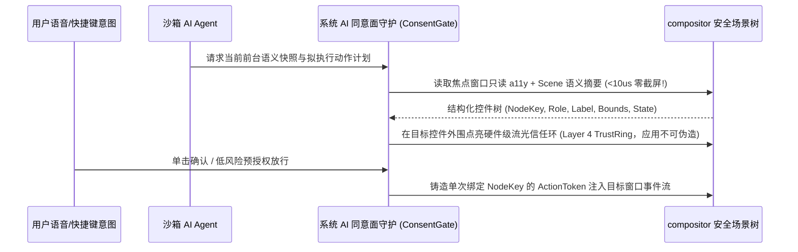

# desktop（沉浸式全场景桌面与原生语义交互）总体设计

Type: spec
Status: active
Updated: 2026-11-18
Version: 2.2.0

一句话说明：`desktop`（承载于新一代 `berry-shell` / `berry-launcher` 2.0）是 BerryOS 的系统级人机交互与 AI 原生入口——深度融合 iOS 18/26/27 液态玻璃（Liquid Glass）与 OpenHarmony 6.0 智慧光场及一镜到底范式，兑现「可打断二阶弹簧与 `geometryTransition` 共享转场 + 真多窗口与窗口级精准投送 + 实况胶囊与底部意图条 + 手表至 PC 多形态连续体 + 零 OCR 能力受控 AI 语义场景总线」。

## 背景

[渲染管线与桌面 SDK 及镜像存储深度审计](../../research/2026-11-18-渲染管线与桌面SDK及镜像存储深度审计.md) 与 [iOS 26 至 27 液态玻璃与 OpenHarmony 6 光场架构对标深研](../../research/2026-11-18-iOS26至27液态玻璃与OpenHarmony6光场架构对标深研.md) 指出：当前 `berry-launcher` 仅实现了静态网格翻页与单槽 `recents_app` 记忆，缺失触控光场反馈、图标到窗口的一镜到底共享几何过渡、实时多任务卡片流、下拉控制与通知中心，且系统栏依赖单帧缓冲静态裁带导致多窗与动态交互受限。依托 [gfx 总体设计](../gfx/design.md) 的液态玻璃折射/光斑波纹能力与 [compositor 总体设计](../compositor/design.md) 的服务端保留式场景树合成，本规格确立兼具旗舰移动丝滑感与桌面高生产力的 `desktop` 2.2 总体契约。

## 范围

- **覆盖**：全屏沉浸式系统窗拓扑与安全区背景默认延伸（Safe-Area Auto-Bleed）；状态栏、实况胶囊（Live Capsule）、手势导航栏、主屏网格与弹性收缩液态玻璃 Dock、控制中心、通知中心、多任务卡片栈、底部单手可达 `"Search or Ask"` 意图搜索条；可随时打断重定向的二阶弹簧手势物理引擎（`Spring2D`）与 `geometryTransition` 一镜到底转场；从竖屏手机到平板分屏、台前调度（Stage Manager）与窗口级跨应用精准拖拽投送的 `vp` 响应式连续体；系统级能力受控 AI 语义场景感知与代操作总线（Semantic Scene Bus）。
- **不覆盖**：合成器底层瓦片剔除与 GPU 着色管线（归 [gpu-accel 总体设计](../gpu-accel/design.md) 与 [compositor 总体设计](../compositor/design.md)）；单个第三方应用内部业务组件实现（归 [应用 API 全景](../../../docs/应用API全景-v1.0.md) 及 [ui-sdk 总体设计](../ui-sdk/design.md)）。

## 契约

### 一、沉浸式系统窗分层架构与液态玻璃光场演进

全面遵循 [iOS 与鸿蒙融合液态玻璃及光场交互标准](../../../docs/iOS与鸿蒙融合液态玻璃及光场交互标准-v2.0.md)，推行安全区背景默认延伸（Safe-Area Auto-Bleed），以真合成图层、连续超椭圆、iOS 26 液态玻璃（凸透镜边缘折射 + 动态镜面高光）与 OpenHarmony 6.0 智慧光感（触控水面光斑波纹 + 环境色漫溢）取代旧裁带残影：

1. **五类独立系统 `SceneSurface` 窗口**：
   - **`WallpaperSurface`（Layer 0）**：承载高分辨率抗锯齿壁纸或低功耗程序化流体渐变着色层；当顶层打开应用或拉出浮层时，合成器自动对其施加 `0.93x` 景深微缩、环境色取样与平滑暗化/模糊过渡。
   - **`LauncherSurface`（Layer 1 底）**：`4×6` 连续超椭圆（`22.37%`）层叠液态玻璃图标网格（支持文件夹聚合、桌面实时小组件与长按错相摆动拖拽重排 `Jiggle Mode`）+ 底部单手可达 **`"Search or Ask"` 液态玻璃意图胶囊** + **`LiquidGlass`（`34pt` 超椭圆）浮动弹性收缩四槽 Dock**（翻页或滚动时自适应微缩，触控按压激起水面光斑扩散波纹）。
   - **`StatusBarSurface` 与实况胶囊（Layer 3 顶）**：常驻顶栏安全区 `54pt`（应用背景自动延伸直抵物理屏顶，内容安全避让），左侧等宽数字粗体时钟、正中常驻 **实况胶囊（Live Capsule，融合 iOS 27 微发光流光轮廓与 OpenHarmony 6.0 实况窗非侵入式胶囊摘要）**（倒计时、媒体、录屏、跨端传输与 AI 语义代操作时弹簧生长，单击一镜到底展开为实况控制卡片）、右侧信号/Wi-Fi/圆角电池；由合成器采样正下方窗口顶部区域平均亮度，**自动在纯白与纯黑前景符号间 200ms 平滑反转**。
   - **`NavGestureSurface`（Layer 3 底）**：默认启用 **iOS `134×5pt` Home Indicator 横条**（安全区 `34pt` 背景默认直通、全手势驱动），同时保留「设置 → 显示与导航 → 经典三键导航」兼容切换开关（开启时以抗锯齿 SF 细线条矢量渲染透明三键）。
   - **`SystemSheetSurface`（Layer 3 浮层）**：右上角下拉唤出 **液态玻璃圆角模块化控制中心**（含越界橡皮筋弹性拉长的竖向全圆角亮度/音量柱与边缘高光折射）；左上角/中部下拉唤出 **叠卡式通知中心（Notification Stack）**；点击底部 `"Search or Ask"` 或主屏任意处下滑一镜到底展开 **Spotlight 与 AI 全局意图面板**。

### 二、一镜到底共享转场与全可打断二阶弹簧手势契约（`geometryTransition` + `Spring2D`）

严禁使用不可打断的固定时长线性/三次插值播放窗口切换——**一切桌面过渡必须满足位置与速度一阶导数连续（$C^1$ 连续），依托服务端场景树共享元素绑定（`geometryTransition`）实现跨层级一镜到底，任意时刻手指再次触屏立即可反向接管**：

1. **图标 ↔ 应用窗口一镜到底连续形变（Hero Morph via `geometryTransition`）**：
   - 点击桌面图标瞬间（`< 8ms`）：按压期间图标已执行 `0.92x` 阻尼下压与触控光斑波纹反馈；松手触发启动时，合成器立即按共享键绑定桌面图标起始超椭圆 `(x, y, w, h, radius)` 与新建窗口容器节点，以临界阻尼弹簧（固有频率 $\omega_n \approx 28\text{ rad/s}, \zeta = 1.0$）平滑展开至全屏（或桌面窗口目标框），期间应用首帧场景就绪后无缝交叉淡入，彻底消灭点击后白屏/黑屏顿挫与动画断帧。
   - 上滑回桌面手势：窗口实时跟随手指二维位移 `(dx, dy)` 缩小为圆角卡片，松手时将手指真实瞬时速度 `(vx, vy)` 直接注入 `Spring2D` 初始速度向量，沿自然抛物弧线一镜到底收拢落回该应用在桌面网格或 Dock 中的原图标槽位。
2. **预测式边缘返回手势（Predictive Back）**：从屏幕左右边缘向内滑动时，当前视图/窗口随手指微缩偏移并实时露出下一层页面或桌面壁纸，用户未松手前可随时滑回取消，超过阈值松手才提交 `WM_EVENT_BACK`。
3. **真多任务切换器（`RecentsSwitcher`）**：上滑悬停进入多任务卡片流，直接引用合成器保留的各应用真实 `SceneSurface` 子树实时渲染高清圆角卡片（包含已被 `SuspendToken` 冻结甚至已转入 `L3` 墓碑快照的应用），支持惯性横滑切换、上滑释放 `job_kill` 彻底清理以及拖拽至屏幕边缘开启分屏。

### 三、iPhone 竖屏先行、iPadOS 台前调度与鸿蒙窗口级精准投送连续体

所有布局尺寸全面采用逻辑点 `pt`（`1pt = 1vp`）经统一断点与 OpenHarmony 6.0 一多响应式栅格驱动，运行期旋转或拉伸窗口时实时无损重排（度量细则以 [iOS 与鸿蒙融合液态玻璃及光场交互标准](../../../docs/iOS与鸿蒙融合液态玻璃及光场交互标准-v2.0.md) 为准）：

| 形态档位 | 视口宽度断点 | 窗口管理与跨窗协同策略 | 桌面与导航形态 |
| :--- | :--- | :--- | :--- |
| **iPhone 竖屏态** | `< 600pt` | 全屏单活动栈 + 底部层叠 `Sheet` + 实况胶囊悬停中转拖放 | `4×6` 网格 + `"Search or Ask"` 底部意图条 + 四槽 `34pt` 液态玻璃 Dock + 实况胶囊状态栏 + 默认 `134×5pt` Home 横条 |
| **iPadOS / 折叠双栏态** | `600pt .. 960pt` | 顶部三点菜单（`•••`）驱动 `Split View` 左右可调分屏 + `Slide Over` 侧拉浮窗 + 分屏间图文直拖 | 宽屏网格 + 底部居中自适应扩充液态玻璃 Dock（常驻 + 分割线 + 最近 3 应用）+ 应用内自动展开双栏侧边导航 |
| **台前调度与自由多窗态** | `≥ 960pt` | **Stage Manager 台前调度**（中央最多 4 个超椭圆自由缩放重叠窗口）+ **OpenHarmony 6.0 窗口级精准拖拽投送**（长按图文/文件跨重叠窗口悬停时目标接收区点亮液态光晕边框并精确落入指定子控件） | 左侧立体微倾最近工作区缩略簇 + 底部自动避让扩充液态玻璃 Dock + 键鼠快捷键与触控板全手势 |

### 四、【独创革命性】零 OCR 能力受控 AI 语义场景总线（Semantic Scene Bus）

充分发挥 BerryOS「全自研保留式 UI 场景树 + 纯能力内核 + AI 同意面」三位一体优势，彻底颠覆传统桌面 AI Agent 靠高频截屏跑视觉大模型（高延迟、高耗电、高隐私泄露风险）的笨重路线：

1. **微秒级零功耗屏幕理解**：经 `SystemResource` 与用户会话授权后，`compositor` 直接从全局保留式场景图导出脱敏结构化语义树（密码框 `input_kind == Password` 及标记 `PRIVACY_SENSITIVE` 的子树在合成器硬件边界内直接物理剥离，AI 进程内存永远接触不到敏感字段！），单次读取耗时 **< 10µs**，功耗较视觉截屏推理降低 **3 个数量级**。
2. **不可伪造视觉审计与精确能力执行**：AI 拟执行点击/填表前，由最高层 `TrustRing` 在目标控件周围渲染系统专属彩色呼吸光圈提示用户；每次代操作均由 `ConsentGate` 按 [AI 同意面设计](../../../docs/AI同意面设计-v1.0.md) 风险分级铸造一次性 `ActionToken` 并记入不可篡改内核遥测审计环。

## 验收标准

1. **物理流畅度与可打断性**：在 120Hz 模式下连续快速点击打开应用并在展开中途手势上滑打断、再二次点击重开，连续 100 次操作零状态卡死、零画面跳变（位移差连续）、全程 99% 帧耗时 `< 8.33ms`。
2. **多形态无损切换**：同一桌面进程从 `360×640vp` 手机竖屏实时切换至 `1280×800vp` 桌面横屏，自动激活自由浮动多窗口标题栏与扩充 Dock，同时打开终端、文件管理器与浏览器三窗重叠拖拽缩放零绘制残留。
3. **AI 语义总线安全闭环**：在含密码框与支付按钮的测试界面触发 AI 语义快照，断言导出树中密码文本 100% 缺席、高风险按钮必须经用户点击系统同意浮层后方可触发且全过程屏幕渲染可见信任光圈。

## 适用边界

- 第三方应用无需编写任何额外适配代码即可自动获得上述窗口弹簧缩放、桌面自由多窗外框、状态栏智能反色与 AI 语义无障碍能力。
