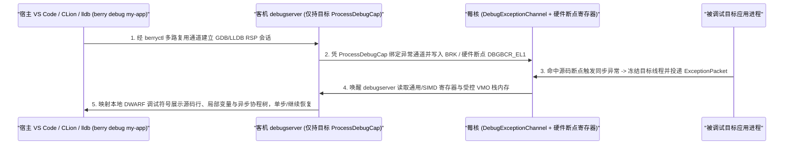

# devtools（纯能力源码级调试器、硬件 PMU 火焰图与实时 UI 检视工具链）总体设计

Type: spec
Status: active
Updated: 2026-11-18
Version: 1.1.0

一句话说明：`devtools`（由内核纯能力调试异常通道、设备端轻量 `debugserver`、零分配符号展开库 `berry-unwind`、全栈硬件采样剖析器 `berry perf`、常驻追踪服务 `traced` 及实时界面检视器 `berry ui-inspect` 组成）是 BerryOS 的工程师与第三方应用开发者神兵利器——彻底告别「靠串口 `println` 盲猜并发死锁与性能热点」的原始时代。

## 背景

[整机生态十维盲区全景审计](../../research/2026-11-18-整机生态十维盲区全景审计.md) 发现：BerryOS 目前仅有崩溃后的遗言收集器 `cbox`（[cbox 总体设计](../cbox/design.md)）和微基准跑分脚本，完全缺少运行期源码级断点调试能力、缺少在机符号化调用栈展开、缺少基于硬件性能计数器（PMU）的全栈采样火焰图，且 [可观测性设计](../../../docs/可观测性设计-v1.2.md) 规划的常驻追踪服务一直挂账未落。没有现代调试与剖析工具链，生态开发者面对复杂异步逻辑或 UI 掉帧将寸步难行。本规格依据 [整机十维缺失拼图全栈终态架构裁决](../../notes/proposed/2026-11-18-整机十维缺失拼图全栈终态架构裁决.md)，确立零 Linux `ptrace` 历史包袱的微内核原生诊断工具链契约。

## 范围

- **覆盖**：微内核纯 Capability 调试异常通道（`DebugExceptionChannel`）与线程寄存器/断点读写原语；宿主 `berry debug` 与设备端 GDB/LLDB 远程串行协议代理 `debugserver`（含内核早期异常 GDB Stub）；基于紧凑展开表（`.eh_frame` / Compact Unwind）的零堆分配栈回溯库 `berry-unwind`；基于 ARMv8 PMU / x86 Arch Perfmon 的全栈采样剖析器 `berry perf` 与常驻低开销追踪守护进程 `traced`（导出标准 Perfetto / Chrome Trace 与折叠火焰图）；面向 GUI 应用的实时场景树、布局盒与脏瓦片检视器 `berry ui-inspect`。
- **不覆盖**：生产环境未挂载调试器时的进程崩溃墓碑落盘与黑匣子持久化（归 [cbox 总体设计](../cbox/design.md)，但共享 `berry-unwind` 展开原语）。

## 契约

### 一、微内核纯能力调试架构（拒绝 `ptrace`）与 LLDB/GDB 源码调试契约

1. **纯 Capability 异常通道替代 `ptrace`**：绝不引入破坏父子进程关系与信号语义的 POSIX `ptrace`。在 [meihe 总体设计](../meihe/design.md) 进程对象上定义显式受控权利 `RIGHT_DEBUG`：仅针对清单标记 `debuggable = true` 的开发包（或处于 `dev` 解锁模式的系统服务），开发者工具方可获取其 `ProcessDebugCap` 并绑定 `DebugExceptionChannel`：
   - 目标线程触发软件断点（`BRK #imm` / `INT3`）、硬件执行断点（`DBGBVR_EL1`）、硬件数据观察点（Watchpoint `DBGWVR_EL1`，秒抓内存被谁静默踩坏！）或未捕获页故障时，内核挂起该线程并向调试通道发送结构化异常包，调试器检视完毕回复 `Resume(Handled | PassToHandler | SingleStep)`（利用 `MDSCR_EL1.SS` 硬件单步位精准步进）；
   - 调试器意外断开连接时，内核自动剥离全部软件断点补丁页（恢复原只读代码 VMO 映射）并解冻目标进程继续安全运行，绝不把被调进程拖死成僵尸。
2. **内核级早期联调桩（`kgdb-stub`）**：在编译期开启 `feature = "kgdb"` 的开发内核中，内置不足 800 行零分配串口/调试通道 GDB RSP 状态机，支持真机早期 Bringup 阶段直接挂载 `aarch64-none-elf-gdb` 查验页表寄存器（`TTBR0/1_EL1`、`ESR_EL1`、`FAR_EL1`）与多核调用栈。

### 二、零分配紧凑栈展开（`berry-unwind`）契约

1. **废除帧指针盲猜，原生解析 `.eh_frame`**：构建链默认保留只读 `.eh_frame` 与 `.eh_frame_hdr` 二分索引段（生产包剥离庞大 `.debug_info` 至宿主侧符号包 `.bsym`，设备内仅留数 KB 展开表）。`berry-unwind` 以纯 Rust `no_std` 零堆分配实现 DWARF CFI 状态机，无论在崩溃信号处理上下文、`cbox` 内核采样还是性能剖析中断上下文中，均能在微秒级精准还原包含叶子函数在内的完整 PC 调用链；宿主 `berry symbolize` 自动结合 `.bsym` 还原内联函数（Inline Frames）与精确 `file:line:col`。

### 三、硬件 PMU 全栈采样（`berry perf`）与 Perfetto 时间线（`traced`）契约

1. **硬件计数器溢出采样与全栈火焰图**：内核受 `PerfCap` 门控开放每核 PMU 计数器配置（`PMCCNTR_EL0` 周期、`L1D_CACHE_REFILL`、`BR_MIS_PRED`、`DTLB_WALK` 及软件锁争用/缺页事件）。溢出中断在安全边界同时捕获 EL1 内核栈与 EL0 用户态紧凑调用链写入每核无锁环形 VMO；宿主执行 `berry perf record -d 5s --flamegraph` 即可一键生成跨「内核 ↔ 系统服务 ↔ 第三方应用」的交互式 SVG 火焰图。
2. **零扰常驻二进制追踪总线（`traced`）**：每个关键子系统（调度器切换、IPC 往返、`BerryFS` 事务提交、合成器 VSync 拍、应用绘制帧、`airtd` 解码步）共享一块只读控制掩码位与无锁 SPSC 追踪槽（未开启追踪类别仅耗费 1 条预测成功的位测试指令 $< 1\text{ns}$）；开启后由 `traced` 汇总直接输出兼容 **Perfetto UI** 的时间线包，一眼看穿掉帧究竟卡在调度抢占、磁盘缺页还是着色耗时。

### 四、实时 GUI 场景树与渲染检视器（`berry ui-inspect`）契约

1. **所见即所得三维图层与脏区透视**：针对开发态应用或模拟器会话，宿主运行 `berry ui-inspect` 即实时拉取 `ui-sdk` 组件状态树与合成器 `SceneIR` 图元树，支持鼠标悬停高亮任意控件的 `vp` 几何边距/弹性约束、一键开启合成器「16×16 脏瓦片闪烁热力图」、「过度绘制（Overdraw）伪彩图」与「慢帧归因标尺」，并在宿主侧实时微调圆角、模糊半径与弹簧刚度参数即时预览。

### 五、调试与性能剖析内核 ABI 号位绑定契约

与 [全系统 31 模块终态合龙总纲与 ABI 号段总表](../2026-11-18-全系统31模块终态合龙总纲与ABI号段总表.md) 保持单一源一致，锁定以下权利位、信号位与系统调用号位：

- **新增权利与信号位**：`RIGHT_DEBUG = 1 << 12`（仅授开发态 `debugserver` 或崩溃/ANR 采样监督器）、`SIGNAL_EXCEPTION_PENDING = 1 << 7`。
- **激活在册号位 `0x41`**：`berry_debug_bind_exception_channel(target_proc_or_thread, options, *out_ch)`（承接 `abi.toml` 预留 `0x41`），门控 `RIGHT_DEBUG`。
- **扩展调试与剖析号段 `0x45..0x48`**：
  - `0x45 berry_thread_read_state(thread, kind, buf, cap, *out_len)`：读取已挂起/异常态线程的通用寄存器、SIMD 寄存器或硬件调试状态，门控 `RIGHT_DEBUG`；
  - `0x46 berry_thread_write_state(thread, kind, buf, len)`：更新寄存器、配置硬件执行断点 `DBGBVR_EL1` / 数据观察点 `DBGWVR_EL1` 或置位单步 `MDSCR_EL1.SS`，门控 `RIGHT_DEBUG`；
  - `0x47 berry_process_vm_rw(proc, op, va, buf, len, *actual)`：调试器受控内存检视与软件断点 `BRK` 私有 CoW 影子页打补丁（不污染全局共享只读代码页，且自动完成 PoU 指令缓存同步），门控 `RIGHT_DEBUG`；
  - `0x48 berry_pmu_sample_open(perf_res, config_ptr, *out_ring_vmo)`：受 `PerfResourceCap` 门控配置每核硬件 PMU 采样周期并导出只读样本环 VMO。

## 验收标准

1. **源码断点与数据观察点门禁**：在模拟器与真机模式下执行 `berry debug`，对多线程 Rust 应用设置条件源码断点与 8 字节内存写观察点（Watchpoint），命中后准确打印局部变量、单步步进 20 次并在断开调试器后目标应用无损继续运行；非 `debuggable` 生产签名包在 `locked` 态下 100% 拒绝签发 `ProcessDebugCap`。
2. **PMU 采样低扰动门禁**：开启 1000Hz 全核调用栈采样时，系统整体吞吐开销 $\le 1.5\%$，导出的 Perfetto 轨迹可完整关联同一次触控引发的 `inputd -> app -> compositor -> vsync` 跨进程因果链。
3. **UI 检视零入侵验证**：关闭检视会话时合成器与客户端额外内存与 CPU 开销严格为 0。

## 适用边界

- 设备端不内置完整 LLVM/Rustc 自举编译器与重型 DWARF 全量符号解析器（大型源码符号映射统一放在宿主机 `berry` CLI 侧按 Build-ID 自动匹配完成，保持客机极致轻量）。
