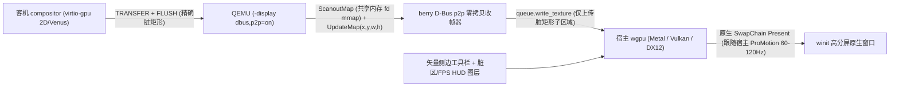

# emulator（宿主模拟器与虚拟化平台）总体设计

Type: spec
Status: active
Updated: 2026-11-18
Version: 2.3.0

一句话说明：`emulator`（`tools/berry` 设备平台）定义 BerryOS 在 macOS、Linux 与 Windows 宿主机上的虚拟化启动、Xcode iOS Simulator 同款超椭圆钛金属外框窗口、120fps 零拷贝 GPU 呈现、液态玻璃倾角光场与触控波纹仿真、双架构同构硬件加速、亚秒级快照速启与全栈开发调试桥接的终态架构。

## 背景

如 [GUI 与 SDK 及启动模拟器全栈深研](../../research/2026-11-18-GUI与SDK及启动模拟器全栈深研.md) 第五节所示，现役 `berry` CLI 存在严重体验断层：VNC 通路受 QEMU 30ms 定时器钳制锁死在 33fps；共享内存 `RamSource` 每 16ms 执行 8.29MB `pread` 全帧拷贝并以 4,050 像素稀疏步长采样签名导致光标与局部脏区频繁漏检吞帧；原生窗口残留 `0.55/0.9` 历史缩放因子，手搓 5×7 点阵工具栏仅实现 15 个字母致菜单乱码；`spawn_kernel` 与 `spawn_image` 配置分裂；x86_64 与 Windows 宿主硬编码跑 `aarch64` 纯软件 TCG 致冷启动长达数分钟；无 VM 快照速启且缺失内置 FAT 造盘、剪贴板、文件拖放与音频转发。依据 [图形合成与 SDK 及模拟器终态架构裁决](../../notes/proposed/2026-11-18-图形合成与SDK及模拟器终态架构裁决.md) 并承接 [显示与加速体系设计](../../../docs/显示与加速体系设计-v1.1.md) 目标路线，本规格定义宿主模拟器子系统的终态内部契约。

## 范围

- **覆盖**：宿主呈现管线（D-Bus p2p 共享图纯 damage 主通道 + `wgpu` Metal/Vulkan/DX12 合成 + 高帧率增量 Web 远程流）；高分屏 Retina 1:1 窗口管理、矢量悬浮工具栏与调试 HUD；双架构同构硬件加速选路（`aarch64` HVF/KVM + `x86_64` KVM/WHPX + 确定性 TCG 基线）；QEMU 设备拓扑强校验与单二进制自包含镜像/数据盘构建；Golden Snapshot 亚秒级速启（QuickBoot）；剪贴板、文件拖放、音频、网络与双向串口跨平台控制面。
- **不覆盖**：客机内部 `compositor` 合成逻辑（归 [compositor 总体设计](../compositor/design.md)）；客机内核虚拟化驱动寄存器细节（归 [meihe 总体设计](../meihe/design.md)）。

## 契约

### 一、120fps 零拷贝宿主 GPU 呈现架构（退役 33fps VNC 与 `pread` 轮询）

1. **一等主通道（D-Bus p2p 共享图 + 纯 Damage 驱动）**：
   - macOS 与 Linux 桌面默认启用 `-display dbus,p2p=on`（免外部 `dbus-daemon`，经 QMP `add_client` 注入匿名 socket 对），`berry` 内置轻量纯 Rust D-Bus 线协议客户端注册 `org.qemu.Display1.Listener`：
     - 收到 `ScanoutMap`（POSIX 共享内存文件 fd）后一次性执行 `mmap(PROT_READ, MAP_SHARED)`，彻底废除 [ram.rs](../../../tools/berry/src/display/ram.rs) 的每 16ms 8.29MB `pread` 系统调用与 4,050 像素稀疏采样猜帧；
     - 仅当收到客机真实提交触发的 `UpdateMap(x, y, w, h)` 时，唤醒 `winit` 事件循环并调用 `wgpu::Queue::write_texture` 仅将脏矩形子块 DMA 上传至 GPU 纹理——客机静默停帧时宿主侧 **0 CPU 轮询、0 内存扫描、0 GPU 重绘**，彻底消除空载满核税；
     - Windows 宿主（无 Unix FD 传递时）自动采用命名共享内存段 + QMP/VirtIO 脏区事件流同构对接同一套 `FrameDamage` 接口，保留 `-vnc` 仅作可选外部无头诊断通道。
2. **高帧率 Web 远程桌面升级**：
   - `berry web` / `--lan` 不再串接锁死 33fps 的 QEMU VNC 轮询口，而是直接订阅宿主进程内的同一套 `ScanoutMap + UpdateMap` 脏区源，按浏览器端 `requestAnimationFrame` 回执节拍推送脏块（小块走紧凑 QOI/WebP/LZ4 无损帧，全屏动效走自适应帧率控制），使局域网平板/浏览器调试突破 33fps 瓶颈直达 60fps。

### 二、Xcode iOS Simulator 同款超椭圆外框、光场仿真与开发者 HUD

1. **无边框超椭圆钛金属设备外框（Device Bezel）与缩放铁律**：
   - 彻底移除 `window.rs` 中 `0.55` 与 `0.9` 历史缩放乘数，遵循 [iOS 与鸿蒙融合液态玻璃及光场交互标准](../../../docs/iOS与鸿蒙融合液态玻璃及光场交互标准-v2.0.md) 第六节：默认开启无系统标题栏透明合成画布，以 `wgpu` 抗锯齿渲染等宽微高光钛金属超椭圆设备外框（Bezel），客机屏幕四角严格按同心 `55pt`（iPhone 态）/ `18pt`（iPad 态）连续超椭圆遮罩硬件裁切（传入 `--frameless-raw` 可切纯画面无壳模式）；
   - 默认按客机逻辑点 `pt`（`vp`）1:1 映射宿主逻辑点并自动钳制在当前显示器可用工作区高度 `92%` 以内保持严格宽高比；拖拽宿主窗口边缘执行 GPU Lanczos 锐利等比缩放，点击「旋转 / 切换形态」则通过 `virtio-gpu` EDID 热更新触发客机免重启切入双栏或台前调度横屏模式。
2. **极简悬浮液态玻璃控制胶囊、虚拟倾角光场与调试 HUD（退役帧内点阵灰条）**：
   - 废除在客机画面底部硬塞 48px 灰条与 15 字母残缺 5×7 点阵 `glyph()` 的旧实现；
   - 控制栏收敛为设备外框右上侧极简悬浮胶囊按钮组，提供：**电源/锁屏、音量加减、iPhone/iPad/折叠屏形态旋转、Home/多任务手势触发、虚拟设备倾角光场滑杆（驱动客机 `LiquidGlass` 动态镜面高光与折射测试）、带壳/纯屏 1:1 无损截屏与录屏、一键保存/回滚快照、Web 共享二维码及开发者 HUD 开关**。
   - 开启开发者 HUD 或演示录屏模式时，在宿主 GPU 合成层零侵入叠加实时帧率曲线、客机本拍 `UpdateMap` 脏矩形红框、`geometryTransition` 共享节点包围盒高亮、触控点击光斑波纹指示器、输入到上屏端到端延迟读数及 CPU/内存水位。

### 三、双架构同构硬件加速与自包含拓扑引擎

1. **全宿主平台原生硬件虚拟化（终结 x86 开发者 TCG 苦役）**：
   - `berry` CLI 升级为双架构感知编排器，根据宿主 CPU 架构与可用虚拟化引擎自动择优：
     - **macOS Apple Silicon**：默认 `qemu-system-aarch64 -accel hvf -cpu host`；
     - **Linux ARM64**：默认 `qemu-system-aarch64 -accel kvm -cpu host`；
     - **Linux x86_64 / Windows x86_64**：当工作区或运行时包存在同源构建的 `x86_64` BerryOS 镜像（依托 [meihe 总体设计](../meihe/design.md) `berry-hal` 双架构同源内核与用户态）时，默认选用 `qemu-system-x86_64 -accel kvm`（Linux）或 `-accel whpx`（Windows）原生硬件加速；仅当开发者显式指定 `--arch aarch64` 或运行跨架构确定性快照测试时回退 `TCG`。
2. **统一启动模型与拓扑前置校验**：
   - 收敛 `spawn_kernel` 与 `spawn_image` 为统一的 `VmSpec` 构建器：`spawn_kernel` 同样经过 `fwcfg_plan` 单源注入 `opt/berry/accel`、`rtc` 与显示参数（根除 HVF 直启漏键崩溃）；
   - 启动前执行静态拓扑自检（`TopologyValidator`）：自动保证 `virtio-mmio.force-legacy=false`、`virtio-gpu-device` 严格先于 `ramfb` 声明、GUI 模式必配 `virtio-tablet-device` + `virtio-keyboard-device`、`simdev=1` 必配第二路字符通道——任何不满足拓扑不变量的组合在宿主进程创建前立即给出精确人类可读与 `--json` 错误提示，绝不放任客机进入静默黑屏或内核 D-abort。
   - **单二进制自包含资产初始化**：在 `berry` 二进制内直接链接纯 Rust `berry-fatfs` / `mkfat` 格式化核；首次运行 `berry shell` 发现 `~/.berry/data/<profile>.img` 缺席时，毫秒级自动在本地创建并盖章合规 FAT 数据盘，彻底消除对外部 Python 脚本与 `just desktop` 预热步骤的隐性依赖。
   - **全平台双向控制台与无头纯终端模式（`--boot-mode headless`）**：
     - 统一复用既有 `fw_cfg` 键 `opt/berry/bootmode`（[fwcfg-keys.toml](../../../tools/fwcfg-keys.toml) 单源扩充 `string=headless`，与既有 `verbose` 同键正交）；当传入 `berry run/console --boot-mode headless` 时，`TopologyValidator` 自动豁免显示设备与 `virtio-tablet` 强制门，QEMU 以纯无头 `-display none` 在 `< 150ms` 内直达客机 `consoled + ptyd + bsh`（见 [pty 总体设计](../pty/design.md)）；
     - `berry console` 默认自动挂载第二路 `virtio-console` 控制端口 `berry-ctlport`：宿主终端触发 `SIGWINCH` 时实时向客机推送最新 `Winsize { cols, rows }`，拦截客机 `bmux/bed` 发出的 OSC 52 剪贴板序列同步至宿主系统剪贴板，并在 Windows/macOS/Linux 三端保持 100% 一致体验；
     - 配套终端协作子命令：`berry push <host_path> <guest_path>` 与 `berry pull <guest_path> <host_path>` 经 `berry-ctlport` 对接客机 `bscp` 实现 0.2 秒免重打镜像文件互传；`berry ssh [cmd]` 自动桥接/转发至客机 `bsshd` 加密远程多路终端会话（见 [cli-suite 总体设计](../cli-suite/design.md)）。

### 四、亚秒级 QuickBoot 快照速启与生产力桥接

1. **Golden Snapshot 亚秒级冷启加速**：
   - 新增 `berry snapshot save/load/reset` 与默认自动快启缓存 `~/.berry/snapshots/<image_sha256>-<profile>-<accel>/`：
   - 某版本镜像首次启动到达桌面稳态（`compositor` 首帧揭幕完成、测试静默）后，后台可自动冻结保存一份基准 VM 状态快照（含 RAM COW 基线与设备态）；
   - 后续日常调用 `berry shell` 时直接从该快照恢复（跳过整段 EDK2 UEFI 固件枚举、内核解压与服务冷初始化），恢复后通过轻量 guest-agent 控制通道即时同步宿主当前挂钟时间 `CLOCK_REALTIME` 与网络状态，实现 **`< 500ms` 瞬时进桌面**（传入 `--cold` 强制走完整冷启动）。
2. **四大宿客生产力通道（经专用 `virtio-serial` / `vsock` 宿主桥接端口 `berry-guestd`）**：
   - **双向剪贴板**：宿主复制文本可直接在客机焦点输入框粘贴，客机复制文本经用户授权同步至宿主剪贴板；
   - **文件拖放直达（Drag & Drop）**：将宿主 `.bap` 安装包或普通图片/文档拖入模拟器窗口：`.bap` 自动触发 `appd` 验签热安装并在桌面生成图标，普通文件自动导入目标应用沙箱收件箱或公共下载目录；
   - **触控与高精输入映射**：macOS 触控板双指滚动与缩放手势原生映射为客机连续像素滚轮与双指 `Pinch` 事件（而非粗糙的离散按键跳动）；
   - **音频转发**：挂载 `virtio-snd` 设备对接宿主 CoreAudio / PipeWire / WASAPI，打通系统提示音与媒体播放。

## 验收标准

1. **性能与流畅度门禁**：Apple Silicon HVF（及 Linux/Windows KVM/WHPX）下 1080×1920 桌面与 10,000 行列表滑动实测宿主窗口上屏帧率稳定达到 **60fps / 120fps**（突破 33fps 限制）；输入框 1px 光标闪烁与单字符回显 100% 逐帧准确呈现（零漏检吞帧）；桌面静止进入停帧态 2 秒后，QEMU + `berry` 合计宿主 CPU 占用率 **`< 2%`**。
2. **速启与自包含门禁**：全新空目录仅放置单个 `berry` 可执行文件与系统镜像，无 Python、无 `just` 环境下双击/无参运行 `berry` 自动建盘点亮完整可交互桌面；热快照模式下从执行命令到窗口可点击响应耗时 **`< 500ms`**。
3. **跨平台与工具栏门禁**：Profile 菜单、快捷栏与 HUD 在 1x/2x/3x 显示器上全字符集清晰无缺字乱码；宿主拖拽 `.bap` 入窗 1 秒内完成安装并可点击启动。

## 适用边界

- CI 自动化确定性回归与像素哈希门禁（`berry shot --deterministic`、`just bench-icount`）永久保留 `TCG + soft` 纯确定性执行路径，不受宿主硬件加速与快照缓存影响。
