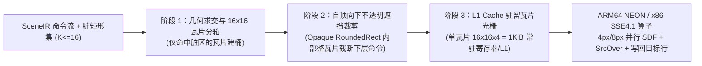

# gfx（图形光栅与矢量着色引擎）总体设计

Type: spec
Status: active
Updated: 2026-11-18
Version: 2.1.0

一句话说明：`gfx`（承载于 `berry-gfx` v2 与纯数学核 `berry-gfxface`）是 BerryOS 的跨后端 2D 矢量、文本与液态玻璃光场渲染引擎——以「统一紧凑中间表示（SceneIR）+ 16×16 瓦片分箱管线 + 预乘色彩混合 + 超椭圆 SDF 解析抗锯齿 + 边缘折射与动态高光液态玻璃 + 软硬双后端像素共识」取代早期纯标量无混合 v1 光栅器。

## 背景

[渲染管线与桌面 SDK 及镜像存储深度审计](../../research/2026-11-18-渲染管线与桌面SDK及镜像存储深度审计.md) 证实：现役 `berry-gfx` v1 缺少 8-bit Alpha 混合、解析抗锯齿、柔和阴影、渐变、背景模糊与灰度矢量字形，且核心填充走逐像素双重界检标量循环，从物理上锁死了现代旗舰桌面视觉品质。本规格遵循「不引庞大第三方 C++ 图形栈、全 Rust `no_std` 自研一步到位」原则（架构取舍见 [场景图 GPU 硬件卸载与对数调度及 CoW 存储架构裁决](../../notes/proposed/2026-11-18-场景图GPU硬件卸载与对数调度及CoW存储架构裁决.md)），定义 `gfx` 2.0 的长期技术契约。

## 范围

- **覆盖**：预乘色彩空间与像素格式契约；统一紧凑绘制中间表示 `SceneIR`；16×16 瓦片分箱（Tile Binning）与遮挡早退管线；ARM64 NEON / x86_64 SIMD 扫描线与混合算子；SDF 解析抗锯齿图元（连续曲率超椭圆 Squircle、多层解析投影、渐变、二/三次贝塞尔矢量路径）；Dual-Kawase 实时背景模糊算子；按需映射 TrueType/OpenType 轮廓光栅、8-bit/子像素字形图集与 CJK/双向文本排版测量；CPU 瓦片软后端与 GPU Uber-Shader 硬后端的一致性对拍契约。
- **不覆盖**：跨进程表面句柄传递、多窗口场景合成与 Virtio-GPU/Vulkan 设备驱动（归 [gpu-accel 总体设计](../gpu-accel/design.md)）；UI 保留树布局与响应式组件状态（归 [应用 API 全景](../../../docs/应用API全景-v1.0.md) 及 `ui-sdk`）；宿主模拟器窗口上屏（归 [Berry 设备平台 CLI-first 设计](../../../docs/Berry设备平台-CLI-first设计-v1.9.md)）。

## 契约

### 一、预乘色彩空间与表面格式契约

1. **内部标准像素表示**：全管线统一采用预乘 Alpha（Premultiplied Alpha）`PremulRgba8`（内存小端布局 `[B, G, R, A]` 对齐 `Bgra8Unorm` 硬件扫描输出与宿主 Metal/Vulkan 纹理，零通道交换开销）及高动态材质中间态 `PremulRgba16Q12`。
2. **标准合成算子**：默认实装 Porter-Duff `Src`（不透明直写）与 `SrcOver`（预乘公式 $C_{\text{out}} = C_{\text{src}} + \lfloor C_{\text{dst}} \cdot (255 - A_{\text{src}}) + 127 \rfloor / 255$，纯无分支整数定点精确除 255：`((x + 128) + ((x + 128) >> 8)) >> 8`），并支持 `DstIn`（蒙版裁剪）与 `Plus`（高光叠加）。严禁再使用「`A != 0` 丢弃 Alpha 强行覆盖」的 v1 镂空键逻辑（旧 `BYI1` 资产解码入口自动转换为预乘 `PremulRgba8`）。
3. **伽马感知文字与渐变混合**：文本覆盖率混合内置 256 项静态线性化查找表（sRGB ↔ Linear LUT，共 1KiB `.rodata`），确保黑底白字与白底黑字笔画视觉粗细严格一致，消除灰边发虚。

### 二、紧凑绘制中间表示（`SceneIR`）契约

`CommandEncoder` 生成零堆分配、可跨进程零拷贝传输、可被 CPU 瓦片光栅器与 GPU Compute/Fragment Uber-Shader 同源消费的紧凑字节对齐命令流：

1. **几何与变换**：支持 2D 仿射变换矩阵 `Affine2D`（Q16.16 定点或 IEEE-754 `f32` 编译期一致表示，覆盖平移、缩放、任意角度旋转与错切）及嵌套圆角裁剪栈 `ClipStack`（不再局限于轴对齐直角矩形裁剪）。
2. **八大原子绘制原语（`PrimKind`）**：
   - `RoundedRect`：支持四角独立半径与曲率指数（含标准圆弧 $n=2$ 与连续曲率超椭圆 Squircle $n \approx 4$）、内嵌 1px 抗锯齿描边（Border / Glass Rim）；
   - `BoxShadow`：解析近似高斯误差函数（`erf` 有理多项式定点数逼近）圆角矩形内外投影，无需分配临时模糊缓冲即可单遍算出任意模糊半径 `sigma` 的柔和阴影；
   - `PathFill / PathStroke`：二阶/三阶贝塞尔平坦化线段流 + 扫描线梯形面积精确 8-bit 覆盖率解析抗锯齿（Non-Zero / Even-Odd 填充规则，支持端点圆帽/方帽与斜接/圆接）；
   - `Brush`：纯色（`Solid`）、多色标线性渐变（`LinearGradient` + Bayer 4×4 抖动消除 8-bit 色带）、径向渐变（`RadialGradient`）与图像采样画刷（`ImageBrush`，支持最近邻与双线性带完整 8-bit Alpha 插值）；
   - `GlyphRun`：定位字形序列（含亚像素横向四分位偏移 `subpx_x ∈ {0, 1, 2, 3}`、字形图集句柄与前景画刷）；
   - `BackdropBlur`（`LiquidGlass` 液态玻璃与光场材质滤镜）：融合 [iOS 与鸿蒙融合液态玻璃及光场交互标准](../../../docs/iOS与鸿蒙融合液态玻璃及光场交互标准-v2.0.md) 第二节，支持模糊半径 `radius_px`、超椭圆冠部边缘凸透镜折射强度 `refract_q8`、饱和度增益与环境色漫溢 `vibrancy_q8`、叠加色调 `tint: PremulRgba8`、随触点/指针坐标 `(light_x, light_y)` 实时衰减的镜面棱边高光与触控光场涟漪相位 `ripple_q8`（系统开启 `Reduce Transparency` 时自动短路为高对比不透明实心填充）。

### 三、16×16 瓦片分箱与 SIMD 光栅管线契约

废除旧版「逐命令全屏/大脏区遍历 + 逐像素 `put_px` 双重界检」架构，升级为现代 **Tile-Based Deferred Rasterization（TBDR 软核）**：

1. **边界检查外提铁律**：所有纹理界与脏区裁剪在阶段 1 瓦片分箱与行段（Span）生成时一次性完成；阶段 3 瓦片内核只操作编译期定长 `[u32; 256]`（16×16 栈上对齐瓦片缓冲）或已证明界内的行切片 `&mut [u32]`，**内层循环零分支界检、零逐像素字节拆装**。
2. **自顶向下零过绘剔除（Zero-Overdraw Culling）**：分箱器对每个 16×16 瓦片反向扫描命令链，一旦遇到完全覆盖该瓦片且 `A == 255` 的不透明实心区域（如全屏应用底色、不透明卡片中心区），直接截断该瓦片更早的所有背景绘制指令，保证壁纸与被盖图层在该瓦片上 **零 CPU 周期消耗**。
3. **SIMD 向量化双轨实现**：
   - 在 `berry-gfxface` 提供 100% 安全纯标量跨度（Span）参考实现，作为宿主机测试 oracle 与未知架构回退；
   - 在 `cfg(target_arch = "aarch64")` 下使用稳定版 `core::arch::aarch64` NEON 内联算子（单次处理 4 至 8 像素：`FillSpan` 64B 成组写入、`SrcOver` 预乘混合、SDF 圆角距离场 4 像素向量求值、双线性图像采样、8-bit 字形覆盖率着色）；在 `cfg(target_arch = "x86_64")` 下提供等价 `SSE4.1/AVX2` 算子（加速宿主机预览与 x86 目标）。
4. **Dual-Kawase 实时毛玻璃算子契约**：
   - 遇到 `BackdropBlur` 原语时，先将底层已合成脏区（外扩模糊核边界边距 `pad = ceil(radius)`）通过 NEON 2×2 均值盒式滤波连续 2 级降采样至 **1/4 分辨率**（像素面积缩至 1/16！）；
   - 在 1/4 缓冲上执行 2 至 3 趟对角 5 抽头 Dual-Kawase 滤波，随后双线性上采样回目标瓦片，单遍融合饱和度矩阵、半透明 `tint` 与静态蓝噪声抖动表；
   - 严禁在全分辨率缓冲上跑大核一维可分离高斯卷积，确保 1080×1920 半屏毛玻璃单帧 CPU 耗时在 Cortex-A72 / Apple HVF 下 **≤ 0.8ms**。

### 四、矢量字体光栅、Glyph Atlas 与多语种文本引擎契约

1. **按需只读映射矢量字库**：废除将字形点阵硬编码进 Rust 源码数组的主路径（仅保留极小 8×16 ASCII 紧急故障恢复字模）；系统内置标准 OpenType/TrueType 字体文件（Latin/符号 + CJK 常用字覆盖集）位于只读根卷，经只读 `VMO` 按需调页映射，全系统多进程共享同一物理字库页，零私有内存复制。
2. **自研 `no_std` 轮廓光栅与多级 LRU 图集**：
   - 内置轻量 TrueType `glyf` / `loca` / `cmap` / `hmtx` / `kern` 解析与扫描线精确面积覆盖率光栅器（输出 8-bit 灰度 Alpha 位图，大字号 >48px 可选生成多通道 MSDF 供缩放动画无损复用）；
   - 字形图集升级为分档Shelf-Packing 2D 纹理页（`1024×1024 R8Unorm`），由确定性代际 LRU 管理；在客户端与合成器共享架构下，全系统共享一份只读公共字形图集 VMO，应用无需各自重复光栅汉字。
3. **排版测量与折行能力（`berry-textlayout`）**：原生支持 UTF-8 解码、Unicode UAX #14 中英文混排断行规则（CJK 按字可断与标点避头尾、英文按词不断裂）、最大行数截断自动追加省略号 `…`、行高倍数、字距微调及光标索引 ↔ 像素坐标双向 O(log N) 映射（支撑文本选区与输入法候选框精确定位）。

## 验收标准

1. **吞吐与帧预算硬指标**：在 Apple Silicon HVF（及同频 ARM64 基准）1080×1920 分辨率下：全屏纯色/圆角清除 **≤ 0.15ms**（较 v1 `1.97ms` 提速 **≥ 13×**）；全屏 `SrcOver` 半透明叠层 **≤ 0.30ms**；半屏 Dual-Kawase 毛玻璃控制中心渲染 **≤ 0.80ms**；含 300 个抗锯齿中英文混合字形与 20 张圆角阴影卡片的复杂列表滑动帧 **≤ 1.2ms**（占 120Hz 8.33ms 预算不足 15%）。
2. **软硬像素共识门禁**：`berry-gfx` NEON 路径、纯标量参考路径与宿主 `wgpu` Uber-Shader 路径在同一标准测试集（含 Squircle 圆角、柔和阴影、渐变、贝塞尔图标、毛玻璃与中英文混排）上逐像素最大通道误差 `max_channel_diff <= 1`（定点舍入界内），纳入 `just test-host` CI 硬门禁。
3. **内存与安全不变量**：`berry-gfx` 核心库保持 `#![no_std]`、渲染执行期零动态堆分配（瓦片桶与降采样工作区使用创建期定容池）、敌意极端坐标（`i32::MIN..=i32::MAX`、NaN/零尺寸/超大模糊半径）下零 Panic、零越界读写（通过 Miri 与 Fuzz 100 万次随机命令流验证）。

## 适用边界

- 3D 网格光栅、骨骼动画与自定义 PBR 材质着色器不在 `gfx` 2D 引擎职责内；需要原生 3D 渲染的应用通过 [gpu-accel 总体设计](../gpu-accel/design.md) 的直通 GPU Surface 通道直接提交硬件纹理。
- CI 回归测试在无 GPU 环境下以纯标量/NEON 瓦片软后端为唯一确定性基准，与硬件加速后端解耦。
