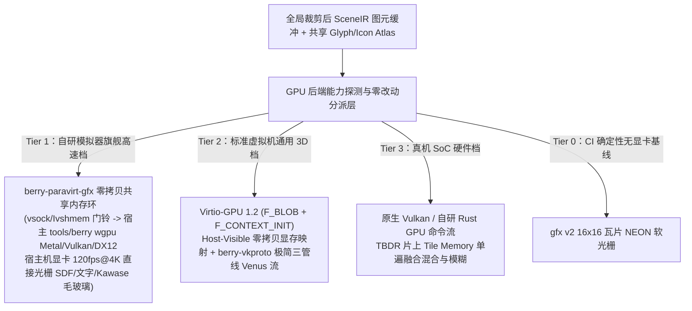

# gpu-accel（真 GPU 硬件渲染卸载与半虚拟化场景加速）总体设计

Type: spec
Status: active
Updated: 2026-11-18
Version: 2.0.0

一句话说明：`gpu-accel` 定义 BerryOS 突破 `virtio-gpu 2D`「仅搬运不绘制」物理天花板的三阶真 GPU 硬件渲染卸载与保留式场景流（`SceneStream`）架构——让模拟器与真机将 2D 矢量、文字、阴影与实时毛玻璃计算 100% 卸载至 GPU 硬件，同时将多应用图形内存占用压缩 90% 以上。

## 背景

[渲染管线与桌面 SDK 及镜像存储深度审计](../../research/2026-11-18-渲染管线与桌面SDK及镜像存储深度审计.md) 与 [10-渲染卸载真相](../../../research/显示与加速体系设计/10-渲染卸载真相-virtio-gpu-2D边界与自研光栅优化.md) 一手实证：Linux `virtio_gpu.h` 的 14 条 2D 命令零绘制语义，像素计算 100% 压在客机 CPU；若所有窗口仅采用客户端分配双/三缓冲位图交换链（Swapchain），在 1080×1920 至 4K 分辨率下多驻留应用仍会消耗数十至上百 MiB 物理内存并承受客机 CPU 光栅开销。本规格在不引入百万行 Mesa C++ 驱动进客户端进程的前提下（坚守 ADR #51 最小可信计算基），衔接 [gfx 总体设计](../gfx/design.md) 与 [显示与加速体系设计](../../../docs/显示与加速体系设计-v1.1.md)，立定单点驱动、全栈受益的 GPU 硬件加速终态契约（决策因果见 [场景图 GPU 硬件卸载与对数调度及 CoW 存储架构裁决](../../notes/proposed/2026-11-18-场景图GPU硬件卸载与对数调度及CoW存储架构裁决.md)）。

## 范围

- **覆盖**：客户端免位图保留式场景流（`SceneStream`）与传统位图交换链（`Swapchain`）无感融合协议；阶一模拟器半虚拟化零拷贝 GPU 渲染环（`berry-paravirt-gfx` → 宿主 `wgpu` Uber-Shader + Apple VZ `IOSurface`）；阶二标准虚拟化 `Virtio-GPU 3D`（`RESOURCE_CREATE_BLOB` 零拷贝显存 + `SUBMIT_3D` 轻量 Rutabaga/Venus 命令子集 `berry-vkproto`）；阶三真机原生 Vulkan / Rust TBDR 硬件队列与显式时间线同步栅栏（Timeline Semaphore / Fence）。
- **不覆盖**：CPU 端 16×16 瓦片 NEON 软光栅数学细则（归 [gfx 总体设计](../gfx/design.md)）；窗口焦点策略与输入路由（归 `compositor`）；宿主模拟器 CLI 命令集（归 [Berry 设备平台 CLI-first 设计](../../../docs/Berry设备平台-CLI-first设计-v1.9.md)）。

## 契约

### 一、单点 GPU 驱动原则与双模表面融合契约

1. **客户端零 GPU 驱动铁律**：普通 SDK 应用进程内**不链接任何 Vulkan / OpenGL / Gallium 驱动库**，仅输出紧凑安全的 [gfx 总体设计](../gfx/design.md) `SceneIR` 增量字节流（典型帧 `256B ~ 4KiB`）与只读图像/字形资产 VMO 引用；全系统仅合成器（或其专署隔离伙伴驱动 `vgpu3d`）持有硬件/虚拟 GPU 上下文能力，从架构根源杜绝复杂着色器编译器攻击面扩散至千百个应用进程。
2. **保留式 `SceneStream` 零位图模式（低内存与后台冻结杀手锏）**：
   - 窗口支持声明 `SurfaceMode::SceneStream`（SDK 应用默认模式）或 `SurfaceMode::Swapchain`（重度游戏/视频/相机自绘模式）。
   - 在 `SceneStream` 模式下，应用**无需分配任何全屏或窗口级 RGBA 像素缓冲 VMO**；合成器校验并合并该会话的 `SceneIR` 节点子树后，连同桌面壁纸、系统栏与过渡弹簧变换矩阵一起，**在单次全局 GPU RenderPass 中直接硬件光栅化到扫描输出帧缓冲**！
   - 10 个并发常驻 `SceneStream` 窗口的显存总占用从 `> 100MiB` 降至 `< 2MiB`，且应用退入后台被 `SuspendToken` 彻底冻结（0% CPU）期间，GPU 仍可按任意缩放比与圆角实时重绘其高清多任务卡片与透视背景。

### 二、三阶硬件 GPU 渲染后端契约

1. **Tier 1：`berry-paravirt-gfx` 半虚拟化宿主 `wgpu` 直通管线（Mac/Linux/Win 模拟器全平台 120fps）**
   - 针对 `virtio-gpu 2D` 无绘制原语且 macOS Homebrew QEMU 缺 `virgl` 的现实约束，定义自研定长二进制环协议 `berry-paravirt-gfx`（纯函数编解码 crate，宿客同源共享）：
     - **共享纹理池（`AtlasSlab`）**：客机将矢量字体产出的 8-bit 字形图集页与 `.bap` 图标纹理写入共享内存池，仅同步增量脏页号；
     - **图元实例流（`GpuPrimInstance` 64B 定长结构）**：将圆角矩形、解析阴影、渐变、字形 Quad 与毛玻璃区域统一编码为 GPU Storage Buffer 实例数组，经单次门铃通知宿主 `tools/berry`；
     - **宿主 GPU Uber-Shader 执行**：宿主 `wgpu` 接收实例切片上传至显卡 Storage Buffer，运行 2 个极简 WGSL Pass（Pass 1：降采样 Dual-Kawase 模糊纹理生成；Pass 2：实例化 SDF/文本/纹理预乘混合上屏），在 Apple Silicon Metal、Linux Vulkan 与 Windows DX12 上统一直跑 **120fps @ 1080P / 60fps @ 4K**，客机 CPU 光栅开销精确降为 **0%**。
2. **Tier 2：Virtio-GPU 1.2 `BLOB + Venus` 极简子集（`berry-vkproto`）**
   - 启用 Virtio-GPU `VIRTIO_GPU_F_RESOURCE_BLOB`：扫描输出与纹理缓冲直接映射宿主机 Host-Visible 共享物理区，**彻底废除 `TRANSFER_TO_HOST_2D` 的 `iov_to_buf` 内存拷贝**；
   - 在宿主支持 `VENUS` / `GFXSTREAM_VULKAN` capset 时，经 `< 3,500` 行纯 Rust 序列化库 `berry-vkproto` 提交预编译 SPIR-V 着色器（同源编译自上述 2 个 WGSL 着色器！）与实例化绘制命令，无需任何 C 语言驱动栈即可打通标准虚拟化 3D 硬件加速。
3. **Tier 3：真机 TBDR（Tile-Based Deferred Rendering）亲和设计**
   - 着色器管线天然针对移动/手表端 ARM Mali、Adreno 与 Apple GPU 的片上 Tile Memory 优化：不透明图元按前向后深度测试（Early-Z）零片外带宽剔除，半透明 `SrcOver` 在片上寄存器内完成，仅在 `BackdropBlur` 边界执行一次局部纹理降采样，将端侧 SoC 显存带宽与动态功耗压至物理极限。

### 三、GPU 故障隔离、超时复位（TDR）与零降级自愈契约

1. **GPU Hang 检测与毫秒级软硬回退**：每次 GPU 批次提交绑定单调 `fence_seq` 与硬件看门狗截止期（`50ms`）；若虚拟或物理 GPU 队列超时未回执，驱动立即执行 VirtIO/硬件复位，并利用合成器完整保留的内存 `SceneGraph` 在下一拍 **零数据丢失热切换至 Tier 0 NEON 瓦片软后端** 继续出帧，随后后台异步重建 GPU 上下文并透明切回硬件档——桌面与应用全程不黑屏、不崩溃！
2. **显存配额记账**：每个会话上传至共享纹理池或 Blob 显存的字节数计入其所属内核 `Job` 图形内存配额，恶意应用无法通过海量创建大纹理耗尽宿主机或真机显存。

## 验收标准

1. **4K/1080P 硬件卸载吞吐门禁**：开启 Tier 1 `berry-paravirt-gfx` 在 1080×1920 @ 120Hz 与 3840×2160（4K）@ 60Hz 档位下运行全屏多窗口拖动 + 实时毛玻璃控制中心压测，客机 `compositor` 线程单帧 CPU 耗时 **< 0.25ms**，宿主机 GPU 帧耗时 **< 2.0ms**，全程满帧零撕裂。
2. **跨后端逐帧视觉一致性**：Tier 1（WGSL Uber-Shader）、Tier 2（SPIR-V Venus）与 Tier 0（`berry-gfx` NEON 软光栅）渲染同一标准桌面场景截图，PSNR **≥ 48dB**（仅存在定点/浮点 1-LSB 舍入差异）。
3. **GPU 故障注入自愈门禁**：运行中人为冻结 GPU 完成中断模拟显卡挂死，断言系统在 `< 60ms` 内自动无缝切至 NEON 软光栅保活桌面交互，恢复 GPU 后自动重建纹理图集切回硬件加速，上层应用零重连、零感知。

## 适用边界

- 本规格专注系统合成与全套 2D/UI/毛玻璃材质硬件加速；未来兼容子系统（如 Linux/Android 容器内运行大型原生 Vulkan 3D 游戏）按 [兼容执行环境实施设计草案](../../../docs/兼容执行环境实施设计草案-v1.1.md) 通过受控独立 Virtio-GPU Context 直通子通道接入，最终输出表面作为一枚 `Swapchain` 纹理汇入本合成管线。
