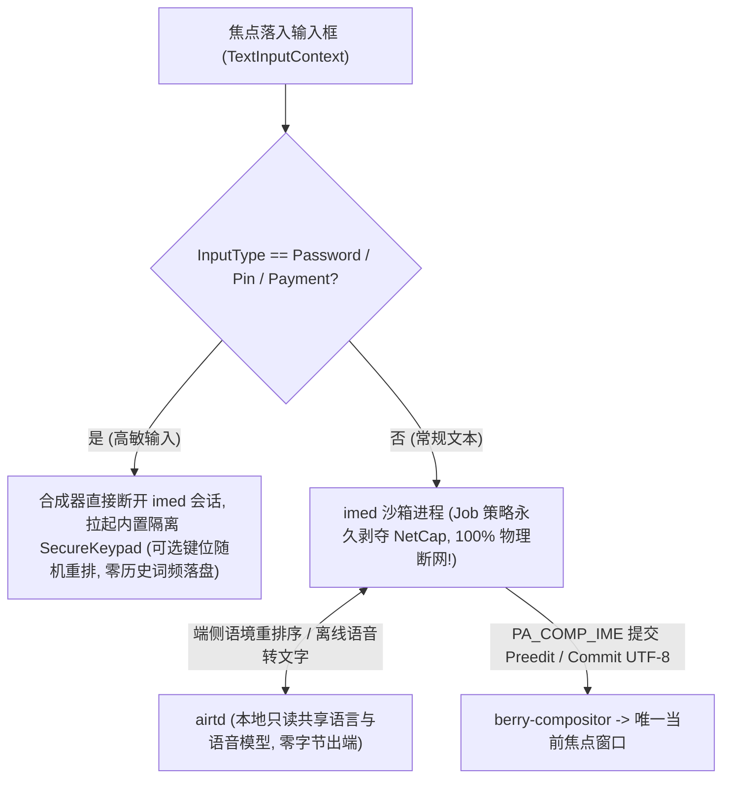

# input-productivity（零联网隐私输入法、多屏扩展桌面、全局聚焦检索与免驱矢量打印）总体设计

Type: spec
Status: active
Updated: 2026-11-18
Version: 1.0.0

一句话说明：`input-productivity`（由零联网安全输入法守护进程 `imed`、多显示器扩展桌面拓扑引擎、全局毫秒级聚焦检索服务 `searchd` 及矢量 PDF 与免驱打印扫描服务 `printd` 组成）打通 BerryOS 从掌上手机直抵桌面级 PC 高效生产力的最后四块拼图。

## 背景

[全栈 25 模块跨界接缝与深水区六盲点复核审计](../../research/2026-11-18-全栈25模块跨界接缝与深水区六盲点复核审计.md) 揭示了四项跨移动与 PC 办公的关键缺口：① 早期规格中输入法守护进程在 `compositor`（称 `softimed`）与 `ui-sdk`（称 `imed`）间尚存异名，且未从架构上解决第三方输入法联网偷传用户按键与密码框窃听顽疾；② [路线图](../../../docs/路线图-v1.2.md) 明确「主战场 = 手机 → PC」，但尚缺手机外接 4K 显示器变身 PC 桌面及双屏异构 DPI/独立刷新率窗口管理契约；③ 缺少跨应用与本地记忆库的全局秒搜入口；④ 缺少原生矢量 PDF 生成与免安装驱动局域网打印扫描支持。本规格依据 [跨模块 ABI 合龙与进程外 JIT 及深水区六子系统裁决](../../notes/proposed/2026-11-18-跨模块ABI合龙与进程外JIT及深水区六子系统裁决.md)，立定隐私优先的桌面级生产力契约。

## 范围

- **覆盖**：统一标准命名的输入法守护进程 `imed`（物理无网络沙箱、全拼/双拼/五笔/多语种词库、端侧 `airtd` 上下文纠错与离线流式语音输入、密码框合成器强制接管内置安全键盘 `SecureKeypad`、PC 硬件键盘光标跟随候选框）；多显示器热插拔扩展桌面（手机一线连 Type-C DisplayPort Desktop Mode、异构 DPI 动态 `vp` 跨屏无损缩放、每屏独立 VSync 锁拍合成）；全局混合聚焦检索服务 `searchd`（BerrySpot）；`gfx` `SceneIR` 原生矢量 PDF 序列化后端与 IPP Everywhere 免驱打印 / eSCL 无驱扫描守护进程 `printd`。
- **不覆盖**：单个应用窗口内部的文本选区排版（归 [ui-sdk 总体设计](../ui-sdk/design.md)）；底层 DisplayPort / USB Type-C Alt-Mode 物理链路握手（归 [soc-peripherals 总体设计](../soc-peripherals/design.md)）。

## 契约

### 一、物理断网零偷传输入法（`imed`）与密码硬隔离契约

1. **命名归一与绝对无网沙箱铁律**：全系统输入法服务名称统一冻结为 **`imed`**（原 `compositor` 草案中的暂名 `softimed` 自本规格起统一归并至 `imed`）。无论系统自带输入法还是用户安装的第三方输入法引擎包，`appd` 在装载 `role = "ime"` 组件时**由内核能力层强制拒绝授予任何 `NetCap` 网络句柄与广域文件写句柄**——输入法进程在物理上完全不具备联网发包能力，词库更新仅能经 `pkgmgr` 静态只读资产包分发，智能整句联想与中英混输语音听写 100% 调用端侧 `airtd` 在本地内存完成，彻底终结「刚打完某商品名转头就在别的 App 看到广告」的行业毒瘤。
2. **密码与支付输入硬件级旁路（`SecureKeypad`）**：当焦点文本框声明 `InputPurpose::Password | OneTimeCode | Pin` 时，`compositor` 自动挂起与 `imed` 的 `InputContext` 桥接（`imed` 连用户正在输入几位密码都无从获知），改由系统壳特权层原地升起零持久化内置安全键盘，同时临时屏蔽普通截屏与录屏采样（截屏图中该区域自动渲染为磨砂隐私遮罩）。
3. **触屏软键盘与 PC 物理键盘双态自适应**：在手机/平板触控态渲染底部贴合 `ime_inset` 的虚拟软键盘（支持单手悬浮缩略键盘与双指捏合拆半键盘）；一旦检测到外接 USB/BLE 物理键盘按键输入，自动收起大面积虚拟键区，仅在输入光标正下方弹出紧凑横向候选词条。

### 二、多显示器扩展桌面与「手机一线连变 PC（Berry Stage）」契约

1. **每显示器独立场景根与独立 VSync 帧钟**：`berry-compositor` 支持同时驱动 $1..=4$ 块物理或虚拟显示输出（`OutputId`）。每块显示器维护独立的分辨率、物理密度 `density_q8`、色域及 [刷新率体系规范](../../../docs/刷新率体系规范-v1.0.md) VSync 节拍器（例如手机本机 120Hz OLED 面板与外接 60Hz/144Hz 4K 显示器各自按原生最高帧率独立锁拍合成，绝不向慢速副屏向下对齐降频）。
2. **手机一线连秒开完整 PC 工作台**：当手机通过 Type-C DP 或 `berry-link` 无线投屏连接大屏显示器时，手机本机屏幕可保持独立触控手机界面（或一键充当高精度多指触控板与手写板），而外接大屏自动激活 [desktop 总体设计](../desktop/design.md) 的 `Desktop/PC` 断点模式（底部悬浮 Dock、自由多窗口层叠缩放、顶栏全局菜单与快捷键分屏），应用在手机与大屏间拖移时收到新 `density_q8` 与窗口尺寸通知，依托纯矢量 `SceneIR` 在单帧内无糊感重排为宽屏多栏布局。
3. **跨屏边缘无缝穿梭**：多屏拓扑编辑器按真实物理摆放相对位置计算屏幕邻接边，鼠标光标按毫米级物理尺度（而非像素跳变）平滑穿越不同 DPI 显示器边界；拖拽窗口跨屏时合成器实时在两屏分别裁剪合成左右半窗，松手瞬间归属权平滑移交目标屏。

### 三、全局毫秒级聚焦检索（`searchd` / BerrySpot）契约

1. **增量倒排 + 端侧向量双引擎秒搜**：桌面任意位置下拉或按下 `Alt/Cmd + Space` 即刻唤起毛玻璃悬浮搜索框 `BerrySpot`。`searchd` 监听 `pkgmgr` 应用表、系统设置树（直达任意三级子开关，如搜「护眼」直出开关按钮）、计算器/汇率单位换算，并在设备充电闲时增量索引用户授权目录文件名、文档摘要及 `berry-vault` 本地向量记忆——首字符敲击至首屏综合结果渲染耗时严格 **$\le 10\text{ms}$**。

### 四、`SceneIR` 原生矢量 PDF 后端与零驱动打印扫描（`printd`）契约

1. **零第三方重库直出工业级矢量 PDF**：因为 BerryOS 全系应用与 `berry-webview` 的绘制输出本就是结构化的 [gfx 总体设计](../gfx/design.md) `SceneIR`（含精确矢量路径、渐变与字形子集轮廓），`gfx` 内置不到 3,000 行纯 Rust `PdfBackend` 即可将任意应用的打印页面直接序列化为文字可选中、放大无限清晰的原生 PDF 1.7 文档流（拒绝把整页栅格化成几十 MB 模糊大图）。
2. **IPP Everywhere 免驱动即插即打**：彻底抛弃传统桌面系统塞满上百 MB 厂商私有 PPD 驱动的历史泥潭——`printd` 通过 `netd` mDNS 自动发现局域网内所有现代打印机与一体机（兼容 AirPrint / Mopria / IPP Everywhere 开放标准）及 USB IPP-over-USB 设备，直接协商纸张尺寸、双面与色彩并投递标准 PDF / PWG-Raster 作业流；扫描仪统一走标准 eSCL（AirScan）无驱协议直出多页 PDF 或 PNG 移交应用。

## 验收标准

1. **输入法零联网与密码旁路验证**：审查运行态 `imed` 进程的内核句柄表，确认网络套接字与外发通道句柄计数恒为 `0`；焦点切入密码框时，`imed` 收到的按键事件数为 `0`，普通截屏输出自动遮蔽安全键盘与密码区。
2. **异构双屏动态跨屏门禁**：在模拟器启动双显示输出（主屏 `1080×2400 @ 120Hz, 3.0x` + 副屏 `3840×2160 @ 60Hz, 1.5x`），将一个活跃应用窗口由手机屏拖入 4K 桌面屏，两屏各自稳定运行于 120fps 与 60fps 零撕裂，应用布局自动由单栏切换为宽屏三栏且文字边缘矢量锐利。
3. **秒搜与矢量打印验证**：在含 50,000 份本地测试文档的环境下，`BerrySpot` 检索响应 P99 $\le 10\text{ms}$；调用系统打印导出的 PDF 文件包含真实可复制 UTF-8 文本流且成功通过本地虚拟 IPP 打印机靶场验收。

## 适用边界

- 二十年前不支持 IPP Everywhere / PCLm / PWG-Raster 的纯私有主机端光栅老旧串口/并口打印机不纳入系统内核/底座内置支持，确有需求可由第三方在用户态通过受限 `UsbDeviceCap` 提供独立打印插件应用。
