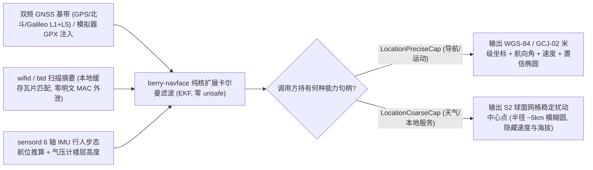

# location（多源融合定位、硬件地理围栏与双精度位置隐私子系统）总体设计

Type: spec
Status: active
Updated: 2026-11-18
Version: 1.0.0

一句话说明：`location`（由多源融合定位守护进程 `locationd`、扩展卡尔曼滤波航位推算核 `berry-navface`、离线网格模糊器与协议库 `berry-locproto` 组成）补齐 BerryOS 在移动、穿戴与车载导航场景的空间坐标感知能力，并以微内核句柄物理隔离「5 公里大致位置」与「米级精确位置」。

## 背景

[全栈 25 模块跨界接缝与深水区六盲点复核审计](../../research/2026-11-18-全栈25模块跨界接缝与深水区六盲点复核审计.md) 查明：此前 25 份系统模块设计中完全缺失地理定位服务，导致地图导航、户外跑步骑行轨迹、本地天气、基于位置的提醒、丢失设备查找以及紧急救援呼叫自动报送经纬度均无底层支撑。同时，行业内大量无需精确坐标的资讯、商城与天气应用滥用米级 GPS 权限长期追踪用户家庭住址与出行轨迹。本规格依据 [跨模块 ABI 合龙与进程外 JIT 及深水区六子系统裁决](../../notes/proposed/2026-11-18-跨模块ABI合龙与进程外JIT及深水区六子系统裁决.md)，立定高精度、超低功耗且默认守护轨迹隐私的现代定位契约。

## 范围

- **覆盖**：真机多星座双频 GNSS 驱动抽象（UART/SPI NMEA 0183 + 原始伪距/载波相位观测量 + 安全星历辅助 A-GNSS）、不出端匿名 Wi-Fi/BLE 粗定位与 [soc-peripherals 总体设计](../soc-peripherals/design.md) `sensord` 6 轴 IMU + 气压计紧耦合航位推算（PDR / Dead Reckoning）；宿主模拟器实时定位与 GPX/KML 轨迹倍速回放桥接（`berry location`）；内核句柄级双精度分权（`LocationCoarseCap` vs `LocationPreciseCap`）与顶栏定位隐私指示联动；协处理器低功耗硬件地理围栏（Geofencing）；紧急呼叫（E911/SOS）受控单次高精度位置通道。
- **不覆盖**：矢量离线地图瓦片渲染业务本身（归上层地图应用基于 [gfx 总体设计](../gfx/design.md) 实现）。

## 契约

### 一、多源异构紧耦合融合定位引擎（`berry-navface`）契约

1. **全场景无缝连续定位**：纯数学融合算法抽入 `no_std` 库 `berry-navface`——开阔地带优先采用双频多星座 GNSS 消除电离层延迟（水平精度 $\le 1.5\text{m}$）；进入地下车库、隧道或高楼峡谷卫星失锁瞬间，自动无缝切换至基于 `sensord` 加速度计/陀螺仪步态积分与磁力计航向的惯性航位推算（Dead Reckoning）及气压计高度变化估算楼层，保持导航箭头连续平滑推进不乱跳。
2. **隐私保护型辅助定位（Zero-Tracking A-GNSS & Wi-Fi Tile）**：冷启动星历加速（A-GNSS）仅经匿名代理拉取全球公开广播星历文件（服务器不知设备所在城市）；室内 Wi-Fi 定位采用按大区预下载到本地的只读压缩接入点哈希瓦片在**设备端离线解算**，严禁像传统厂商那样将用户周边的路由器 BSSID 列表实时明文上传云端。
3. **模拟器一等公民轨迹仿真**：宿主 `berry` 平台提供地图选点面板与 CLI 命令 `berry location set <lat> <lon> [alt]`、`berry location play track.gpx --speed 2x`，经虚拟传感器通道直驱客机 `locationd`，使导航与运动类应用无需出门路测即可完成全自动化闭环回归。

### 二、句柄级「大致位置 vs 精确位置」物理隔离契约

1. **双轨独立能力令牌**：系统授权弹窗同时提供「精确位置」开关（天气、日历、社交发帖默认关闭精确开关，仅发 `LocationCoarseCap`）：
   - 持有 `LocationCoarseCap` 的应用与持有 `LocationPreciseCap` 的应用连接的是 `locationd` 完全不同的会话分支；
   - **抗多次采样三角定位反推（Stable Grid Snapping）**：粗定位绝不能简单给真实坐标加零均值高斯噪声（否则恶意应用连续采样 100 次求平均即可算回用户真实住宅坐标！）——`locationd` 将地球表面划分为约 $5\text{km} \times 5\text{km}$ 的 S2 球面单元格，并混入每应用每 24 小时轮换的私有 HMAC 偏移量，只要用户在同一个单元格内活动，应用读到的恒定是同一个模糊锚点且速度、航向与海拔字段恒置零。
2. **后台定位严苛铁律与顶栏状态外显**：普通应用仅发「前台使用期间（While-In-Use）」位置会话，一旦切入后台且无实时语音导航前台活动胶囊（Live Capsule），`locationd` 立即挂起其位置推送；任何应用正在获取位置时，桌面状态栏强制显示定位箭头指示并记入隐私访问时间轴。

### 三、超低功耗地理围栏（Geofencing）与穿戴批处理契约

1. **零应用常驻地理围栏**：应用需要「到家自动开灯」或「靠近地铁站弹出乘车码」时，向 `locationd` 注册最多 32 个圆形或多边形地理围栏（`Enter` / `Exit` / `Dwell`）后即可彻底进入冻结或墓碑态；`locationd` 利用基站扇区跳变、已存家庭/公司 Wi-Fi 连接变化与低功耗 GNSS 协处理器间歇探针监测边界，平日额外待机功耗 $< 0.5\text{mW}$，仅在真正跨越围栏瞬间通过 `workmgr` / `intentd` 精准唤醒目标动作。
2. **穿戴户外运动批处理（Batching FIFO）**：手表独立跑步记录轨迹时，GNSS/传感器协处理器每 1 秒采样暂存至硬件 64 槽 FIFO，每 60 秒才批量唤醒一次主应用核落盘绘线，大幅延长穿戴端 GPS 运动续航。

## 验收标准

1. **反三角定位隐私数学验证**：模拟用户在 $1\text{km}$ 住宅生活圈内随机漫步 10,000 个真实轨迹点，持 `LocationCoarseCap` 的测试应用全程读取到的坐标恒定锁死在同一模糊网格锚点，估算真实住址误差始终 $> 2.5\text{km}$；两个不同应用在同一地点读到的模糊锚点互不相同（防应用共谋指纹关联）。
2. **隧道失锁航位推算门禁**：回放一段包含 60 秒完全切断卫星信号并带 90 度转弯的实测车载/步行 GPX+IMU 数据集，`berry-navface` 推算轨迹在失锁末端的累计水平漂移误差 $< 8\%$，恢复卫星信号后 2 秒内平滑收敛无折线瞬移。
3. **息屏围栏零唤醒验证**：注册 10 个远端地理围栏后设备静置 1 小时，目标应用进程 CPU 唤醒次数恒为 0；模拟器注入坐标跨入围栏半径后 1 秒内准确触发唤醒回调。

## 适用边界

- 厘米级测绘 RTK 差分基站接入通过标准蓝牙/USB 串口外接高精度接收机向专业测绘应用开放，不计入日常消费级手机基线功耗预算。
