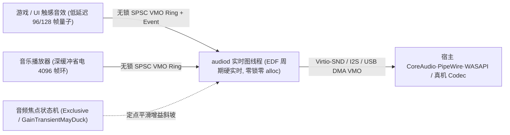

# media（实时音频图、硬编解码与相机隐私媒体管线）总体设计

Type: spec
Status: active
Updated: 2026-11-18
Version: 1.0.0

一句话说明：`media`（由实时音频服务器 `audiod`、零拷贝媒体编解码服务 `mediad`、相机管线服务 `camerad` 及协议库 `berry-mediaproto` 组成）是 BerryOS 的全栈视听实时子系统——以「无锁共享环 EDF 硬实时混音 + 硬件解码 YUV 表面直通合成器 + 物理级相机/麦克风隐私指示硬互锁」补齐操作系统感官闭环。

## 背景

[整机生态十维盲区全景审计](../../research/2026-11-18-整机生态十维盲区全景审计.md) 揭示：当前 BerryOS 完全没有音频输出与录音通路、没有视频编解码服务，相机与相册应用仅停留在静态占位界面。传统操作系统在媒体栈上常犯两类结构性错误：要么音频路径充满互斥锁、堆分配与多次内核态拷贝导致触控音效延迟超过 40ms 并偶发爆音；要么视频解码帧经 CPU 软转 RGB 反复拷贝烧穿内存带宽。本规格依据 [整机十维缺失拼图全栈终态架构裁决](../../notes/proposed/2026-11-18-整机十维缺失拼图全栈终态架构裁决.md)，确立对标 CoreAudio 与 PipeWire 的零拷贝低延迟视听架构。

## 范围

- **覆盖**：实时音频图守护进程 `audiod`（无锁 SPSC 共享内存样本环、SIMD 多相重采样与混音、音频焦点仲裁与自动闪避 Ducking、低功耗大缓冲音乐卸载模式）；声卡与音频外设契约（QEMU `virtio-snd`、真机 I2S/HDA、USB UAC、蓝牙 LE Audio）；硬件与纯 Rust 沙箱音视频编解码器 `mediad`（Opus/AAC/FLAC、H.264/HEVC/AV1/VP9）及 PTS 主时钟音画同步；相机捕获守护进程 `camerad` 与麦克风/摄像头物理隐私门禁硬互锁。
- **不覆盖**：最终图层在屏幕上的几何混合与着色上屏（归 [gpu-accel 总体设计](../gpu-accel/design.md) 与 [compositor 总体设计](../compositor/design.md)）；蓝牙无线射频链路层（归 [net-conn 总体设计](../net-conn/design.md)）；无障碍读屏文本生成（归 [i18n-a11y 总体设计](../i18n-a11y/design.md)）。

## 契约

### 一、零锁零分配硬实时音频引擎（`audiod`）契约

1. **实时线程死律**：`audiod` 的图处理线程（Graph Runner）向 [sched-rt-gfx 总体设计](../sched-rt-gfx/design.md) 申请周期性硬实时 EDF 预算（默认量子 `128 frames @ 48kHz ≈ 2.67ms`，游戏极速档 `64 frames ≈ 1.33ms`）。在该线程函数闭包内**绝对禁止调用任何堆内存分配器、互斥锁、阻塞式系统调用或磁盘 I/O**；一切拓扑增删与音量变更均通过预分配无锁命令槽与余弦平滑增益斜坡（Ramp，消除咔哒爆音）在量子边界原子生效。
2. **双模缓冲自适应（交互极速 vs 息屏省电）**：
   - 交互音效、通话与合成器采用小量子紧密唤醒，端到端音频延迟严格 $\le 8\text{ms}$（模拟器直通宿主原生音频后端 $\le 12\text{ms}$）；
   - 纯后台音乐播放且无低延迟活跃流时，`audiod` 自动切换至 100ms–250ms 大缓冲批处理节拍，允许应用与 CPU 长时间驻留深睡态，同时向 [am 总体设计](../am/design.md) 出具真实活跃音频流资源证据（免除音乐应用被失焦 3 秒自动冰封；一旦流静音或暂停超 5 秒自动吊销证据并冻结进程）。
3. **系统级音频焦点与闪避仲裁（Audio Focus & Ducking）**：流按角色分为 `Alarm`、`VoiceCall`、`Accessibility`、`Navigation`、`Notification`、`Media`、`Game`、`SystemFeedback`。当导航播报或通知音声明 `GainTransientMayDuck` 时，`audiod` 自动将背景 `Media` 流增益在 30ms 内平滑衰减 `-12dB` 并在播报结束后平滑恢复；当语音通话声明 `Exclusive` 时，强制向背景媒体发送暂停控制事件。

### 二、零拷贝视频硬解与音画同步（`mediad`）契约

1. **沙箱隔离编解码**：所有容器解复用（MP4/MKV/WebM）与编解码工作均运行在零网络、零文件系统权限的受限沙箱工作进程池内（输入仅借用只读数据源 VMO，输出仅写回解码帧池 VMO），彻底阻断恶意构造媒体文件利用解码器内存漏洞逃逸。
2. **YUV 硬件平面零拷贝直通合成器**：`mediad` 通过 `virtio-video`（模拟器对接宿主 VideoToolbox / VAAPI / NVDEC）或真机 VPU 硬解产出 `NV12` / `P010`（10-bit HDR）格式 `GpuSurface` 句柄及显式 `AcquireFence`，直接嵌入应用的 `SceneStream` `ExternalTexture` 节点移交合成器，由 GPU Uber-Shader 在最终上屏单遍完成 BT.709/BT.2020 YUV→RGB 色彩空间转换与圆角裁剪，**全链路 CPU 零像素拷贝**。
3. **单调音频主时钟音画同步（PTS Master Clock）**：`audiod` 在共享只读状态页实时发布硬件声卡已消费样本精确计数与对应的 `CLOCK_MONOTONIC` 时间戳；播放器以音频硬件消费时钟为主基准计算视频帧目标呈现时间 `target_present_ns`，随合成器提交协议精确锁拍呈现（音画同步误差严格控制在 $\pm 15\text{ms}$ 以内）。

### 三、相机管线与不可绕过物理隐私互锁（`camerad`）契约

1. **多流零拷贝分发**：`camerad` 统一纳管宿主摄像头穿透（`virtio-camera` / UVC）与真机 MIPI-CSI ISP，支持同时输出低延迟预览流（直通合成器 `ExternalTexture`）与高分辨率拍照/编码流（纯 Rust JPEG/HEIC/AVIF 编码器落盘）。
2. **内核与合成器硬互锁隐私指示（Privacy Ledger Gate）**：凡任何进程申请打开麦克风录音环或摄像头帧流，`audiod` / `camerad` 必须先向合成器的不可遮挡系统隐私指示层注册活跃采集租约，合成器点亮顶栏硬件安全指示点（麦克风琥珀点 / 摄像头翠绿点）并返回内核签名租约令牌后，驱动队列才物理放行首帧数据；若指示点租约失效或用户在控制中心一键拨动全局「闭麦/闭镜」硬件隐私开关，驱动立即向客户端填充全静音零样本或黑场图案，无需杀死应用即可瞬间物理断流。

## 验收标准

1. **实时零爆音门禁**：在双核 CPU 85% 合成与编译负载压力下，连续播放 48kHz 双声道正弦扫频流并并发混入每 200ms 一次的 UI 触控音效持续 10 分钟，`audiod` 实时环 `xrun_count == 0`（零欠载爆音），实时线程堆分配次数 = 0。
2. **4K60 零 CPU 拷贝播放**：1080P/4K 视频播放路径中，客机 CPU 像素色彩转换拷贝字节数 = 0，音画 PTS 偏差 99 分位 $\le 12\text{ms}$。
3. **隐私互锁不可绕过性**：自动化测试模拟绕过 UI 请求直接向 `camerad`/`audiod` 发起采集消息，在未持有授权 `CaptureCap` 或全局隐私开关关闭态下，100% 被拒或仅收到全零静音/黑帧；正常采集开启 1 帧内顶栏隐私点必亮并记入审计台账。

## 适用边界

- 专业数字音频工作站（DAW）级多通道 ASIO 外置声卡插件生态与杜比全景声商业专利解码不在首版内建范围（内建开放免版税标准 Opus、FLAC、Vorbis、WAV 及系统硬件透传直通）。
