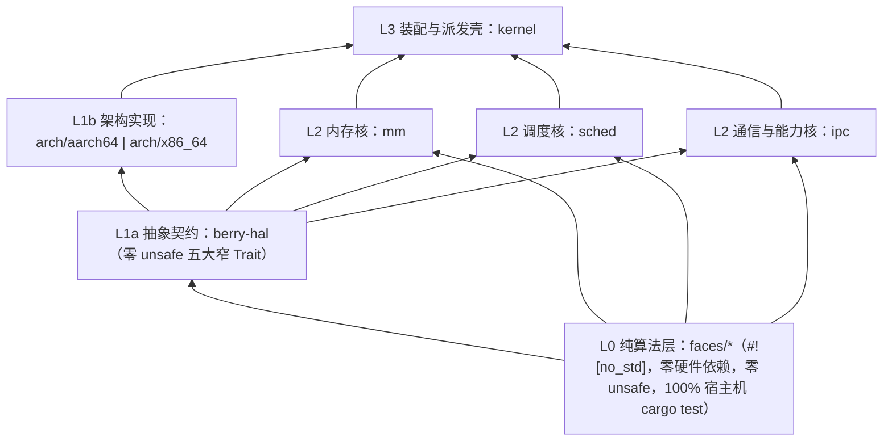

# meihe（莓核微内核）总体设计

Type: spec
Status: active
Updated: 2026-11-18
Version: 2.2.0

一句话说明：`meihe`（莓核）是 BerryOS 的唯一 EL1/Ring0 特权微内核——以「可注入的机制/策略分离 + 硬件信任边界」为单一中心，统合四层无环 Crate 拓扑、八秩无全局大锁 16 核并发模型、安全内核基元（生产面 `unsafe` ≤ 3.0%）与五大形式化模型检验不变量，作为全核演进的顶层架构宪法。

## 背景

莓核 1.x 跑通了从引导、虚拟内存、能力与通道 IPC、按需调页、双核 SMP 到调点调度 1.1（EEVDF + intent 四带 + 三槽策略表）的完整系统栈。但如 [莓核全核深度体检报告](../../research/2026-11-18-莓核全核深度体检报告.md) 所示，底层仍残留 G0/G2 过渡态结构债（TLB 关中断对飞死锁、ASID 无位图撞号、进程退出与通道互钉永久泄漏、`WAIT_ANY` 哨兵废除快路径、`KERN_LOCK` 与 `u8` 锁位图锁死双核上限、GICv2 与睡眠轮询驱动阻断真机、生产面 `unsafe` 达 10.54% 且存在向 `user/` 的跨层逆向依赖）。本顶层规格依据 [架构综合纲领](../../../docs/架构综合纲领.md) 与 [莓核二代终态架构六大核心裁决](../../notes/proposed/2026-11-18-莓核2代终态架构六大核心裁决.md)，锁定莓核 2.0 的跨子系统全局契约；各核心子模块的字节级与状态机细则分别归属下表唯一承载点（一事实一归属，不重复双写）：

| 领域 | 模块内部终态规格（`.agents/plans/`） | 对外跨层现行标准（`docs/`） |
|---|---|---|
| 调度与策略框架 | 机制并入本规格并发节 | [调度彻底计划 v1.2](../../../docs/调度彻底计划-v1.2.md) |
| 内存与弹性调页 | [mm 总体设计](../mm/design.md) | [内存管理设计 v1.1](../../../docs/内存管理设计-v1.1.md)（衔接 [am 总体设计](../am/design.md)） |
| 异步端口、IPC 与能力沙箱 | [ipc 总体设计](../ipc/design.md) | [IPC 设计 v1.0](../../../docs/IPC设计-v1.0.md)、[能力模型设计 v1.0](../../../docs/能力模型设计-v1.0.md)、[系统调用 ABI 设计 v1.0](../../../docs/系统调用ABI设计-v1.0.md) |
| 跨架构抽象、中断、SMMU 与黑匣子 | [hal 总体设计](../hal/design.md) | [安全与硬件隔离设计 v1.0](../../../docs/安全与硬件隔离设计-v1.0.md)、[驱动模型设计 v1.0](../../../docs/驱动模型设计-v1.0.md)（衔接 [cbox 总体设计](../cbox/design.md)） |
| 工程拆刀与推进清单 | [莓核五波十六刀演进实施计划](../2026-11-18-莓核五波十六刀演进实施计划.md) | — |

## 范围

- **覆盖**：内核四层 Crate 有向无环依赖宪法；四大安全内核基元（`CpuMask`、`PerCpu`、`StaticOnce`、`PinnedObj`）与 `unsafe ≤ 3.0%` 准入铁律；八秩细粒度 `LockRank` 严格偏序矩阵与去 `KERN_LOCK` 并发协议；16 核 SMP 生命周期、18 槽无阻塞 RCU 策略换表与每核本地异步回收；五大核心机制的 TLA+ / `loom` 形式化检验不变量。
- **不覆盖**：单个子系统内部的数据结构位域细节（分别归属 `mm`、`ipc`、`hal` 模块设计）；用户态系统服务与工具包实现。

## 契约

### 一、四层 Crate 有向无环拓扑与分层禁令

内核工作区严格执行自底向上的四层有向无环图（DAG），由 `tools/docs_guard.py` 静态校验 Cargo 依赖边：

1. **零逆向依赖铁律**：`faces/*`、`berry-hal`、`arch/*`、`mm`、`sched`、`ipc`、`kernel` 对 `user/`、`drivers/`、`tools/` **严禁存在任何路径或符号依赖**；跨内核与用户态共享的纯数学/协议定义（如能量模型 `em`、点阵字形核 `fbfont`）一律下沉至 `faces/`，由用户态向上单向引用。
2. **职责去臃肿纪律**：`kernel` crate 仅保留启动装配（`boot`）、系统调用 C-ABI 参数编解码派发壳（按域拆分子模块，单文件不超过 800 行）与子系统胶水；任何可脱离硬件寄存器的状态机判定律一律进 `faces/*` 先过宿主机单测再接线内核（承接 [调度彻底计划 v1.2](../../../docs/调度彻底计划-v1.2.md) 裁四）。

### 二、安全内核基元与 `unsafe ≤ 3.0%` 准入宪法

废除业务逻辑中的裸 `static mut`、手工裸指针强转与无内部同步的 `unsafe impl Sync`，全核强制使用以下四个已封装并经 Miri / `loom` 验证的安全基元：

1. **`CpuMask(u16)`**：单寄存器 16 核位图值类型，提供 `singleton(cpu)`、`online()`、`iter()`（基于 `trailing_zeros` 硬件指令单拍迭代），编译期钉死 `MAX_CORES = 16`。
2. **`PerCpu<T>`**：基于硬件每核基址寄存器（`TPIDR_EL1` / `GSBase`）与 64B 缓存行对齐隔离槽 `[CachePadded<UnsafeCell<T>>; 16]`；**唯一安全借用入口 `with_local(&self, pin: &PreemptPin, f: impl FnOnce(&T))` 将借用生命周期静态绑定在不可抢占/关中断守卫 `PreemptPin<'_>` 上**，编译期杜绝借用跨上下文切换迁移到他核的悬垂风险。
3. **`StaticOnce<T>`**：基于三态原子机（`UNINIT=0 / INITING=1 / READY=2`）的启动期单次写入、运行期零开销 `Acquire` 只读容器，彻底替代启动配置的 `static mut Option<T>`。
4. **`PinnedObj<T>`**：侵入式 `AtomicUsize` 引用计数对象句柄（`Relaxed` 增、`Release` 减 + 归零 `Acquire` 栅栏析构），替代依赖 `KERN_LOCK` 的非原子 `ObjRef`。
5. **`unsafe` 五类白名单与密度硬帽**：内核生产面（剔除 `ktest`/`bench`）`unsafe` 非空行占比硬上限 **≤ 3.0%**；`tools/unsafe_audit.py` 仅允许五类合法出现点：① `arch/` 特权指令与汇编边界；② 页表描述符与 DMA 物理直映读写；③ `Buddy`/`Slab` 底层空闲块指针；④ 侵入式双链容器（`Runqueue`、`ObserverList`）封装体内部；⑤ 经 `access_ok` + `PAN` 窗口包裹的 `copy_from/to_user` 原语内部。业务与系统调用层出现新裸 `unsafe` 块在评审与门禁中直接拒收。

### 三、八秩无全局大锁并发模型（去 `KERN_LOCK` 化）

1. **废除 `KERN_LOCK` 与 `SVC` 入口锁预取**：所有系统调用从 EL0/Ring3 进入内核后均处于**零锁、开中断（仅异常入口瞬时保存帧后按需恢复中断，或细锁内局部 `irqsave`）**状态；彻底废除旧 `0x2E` 在系统调用入口同时锁死 `SLEEPQ + RQ0 + RQ1 + KERN_LOCK` 的串行包络。
2. **Task 调度标志与执行流锁栈彻底分离**：
   - `Task::sched_flags: AtomicU8` 仅承载任务调度状态位：`FLAG_FROZEN (1<<0)`（`SuspendToken` 独占）与 `FLAG_THROTTLE (1<<1)`（CBS/Deadline 预算限流独占），永不编码任何 CPU 核号或自旋锁持有态；
   - 执行流持锁顺序由 `PerCpu<LockdepState>` 按以下**八秩严格偏序（`LockRank`）**执法（任何执行流已持最大秩 `R_cur` 时，新取锁秩 `R_new` 必须满足 `R_new > R_cur`；同秩仅允许下文列明的有向对）：

| 秩号（`LockRank`） | 锁类别 | 粒度与作用域 | 同秩嵌套规则与约束 |
|---|---|---|---|
| **10** | `JobLock` | 每个 `Job` 容器一把 | 仅允许**父 `Job` → 子 `Job`** 单向嵌套；配额数值扣减走无锁原子 CAS 不取此锁 |
| **20** | `HandleTableLock` | 每个 `Process` 一把 | **禁止同秩双取**：跨进程传递遵循「锁源表 `take` → 放源表 → 锁目标表 `insert`」 |
| **30** | `VmarLock` | 每个地址空间一把 | 仅允许**父 `Vmar` → 子 `Vmar`** 单向嵌套；保护区间平衡树与 L1–L3 页表 |
| **40** | `VmoLock` | 每个 `Vmo` 一把 | CoW 创建子对象时仅允许**父 `Vmo` → 新建未公开子 `Vmo`** 单向嵌套 |
| **50** | `ObjStateLock` | 每个 `ChannelShared`/`Port`/`DpgPool` 一把 | 保护环形消息槽与内嵌 `ObserverList`；锁内投递 `PortPacket` 可嵌套目标 `Port` 队列子锁（`52`） |
| **60** | `SleepBucketLock` | `SLEEPQ` 64 散列桶每桶一把 | 替代旧全局 `SLEEPQ_LOCK`；禁止同时持两个散列桶锁 |
| **70** | `RunqueueLock` | 每核 `RQ[cpu]`（`0..16`）一把 | 跨核偷取/迁移需双锁时，**强制按核号严格升序 `min(a,b) → max(a,b)` 获取** |
| **80** | `LeafLock` | `BuddyLock` / `SlabClassLock` / `AsidLock` / `PrintLock` | **绝对叶子锁（全程 `irqsave`）**：持锁期严禁获取任何锁、严禁睡眠、严禁触发缺页或唤醒 |

3. **16 核无阻塞 RCU 策略表与每核本地排空**：
   - `sched::policy` 快照池容量定死为 `const SNAP_SLOTS: usize = MAX_CORES + 2`（即 **18 槽**）；读者在 `PreemptPin` 决策窗内设 `HAZARD[cpu] = active_idx`、出窗立即执行 `HAZARD[cpu].store(SLOT_NONE, Release)`；由于至多 16 核在读 + 1 个当前 `ACTIVE` 槽 ≤ 17 槽，写者 `publish()` 在 `POLICY_LOCK` 下恒能在 18 槽中 O(1) 命中至少 1 个绝对空闲槽，**数学上 100% 无饥饿、无阻塞、零满槽 panic**；
   - 死亡线程栈回收（`REAPQ`）与退出进程表异步清理（`HT_DRAINQ`）全部实例化于 `PerCpu`，任何核产生退出实体均推入本核队列并在本核 `idle`/`yield`/周期检查点就地释放，消除 CPU0 单核排空瓶颈。
4. **跨界扩展系统调用的微内核窄腰边界（调试、采样、随机数与受限态）**：
   - 遵从「机制极薄入核、协议与策略全留用户态」铁律，合龙总纲登记的四族跨界原语在莓核内部仅保留最小特权状态机：① **调试与追踪组（`0x41`、`0x45..0x49`）**仅负责 `RIGHT_DEBUG` 门控下的异常冻结包投递、寄存器读写、CoW 断点页替换及每核 PMU/Syscall 无锁环形 VMO 采样写入（DWARF 符号与 RSP 协议全归 [devtools 总体设计](../devtools/design.md) 与 `bdbg`）；② **受限态切换组（`0x4A berry_restricted_enter` / `0x4B berry_restricted_kick`）**仅在 `Task` TCB 绑定一页 `state_vmo` 执行同线程 Normal/Restricted 双寄存器组切换并将受限态 `SVC` 原样反射回用户态 `linux_runner`，**内核零行 Linux 系统调用翻译代码**（见 [compat 总体设计](../compat/design.md)）；③ **硬件熵源口（`0x89 berry_cprng_draw`）**仅提供每核无锁 ChaCha20 CSPRNG（由 `RNDR` / 中断抖动周期重播，见 [security 总体设计](../security/design.md)）。
5. **调页死锁免疫、内核栈保护页与跨核 PI 推挤规约**：
   - **Pager 服务端物理内存钉死（Zero-Fault Immunity）**：所有承载按需调页（`pager_create` / `0x21` / `0x23` / `0x24`）的服务端进程（`fsmgr`、`pkgmgr`），其代码段、全局数据段与服务线程栈必须在初始化完成时全量设置 `VMO_CONTIGUOUS | VMO_PINNED`，禁止按需换出；调页供给内核快路径严禁触发任何动态内存分配（Slab/Buddy），杜绝 Pager 自缺页导致的微内核环路死锁；
   - **内核线程栈底 4KiB 保护页（Kernel Stack Guard Page）**：所有内核线程堆栈（16KiB）必须分配于独立的内核虚拟地址段，栈底 4KiB 物理帧强制置为未映射（Unmapped Guard Page）；任何深度递归导致的栈溢出将立即在硬件层触发同步 Translation Fault，转入黑匣子捕获栈帧，绝对阻断静默踩踏破坏相邻内核堆对象；
   - **跨核优先级继承 `SGI_PRIO_BOOST` 无大锁异步推挤**：当 CPU A 上的高优线程通过 `channel_call` 阻塞于 CPU B 上的服务端线程时，CPU A 严禁直接获取 CPU B 的 `RunqueueLock`（杜绝跨核锁序死锁）；CPU A 原子更新目标任务的 `prio_boost` 字段并向 CPU B 发射 `SGI_PRIO_BOOST` 核间中断，由 CPU B 在本地安全调度检查点就地更新红黑树键值。

### 四、五大形式化模型检验不变量（TLA+ / `loom` 契约）

兑现 [架构综合纲领](../../../docs/架构综合纲领.md) 第 9 轴「形式化手段只锁不可委托核心机制」，以下五条不变量必须具备独立宿主机 `loom` 并发交错测试或 TLA+ 状态机规约，挂入 CI 门禁：

1. **`INV-MEM`（物理帧与配额守恒）**：任意稳态时刻，`BuddyAllocator::free_pages() + Σ PerCpuPageset + Σ SlabPages + Σ KernelStaticPages + Σ FrameRefTable_ActiveFrames == TotalManagedFrames`，且任意 `Job` 的 `ram_bytes_used` 精确等于其直属进程与子 `Job` 占用物理页字节之和；进程生灭循环后泄漏量为 0。
2. **`INV-ASID`（同代地址空间唯一性）**：对任意两个同时存活的地址空间 `A != B`，必有 `A.asid != B.asid`；且任意核 `c` 跳过 `tlbi aside1is` 激活 `A` 的充要条件是 `A.alloc_gen == roll_gen && last_cpu_gen[c][A.asid] == roll_gen && last_cpu_koid[c][A.asid] == A.koid`（双重锚定 `koid` 防御一切极端世代混叠）。
3. **`INV-LOCK`（八秩偏序无环性）**：内核任意任务态与中断态可达路径上的加锁序列严格单调递增于 `LockRank`（同秩双 `RQ` 严格按核号递增），且 `LeafLock` 与中断上下文永不等待非 `irqsave` 锁，保证系统在 16 核全抢占下绝对无死锁（Deadlock-Free）。
4. **`INV-CAP`（能力单调收窄与瞬时撤销）**：任意经 `duplicate` / `handle_mint` / `channel_send` 派生的句柄 `H_child` 恒满足 `H_child.rights ⊆ H_parent.rights`、（若 `H_parent.badge != 0`）`H_child.badge == H_parent.badge`，且一旦关联 `RevokeEpoch` 执行 `epoch_revoke`，在全局线性化点之后任何核对 `H_child` 的查表结果 100% 为 `ERR_DEAD (-52)`。
5. **`INV-PI`（跨核等待图有界收敛）**：阻塞等待边更新在 ≤ 8 跳内单调终止（成环时不动点立即收敛），任意高优线程 `H` 阻塞于低优执行者 `L` 期间（无论 `L` 在哪颗核运行或就绪），`L` 的有效调度序恒不低于 `H`，服务完成即刻精确回退至 `L` 自身声明序与剩余等待者上确界。

## 验收标准

1. **架构边界门禁**：`tools/docs_guard.py` 校验四层 Crate DAG 对 `user/`、`drivers/` 零逆向依赖；`tools/unsafe_audit.py --check` 校验内核生产面 `unsafe` 密度 **≤ 3.0%** 且非白名单模块 `unsafe` 计数为 **0**。
2. **多核扩展与稳定性**：QEMU `-smp 1`、`-smp 2`、`-smp 8`、`-smp 16` 在开 `lockdep` 与关 `lockdep` 双配置下跑通全量 `ktest`、`smoke`、`smoke-smp` 与 10,000 轮进程/通道/调页/强杀混沌压测，零 `LOCKDEP VIOLATION`、零内存漂移、零看门狗超时。
3. **形式化套件全绿**：`just test-host` 内嵌的五大核心不变量 `loom` 并发模型检验套件 100% 通过。

## 适用边界

- 本规格约束莓核 2.0 内部全部核心机制；实施过程严格按 [莓核五波十六刀演进实施计划](../2026-11-18-莓核五波十六刀演进实施计划.md) 分波推进，在 Wave 2 刀 2.2 完成全部对象细锁化之前，未迁移遗留路径暂由过渡期细锁适配层保护，禁止两套锁序并存成环。
