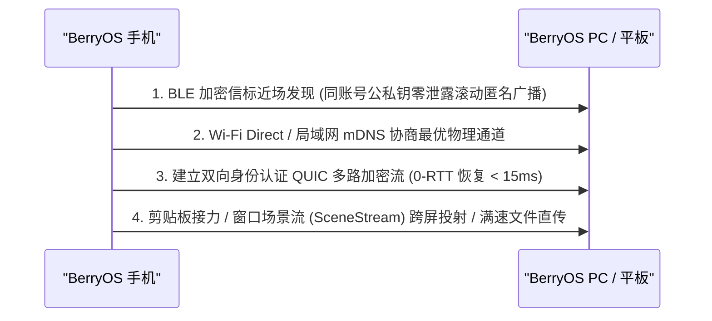

# net-conn（现代全栈安全网络、无线协议栈与跨端分布式软总线）总体设计

Type: spec
Status: active
Updated: 2026-11-18
Version: 1.0.0

一句话说明：`net-conn`（由现代网络守护进程 `netd` 2.0、传输层安全与现代协议库 `berry-netsec` / `berry-http`、无线守护进程族 `wifid` / `btd` 及跨设备软总线 `berry-link` 组成）是 BerryOS 连接互联网与多端协同的大动脉——以「IPv4/IPv6 双栈零拷贝环 + 纯 Rust TLS 1.3/QUIC 与系统根证书库 + Wi-Fi/BLE 无线栈 + 零配置跨端软总线」彻底终结早期仅能跑明文单路 IPv4 的局域原型状态。

## 背景

[整机生态十维盲区全景审计](../../research/2026-11-18-整机生态十维盲区全景审计.md) 查明：仓内既有 `berry-tls` 实为 ELF 线程局部存储库，全系统尚无传输层安全（TLS 1.3）、X.509 证书链校验与系统根证书库，导致浏览器与任何现代云端 API 均无法建立 `https://` 安全连接；同时 `vnet` 仅限于 QEMU SLIRP 下的单会话/浅表 IPv4 TCP，缺失 IPv6、拥塞控制、能力防火墙、Wi-Fi、蓝牙 BLE 以及连接手机、PC 与穿戴设备的近场分布式软总线。本规格依据 [整机十维缺失拼图全栈终态架构裁决](../../notes/proposed/2026-11-18-整机十维缺失拼图全栈终态架构裁决.md)，立定 BerryOS 全栈网络与无线互联契约。

## 范围

- **覆盖**：`netd` 2.0 双栈（IPv4 + IPv6 SLAAC/DHCPv6）协议栈、共享内存无锁收发数据包环、BBRv2/CUBIC 拥塞控制与多网卡智能选路（Multipath / Wi-Fi 切蜂窝无缝保活）；纯 Rust `no_std` 传输层加密套件 `berry-netsec`（TLS 1.3、X.509v3 严格验证、Mozilla 根证书只读 VMO、DNS-over-HTTPS/TLS）与 `berry-http`（HTTP/1.1、HTTP/2、基于 QUIC 的 HTTP/3 及 WebSocket）；基于 Capability 的应用级网络策略防火墙与用户态 VPN 虚拟隧道接口；802.11 WPA3 Wi-Fi 服务 `wifid`、Bluetooth 5.4 / BLE 服务 `btd` 与蜂窝 eSIM RIL 抽象；跨端分布式协同软总线 `berry-link`。
- **不覆盖**：PCIe / SDIO / USB 底层物理总线枚举（归 [soc-peripherals 总体设计](../soc-peripherals/design.md)）；内核密码学随机数硬件熵源本身（归 [security 总体设计](../security/design.md)）。

## 契约

### 一、双栈零拷贝网络守护进程（`netd` 2.0）与能力防火墙契约

1. **控制面与数据面分离**：连接建立、DNS 解析与能力鉴权走轻量 Channel RPC；高吞吐 TCP / UDP / QUIC 数据收发采用每套接字或每进程共享 `IoRing VMO`（收发描述符环 + 页面池），彻底消除大流量下载或投屏时逐包 256B IPC 拷贝瓶颈，单核千兆/万兆虚拟网卡线速直通。
2. **完备双栈与现代传输状态机**：原生支持 IPv4（DHCPv4/ARP/ICMPv4）与 IPv6（NDP/SLAAC/DHCPv6/ICMPv6、Happy Eyeballs v2 双栈竞速回退，250ms 内自动择优连接）、TCP 选择性确认（SACK）、窗口缩放、时间戳、BBR 拥塞控制与 Path MTU 发现。
3. **零全局网络特权与细粒度能力防火墙**：
   - 应用未在清单声明网络能力则压根拿不到 `NetCap` 句柄（物理断网，非可绕过软开关）；
   - `NetCap` 支持三级细化约束：`Internet`（公网）、`LocalNetwork`（局域网 mDNS/内网段，需独立授权以防扫描家庭路由器隐私）、`DomainPinned([域名白名单])`（高敏插件仅允许连接指定 API 域名）；
   - 内置标准 `TunCap` 虚拟网卡槽位，支持无特权用户态 WireGuard / 企业零信任 VPN 安全接管指定应用或全局路由。

### 二、纯 Rust 传输层安全（`berry-netsec`）与 HTTP/QUIC 契约

1. **全自研/零 C 依赖现代密码学套件**：在既有 `berry-crypto`（Ed25519 + SHA-512）基础上，统一补齐常数时间（Constant-Time）实现的 `X25519` / `P-256` 椭圆曲线密钥交换、`ChaCha20-Poly1305` 与 `AES-128/256-GCM`（ARMv8 Crypto Extensions `AESE`/`PMULL` 硬件加速 + 纯软常时回退）、`SHA-256`/`SHA-384` 及 `HKDF`。
2. **仅做 TLS 1.3，彻底砍断历史降级漏洞面**：`berry-netsec` 默认**仅实现并接受 TLS 1.3（RFC 8446）与 QUIC-TLS（RFC 9001）**，物理移除 TLS 1.0/1.1、静态 RSA 密钥交换、CBC 填充模式等一切历史脆弱密码套件（极少数老旧局域网设备兼容单独隔离在受限显式开关库中）。
3. **系统级只读根证书库与防吊销**：系统可信根 CA 列表封装于 `/system/etc/certs.vmo` 只读映射页（随 OTA 独立热更新），内置零分配 ASN.1 DER 严格解析器、域名通配校验与 CRLite 布隆过滤器离线证书吊销极速核验；系统默认启用加密域名解析（DoT / DoH），防止运营商或公共 Wi-Fi DNS 劫持与嗅探。

### 三、无线连接栈（`wifid` / `btd` / `rild`）契约

1. **Wi-Fi 子系统（`wifid`）**：支持 Virtio-Mac80211_hwsim（模拟器虚拟无线环境测试）与真机 SDIO/PCIe FullMAC/SoftMAC 网卡；原生实装 **WPA3-SAE（抗离线字典攻击）** 与 WPA2-PSK 兼容握手、MAC 地址按每 SSID 默认随机化（防商场探针追踪）及 802.11v/k/r 无感漫游。
2. **蓝牙与低功耗蓝牙子系统（`btd`）**：基于标准 HCI 传输层（UART H4 / USB HCI / Virtio-BT，模拟器可桥接宿主蓝牙控制器或虚拟配对环），完整分层实现 L2CAP、SMP 安全配对、ATT/GATT 客户端与服务端（支撑手表↔手机通知/健康数据同步、BLE HID 键鼠），以及面向无线耳机的 LE Audio（LC3 低功耗高音质编解码对接 [media 总体设计](../media/design.md)）。
3. **蜂窝与 eSIM 抽象（`rild`）**：定义与高通 QMI / 标准 MBIM 对接的窄腰用户态调制解调器契约，统一管理数据 APN、短信通道、紧急呼叫与 LPA（eSIM 配置文件下载激活）。

### 四、跨端分布式协同软总线（`berry-link`）契约

1. **同账号零配置互信与设备发现**：同一用户密钥环下的 BerryOS 穿戴、手机与 PC 设备通过 BLE 低功耗滚动加密信标在毫秒级互相感知距离与在场状态（外界抓包仅见随机噪声，无法关联设备指纹），随后自动拉起局域网或 Wi-Fi Direct 点对点高速 **双向 mTLS QUIC 通道**。
2. **三大原生跨端超能力**：
   - **跨端剪贴板与键鼠穿越**：PC 键鼠滑出屏幕边缘即无缝接管旁侧平板/手机焦点，跨设备复制粘贴同样遵守 [app-interop 总体设计](../app-interop/design.md) 的粘贴瞬间按需拉取隐私契约；
   - **远程 `SceneStream` 应用流转**：得益于 [gpu-accel 总体设计](../gpu-accel/design.md) 的紧凑 `SceneIR` 命令流设计，手机上的原生应用无需视频编码压缩画质，直接通过 `berry-link` QUIC 流将矢量 `SceneStream` 投射至 PC 桌面以原生 4K 锐度渲染交互；
   - **断网近场高速隔空投送（BerryDrop）**：点对点满速传输文件与照片，配合 [backup-sync 总体设计](../backup-sync/design.md) 实现一键无线换机。

## 验收标准

1. **真实公网 HTTPS 与协议门禁**：客机内 `browser-app` 及标准客户端通过 `netd` 2.0 + `berry-netsec` 成功完成 TLS 1.3（X25519 + ChaCha20-Poly1305 / AES-GCM）握手并拉取真实 HTTPS 站点与 HTTP/2 多路流；针对过期证书、域名不匹配、伪造中继 CA、降级攻击等 Wycheproof / BadSSL 负例向量拦截率 100%。
2. **高并发与吞吐门禁**：单进程 64 路并发套接字在压力测试下零句柄泄漏、零死锁，共享环大块传输吞吐较旧版 256B IPC 路径提升 $\ge 20\times$。
3. **跨端协同演练**：在同一宿主机拉起两个双实例 BerryOS 模拟器节点（模拟手机与 PC），`berry-link` 自动发现并在 50ms 内建链，成功将节点 A 的应用窗口矢量跨屏流转至节点 B 交互操作。

## 适用边界

- 传统过时且不安全的企业遗留协议（如 WEP、WPA-TKIP、PPTP VPN、SSLv3/TLS 1.0/1.1）明文永久拒绝支持。
