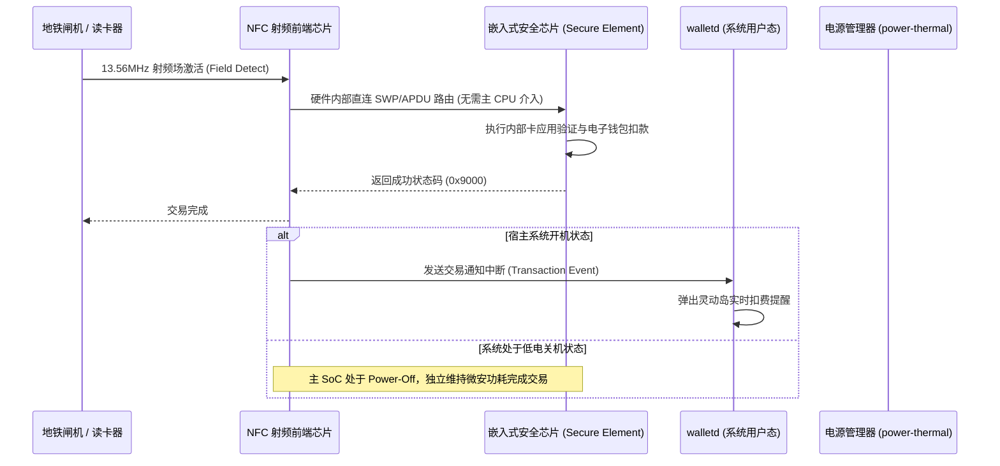

# nfc-accessories（近场通信、硬件钱包与高精外设扩展）总体设计

Type: spec
Status: active
Updated: 2026-11-18
Version: 1.0.0

## 1. 模块定位与职责边界

NFC & Accessories 体系是 BerryOS 面向物理世界交互、空间定位与专业生产力外设的系统服务基座。它横跨安全芯片（eSE/TEE）、射频硬件（NFC/UWB）与主动式数字手写笔/智能磁吸键盘，既保障金融级无感支付与数字车钥匙的极端物理安全性，又为手写输入与空间测距提供毫秒级低延迟响应。

```
+-------------------------------------------------------------------------+
|                    桌面 UI / 系统钱包卡包 / 触控交互管线                   |
+-------------------------------------------------------------------------+
       |                                          |
       v (Card Emulation / P2P)                   v (Low-latency Stroke / UWB)
+-------------------------------+       +-------------------------------+
|     walletd 硬件钱包守护进程    |       |   accessoryd 生产力外设守护   |
|   - 交通卡 / 门禁卡 / 车钥匙   |       |   - 主动式手写笔预测与倾角    |
|   - 快捷交通卡免唤醒低电刷卡   |       |   - UWB 厘米级空间测距定向    |
+-------------------------------+       +-------------------------------+
       | (APDU / SE Channel)                      | (HID / BLE / SPI)
       v                                          v
+-------------------------------+       +-------------------------------+
|   eSE 安全芯片 / NFC 控制器   |       | 触控数字化仪 (Digitizer) / UWB|
+-------------------------------+       +-------------------------------+
                                |       |
                                v       v
+-------------------------------------------------------------------------+
|                  HAL 驱动抽象层 (SPI / I2C / UART / GPIO)               |
+-------------------------------------------------------------------------+
```

### 职责边界划分
- **归属 NFC & Accessories 的职责**：
  1. **NFC 全栈支持与 eSE 交互**：支持卡模拟（Card Emulation, CE）、读写器（Reader/Writer）与 P2P 模式。通过 APDU 指令通道直连嵌入式安全元件（eSE），支持 GlobalPlatform 2.3+ 规范。
  2. **数字车钥匙与无感门禁**：遵循 CCC (Car Connectivity Consortium) Digital Key 3.0 规范，结合 NFC 碰一碰与 UWB 飞行时间（ToF）距离测算，严密抵御中继攻击（Relay Attack）。
  3. **快捷交通卡（Express Card）与断电保刷**：即使系统由于低电关机进入挂起模式，NFC 芯片与 eSE 仍保持微安级供电，支持关机后 5 小时内正常碰卡进站。
  4. **主动式压感手写笔（Berry Pencil）**：实现触控数字化仪（Digitizer）事件与手写笔倾角、旋转、4096 级压感与双击手势的高频采集（240Hz/480Hz），结合点阵预测算法提供 $< 4\text{ms}$ 的书写跟手延时。
  5. **UWB 空间感知与精准寻物（Find My）**：管理超宽带天线阵列的到达相位差（PDoA）与距离计算，提供厘米级测距与三维空间指向。
- **严禁越界的范围**：
  1. 严禁普通第三方应用直接读写 eSE 根证书或安全根密钥；所有交易必须通过 `walletd` 系统特权通道拉起安全界面（Face/Fingerprint Biometrics 授权）。
  2. 严禁在主 CPU 上循环轮询手写笔 HID 原始报文；事件必须通过 DMA/中断驱动，并直推 [input-productivity](../input-productivity/design.md) 事件队列。
  3. 严禁未授权应用在后台静默开启 UWB 空间雷达扫描，防止室内高精定位隐私泄露。

## 2. 核心架构与数据流

### 2.1 快捷交通卡与断电碰卡流


### 2.2 超低延迟手写笔预测管线
手写笔书写体验的关键在于「笔尖与墨迹零间距」。`accessoryd` 与 `compositor` 协同执行点阵预测：
1. **高频采样**：硬件数字化仪以 240Hz 采样物理触点坐标 $(x, y)$、倾角 $(\theta, \phi)$ 及压感 $(P)$；
2. **卡尔曼滤波与高阶多项式预测**：根据前 4 个点的速度与加速度，外推末端向前预测 $8\text{ms}$（匹配下一帧显示时间）；
3. **极速局部渲染（Direct Overlay）**：绕过完整应用组件布局，墨迹直接写入 Compositor 的前置透明 Overlay VMO，将渲染时延压制在 1 帧以内。

## 3. 接口契约与 ABI/IPC 定义

### 3.1 钱包服务 IPC 协议 (`walletd`)
```c
enum BerryCardType : uint32_t {
    BERRY_CARD_TRANSIT    = 1,
    BERRY_CARD_ACCESS_KEY = 2,
    BERRY_CARD_CAR_KEY    = 3,
    BERRY_CARD_BANK_PASS  = 4,
};

struct BerryCardMetadata {
    uint64_t card_id;
    uint32_t card_type;         // BerryCardType
    uint32_t is_express_mode;   // 1: 允许无需生物识别免密刷卡
    char     display_name[64];
    uint8_t  aid[16];           // GlobalPlatform Application Identifier
    uint32_t aid_len;
};

// 交易完成通知 (发送至灵动岛与通知中心)
struct BerryTransactionNotice {
    uint64_t card_id;
    uint64_t timestamp_ms;
    int64_t  amount_cents;      // 金额 (分为单位)
    int64_t  balance_cents;     // 余额
    char     merchant_name[64]; // 商户/站点名称
};
```

### 3.2 笔外设事件结构体 (`BerryPencilEvent`)
```c
struct BerryPencilEvent {
    uint64_t timestamp_ns;
    float    x;                 // 绝对屏幕坐标 X
    float    y;                 // 绝对屏幕坐标 Y
    float    pressure;          // 归一化压感 0.0 .. 1.0 (硬件 4096 级解析)
    float    tilt_azimuth_rad;  // 笔身方位角
    float    tilt_altitude_rad; // 笔身倾斜俯仰角
    uint32_t tool_type;         // 0: Pen, 1: Pencil, 2: Eraser
    uint32_t button_flags;      // BIT(0): 笔身轻触, BIT(1): 双击手势, BIT(2): 侧键挤压
};
```

### 3.3 UWB 测距结构体 (`BerryUwbDistanceFrame`)
```c
struct BerryUwbDistanceFrame {
    uint64_t target_device_mac;
    uint32_t status;            // 0: SUCCESS, 1: BLOCKED, 2: OUT_OF_RANGE
    float    distance_meters;   // 测距精度精确至 0.05m
    float    azimuth_deg;       // 水平方位角 (-180.0 .. +180.0)
    float    elevation_deg;     // 垂直俯仰角 (-90.0 .. +90.0)
    uint32_t secure_ranging_ok; // 1: 经过加密认证，防中继重放有效
};
```

## 4. 故障模型、降级与安全边界

### 4.1 故障模型与降级防护
1. **NFC 射频碰撞与场强畸变**：
   - 遭遇金属遮挡或多卡并存导致通讯 CRC 错误时，`walletd` 指导射频芯片执行 Anti-collision 重新选卡；若连续 3 次重试失败，在屏幕提示「请调整贴近位置」。
2. **手写笔蓝牙断联与电量耗尽**：
   - 主动式压感协议降级为基础电容被动触控（保留坐标与基本点击，停用倾角与压感）；灵动岛弹窗提示「手写笔电量过低」。
3. **UWB 室内多径干扰（Multipath Reflection）**：
   - 算法模块引入 RSSI 信号强度与飞行时间置信度过滤器，剔除虚假反射，防止汽车钥匙误开门。

### 4.2 安全与反洗劫边界
- **物理 eSE 防御**：安全芯片具备物理防侧信道攻击（DPA/SPA）与探针防御，密钥绝不离开 eSE 硬件边界。
- **车载测距防中继（Distance Bounding Protocol）**：CCC 3.0 协议要求在脉冲纳秒级别交互随机认证序列，若应答时间超过物理光速往返阈值，直接判定为恶意中继攻击并锁死车门。
- **外设固件验签**：手写笔及键盘配件 OTA 升级固件必须具备官方 Ed25519 签名，杜绝恶意配件劫持 HID 通道。

## 5. 落地步骤与验收指标

### 5.1 实施路径
1. **第一波（NFC 协议栈与 APDU 通道）**：
   - 编写 NFC 控制器驱动（NCI 协议封装）；
   - 建立与 eSE 安全芯片的通信信道，完成基础 ISO 7816 APDU 读写。
2. **第二波（系统钱包与快捷刷卡）**：
   - 搭建 `walletd`，实现交通卡添加、状态查询与低电保刷；
   - 联动 [widgets-intents](../widgets-intents/design.md) 在灵动岛展示即时消费卡片。
3. **第三波（生产力手写笔与 UWB 测距）**：
   - 接入 Digitizer 驱动与卡尔曼轨迹预测管线；
   - 接入 UWB 射频驱动，实现设备空间指引交互。

### 5.2 商业化验收门禁
- **G-NFC-1（刷卡延时）**：手机碰上闸机到交易完成并给出触觉震动反馈耗时 $\le 180\text{ms}$。
- **G-NFC-2（手写跟手延时）**：手写笔笔尖与墨迹端到端视觉延迟 $\le 4\text{ms}$（预测补偿状态）。
- **G-NFC-3（低电断电保刷时长）**：设备进入低电自动关机后，NFC 快捷交通卡可刷可用时间 $\ge 5\text{小时}$。
- **G-NFC-4（UWB 测距精度）**：3 米范围内测距误差 $\le 5\text{cm}$，方位角误差 $\le 5^\circ$。
