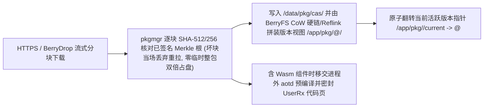

# pkgmgr（应用包管理守护进程、内容寻址增量分发与零残留卸载体系）总体设计

Type: spec
Status: active
Updated: 2026-11-18
Version: 1.0.0

一句话说明：`pkgmgr`（由包管理核心守护进程 `pkgmgr`、内容寻址共享块库 `berry-cas`、流式差分合并器 `berry-delta` 与商店协议 `berry-storeproto` 组成）是 BerryOS 第三方与系统应用的生命周期大管家——实现「边下边验流式安装、跨包内容寻址去重、前台零打断热更新、按需动态资产包与五方原子零垃圾卸载」。

## 背景

[全栈 25 模块跨界接缝与深水区六盲点复核审计](../../research/2026-11-18-全栈25模块跨界接缝与深水区六盲点复核审计.md) 指出：BerryOS 虽已具备离线打包工具 `mkapp`、分发签名链规范（[SDK-2 分发与签名链设计](../../../docs/SDK-2-分发与签名链设计-v1.2.md)）及整机系统分区 A/B OTA（[storage-image 总体设计](../storage-image/design.md)），但缺少运行期在线安装、增量升级、多用户共享装包与干净卸载的用户态包管理架构。传统操作系统卸载应用后常在磁盘各处遗留孤儿缓存、残留通知渠道与未销毁密钥，或因正在运行的应用无法原地覆盖文件而强行杀退用户正在编辑的窗口。本规格依据 [跨模块 ABI 合龙与进程外 JIT 及深水区六子系统裁决](../../notes/proposed/2026-11-18-跨模块ABI合龙与进程外JIT及深水区六子系统裁决.md)，定义现代纯事务化包管理契约。

## 范围

- **覆盖**：`.bap` v2 页对齐 Merkle 分块包结构与边下载边验签流式落盘；`/data/pkg/cas/` 全局只读内容寻址存储（Content-Addressed Store，跨应用与跨多用户自动块级去重）；基于二进制块差分的省流量热更新与「运行态并存、下次启动毫秒级原子切代」机制；大型游戏/专业应用按需动态特征与资产包（Dynamic Feature & Asset Packs）；长月未用应用「保数据仅卸包体（App Offload）」；跨文件系统、密钥库、通知、后台任务与意图路由表的两阶段原子卸载协议；系统应用商店客户端契约。
- **不覆盖**：应用启动后的进程冻结与内存回收梯度（归 [am 总体设计](../am/design.md)）；底座根文件系统 `BerryROFS` 整卷固件升级（归 [storage-image 总体设计](../storage-image/design.md)）。

## 契约

### 一、流式 Merkle 验签安装与全局内容寻址去重（`berry-cas`）契约

1. **零双倍空间流式安装**：传统安装需先在临时目录存下完整 2GiB 安装包再解压出 2GiB 文件（峰值占用 4GiB 导致剩余空间不足的手机安装失败）。`pkgmgr` 先下载并经 `berry-crypto` 严格验证小于 64KiB 的 `.sig` 信封与 Merkle 树头表，随后每流式接收一个 64KiB 压缩块即当场验算哈希、解压直写最终 `BerryFS` 块池，全程**零整包临时副本**，磁盘峰值开销严格等于单份包体积。
2. **跨应用与跨用户只读块去重**：所有已安装包的代码段、公共字体、图标与只读资源块按内容密码学哈希存入全局只读 `/data/pkg/cas/`，各应用版本目录通过 `BerryFS` CoW 共享 Extent 引用同一物理块；多用户 Profile 安装同一应用时仅在目标用户空间创建空沙箱 `/data/user/<uid>/app/<id>` 并登记引用位，**包体存储与代码页物理内存 100% 零重复**。

### 二、前台零打断增量热更与版本安全回退契约

1. **块级差分下载（`< 10%` 流量消耗）**：升级应用时，`pkgmgr` 比对本地已驻留 `@<old_ver>` 的块哈希清单与远端 `@<new_ver>` 清单，仅请求变更块或 `zstd` 字典二进制补丁（`berry-delta`），在本地基于旧块合成新块并验证新包完整 Merkle 根签名与 `key_lineage` 防降级水位（严禁不同开发者私钥覆盖同名包，除非持有合法密钥轮换证明链）。
2. **运行态无感预装（Stage-While-Running）**：若用户当前正在前台使用 `@<old_ver>`，`pkgmgr` 绝不强杀前台窗口——新版本在独立不可变目录 `@<new_ver>` 完整就绪并完成 Wasm/元数据索引预热后标记 `PendingSwitch`；待该应用切入后台自然静默或下次拉起时，`appd` 在 `< 1ms` 内原子切换符号根至 `@<new_ver>` 并在后台回收无引用的 `@<old_ver>` 孤儿块。若新版本连续两次启动在 3 秒内崩溃，`pkgmgr` 自动降级切回保留 24 小时的 `@<old_ver>`（应用级防炸保险）。

### 三、按需动态模块（Asset Packs）与智能瘦身（App Offload）契约

1. **按需流式挂载扩展包**：支持将核心可执行包（`< 20MiB` 秒装即用）与高清材质、离线语音包、游戏章节拆分为独立签名的 `AssetPack`；应用运行期通过 `berry-storeproto` 请求某扩展包后，`pkgmgr` 下载验签完毕即将其作为只读子目录句柄热注入应用的 `/app/assets/` 视图。
2. **零数据丢失自动归档（Offload Unused Apps）**：与 [am 总体设计](../am/design.md) L4 归档梯度闭环——对超过 90 天未打开且占盘较大的应用（经用户在存储设置开启自动省空间后），`pkgmgr` 释放其 `/app/pkg/<id>` 代码与 `/app/cache/<id>` 全部物理块，桌面保留带云朵角标的灰阶图标，同时 **100% 原封不动保留加密的 `/app/data/<id>` 用户文档与登录态**；用户日后点击图标即自动重拉签名包体并无缝恢复原状。

### 四、五方两阶段零残留原子卸载契约

当用户确认卸载应用 `app_id` 时，`pkgmgr` 写入持久化卸载意图日志（防卸载中途掉电残留半尸）并按严格顺序执行五方清理事务：

1. 指令 `appd` 终止目标 `Job` 全部进程并销毁内存墓碑槽；
2. 指令 `workmgr`、`notifyd` 与 `intentd` 原子注销该应用名下全部定时唤醒、屏幕通知、快捷方式与 App Links 路由表；
3. 指令 `keystored` 永久擦除该应用命名空间绑定的全部私钥与硬件计数器槽；
4. 指令 `BerryFS` 销毁该用户下 `/app/data/<id>`、`/app/cache/<id>` 的 Inode 子树及其派生 FBE 目录密钥；
5. 递减 `/data/pkg/cas/` 对应块引用计数（归零即回收物理空间），确认五步全清后擦除卸载事务日志——达成**卸载后全盘零字节孤儿残留**。

## 验收标准

1. **边下边验篡改即断门禁**：在流式安装 100MiB 测试包至第 50MiB 时人为翻转单比特网络字节，`pkgmgr` 在当前 64KiB 块边界立即捕获 Merkle 校验失败中断传输并回滚未提交块，零脏文件入库；伪造非原签名者私钥尝试升级同名应用 100% 被拒。
2. **零打断升级与自动回退验证**：前台运行 v1 应用并保持交互计数递增期间完成 v2 后台热更，前台零闪退中断；切后台重开即生效 v2；注入启动即 `panic` 的坏包 v3，连续两次崩溃后系统自动回退至 v2 正常打开。
3. **安装—使用—卸载全盘净零泄漏门禁**：记录初始磁盘已用块数、`keystored` 槽数与 `notifyd`/`workmgr` 表项数，执行完整「安装 → 写文件 → 建密钥 → 发通知 → 设后台任务 → 卸载」循环 50 次后，五项资源水位与初始基线**逐字精确相等**。

## 适用边界

- 开发者模式或用户显式开启「允许安装已签名侧载包（Sideload）」系统开关（须过 `HardwareAuthToken` 锁屏核身防恶意脚本静默开启）时，允许经 `berry install` 或文件管理器安装非官方商店渠道的合规自签名 `.bap` 包，兼顾大众安全与极客完全设备自主权。
