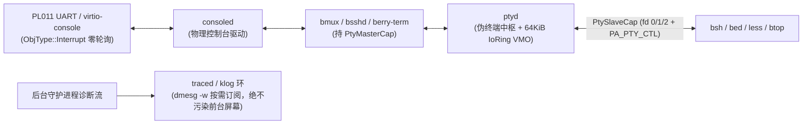

# pty（用户态伪终端、多路控制台与 VT100 终端协议栈）总体设计

Type: spec
Status: active
Updated: 2026-11-18
Version: 1.0.0

一句话说明：`pty` 定义 BerryOS 纯用户态伪终端守护进程（`ptyd`）、物理控制台驱动中枢（`consoled`）、零依赖终端转义与屏幕网格引擎（`berry-vt`）以及单链路多窗终端复用器（`bmux`）——以「共享无锁 `IoRing VMO` 双工数据面 + 纯能力 `PtyMaster/PtySlave` 控制面」彻底取代内核 `task_console` 逐字节转发模型，支撑全屏编辑器、实时监控 TUI 与多会话并发操作。

## 背景

[终端与命令行全栈体验深度体检报告](../../research/2026-11-18-终端与命令行全栈体验深度体检报告.md) T1–T5 查明：现役控制台驻留在内核 `task_console` 线程内，每收到 1 字节发起一次 `channel_send` 推入 128B 吸收环，粘贴长文本即静默丢字；全系统无伪终端主从对、无行列尺寸（`Winsize`）与窗口缩放通知、无 Raw/Cooked 行规切换，且后台服务诊断输出与前台终端共用单一 `CONSOLE_H` 造成混流花屏。依据 [终端优先全栈闭环架构六大核心裁决](../../notes/proposed/2026-11-18-终端优先全栈闭环架构六大核心裁决.md) 裁决一，本规格在莓核零 TTY 代码前提下确立用户态终端子系统长期契约。

## 范围

- **覆盖**：物理串口与虚拟控制台守护进程 `consoled`（接管 PL011 UART0、`virtio-console` 及内核日志静音分流）；伪终端服务 `ptyd`（`PtyMaster` / `PtySlave` 能力对、双 `64KiB` 共享 `IoRing VMO` 字节流、`PtyCtl` 行规与窗口尺寸协议、前台中断/挂起信号路由）；纯 Rust `no_std` 终端状态机与差异渲染核 `berry-vt`（VT100 / xterm-256color / TrueColor / 备用屏幕 / 括号粘贴）；终端多路复用器 `bmux`（多标签、水平/垂直分屏、断线保活重连、回滚搜索）。
- **不覆盖**：Shell 行编辑、历史环与语法解析（归 [bsh 总体设计](../bsh/design.md)）；内核 `Interrupt` 与共享 VMO 底层原语（归 [hal 总体设计](../hal/design.md) 与 [ipc 总体设计](../ipc/design.md)）；图形桌面窗口合成（归 [compositor 总体设计](../compositor/design.md)，GUI `berry-term` 直接作为 `PtyMaster` 客户端复用本模块契约）。

## 契约

### 一、架构分层与物理控制台守护进程（`consoled`）

1. **内核 `task_console` 退役与前后台日志硬隔离**：
   - 内核仅在早期单核引导段与 EL1 Panic / `ramoops` 落盘路径直写物理 UART；进入用户态 `rootmgr` 后，PL011 MMIO 页与 GIC SPI #33 `Interrupt` 能力移交用户态 `consoled` 独占驱动（零内核轮询线程）。
   - 系统守护进程（`rootmgr`、`devmgr`、`fsmgr`、`netd` 等）的 `stdout/stderr` 统一绑定至日志收集端写入环形缓冲（由 `dmesg` / `dmesg -w` 读取），**严禁任何非当前会话进程向活跃物理终端直写字节**，从根源消灭后台打印撕裂全屏编辑器与 `btop` 界面的顽疾。
2. **宿主自动几何握手与高速批量收发**：`consoled` 启动或重连时通过非侵入式 CSI 查询序列（`\x1b[18t` / `\x1b[6n` 带 80ms 超时回退默认 `80x24`）或宿主机 `berry console` 控制帧实时同步宿主窗口 `Winsize { cols, rows }`，并以 FIFO 满批 DMA/寄存器突发读写取代单字节调用，支撑 `> 10MiB/s` 虚拟控制台吞吐。

### 二、`ptyd` 伪终端主从能力模型与共享环协议

1. **主从能力对创建**：客户端向 `/svc/pty` 发送 `PTY_OPEN(initial_winsize, initial_termios)`，`ptyd` 返回一对受能力门控的会话套件：
   - **`PtyMasterCap`**：由终端宿主（`consoled`、`bmux`、`bsshd` 或 GUI `berry-term`）持有，包含主端控制 `Channel`、主写从读 `InputRing VMO (64KiB)`、从写主读 `OutputRing VMO (64KiB)` 与双向唤醒 `EventPair`。
   - **`PtySlaveCap`**：可经 `handle_duplicate` 分发给会话内 Shell 及其前台子进程，暴露标准流接口（映射为 `fd 0`、`fd 1`、`fd 2`）与受限控制端 `PA_PTY_CTL`。
2. **零拷贝 `IoRing VMO` 流控与反压契约**：
   - 每个 `IoRing VMO` 采用 64B 缓存行对齐头 `{ head: AtomicU32, tail: AtomicU32, flags: AtomicU32 }` 加 `64KiB` 环形数据区；单次读写直接内存 `memcpy` 任意长度字节块，仅在「空转非空」或「满转非满」边沿触发一次 `EventPair` 信号通知，稳态大块输出与数千字节脚本粘贴**零逐字节系统调用、零静默丢字节**（环满时生产者自动在 `SIGNAL_WRITABLE` 上阻塞背压）。
   - 当全部 `PtySlaveCap` 句柄关闭时，主端立即收到 `SIGNAL_PEER_CLOSED`（映射为终端 `EOF / SIGHUP` 退出语义）；当 `PtyMasterCap` 关闭时，从端读返回 `0 (EOF)`、写返回 `-EPIPE` 并向关联前台 `Job` 广播挂断通知。
3. **`PtyCtl` 行规（Line Discipline）与控制语义（纯用户态 `ptyface` 单源）**：
   - **`Termios` 紧凑模式集**：精准提炼现代终端必需的四位正交开关——`ICANON`（行缓冲编辑 vs 原始字节直通 Raw 模式）、`ECHO`（输入回显开关，密码输入关 `ECHO`）、`ISIG`（识别 `0x03 Ctrl-C` / `0x1A Ctrl-Z` / `0x1C Ctrl-\` 控制键 vs 透传原始键值给编辑器）、`ONLCR`（输出 `\n` 自动映射 `\r\n`）。
   - **微内核原生前台信号路由**：当 `ISIG = 1` 且主端写入 `0x03 (VINTR)` 或 `0x1A (VSUSP)` 时，`ptyd` 不经 Unix 进程组广播，而是直接向当前绑定在该 PTY 上的 `fg_notify` 端口投递结构化控制包 `PtyEvent::Intr` / `PtyEvent::Susp`（由会话主控 `bsh` 立即对前台 `Job` 执行 `job_kill` 或 `process_suspend`）；全屏应用（`bed`、`less`、`btop`、`bsh` 自身 `berry-line` 编辑器）进入时置 `ICANON = 0, ECHO = 0`（编辑器按需保留或接管 `ISIG`），退出或崩溃（主控 `bsh` 在 `reap` 后自动兜底恢复初态 `Sanity Termios`）时必定复原终端状态，绝不留「盲打乱码死终端」。
   - **窗口尺寸变更（`WINCH`）**：宿主缩放窗口触发 `PtyMaster::set_winsize(cols, rows)`，`ptyd` 原子更新共享头内的 `Winsize` 快照并置位从端 `SIGNAL_USER_0 (SIGNAL_PTY_WINCH)`；正在 `Port` 等待的全屏程序在 1 毫秒内感知新尺寸并重绘布局。

### 三、`berry-vt`：纯 `no_std` 终端协议解析与差异渲染核

1. **完备现代转义序列支持**：以纯表驱动有限状态机（对齐 Paul Williams VT500 状态转换图，零分配、任意畸形 UTF-8/转义字节流不 Panic）实现：
   - 光标控制（`CUP`、`CUU/CUD/CUF/CUB`、`CHA`、`VPA`、`DECSC/DECRC`、光标显隐 `?25h/?25l` 与形状 `DECSCUSR`）；
   - 屏幕与行擦除（`ED 0/1/2/3`、`EL 0/1/2`）、插入删除行字符（`IL/DL/ICH/DCH`）、自定义上下滚动区（`DECSTBM`）；
   - 全属性色彩（粗体、斜体、下划线、反显、16 标准色、256 调色板与 24-bit `ESC[38;2;r;g;b m` TrueColor）；
   - **备用屏幕缓冲（Alternate Screen `?1049h / ?1049l`）**：`bed`、`less`、`btop` 打开时切入备用屏，退出时瞬间无损还原此前 Shell 屏幕内容与光标位置；
   - **括号粘贴模式（Bracketed Paste `?2004h / ?2004l`）**：多行代码粘贴进 `bsh` 或 `bed` 时包裹 `\x1b[200~ ... \x1b[201~`，防止粘贴文本中的换行误触发逐行盲目执行或自动缩进错乱；
   - **键盘扩展协议**：支持标准 xterm 修饰键编码（`Ctrl/Alt/Shift + 方向键/Home/End/PgUp/PgDn/Delete/F1..F12`）与鼠标滚轮/点击上报（SGR `1006` 模式，供 `bmux` 分屏点击、`less` 滚轮翻页与 `bed` 定位光标使用）。
2. **脏格差分发射器（Diff Renderer）**：内置双缓冲 `CellGrid`，UI 工具只需绘制目标网格，`berry-vt` 自动对比上一帧仅发射最小字节数的增量 ANSI 序列，保证在 115200 波特率物理串口下翻页与刷新依然丝滑不卡顿。

### 四、`bmux`：单串口/单连接多窗终端复用器契约

1. **解决纯命令行环境多任务刚需**：在仅有单路串口或单路远程连接时，输入 `bmux` 即可进入多会话工作台：
   - 支持最多 16 个窗口（Tab）与任意水平/垂直分屏（Pane），每个窗格背后挂载一对独立 `ptyd` 主从实例；
   - 默认前缀键 `Ctrl-B`（兼容主流 `tmux` 肌肉记忆：`c` 新建窗、`%` 左右分屏、`"` 上下分屏、`方向键` 切焦点、`z` 当前窗格全屏最大化、`[` 进入 `vi` 风格历史回滚复制模式、`d` 分离会话后台保活）；
   - **断线保活（Detach / Reattach）**：宿主断开 `berry console` 或网络闪断时，`bmux` 服务端会话及其中运行的长编译/压测/追踪任务毫发无损继续运行，重连后执行 `bmux attach` 瞬间恢复全部窗格现场；底部 1 行状态栏实时显示窗口列表、CPU/内存简报与时钟。

## 验收标准

1. **高吞吐粘贴与零丢字门禁**：向 `consoled -> ptyd -> bsh` 一次性零间隔灌入 `64KiB` 含换行与中文 UTF-8 的脚本文本，接收字节数与 SHA-256 100% 逐位一致，`fwd_drop == 0`。
2. **全屏模式切换与异常自愈门禁**：连续在 `bsh` 中打开全屏应用（切入 Raw + Alternate Screen）、用 `kill` 强杀该子进程 100 次，每次返回 `bsh>` 后主屏幕历史无残影、终端回显与行缓冲状态 100% 自动恢复正常；宿主终端动态拖拽改变行列尺寸时，客机内活动程序在 `< 10ms` 内收到 `WINCH` 并精确重排。
3. **后台日志零污染门禁**：在前台全屏运行 `bed` 或 `btop` 期间，后台守护进程高频打印 1,000 条诊断日志，前台终端屏幕字符网格 **0 字节串扰**，且 `dmesg` 可完整读出全部 1,000 条日志。
4. **`ptyface` 与 `berry-vt` 宿主机性质测试门禁**：随机喂入 1,000 万字节模糊测试（Fuzzing）畸形 CSI/OSC/UTF-8 序列零 Panic、零越界；`bmux` 四分屏并发跑满屏输出 + 断线重连后屏幕状态与 `berry-vt` 参考网格 100% 一致。

## 适用边界

- 本模块不提供老旧硬件电传打字机（Baudot、奇偶校验硬件流控 XON/XOFF、7-bit 剥离等 1970 年代串口遗留行规），统一面向 8-bit clean UTF-8 现代终端语义。
