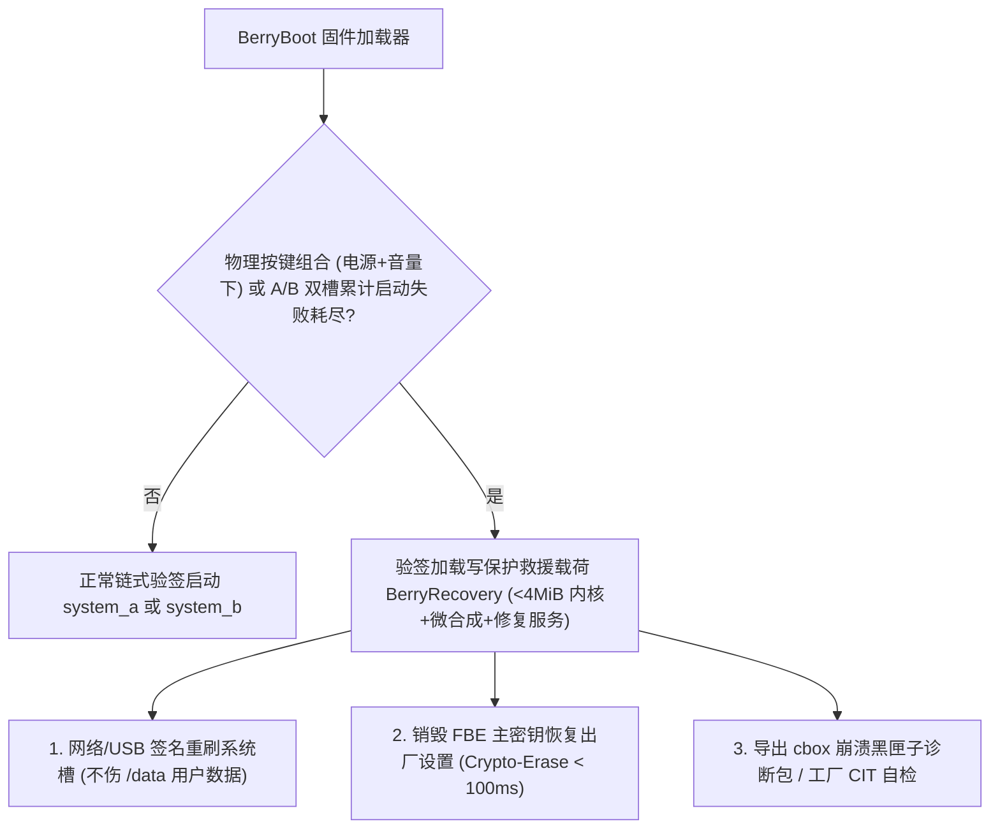

# recovery（独立最小救援恢复环境、硬件工厂自检与产线密钥注入）总体设计

Type: spec
Status: active
Updated: 2026-11-18
Version: 1.0.0

一句话说明：`recovery`（由独立自包含救援微系统 `BerryRecovery`、受控救砖刷机协议 `berry-fastboot`、自动化工厂硬件自检套件 `berry-cit` 与产线安全封签工具链组成）是 BerryOS「永不死砖」与规模化硬件量产的最后一道物理保险栓。

## 背景

[整机生态十维盲区全景审计](../../research/2026-11-18-整机生态十维盲区全景审计.md) 指出：[storage-image 总体设计](../storage-image/design.md) 虽然引入了 GPT A/B 双槽系统分区与启动看门狗自动回滚，但仍存在三大现实工程盲区：① 若极端闪存坏块、开发测试刷机失误导致 A/B 双槽均无法挂载，或用户遗忘锁屏密码需要安全抹掉整机恢复出厂，系统缺乏不依赖主系统与数据分区的独立图形化救援环境；② 缺乏标准高速有线/局域网受控重刷协议；③ 真实硬件走下工厂 SMT 产线时，缺乏逐项检验屏幕、触控、音频、传感器与射频的硬件自检模式（CIT）以及一次性写入设备唯一身份证书与锁定防回滚熔丝的产线注入流程。本规格依据 [整机十维缺失拼图全栈终态架构裁决](../../notes/proposed/2026-11-18-整机十维缺失拼图全栈终态架构裁决.md)，立定独立救援与量产全链路契约。

## 范围

- **覆盖**：独立只读救援镜像 `BerryRecovery`（体积 $< 4\text{MiB}$，零外部磁盘依赖全内存自包含运行）的引导触发机制与极简高可靠图形/按键/触控交互界面；基于 USB Bulk / 局域网双向签名的救砖修复协议 `berry-fastboot` 与联网云端镜像一键拉取重装（Internet Recovery）；密码学秒级安全擦除（Crypto-Erase 恢复出厂设置）；工厂产线硬件自检套件 `berry-cit`；产线密钥注入与 Verified Boot 解锁/上锁状态机（`dev` / `open` / `locked`）。
- **不覆盖**：常规运行态后台无感流式 OTA 写入非活跃槽（归 [更新与 OTA 设计](../../../docs/更新与OTA设计-v1.0.md) 与 [storage-image 总体设计](../storage-image/design.md)）。

## 契约

### 一、物理隔离的 `< 4MiB` 自包含救援微系统（`BerryRecovery`）契约

1. **故障域彻底解耦**：`BerryRecovery` 存放在受硬件写保护属性（eMMC Boot Partition / SPI NOR 或独立只读恢复槽）保护的签名镜像内，仅捆绑最小莓核、`gfx` CPU 软光栅极简 UI、USB Gadget/网卡驱动、`BerryFS` 检查器与验签引擎，总压缩体积严格控制在 **4MiB 以内**。即便主存储上的 `system_a`、`system_b` 与 `userdata` 分区表全部损毁，设备依然能 100% 点亮屏幕进入清晰易懂的多语言图形救援菜单（同时支持纯物理音量键/电源键上下选定，应对触控屏摔坏场景）。
2. **双路无损与彻底修复手段**：
   - **保数据重装系统（Reinstall OS Keeping Data）**：连接 USB 宿主 `berry flash --keep-data` 或直接在救援界面连入 Wi-Fi 经 TLS 1.3 + Ed25519 官方信任根流式拉取最新签名 `BerryROFS` 镜像重写 `system_a/b` 槽，用户的加密 `/data` 分区毫发无损；
   - **密码学瞬时恢复出厂（Crypto-Erase）**：用户确认抹掉所有内容时，无需耗时数十分钟全盘覆写闪存磨损寿命——直接指令 TEE / 安全元件不可逆销毁 [security 总体设计](../security/design.md) 的 FBE 硬件包装主密钥并重建空 `BerryFS` 超级块，旧密文扇区在数学上永久沦为不可解密的随机噪声，全程耗时 $< 100\text{ms}$。

### 二、受控刷机协议（`berry-fastboot`）与防盗刷锁（FRP）契约

1. **与 `berry` CLI 一体化贯通**：废除零散私有刷机驱动，开发机直接运行 `berry rescue list / flash / unlock / logs` 即可经标准 USB WinUSB/Bulk（无需 Windows 装第三方内核驱动）或救援局域网配对码通道与 `BerryRecovery` 通信。
2. **解锁必清数据铁律（Unlock Wipes Data）**：在量产 `locked` 态下，Bootloader 仅接受经官方或用户自注册自定义根密钥（`open` 态支持开发者刷入自己的根公钥重上锁，兑现真正的硬件自由权！）签名的固件；任何由 `locked` 切换为 `dev`（关闭强制验签）的操作，必须在用户在设备物理屏幕与硬件按键二次确认后，**由硬件层强制联动执行 Crypto-Erase 彻底销毁用户数据主密钥**，物理阻断捡拾者通过解锁刷入篡改内核窃取原机主数据。

### 三、工厂硬件自检（`berry-cit`）与产线密钥注入（Provisioning）契约

1. **全外设闭环自检（CIT）**：在产线模式下，`berry-cit` 提供自动化 JSON 串口/USB 指令集与人工点检界面，覆盖：屏幕坏点/色彩棋盘格、多点触控轨迹网格闭环、扬声器→麦克风扫频声学环回信噪比测试、前后相机清晰度标板采图、6 轴 IMU 水平零偏校准、环境光校准、电池充放电电流计读取及 Wi-Fi/BLE RSSI 信号门限核验，全部校准系数写入只读 `factory_calib` 保护扇区。
2. **产线唯一身份注入与封签**：在出厂封签工位，设备 TEE / 安全芯片在片内真随机生成唯一设备证明密钥对（Attestation Key），仅导出公钥请求产线 HSM 签发设备证书链写回安全存储，随后烧断一次性可编程熔丝（eFuse）固化 OEM 根公钥哈希并将防回滚计数器置初始水位，永久关闭未签名产线测试后门。

## 验收标准

1. **双槽全毁自救演练**：在 QEMU / 模拟器测试中用随机垃圾字节彻底破坏 `system_a` 与 `system_b` 分区头部，重启后 Bootloader 在 2 秒内自动捕获验签失败并平滑进入 `BerryRecovery` 图形救援界面，经 `berry rescue flash` 在线修复后正常进桌面且原 `/data` 加密文件完好无损。
2. **解锁强制擦除对抗验证**：在 `locked` 态写入用户加密数据后触发 Bootloader 解锁流程，验证解锁完成后原 CE/DE 包装密钥 100% 被销毁不可恢复。
3. **镜像体积硬帽**：`BerryRecovery` 完整打包产物（含压缩内核与内置救援用户态）严格 $\le 4\text{MiB}$。

## 适用边界

- SoC 片内掩膜 MaskROM 级串口/USB 紧急下载协议（如高通 EDL / 瑞芯微 MaskROM）属于芯片厂商硬件固化电路，本规格管辖从一级/二级引导器 `BerryBoot` 起算的全可控软件救援链。
