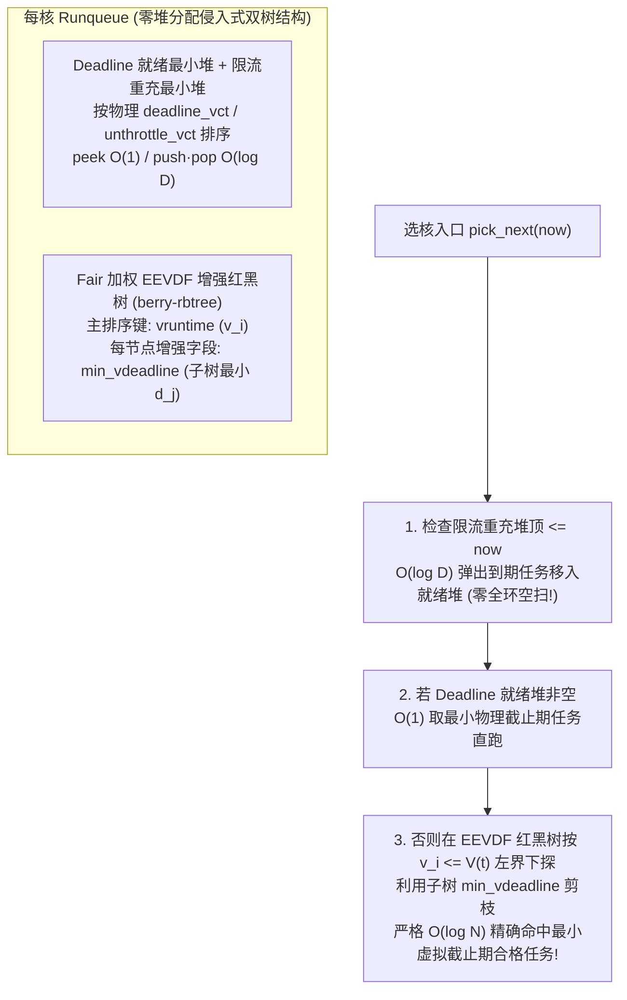
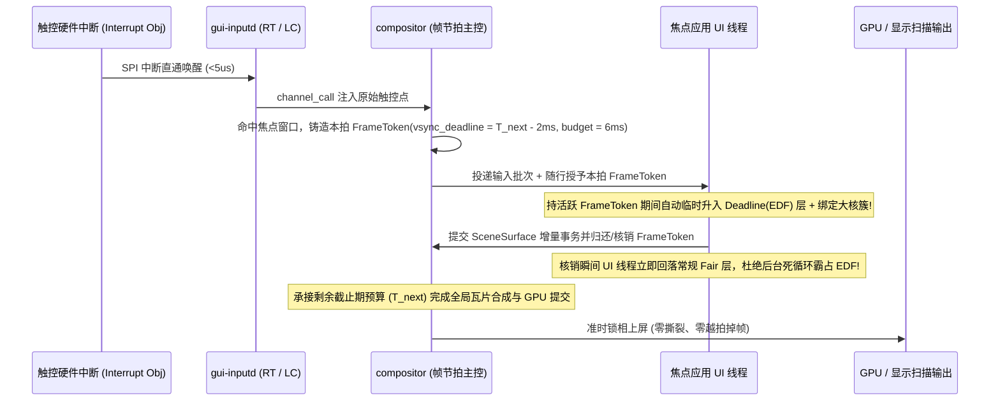

# sched-rt-gfx（对数复杂度运行队列与帧感知闭环调度）总体设计

Type: spec
Status: active
Updated: 2026-11-18
Version: 2.0.0

一句话说明：`sched-rt-gfx` 作为 [meihe 总体设计](../meihe/design.md) 与 [调度彻底计划](../../../docs/调度彻底计划-v1.2.md) 在算法复杂度与端到端图形能效闭环上的权威补完规格，确立「$O(\log n)$ 子树增强侵入式红黑树运行队列 + 触控至合成全链路 `FrameToken` EDF 实时借用 + 焦点驱动自动冻结与在线能效闭环」三大终态契约。

## 背景

[莓核全核深度体检报告](../../research/2026-11-18-莓核全核深度体检报告.md) 与 [渲染管线与桌面 SDK 及镜像存储深度审计](../../research/2026-11-18-渲染管线与桌面SDK及镜像存储深度审计.md) `S-6` 共同表明：除微内核锁序与基础调度数学外，运行队列底层数据结构仍停留在 $O(n)$ 双向循环链表全扫描，且显示/触控关键服务全部以 `intent = 0` 孤立运行，尚未打通从手指触屏到像素上屏的端到端帧截止期保障与失焦省电自动冰封。本规格消除上述最后两块短板，使 BerryOS 调度器在大规模并发扩展性与 120Hz 图形零掉帧体验上同时达到业界顶尖水准。

## 范围

- **覆盖**：侵入式子树增强红黑树（Augmented Intrusive RB-Tree，`berry-rbtree`）EEVDF $O(\log n)$ 选核数据结构与侵入式最小二叉堆（`berry-minheap`）Deadline/限流队列；触控中断 → `gui-inputd` → `compositor` → 焦点应用 UI 线程 → `compositor` GPU 提交的 **`FrameToken` 端到端截止期与大核亲和传播契约**；窗口焦点态驱动的 `Active → Throttled → Frozen → Tombstone` 自动电源与内存联动状态机；帧耗时抖动（Jank Early-Warning）驱动的硬件/虚拟 DVFS 闭环控制。
- **不覆盖**：加权虚拟时间 $V(t)$ 与睡眠滞后衰减的基础数学定义（权威在 [调度彻底计划](../../../docs/调度彻底计划-v1.2.md)）；16 核细粒度锁秩定义（权威在 [meihe 总体设计](../meihe/design.md) 契约三）。

## 契约

### 一、零分配 $O(\log n)$ 增强型运行队列数据结构契约（告别 $O(n)$ 环扫）

彻底退役 `Runqueue` 在 `pick_next`、`pick_next_if_above` 与 `lazy_unthrottle_deadlines` 中的双向链表全环遍历：

1. **EEVDF 子树增强侵入式红黑树（`berry-rbtree` 纯核 crate）**：
   - 每个 `Task` TCB 内嵌定长侵入式树节点 `RbNode { parent_color: usize, left: Option<NonNull<Task>>, right: Option<NonNull<Task>>, subtree_min_vd: u64 }`（零动态内存分配）。
   - 树按任务虚拟运行时间 `vruntime` ($v_i$) 有序排列，并在左旋、右旋、插入与删除时 $O(1)$ 自底向上维护子树内所有节点的最小虚拟截止期 `subtree_min_vd = min(self.vd, left.min_vd, right.min_vd)`。
   - **$O(\log n)$ 精确选核算法**：给定当前核加权虚拟时钟 $V(t)$，所有满足资格条件 $\text{lag}_i \ge 0 \iff v_i \le V(t)$ 的任务恰好构成树中键值 $\le V(t)$ 的前缀集合！沿根向 `V(t)` 分界路径下探至多 $\le 2 \log_2(N+1)$ 层：对所有整棵左子树键值均 $\le V(t)$ 的分支直接读取其 `subtree_min_vd` 求全局最小 $d^*$，随后向拥有 $d^*$ 的唯一子树下降定位目标节点——**入队、出队、抢占探峰与选核最坏时间复杂度严格锁定 $O(\log N)$**，在 10 线程与 4,096 线程负载下均保持数十纳秒恒定延迟！
2. **双侵入式四叉/二叉最小堆管理 Deadline 与带限流（`berry-minheap`）**：
   - 每个核独立维护两个侵入式最小堆：`dl_runnable_heap`（按当前周期物理绝对截止期 `deadline_vct` 排序）与 `dl_throttled_heap`（按下一周期解限流时刻 `replenish_vct` 排序）。
   - Tickless `nearest_deadline()` 直接 $O(1)$ 读取 `dl_throttled_heap.peek()` 对齐硬件定时器 `CNTV_CVAL_EL0`，到期唤醒时仅弹出已到期堆顶元素重充入就绪堆，彻底消灭全环扫描。

### 二、触控至上屏端到端 `FrameToken` 实时调度契约（Render Critical Path）

解决「单个守护进程设高优先级仍会在应用渲染或合成等待处断链掉帧」的经典难题，建立全系统唯一的**硬件 VSync 锁相帧令牌传递链**：

1. **受控单拍 `FrameToken` 机制**：
   - 普通 GUI 应用默认运行于 `Fair` 层（`INTERACTIVE` 档），**不允许应用自行无条件常驻 `Deadline` 层霸占实时带宽**；
   - 每当 `compositor` 开始新的一拍交互帧（由触控到达或活跃动画驱动），`compositor` 从系统图形实时预算池（占全机 CBS 准入池上限如 `35%`）切出单拍 `FrameToken { deadline_vct, remaining_budget_cycles, preferred_cluster: BigCore }` 随帧请求/输入事件下发给当前可见窗口的 UI 线程；
   - 应用 UI 线程接收该消息瞬间由内核自动激活单拍 EDF 身份与大核亲和放置；一旦应用提交本拍 `SceneSurface` 事务（或 6ms 预算耗尽），单拍 EDF 身份**立即自动剥离**，即便恶意或缺陷应用在 UI 线程写 `loop {}` 死循环，也只会在 6ms 后退回普通公平层受常规配额约束，**100% 保证合成器与桌面手势永不被卡死**！
2. **关键系统图形链路默认档位固化**：`rootmgr` / `devmgr` 启动配置强制将 `gui-inputd` 定为短促 `RT/LC` 中断响应级、`compositor` 主合成线程定为 VSync 周期驱动 `Deadline` 级，彻底清零旧代码 `intent = 0` 裸奔态。

### 三、窗口可见性驱动的四阶省电冰封与在线能效闭环契约

1. **桌面焦点 × 调度器 × 内存回收全自动联动表**：
   - **`Foreground-Interactive`（当前焦点窗 / 分屏可见窗）**：享 `INTERACTIVE` 权重与 VSync `FrameToken` 资格；
   - **`Visible-Occluded / PiP`（画中画或桌面非焦点背景可见窗）**：降为 `UTILITY` 档，限制帧率投票上限 `≤ 30Hz`；
   - **`Hidden-Grace`（刚退入后台不可见 `0 .. 3s` 宽限窗，或持有效音频/导航/下载资源证据窗）**：降为 `BACKGROUND` 档并启用宏观 CBS 省电包络 + Timer Slack 合并唤醒；
   - **`Frozen-Standby`（后台不可见超 `3s` 且无活跃后台能力证据）**：`appd` 自动对其调用同步 `process_suspend` 持有 `SuspendToken`——**应用进程 CPU 占用与定时器唤醒严格归 `0`**（其最后画面仍由 `compositor` 场景图无损保留）；若收到合法推送或通道消息，由内核 `frozen_owner` 唤醒钩子通知 `appd` 授予 2 秒短时处理配额后再冻；当系统触发内存水位压力时，优先将最久未用冻结进程转入 `L3` 墓碑释放全部私有物理页。
2. **帧感知 `berry-power` 常驻闭环**：
   - `berry-power` 运行于 `Port` 事件与动态采样环上：空闲停帧期 `berry-power` 同步挂起自身采样定时器实现全机真 `0` 唤醒深睡；
   - 活跃渲染期订阅 `compositor` 帧耗时遥测：当连续 2 帧完成时刻逼近 VSync 截止期 `> 75%`（Jank 预警）时，无需等待 20ms EWMA 慢爬坡，当拍直接通过内核频率聚合口拉升 CPU/GPU 频率档位并置 `EPP = Perf`，动画结束后平滑回落省电档。

## 验收标准

1. **$O(\log n)$ 扩展性硬门禁**：在宿主机 `berry-rbtree` 基准与 QEMU `-icount` 内核基准下，就绪队列从 `8` 个任务扩展至 `2,048` 个混布权重任务时，单次 `pick_next` 指令数增长不超过 **3.5 倍**（线性扫描会暴涨 **256 倍**！），且 100 万次随机插入/删除/旋转下红黑树平衡性与 `subtree_min_vd` 增强不变量 100% 成立。
2. **抗恶意负载 120fps 保帧门禁**：后台同时运行 8 个满载编译/哈希计算线程外加 1 个在回调内故意写死循环的故障 GUI 应用，前台手指滑动桌面或正常应用列表，合成器 120Hz VSync 掉帧率 **< 0.2%**，触控按下到屏幕像素变化端到端延迟稳定在 **≤ 1.5 拍帧周期**。
3. **后台零唤醒省电门禁**：打开 8 个普通应用后切回桌面静置 5 秒，断言 8 个后台应用全部进入 `INHIBIT_FROZEN` 态，后续 60 秒内后台应用产生 CPU 唤醒次数严格为 **0**，点击多任务卡片任一应用可在 **< 16ms（1 帧内）** 即刻解冻恢复交互。

## 适用边界

- 本规格与 [meihe 总体设计](../meihe/design.md) 及 [ipc 总体设计](../ipc/design.md) 完全正交兼容：底层加权虚拟时钟 $V(t)$ 与 $(w_i, r_i)$ 公式保持不变，本规格将其运行队列容器由环形链表升格为增强红黑树并补齐图形-电源垂直控制环。
