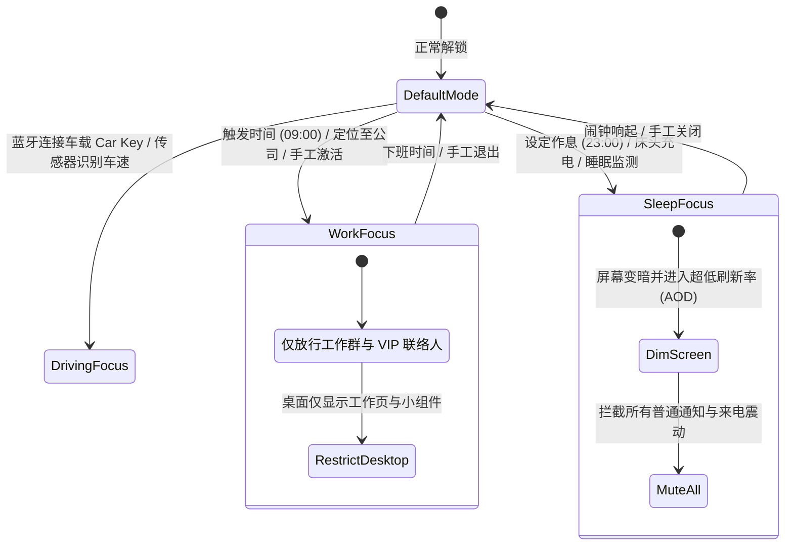

# screen-governance（屏幕行为治理、专注模式与企业双域防泄密）总体设计

Type: spec
Status: active
Updated: 2026-11-18
Version: 1.0.0

## 1. 模块定位与职责边界

Screen Governance 是 BerryOS 维系用户专注力、数字健康、以及政企环境数据防泄密（DLP）的核心治理框架。它处于用户态系统服务层，向上联结桌面、通知中心与多任务管理器，向下通过策略管道（Policy Engine）管控进程调度、应用拉起、跨域剪贴板流转与存储隔离，既提供细腻的「专注模式（Focus Mode）」与「屏幕使用时间（Screen Time）」，又构建零泄漏的「工作域（Work Profile）」企业沙箱。

```
+-------------------------------------------------------------------------+
|                  系统设置 / 快捷控制中心 / MDM 远程策略控制                |
+-------------------------------------------------------------------------+
                                    |
                                    v
+-------------------------------------------------------------------------+
|                       governanced 屏幕与行为治理守护                     |
|   +-------------------+  +-------------------+  +-------------------+   |
|   | 专注模式状态机    |  | 屏幕时长与配额管控 |  | 企业工作域隔离总线|   |
|   +-------------------+  +-------------------+  +-------------------+   |
+-------------------------------------------------------------------------+
       |                                       |
       v (通知/桌面过滤)                        v (访问拦截与配额限制)
+-------------------------------+       +-------------------------------+
|   桌面与通知中心 (desktop)     |       |    应用管理中枢 (am / cbox)    |
|   - 专注壁纸/组件过滤         |       |    - 停机锁屏 / 额度熔断      |
|   - 紧急联络人白名单放行       |       |    - 双域剪贴板 / 存储密钥隔离|
+-------------------------------+       +-------------------------------+
```

### 职责边界划分
- **归属 Screen Governance 的职责**：
  1. **专注模式（Focus Engine）**：定义与维护「工作、睡眠、个人、驾驶、自定义」多场景专注模式；根据模式动态重组桌面页面、过滤非白名单应用通知并联动灵动岛状态显示。
  2. **屏幕使用时间与数字健康（Screen Time）**：高精采集前台应用与网站活跃时长（精确至秒）；执行应用使用配额限制、停机时间（Downtime）及防沉迷强制锁屏。
  3. **数据隐私合规存储**：屏幕时长历史数据必须纯本地加密存储于 `/data/system_ce/<uid>/screentime.db`，未经用户明确授权绝对禁止云端上传。
  4. **企业工作域隔离（Work Profile / MDM）**：建立用户个人空间与企业办公空间的双域隔离架构；实现两套独立的凭据加密密钥（CE Keys）、独立的联系人与相册，以及受管控的跨域剪贴板安全防泄密规则（DLP）。
  5. **企业管理策略执行（MDM Policy）**：解析并下发设备管理员策略（如远程数据擦除、禁止截屏、禁止外部 USB 存储挂载、强制锁屏密码复杂度）。
- **严禁越界的范围**：
  1. 严禁采集用户具体输入按键或窃听屏幕像素内容；Screen Time 仅审计包名（App ID）与窗口前台时间。
  2. 严禁在工作域策略中劫持个人域的私密通讯与私人照片，个人域遵循零知识原则。
  3. 严禁专注模式拦截 110/119/120 等国家法定紧急呼叫与地震火警紧急预警广播（WEA）。

## 2. 核心架构与数据流

### 2.1 专注模式多态切换与流体过滤


### 2.2 企业双域（Personal vs Work）隔离与数据防泄漏 (DLP)
在同一台物理设备上，BerryOS 实例化两套平行命名空间与加密上下文：
- **个人空间 (`UID 1000`)**：由用户个人锁屏密码衍生密钥，用于个人微信、相册、游戏。
- **工作空间 (`UID 2000`)**：由企业管理策略管控，采用独立的企业凭据密钥，应用图标打上徽标（Badge）：
  - **剪贴板隔离**：工作域复制的内容禁止粘贴到个人域（防止客户机密外泄），个人域复制内容在合规策略允许下可向工作域单向粘贴；
  - **存储沙箱隔离**：个人域 `/app/data/` 与工作域 `/data/user/2000/` 物理目录完全隔离，跨域访问必须通过系统的安全分享代理（Managed File Picker）。

## 3. 接口契约与 ABI/IPC 定义

### 3.1 专注模式契约 (`governanced`)
```c
enum BerryFocusType : uint32_t {
    FOCUS_TYPE_OFF      = 0,
    FOCUS_TYPE_WORK     = 1,
    FOCUS_TYPE_PERSONAL = 2,
    FOCUS_TYPE_SLEEP    = 3,
    FOCUS_TYPE_DRIVING  = 4,
    FOCUS_TYPE_CUSTOM   = 5,
};

struct BerryFocusModeConfig {
    uint32_t focus_type;
    uint32_t allow_calls_policy;   // 0: 所有人, 1: 仅收藏联系人, 2: 重复拨打者, 3: 无人
    uint32_t dim_lockscreen;       // 1: 锁屏变暗
    char     active_desktop_page[64]; // 仅允许显示的桌面页面名称
    uint32_t whitelist_apps_count;
    char     whitelist_app_ids[32][64]; // 白名单应用包名列表
};
```

### 3.2 屏幕使用时长统计结构体 (`ScreenTimeStat`)
```c
struct BerryAppUsageRecord {
    char     app_id[64];
    uint64_t foreground_time_ms;
    uint32_t launch_count;
    uint32_t notification_count;
    uint32_t category;             // 1: 社交, 2: 生产力, 3: 游戏, 4: 娱乐
};

struct BerryDowntimePolicy {
    uint32_t is_enabled;
    uint32_t start_minute_of_day;  // 如 22:00 -> 1320
    uint32_t end_minute_of_day;    // 如 07:00 -> 420
    uint32_t allow_quick_bypass;   // 允许用户按「再用 15 分钟」
};
```

### 3.3 企业跨域 DLP 剪贴板安全协议
```c
struct BerryDlpClipboardPolicy {
    uint32_t work_to_personal_allowed; // 默认 0 (禁止工作域向个人域粘贴)
    uint32_t personal_to_work_allowed; // 默认 1 (允许个人向工作域粘贴)
    uint32_t audit_log_enabled;        // 是否记录每次跨域复制审计日志
    uint32_t watermark_required;       // 工作应用截屏/查看是否强制水印
};
```

## 4. 故障模型、降级与安全边界

### 4.1 故障模型与弹性防护
1. **紧急呼叫绝对放行原则**：
   - 无论系统处于何种深度睡眠专注模式或屏幕时间停机锁定状态，检测到紧急号码（110/119/120/122/911）呼出或国家级灾害预警，立即无条件绕过所有策略拦截，点亮屏幕并全力播放告警音频。
2. **MDM 离线与断网弹性**：
   - 企业离线状态下，本地策略缓存持续生效；当企业下发锁机或擦除指令但网络不畅时，短信通道（SMS Wakeup）或最近可用网络握手成功后立即执行。
3. **配额数据库损坏**：
   - 若 `screentime.db` 发生 SQLite 损坏，系统记录警告并平滑轮转新建当日数据库，禁止阻塞前台应用启动流程。

### 4.2 安全与反绕过防御
- **防时间篡改绕过**：Screen Time 不依赖用户可调的本地壁钟，内部绑定 [meihe](../meihe/design.md) 内核单调启动时钟（Monotonic Boot Clock）与网络安全授时（NTS），用户倒拨系统时间无法破解使用限额。
- **防强制杀后台（Kill Protection）**：`governanced` 属于系统核心特权服务，由内核 Job Quota 保护，普通应用无权发信号终止该守护进程。
- **企业擦除零残留**：触发企业远程擦除（Enterprise Wipe）时，系统直接销毁工作域的 CE 主加密密钥（Key Eviction），使所有企业私有数据在存储介质上物理瞬时失效为随机不可逆噪音。

## 5. 落地步骤与验收指标

### 5.1 实施路径
1. **第一波（屏幕使用时长统计基建）**：
   - 联动 [am](../am/design.md) 应用生命周期，实现窗口聚焦与退火的前台秒级精确记账；
   - 建立本地加密聚合数据库与限额报警器。
2. **第二波（专注模式与流体桌面联动）**：
   - 编写 `governanced`，实现专注模式状态机与配置存储；
   - 联动 [desktop](../desktop/design.md) 实现桌面页面流体翻转与通知白名单动态过滤。
3. **第三波（企业工作域与 DLP 防泄密）**：
   - 实现双 UID 凭据密钥分离与跨域剪贴板安全网关；
   - 接入标准 MDM 策略解析器。

### 5.2 商业化验收门禁
- **G-GOV-1（屏幕时长采样损耗）**：Screen Time 采集与记账引入的系统 CPU 额外开销 $\le 0.3\%$。
- **G-GOV-2（专注模式切换延迟）**：触发专注模式到桌面 UI、通知白名单与系统壁纸完全切换到位用时 $\le 120\text{ms}$。
- **G-GOV-3（企业数据零泄漏）**：在禁用跨域复制策略下，剪贴板注入、跨域隐式 Intent 及文件直写穿透攻击拦截率 $100\%$。
- **G-GOV-4（时间篡改穿透防御）**：手动修改本地时间测试 100 次，防沉迷限额突破成功率为 $0\%$。
