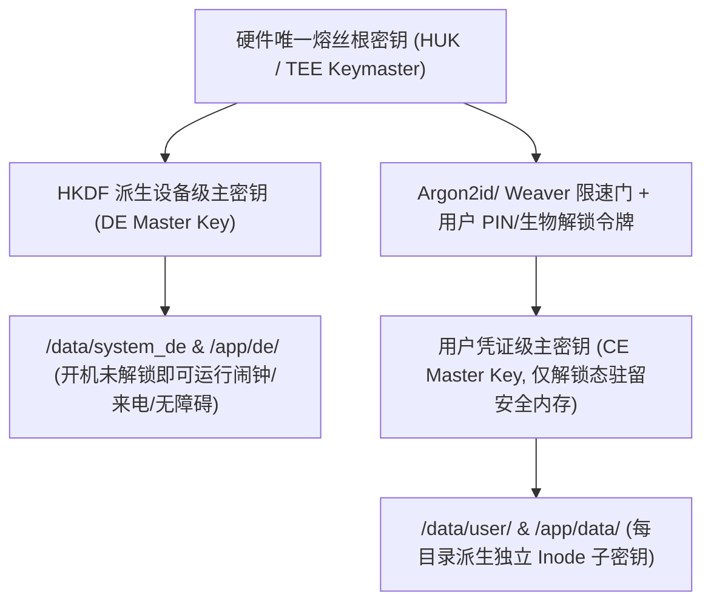

# security（内核熵池、静态数据加密、硬件密钥库与锁屏多用户隔离）总体设计

Type: spec
Status: active
Updated: 2026-11-18
Version: 1.0.0

一句话说明：`security`（由内核密码学真随机熵池、文件级静态加密层 FBE、硬件密钥守护进程 `keystored`、安全认证服务 `biometricd` 与最高优锁屏层 `Keyguard` 组成）是 BerryOS 的数据落盘防线与人机信任根——以「硬件喂熵 CSPRNG + DE/CE 双级文件静态加密 + 私钥不出岛硬件密钥库 + 锁屏即擦密钥」确保即使设备遗失或闪存被拆焊，攻击者亦无法窥探分毫用户隐私。

## 背景

[整机生态十维盲区全景审计](../../research/2026-11-18-整机生态十维盲区全景审计.md) 证实：BerryOS 虽已具备内存隔离与 `.bap` 包签名验签，但全系统尚无内核密码学随机数熵池（CSPRNG）、无磁盘静态加密（拆盘即明文）、`berry-ksproto` 仅停留在无后端协议帧定义且 `0x85 attest` 恒返回 `-ENOTSUP`、无锁屏门禁（Keyguard）与生物认证令牌、无多用户数据隔离。本规格依据 [整机十维缺失拼图全栈终态架构裁决](../../notes/proposed/2026-11-18-整机十维缺失拼图全栈终态架构裁决.md)，承接并补完 [安全与硬件隔离设计](../../../docs/安全与硬件隔离设计-v1.0.md) 未覆盖的数据静态保护与身份安全全栈契约。

## 范围

- **覆盖**：内核早期多源密码学安全伪随机数发生器（CSPRNG）与系统调用出口；`BerryFS` 原生文件级静态加密（FBE：Device-Encrypted 直通启动层与 Credential-Encrypted 用户凭证层）；承接 [berry-ksproto](../../../user/berry-ksproto/src/lib.rs) 的真身服务 `keystored`（软件加密岛、ARM TrustZone OP-TEE / 独立安全芯片后端、远程密钥证明 `0x85 attest`、防回滚单调计数器与 Passkeys/WebAuthn）；系统锁屏安全层 `Keyguard`、硬件认证令牌 `AuthToken`（PIN / 指纹 / 3D 人脸 / 手表近场解锁）及多用户与隐私分身空间隔离。
- **不覆盖**：包分发签名信封与信任账本格式（归 [SDK-2 分发与签名链设计](../../../docs/SDK-2-分发与签名链设计-v1.2.md)）；进程运行期页表、SMMU 与 PAC/BTI/MTE 硬件指令防护（归 [meihe 总体设计](../meihe/design.md) 与 [mm 总体设计](../mm/design.md)）。

## 契约

### 一、内核多源密码学熵池（CSPRNG）契约

1. **三路硬件熵聚合初始化**：内核启动阶段即刻汇聚三路独立熵源注入 BLAKE2s/SHA-512 熵提取池：① ARMv8.5-RNG `RNDRRS` 硬件真随机指令（若 CPU 支持）；② `virtio-rng` 半虚拟化宿主熵通道或 SoC 片上 TRNG 外设；③ 高频定时器与指令流水线微架构抖动熵（Jitter Entropy）及上次正常关机由 Bootloader 传递并立即覆写销毁的 `seed.bin` 随机种子。
2. **零锁每核 ChaCha20 快速发生器**：熵池满 256-bit 安全性水位后，派生每 CPU 独立的 `ChaCha20` 快速密钥流缓冲（每 60 秒或每产出 1MiB 自动前向安全重播种 Fast-Key-Erasure），通过新增系统原语 `berry_cprng_draw(buf, len)`（及 `berry-libc` `getrandom()` 真身）向全系统 TLS 握手、ASLR 地址随机化与密钥生成提供零阻塞密码学随机字节。

### 二、`BerryFS` 原生双级文件静态加密（FBE）契约

1. **算法与粒度**：紧耦合 [storage-image 总体设计](../storage-image/design.md) 的 `BerryFS` B+Tree 引擎，目录树文件名采用 `AES-256-HCTR2` / `XChaCha20-SIV` 保长确定性前缀加密，文件数据 Extent 页（4KiB）采用带认证标签或防篡改扇区微调的 `AES-256-XTS`（ARMv8 `AESE` 硬件指令线速加解密，无硬件扩展时用 `XChaCha20-Poly1305`），每个应用沙箱目录由主密钥经 HKDF 派生唯一子密钥。
2. **Direct Boot（直通启动）与双级密钥生命周期**：
   - **设备级加密（DE）**：仅绑定硬件唯一根密钥与验证启动状态（Verified Boot Hash），冷启动上电即解锁，专供系统闹钟、Wi-Fi 重连、紧急呼叫与无障碍读屏在用户首次输入密码前正常工作；
   - **凭证级加密（CE）**：由硬件根密钥与用户锁屏密码经抗暴力破解限速器（硬件 Weaver 芯片或内存硬化 `Argon2id`，连续输错指数退避直至熔断自毁）联合派生；设备刚开机（Before First Unlock, BFU）或用户在高安全模式下锁定设备时，**内核与文件系统立即清零内存中的 CE 密钥槽并丢弃对应明文页缓存**，任何物理冷启动内存提取或闪存拆焊均无法还原明文。

### 三、硬件背书密钥库（`keystored`）与远程证明契约

1. **无缝兑现 `berry-ksproto` 三档安全后端**：用户态 `keystored` 服务完整实装 `berry-ksproto` 全部原语并扩充对称/非对称加密会话与 FIDO2 Passkey 签名操作，透明对接三档后端：`SecurityLevel::Software`（受 FBE 保护的纯 Rust 隔离沙箱岛，供 QEMU 基础环境使用）、`SecurityLevel::TrustedEnvironment`（经 SMC 进入 ARM TrustZone OP-TEE TA）、`SecurityLevel::StrongBox`（经 SPI 对接独立安全元件 SE）。
2. **私钥永不出岛与 `0x85 attest` 贯通**：应用调用 `OP_KEY_GENERATE` 生成的私钥经硬件根密钥包裹为不透明 `keyblob`，签名或解密运算只能在 `keystored` / TEE 内部执行；打通 `0x85 attest` 与 `OP_KEY_ATTEST`，生成包含启动链度量哈希、OEM 锁定态、系统安全补丁水位与客户端随机质询（Challenge）的硬件签名证明证书链。

### 四、不可伪造锁屏层（`Keyguard`）、`AuthToken` 与多用户隔离契约

1. **可信输入独占锁屏表面**：`Keyguard` 驻留于 [desktop 总体设计](../desktop/design.md) 五层空间栈的最高安全拦截位；处于锁定态时，合成器物理阻断一切普通应用表面上屏（显式声明 `ShowWhenLocked` 的闹钟响铃、来电接听与受限锁屏相机除外，且锁屏相机仅能向临时写盲盒目录追加新照片、绝无读取历史相册句柄之权），通知横幅默认隐藏正文详情直至人脸/指纹核身通过。
2. **密码学签名 `AuthToken`（拒绝布尔返回值伪造）**：当用户完成 PIN 核验或 `biometricd` 指纹/人脸/穿戴近场可信距离核验时，认证后端签发带单调时间戳、挑战流水号与 HMAC/Ed25519 签名的 `HardwareAuthToken`；凡标记 `UserAuthRequired` 的敏感支付密钥或密码保险箱条目，`keystored` 必须亲自校验该令牌签名与时效（如 15 秒内有效）方可执行密码学运算，应用层篡改 UI 分支完全无效。
3. **多用户与隐私空间（Profile Isolation）**：支持主用户（`uid=0`）、子账号、访客模式（退出即销毁临时 CE 密钥实现毫秒级全量无痕清理）以及独立密码进入的「隐私保险箱分身」——不同 Profile 拥有完全正交的 `BerryFS` 子卷根句柄、独立 `keystored` 命名空间与独立应用数据沙箱，共享同一份只读系统镜像与 `.bap` 代码页以零膨胀节省存储。

## 验收标准

1. **熵池质量与性能门禁**：冷启动首帧用户态进程拉起前 CSPRNG 完成满熵初始化，通过 NIST SP 800-22 随机性统计套件检验，单核 `berry_cprng_draw` 吞吐 $\ge 800\text{MB/s}$。
2. **BFU / 锁屏拆盘零明文验证**：向 `/app/data/demo/` 写入特征敏感明文字符串后正常关机，在宿主机对底层 `disk.img` 全盘执行字节级扫描与熵分析，特征串零命中且密文扇区呈均匀白噪声分布；未输入正确解锁凭证前任何篡改磁盘数据的行为均被认证标签拦截。
3. **`keystored` 与 `AuthToken` 对抗验证**：构造伪造 `HardwareAuthToken` 请求调用绑定用户认证的私钥签名，100% 返回鉴权拒绝错误；锁屏态下尝试通过快捷键或 IPC 枚举普通应用窗口或读取历史照片句柄 100% 阻断。

## 适用边界

- 防御物理级开盖电子显微镜探针探测 SoC 内部 SRAM 总线的军工抗篡改需求依赖真机独立 CC EAL5+ `StrongBox` 安全芯片选型，纯软件与常规 TrustZone 层仅承诺抵御闪存拆焊、冷复位内存残留读取与软件提权攻击。
