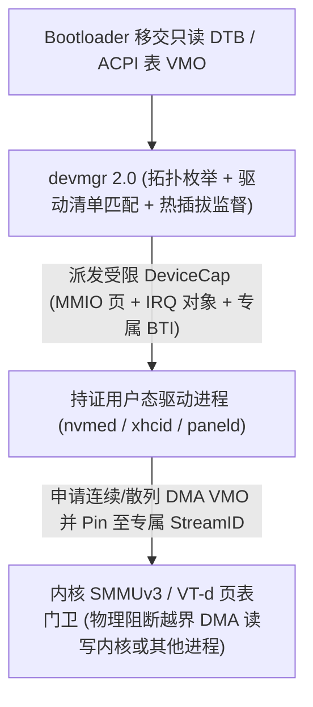

# soc-peripherals（真实 SoC 高速总线、传感器融合中枢与高保真触觉引擎）总体设计

Type: spec
Status: active
Updated: 2026-11-18
Version: 1.0.0

一句话说明：`soc-peripherals`（由设备枚举与 DMA 隔离总管 `devmgr` 2.0、高速总线栈 `pcied`/`usbd`、低功耗传感器融合中枢 `sensord`、高保真触觉引擎 `hapticsd` 及板级电源时钟树 `plat-pm` 组成）是 BerryOS 跨出 QEMU 虚拟温室、真正统治真实 ARM64/x86_64 手机、PC 与穿戴硅片的硬件躯干。

## 背景

[整机生态十维盲区全景审计](../../research/2026-11-18-整机生态十维盲区全景审计.md) 指出：现役系统仅能驱动 `virtio-mmio` 与 PL011/PL061，在面对真实 PC/VMware Fusion 及移动/穿戴 SoC 时缺少四大关键支柱：① 缺少 PCIe ECAM/MSI-X、IOMMU/SMMUv3 与 USB/xHCI 总线栈；② 缺少重力加速度计/陀螺仪、环境光与心率传感器中枢（导致自动旋转、抬腕亮屏与自动亮度无真实数据源）；③ 缺少与弹簧物理动效锁拍的线性马达触觉反馈引擎；④ 缺少设备树（DTB/ACPI）电源轨/时钟树管理及真机 S3 深睡外设挂起恢复协议。本规格依据 [整机十维缺失拼图全栈终态架构裁决](../../notes/proposed/2026-11-18-整机十维缺失拼图全栈终态架构裁决.md)，承接 [驱动模型设计](../../../docs/驱动模型设计-v1.0.md)「驱动即持证用户态应用」原则立定真机外设全栈契约。

## 范围

- **覆盖**：统一硬件拓扑发现（Flattened Device Tree DTB 与 ACPI 表用户态只读解析）与 `devmgr` 2.0 硬件资源能力券（受 SMMUv3/VT-d 保护的 `DmaBtiCap`、MMIO VMO、`MsiInterruptCap`）；PCIe ECAM + MSI/MSI-X、NVMe、SDHCI/eMMC、USB xHCI 主从协议栈与 Type-C PD、I2C/SPI/PWM、MIPI-DSI/eDP/DisplayPort 真机显示控制器契约；传感器融合守护进程 `sensord`（模拟器宿主/QMP 注入桥接 + 真机 IIO/Sensor Hub）；线性马达高保真触觉守护进程 `hapticsd`；Clock / Regulator / PMIC 引用计数树与 S3 Suspend-to-RAM 外设逆序冻结恢复协议。
- **不覆盖**：GICv2/v3/v4 与 APIC 根中断控制器本身及 CPU 核上下电 PSCI 底层封装（归 [hal 总体设计](../hal/design.md)）；无线 802.11/BLE 上层网络协议（归 [net-conn 总体设计](../net-conn/design.md)）。

## 契约

### 一、`devmgr` 2.0 零特权用户态驱动与 IOMMU/SMMU 硬隔离契约

1. **驱动崩溃零伤内核且支持毫秒级热重启**：除极早期串口、定时器、根中断控制器与 SMMU 页表门卫留在内核外，PCIe、NVMe、USB、面板、触控与传感器驱动 **100% 运行于独立 EL0 用户态进程**。每个驱动进程仅获发其声明绑定的精确物理 MMIO 页窗口与专属总线事务标识（Bus Transaction Initiator, `BtiCap`）——由内核编程 ARM SMMUv3 / Intel VT-d Stage-1/2 页表，使外设硬件 DMA 引擎仅能访问驱动显式 Pin 定的缓冲区页面；驱动即使遭遇固件恶意返回引发崩溃，亦无法破坏内核内存，并由 `devmgr` 重置外设总线位后毫秒级拉起恢复。
2. **现代高速总线矩阵**：
   - **PCIe + MSI-X + NVMe**：支持 ECAM 配置空间枚举、每队列独立 MSI-X 向量直投用户态驱动线程 `InterruptObject`（零共享电平中断争用），NVMe 多提交/完成队列无锁直驱 `BerryFS`；
   - **USB xHCI 主从双模与 Type-C**：主机模式原生支持 USB HID（键鼠/手柄）、USB Mass Storage、UVC 摄像头、UAC 声卡；设备（Gadget）模式支持 `berryctl` 高速 USB Bulk 调试与网卡共享，让开发机一根 Type-C 线直连真机调试部署；
   - **真机显示与触控总线**：I2C 多点电容触控屏中断时间戳硬件锁存（支撑 `< 1ms` 触控采样）、MIPI-DSI Command/Video 模式面板初始化序列与硬件 TE（Tearing Effect）引脚直连 [compositor 总体设计](../compositor/design.md) VSync 源。

### 二、低功耗传感器融合中枢（`sensord`）契约

1. **软硬同构传感器总线**：`sensord` 向上层桌面与 SDK 暴露统一无锁共享采样环与阈值事件订阅接口；底层在真机对接片上低功耗协处理器（Sensor Hub FIFO 批处理唤醒），在 `berry` 宿主模拟器下对接窗口方向/光线滑杆与 CLI 实时物理姿态注入（`berry sensor set --tilt ... --lux ... --hr ...`），保证模拟器与真机 100% 同构联调。
2. **内建姿态解算与系统级联动**：
   - **6 轴/9 轴姿态融合（Madgwick / 互补滤波四元数）**：驱动桌面无卡顿真实重力方向切换、相机水平仪，并在穿戴/手机息屏态以极低功耗硬件中断识别「抬腕亮屏（Raise-to-Wake）」与「翻转静音」；
   - **环境光（ALS）感知曲线**：结合人眼韦伯-费希纳对数定律与迟滞防抖滤波，平滑驱动面板背光 PWM / 伽马曲线与日夜主题自动切换；
   - **穿戴健康传感器门控**：心率/血氧 PPG、计步与皮肤温度归入高敏健康能力域（`HealthSensorCap`），须经用户显式授权方可订阅。

### 三、帧拍同步高保真触觉物理引擎（`hapticsd`）契约

1. **参数化瞬态与连续波形原语（拒绝粗糙嗡嗡长振）**：面向现代 X 轴线性谐振马达（LRA），定义紧凑触觉原语集：`CrispTick`（滚轮拨动 3ms 清脆微振）、`LightClick`（开关切换）、`RigidThud`（拉到底部弹性边界阻尼撞击）、`SoftPulse`（长按蓄力渐强）与音频随动波形（Audio-to-Haptics）。
2. **与 UI 物理动画微秒级同拍触发**：[ui-sdk 总体设计](../ui-sdk/design.md) 的滚动边界回弹、开关拨动与返回手势确认点携带 `HapticCueId` 随帧提交；合成器在对应动画帧越过物理阈值的同一 VSync 拍向 `hapticsd` 发出无阻塞触发脉冲，确保手指视觉看到的回弹瞬间与指尖感受到的物理敲击延迟差 $\le 2\text{ms}$（在模拟器侧映射为 macOS Force Touch 触控板原生触感反馈或视觉微震指示）。

### 四、板级电源/时钟引用树与真机 S3 深睡拓扑契约

1. **声明式电源轨与时钟门控**：`plat-pm` 基于设备树构建 `ClockTree` 与 `RegulatorTree` 有向无环图，采用严格引用计数——当最后一个使用摄像头或音频总线的驱动关闭会话时，自动按依赖逆序门控时钟并切断对应 LDO/Buck 电源轨，彻底杜绝真机漏电（Leakage Current）。
2. **两阶段确定性 S3 挂起与唤醒重放**：系统进入 S3 Suspend-to-RAM 前，`devmgr` 按设备依赖拓扑**自叶向根逆序**下发 `PrepareSuspend -> Suspend`（限时 200ms 超时熔断并记录拒睡元凶唤醒源台账），待全部外设刷空 DMA 停机后由内核执行 PSCI `SYSTEM_SUSPEND`；被硬件唤醒源（RTC 闹钟、电源键、BLE/Wi-Fi 魔术包、抬腕中断）唤醒后，**自根向叶正序**恢复供电、时钟与控制器上下文，从按键到亮屏可触控全链路恢复时间 $\le 150\text{ms}$。

## 验收标准

1. **DMA 越界物理拦截门禁**：在启用 SMMUv3 / IOMMU 的测试环境下，故意注入篡改描述符的测试用户态驱动尝试向内核代码物理页发起 DMA 读写，硬件 SMMU 立即捕获页故障中断并隔离重启该驱动，内核与其余服务零受损。
2. **VMware / QEMU PCIe+xHCI 全链跑通**：在纯 PCIe（无 `virtio-mmio`）标准 UEFI 虚拟机配置下，通过 `pcied` + `nvmed` + `xhcid` 成功挂载 `BerryFS` 根盘并响应 USB 键鼠交互。
3. **传感器与深睡电流门禁**：模拟器注入屏幕旋转四元数与环境光照度跃变，桌面 1 帧内平滑启动旋转过渡动画与亮度渐变；S3 挂起恢复压力测试连续循环 500 次零死锁、零外设失联。

## 适用边界

- 闭源无文档私有 GPU/基带固件若无法提供用户态重封装资料，按 [兼容子系统设计](../../../docs/兼容子系统设计-v1.0.md) 隔离于受 SMMU 严格圈禁的固件代理容器内，绝不放进微内核特权空间。
