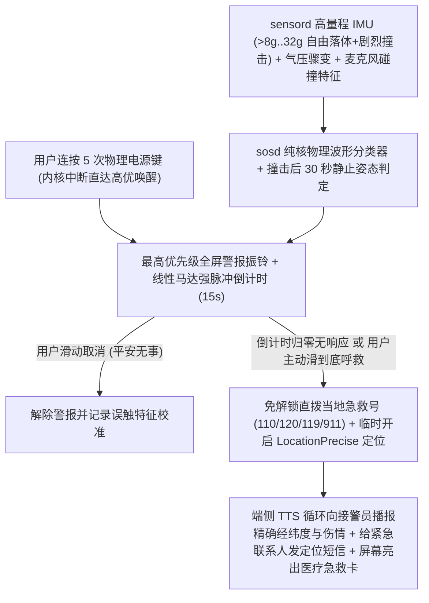

# telephony-sos（统一实时通话管控框架、卫星/蜂窝应急通信与穿戴手机 SOS 生命线）总体设计

Type: spec
Status: active
Updated: 2026-11-18
Version: 1.0.0

一句话说明：`telephony-sos`（由统一通话中枢 `callmgr`、穿戴/手机冲击跌倒状态机 `sosd` 与锁屏医疗急救卡服务组成）将蜂窝语音、加密网络音视频通话与生死攸关的紧急救援整合为系统一等公民——关键时刻无需解锁一秒呼救。

## 背景

[全栈 25 模块跨界接缝与深水区六盲点复核审计](../../research/2026-11-18-全栈25模块跨界接缝与深水区六盲点复核审计.md) 指出：作为面向移动与穿戴设备的现代操作系统，BerryOS 此前缺少统管蜂窝来电与互联网 VoIP 通话的电话框架（导致网络音视频应用在锁屏态无法像原生电话一样全屏响铃接听或联动蓝牙耳机按键），更缺少穿戴/手机严重跌倒与车祸冲击检测自动呼救及医疗急救卡等生命安全基础设施。本规格依据 [跨模块 ABI 合龙与进程外 JIT 及深水区六子系统裁决](../../notes/proposed/2026-11-18-跨模块ABI合龙与进程外JIT及深水区六子系统裁决.md)，立定全场景通信与生命安全守护契约。

## 范围

- **覆盖**：系统统一通话守护进程 `callmgr`（同构纳管 [net-conn 总体设计](../net-conn/design.md) `rild` 蜂窝 IMS VoLTE/VoNR 通话与第三方端到端加密 VoIP 通话、锁屏来电接听卡片、灵动实时胶囊、蓝牙 HFP/LE Audio 耳机与车载按键状态同步、防骚扰本地端侧 AI 识别）；通话音频独占路由与**反偷录双端硬件提示音合规门**；穿戴与手机严重跌倒/车祸撞击检测守护进程 `sosd`、连按五次电源键紧急呼叫、自动语音播报经纬度、锁屏只读医疗急救卡（Medical ID）及无地面信号时的低轨卫星/离网应急短报文槽位。
- **不覆盖**：底层调制解调器射频编解码固件（归 `rild` 与硬件基带）；通用聊天消息列表展示（归上层即时通讯应用）。

## 契约

### 一、蜂窝与加密 VoIP 同构通话中枢（`callmgr`）契约

1. **体验平权且杜绝虚假来电保活**：第三方音视频应用无需常驻后台耗电——来电推送到达时唤醒应用向 `callmgr` 报告 `IncomingCall(CallerMeta)`（若应用唤醒后 3 秒内未调用 `callmgr` 亮出真实来电界面，`workmgr` 立即判定滥用高优推送通道并降权惩罚）。`callmgr` 统一在锁屏层渲染系统标准接听/拒接全屏界面（解锁态渲染顶部胶囊横幅），并自动接管蓝牙耳机单击接听、双击挂断与静音键同步。
2. **不可绕过的通话录音知情权护栏**：普通应用在 `VoiceCall` 激活期间默认无法直接读取通话上下行混音环（物理阻断木马后台偷录电话）；唯有用户在系统通话界面显式点击「通话录音」按钮时，`audiod` 才建立录音文件流，且在开启瞬间**由 `audiod` 混音器强制向通话对端上行链路与本端同时注入清晰的「通话已开始录音」标准提示音**，兼顾合法取证需求与双方隐私知情权。
3. **不出端反诈与骚扰拦截**：陌生号码呼入时，`callmgr` 仅查核本地离线高频骚扰前缀布隆过滤器，并在用户开启端侧通话助手时由本地 `airtd` 替用户接听机器人推销电话并实时转写摘要字幕上屏，通话语音 100% 不上传任何第三方服务器。

### 二、跌倒/车祸检测与零解锁紧急救援生命线（`sosd`）契约

1. **任何状态下永不失效的求救热键**：内核电源键中断处理链内置独立硬件连按计数器——连续快速按动 5 次电源键（或长按电源+音量上键），即使用户态桌面应用卡死或处于未输入密码的开机直通（BFU）锁屏态，也能由驻留 DE 加密层的 `sosd` 直接接管屏幕拉起紧急呼救滑块。
2. **多模态低误报跌倒与车祸检测**：结合 `sensord` 失重跌落—冲击峰值—冲击后水平静止三段式运动学特征（车祸模式另融合 `locationd` 高速行驶骤停与车厢气囊气压突变），触发高分贝警报与强触觉震动提醒；若机主昏迷 15 秒未触屏取消，`sosd` 自动拨通紧急救援电话，并通过 `airtd` 离线 TTS 向接警台清晰播报：「机主疑似发生严重跌倒或碰撞且无意识，当前精确坐标北纬……东经……误差 N 米」，同时向预设紧急联系人发送实时位置追踪链接。
3. **锁屏只读医疗急救卡（Medical ID）**：用户预先填写的血型、药物过敏史、基础病史、器官捐献意愿与紧急联系人电话加密存储在 DE 直通层专属槽位；处于紧急呼救界面时，现场医护人员无需知道锁屏密码即可一键查看该只读卡片，且绝无访问设备内任何其他相册或聊天数据的通道。
4. **无地面网络卫星/离网求救扩展槽（Satellite SOS Slot）**：在 `rild` / `sosd` 预置极窄带宽压缩求救报文协议（单包 $< 32$ 字节编码经纬度、海拔、剩余电量与伤情分类问卷），无缝对接真机北斗短报文 / 天通 / 低轨直连卫星调制解调器硬件。

## 验收标准

1. **双模通话与耳机联动验证**：模拟器注入加密 VoIP 来电与模拟蜂窝来电，在锁屏态均正确弹出系统接听界面，模拟蓝牙 HFP 按键可准确接通、静音与挂断；开启通话录音瞬间对端音频流 100% 检出提示音波形。
2. **SOS 断网/锁屏极端通关门禁**：在未输入首次开机密码（BFU 锁屏态）且关闭常规数据网络的条件下，注入 5 连击电源键或标准跌倒 IMU 测试向量，15 秒倒计时后成功拉起紧急语音经纬度播报并完整展示预设医疗急救卡。

## 适用边界

- 紧急呼叫实际接入运营商无 SIM 卡紧急通道（Emergency Camp-on）遵循各国电信入网法规及硬件基带频段认证。
