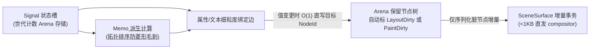

# ui-sdk（声明式响应式 UI 框架与应用开发套件）总体设计

Type: spec
Status: active
Updated: 2026-11-18
Version: 2.0.0

一句话说明：`ui-sdk`（统合升级 `berry-ui`、`berry-appshell`、`berry-sdk`、动态堆与系统输入法协议）是 BerryOS 面向第一方与第三方开发者的现代化应用开发平台——以「零虚拟 DOM 细粒度信号响应式（Signals）+ 声明式组件宏与 TLV 双态同构 + `Port` 原生 `async/await` 执行器 + 完备 CJK 输入法与无上限池化文本」将千行样板代码压缩 90% 以上。

## 背景

[渲染管线与桌面 SDK 及镜像存储深度审计](../../research/2026-11-18-渲染管线与桌面SDK及镜像存储深度审计.md) 表明：尽管 `berry-ui` 已具备扎实的零分配 Arena 与 TLV 序列化雏形，但因缺失响应式状态绑定、组件化封装、异步 I/O 泵与动态文本存储，编写一个简单设置页竟需 1,115 行手动状态回写与底层通道样板代码，且受困于 64 字节文本硬帽、256KiB 静态堆与零中文输入能力。本规格对标 SwiftUI、ArkUI 与现代 Rust 细粒度响应式架构（Leptos / Xilem 思想，全自研零第三方重依赖），立定 `ui-sdk` 2.0 终态契约。

## 范围

- **覆盖**：细粒度响应式原语（`Signal` / `Memo` / `Effect`）与场景节点直连自动更新；声明式 Rust `view!` 组件体系与字节精确 TLV 编译双入口；池化 UTF-8 文本缓冲与虚拟化滚动容器；基于内核 `Port` 的单线程零阻塞 `berry-async` 运行时与零样板 `App::run` 应用壳；用户态 `Vmar` 按需动态堆分配器；能力安全的系统中文/多语种输入法（`imed`）与剪贴板一次性句柄协议；统一设计系统 Token（明亮/暗黑/高对比与无障碍缩放）。
- **不覆盖**：底层瓦片光栅与矢量字体轮廓数学（归 [gfx 总体设计](../gfx/design.md)）；跨窗口合成与 GPU 后端（归 [compositor 总体设计](../compositor/design.md)）；`.bap` 签名与沙箱 `Job` 装载（归 [微内核与全栈底座彻底重构规格](../2026-11-18-微内核与全栈底座彻底重构规格.md) 契约五）。

## 契约

### 一、细粒度信号响应式内核与声明式组件契约（Zero-VDOM Signals）

彻底告别应用开发者手动持有几十个 `NodeId` 并在 `match msg` 中逐个调用 `ui.set_text` / `ui.set_props` 的易错模式，同时**绝不引入全树重建的虚拟 DOM 垃圾回收开销**：

1. **三元响应式原语（`berry_ui::reactive`）**：
   - `Signal<T>`：`Copy` 轻量句柄（`u32` 代数槽索引，生命周期绑定组件作用域 `Scope`），读写复杂度 $O(1)$；调用 `.set(val)` 或 `.update(|v| ...)` 时自动将订阅该信号的绑定边推入本帧待刷队列（同一帧内多次修改自动批处理合并，每帧至多触发一次节点更新与一次增量提交）。
   - `Memo<T>`：缓存派生值，严格按依赖图拓扑高度求值，100% 消除菱形依赖中间态闪烁（Glitch-Free），结果相等（`PartialEq`）时短路截断下游传播。
   - `For<Items, KeyFn, ViewFn>`：唯一需要局部对账的列表原语——基于稳定 `Key` 执行双端 O(N) 最小移动对账，并与虚拟化视口裁剪联动，仅实例化可视区及前后缓冲项节点。
2. **声明式组件与 TLV 字节同构**：
   - 提供零过程宏外部依赖（声明式 `macro_rules!` 或内建轻量源码生成器）的声明式组件语法：一个完整的交互式设置页（含状态持久化、暗黑模式切换、滑块实时百分比、异步网络探测）代码量控制在 **≤ 60 行**，应用层 **零 `unsafe`、零手工 VMO/Channel 调用**。
   - 保持 `.bui` 二进制 TLV 视图资产一等公民地位：静态布局骨架可编译为只读 `.bui` 段，动态槽位通过具名绑定键（`slot_key`）与 Rust `Signal` 挂载，天然支撑 `berry dev --watch` 免重编二进制毫秒级 UI 热重载。

### 二、解除硬容量墙：池化文本、物理滚动与完备核心组件集契约

1. **分层池化 UTF-8 文本引擎（破除 `TEXT_INLINE = 64B` 死限）**：
   - 采用小字符串优化（SSO）：`≤ 48B` 短标签直接内联于节点槽零分配；`> 48B` 长段落或富文本自动落入 Arena 托管的共享字节块池（`TextPool`，支持任意 KB/MB 级文档与日志，节点销毁时按引用计数 O(1) 归还槽位），彻底废除 `UiError::TextTooLong` 64 字节硬墙与 `INPUT_TEXT_MAX = 8` 限制。
2. **旗舰级物理滚动与虚拟列表（`ScrollView` / `VirtualList`）**：
   - 内置精确视口圆角裁剪、速度追踪器（最小二乘多项式拟合触控抬手速度，抗采样抖动）、iOS/Harmony 同款指数摩擦惯性滚动（Fling）及越界胡克定律临界阻尼弹簧回弹（Rubber-Banding Overscroll）；
   - `VirtualList` 支撑 **100,000+ 行条目**（如大型目录文件列表、长聊天记录、系统日志）保持恒定 `< 64` 个活跃 UI 节点与 120fps 满帧滑动。
3. **完备 P0–P2 组件真身闭合**：
   - 将 [UI 组件清单与实施规划](../../../docs/UI组件清单与实施规划-v1.0.md) 中尚处于「仅 TLV 数据层」的组件全部补齐渲染、弹性布局（支持 Flex 权重伸缩、`min/max` 约束、百分比与 `vp()` 密度自适应）、键盘焦点环（Tab / 方向键无障碍遍历）、悬停/按压弹簧微动效与无障碍 `a11y` 语义导出；
   - **清理历史包袱**：全量退役并归档 `user/bins/{settings-app,browser-app,files-app,photos-app,camera-app,contacts-app,mms-app}` 七个早期静态手绘占位包，统一收敛至基于 `ui-sdk` 2.0 构建的唯一真交互系统应用族。

### 三、基于 `Port` 的 `berry-async` 执行器与动态页堆契约

1. **单线程零阻塞 UI 异步执行器（`berry-async`）**：
   - `berry-appshell` 2.0 主循环直接构建在内核一等 `Port` 之上：同一个 `port_wait` 同时监听合成器 VSync 帧回执、窗口输入/安全区变更事件、生命周期冻结/墓碑保存信号、定时器 `Timer` 到期以及文件/网络异步 RPC 完成包！
   - 开发者在按钮点击或组件挂载时直接调用 `cx.spawn(async move { let body = http::get(url).await?; text_sig.set(body); })`——网络与磁盘等待期间 UI 线程自动回到 `Port` 响应 120fps 触控动画，彻底消灭同步 RPC 卡死界面问题。
2. **取代 256KiB 静态 BSS 堆（`berry-libc` 动态 `Vmar` 分配器）**：
   - 重写 [alloc.rs](../../../user/berry-libc/src/alloc.rs)：小对象（`8B..=2048B`）走线程本地无锁 Magazine + 分箱 Slab 页（从进程私有 `HeapVmar` 按 64KiB 块按需映射 `VMO_OPT_ZFOD`）；大对象（`> 2048B`）直接 `vmar_map` 独立匿名 VMO 并在 `free` 时立即 `vmar_unmap` + `close` 100% 归还内核物理帧！
   - 进程启动初始 `.bss` 堆内存占用从固定 256KiB/4MiB 降为 **0 页**，最大可用堆随应用所属 `Job` 配额弹性伸缩，空闲内存即时归还系统。

### 四、能力安全的系统输入法（`imed`）与隐私剪贴板契约

1. **微内核零信任输入法协议（`berry-imeproto` + `imed` 服务）**：
   - 软键盘与拼音引擎运行在独立沙箱服务 `imed`（置于合成器 `InputMethod` 顶层，无网络权限，从根源杜绝输入法窃取隐私外传！）；
   - 当用户点击 `TextInput` / `TextEditor` 获得焦点时，仅有当前焦点窗口由 `compositor` 搭桥建立临时 `InputContext` 会话：支持预编辑下划线串（Preedit Composition）、光标跟随候选词浮层、中英文混输及软键盘弹出高度 `SafeInsets.ime_bottom` 同步弹簧顶起动画。
2. **一次性能力令牌剪贴板与 Picker（无需弹窗授权即保隐私）**：
   - 应用读取剪贴板或选择相册/文件时，不授予常驻目录或全局剪贴板读权限：仅当用户明确点击系统级「粘贴」气泡或文件选择器确认后，系统服务才铸造一枚仅含该次选中数据只读 VMO 的一次性句柄投入目标窗口事件流，天然兑现 [应用规范](../../../docs/应用规范-v1.0.md)「Picker 即权限」承诺。

## 验收标准

1. **开发人体工学门禁**：使用 `ui-sdk` 2.0 重写官方 `settings`、`files`、`contacts`、`messages`、`browser` 与 `berry-term`，每个核心视图模块业务代码较旧版缩减 **≥ 70%**，应用层代码实现 **0 `unsafe`、0 裸 `berry_channel_*` 调用**。
2. **大规模渲染与异步不变量**：10 万行 `VirtualList` 快速甩动帧耗时 **< 2ms** 且内存占用恒定；显示 50KiB 中英文混合长文档零截断报错、自动断行准确；在执行慢速网络请求（人为注入 3 秒延迟）期间，同界面滑块与列表滚动全程保持满帧无卡顿。
3. **动态堆与中文输入门禁**：应用分配 16MiB 缓冲释放后，内核物理页计数立即回落归还；焦点切换至任意输入框自动平滑顶起中文拼音软键盘，完整走通全拼/简拼候选词上屏、选区复制与一次性令牌粘贴全流程。

## 适用边界

- `ui-sdk` 作为用户态 L3 标准库随 SemVer 演进，不增加任何专用内核系统调用（全部复用 `Port`、`Channel`、`Vmo` 与 `Vmar` 通用微内核原语）。
