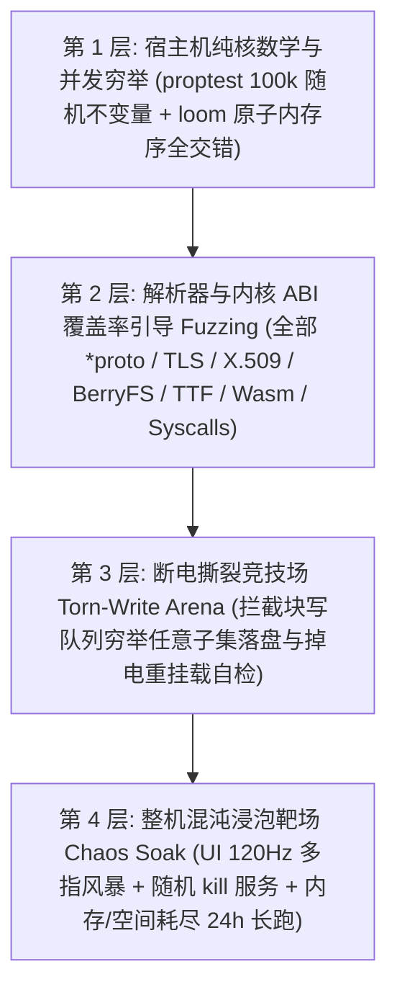

# verif（全栈持续模糊测试、随机掉电撕裂竞技场与确定性混沌验证靶场）总体设计

Type: spec
Status: active
Updated: 2026-11-18
Version: 1.0.0

一句话说明：`verif`（由覆盖率引导模糊测试矩阵 `fuzz/`、多核系统调用状态机轰炸器 `berry-syzfuzz`、块设备断电撕裂仿真器 `torn-arena` 与桌面混沌猴子 `ui-monkey` 组成）是守护 BerryOS 全栈 31 个模块实现「数学级不崩、断电零损盘、恶意输入零逃逸」的工业级自动化攻防熔炉。

## 背景

[全栈 25 模块跨界接缝与深水区六盲点复核审计](../../research/2026-11-18-全栈25模块跨界接缝与深水区六盲点复核审计.md) 指出：随着 BerryOS 版图扩展至现代 CoW 文件系统、TLS 1.3/X.509/QUIC 网络栈、媒体容器解复用、TrueType 字体、Web/Wasm 引擎与 16 核无大锁微内核，任何一处未受控的边界整数溢出、状态机死锁或半扇区掉电撕裂都可能成为致命隐患；而现役 [abi.toml](../../../tools/abi.toml) 生成的 `abi.syz` 尚未闭环编译执行，测试仍以固定线性冒烟为主。本规格依据 [跨模块 ABI 合龙与进程外 JIT 及深水区六子系统裁决](../../notes/proposed/2026-11-18-跨模块ABI合龙与进程外JIT及深水区六子系统裁决.md)，把对抗式自动化验证升格为独立一等工程子系统。

## 范围

- **覆盖**：四层立体自动化验证金字塔——① 纯算法 `*face` 性质测试（Property-based Testing）与 `loom` 无锁并发全交错模型检验；② 全量解析器与协议栈覆盖率引导模糊测试（`cargo-fuzz` / LibFuzzer）及闭环的 `abi.toml -> berry-syzfuzz` 多核系统调用竞争轰炸；③ `BerryFS` 与 `keystored` 块设备任意写序/半块撕裂断电仿真竞技场（Power-Cut Torn-Write Arena）；④ 桌面合成器 120Hz 随机多指手势风暴、服务随机强杀与内存/磁盘耗尽故障注入混沌工程（Chaos Monkey）及 `-icount` 确定性种子一键重放契约。
- **不覆盖**：芯片产线单机物理声光硬件点检（归 [recovery 总体设计](../recovery/design.md) `berry-cit`）；第三方 OEM 兼容性准入冻结件管理（归 [BCTS 兼容性测试套件设计](../../../docs/BCTS兼容性测试套件设计-v1.1.md)）。

## 契约

### 一、四层立体攻防验证金字塔契约

1. **第一层（零硬件依赖微秒级穷举）**：凡进入内核、调度、分配器、合成器与导航滤波的纯逻辑库（`berry-rbtree`、`berry-minheap`、`asidface`、`vmarface`、`portface`、`compface`、`navface`、`berry-crdt`），强制配备 `proptest` 随机操作序列与参考朴素模型（Oracle）双跑对拍（每次提交跑 $\ge 10,000$ 组随机树旋转/合并/并发操作），凡涉及 `Atomic*` 无锁状态机的模块强制通过 `loom` 全交错检查零死锁、零 ABA 悬垂。
2. **第二层（零容忍解析器与内核多核系统调用 Fuzzing）**：
   - **解析器必挂 Fuzz 靶**：工作区统一建立 `fuzz/fuzz_targets/`，任何处理不可信字节流的 crate（全部 `berry-*proto`、ASN.1/X.509、TLS/HTTP/QUIC 帧、`BerryROFS`/`BerryFS` 磁盘块、TrueType 轮廓、MP4/Opus 解复用、HTML/CSS/Wasm 字节码、`.bap`/`.sig` 信封）**不附带 Fuzz 靶标与种子语料库不准合入主线**；在任何畸形随机字节输入下，严禁出现 `panic!`、数组越界、算术溢出、无限死循环或超额内存分配（所有不可信长度前缀必须经有界流式配额校验）。
   - **内核 ABI 多核并发轰炸（`berry-syzfuzz`）**：打通 `tools/abi.toml` 自动生成类型感知的多线程系统调用变异器（携带合法句柄表传递、并发 `dup/close/revoke`、跨核 `vmar_map/unmap` 与 `channel_call` 竞态组合），在开启内核 `lockdep`、KASAN/页表守卫与引用计数泄漏检查的靶机镜像上持续并行轰炸。

### 二、块设备断电撕裂竞技场（`torn-arena`）契约

针对 [storage-image 总体设计](../storage-image/design.md) `BerryFS`、`pkgmgr` 五方卸载事务与 `keystored` 防回滚账本，构建比真实拔电源严酷百倍的内存虚拟块设备拦截器：

1. **缓存乱序与半写精确建模**：虚拟块驱动记录两次硬件 `CACHE_FLUSH`（FUA）屏障之间的全部待落盘 4KiB 块写集合 $W = \{w_1, w_2, \dots, w_k\}$；根据现代 NVMe/eMMC 控制器允许屏障前任意重排物理写序的规范，`torn-arena` 自动分叉派生数百个崩溃镜像快照——包含 $W$ 的任意子集落盘、未达屏障即截断、甚至模拟极端硬件故障下的半页撕裂（CRC 失配）。
2. **双重硬不变量裁决**：对每一个派生出的断电镜像重新挂载 `BerryFS` 执行全树 `fsck` 扫描：① 文件系统结构必须 **100% 零元数据损坏自愈挂载**（最多仅回退至上一已确认 `FLUSH` 的超级块根）；② 凡应用调用 `fsync()` 已返回成功的事务数据 **100% 字节级完整在席，零静默丢数**。

### 三、整机混沌猴子（`ui-monkey` & Fault Injection）与确定性重放契约

1. **UI 与服务混沌风暴**：`berry verify chaos --seed <u64> --duration 4h` 在模拟器上以确定性伪随机发生器并发驱动四路破坏流：
   - 120Hz 随机多点触控点击、边缘打断手势、快速横竖屏旋转与软键盘弹收；
   - 随机选择非内核守护进程（如用户态网卡驱动、音频服务、第三方后台应用甚至 `berry-shell`）注入 `process_terminate` 强杀，检验 `devmgr`/`appd`/`compositor` 是否在 1 帧至数毫秒内无感自愈重拉；
   - 周期性注入物理内存压榨气球（Memory Balloon）与磁盘满配额（`-ENOSPC`）故障。
2. **一键最小化复现（Deterministic Shrinking）**：任何一层靶场一旦猎获崩溃、`lockdep` 环报警、物理页净泄漏或帧冻结超时，自动将触发该故障的随机种子与最小化重放脚本（含 QEMU `-icount` 确定性指令步进配置）固化落入回归种子库，修复后永久作为 CI 守门用例防复发。

## 验收标准

1. **Fuzzing 零崩硬门槛**：核心 20 个解析器与协议 Fuzz 靶标各自累计跑满 $10^7$ 次变异迭代，零 `panic`、零超时挂死、零未捕获异常。
2. **断电撕裂万次通关门禁**：在并发创建、重命名、截断、加密写入与删除文件的混合工作负载下，经 `torn-arena` 注入 10,000 次随机屏障前乱序掉电测试，`BerryFS` 挂载成功率与已提交 `fsync` 数据完好率均达 **100.00%**。
3. **混沌长跑零泄漏门禁**：4 小时高强度 `berry verify chaos` 混沌风暴结束后，系统桌面依然保持 120fps 流畅响应，关闭全部测试应用后物理空闲页帧数、内核句柄槽与 `Job` 计数 100% 回归初始稳态水位。

## 适用边界

- 持续数千万次深度 Fuzzing 与多小时混沌浸泡归入夜间/专用算力编队流水线（Nightly Fuzz & Soak Fleet），每次日常 PR 提交门禁运行快速回归种子集（$< 90\text{s}$）与变动模块 `proptest`/`loom` 套件。
