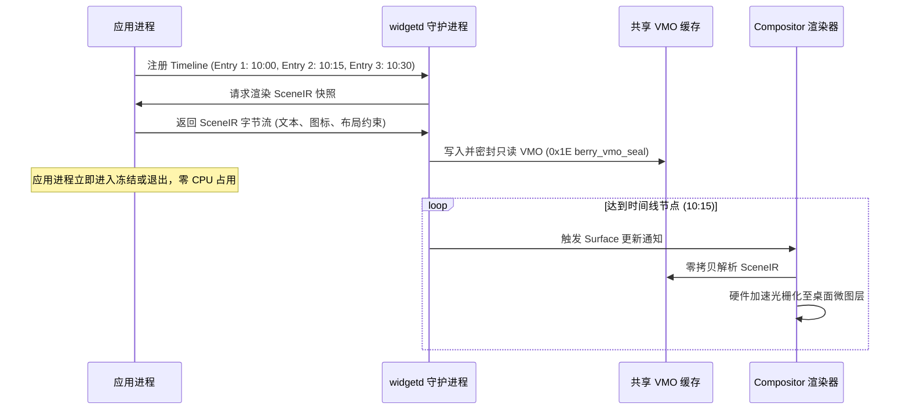

# widgets-intents（声明式小组件、灵动岛实时活动与意图自动化框架）总体设计

Type: spec
Status: active
Updated: 2026-11-18
Version: 1.0.0

## 1. 模块定位与职责边界

Widgets & Intents 体系是 BerryOS 实现现代流体桌面、锁屏一瞥即得与跨应用语义编排的核心子系统。它打破传统应用间各自孤立的展示边界，支持将应用关键状态投影为桌面/锁屏微视图（Widgets）、灵动岛与实时活动（Live Activities），并通过声明式语义意图（App Intents）供系统级搜索、AI 大模型代理及自动化快捷指令（Shortcuts）直接驱动。

```
+-------------------------------------------------------------------------+
|                  AI Agent / 全局搜索 / 快捷指令自动化                     |
+-------------------------------------------------------------------------+
                                    | (语义分发 & 意图唤醒)
                                    v
+-------------------------------------------------------------------------+
|                         intentd 意图路由中枢                             |
+-------------------------------------------------------------------------+
       |                                                    |
       v (时序帧分发)                                         v (即时命令调用)
+-----------------------------------+             +-----------------------+
|        widgetd 组件生命周期守护    |             |      目标应用沙箱      |
|  - Timeline Provider 缓存调度     |             |  - 意图处理闭包        |
|  - SceneIR 声明式场景树解析器     |             |  - 实时活动推送信道    |
+-----------------------------------+             +-----------------------+
       |
       v (只读共享 VMO / 零内存拷贝)
+-------------------------------------------------------------------------+
|                Compositor 沉浸式渲染管线 (灵动岛 & 桌面)                  |
+-------------------------------------------------------------------------+
```

### 职责边界划分
- **归属 Widgets & Intents 的职责**：
  1. **声明式小组件管线（Widgets）**：管理小组件时间线调度（Timeline Provider）。应用进程只提供数据快照与时间线预测，不在后台常驻执行图形代码；小组件由系统端统一以 `SceneIR` 声明式布局直接由 [compositor](../compositor/design.md) 离屏合成为无闪烁图层。
  2. **灵动岛与锁屏实时活动（Live Activities）**：提供多态展开视图（紧凑双翼 Compact Leading/Trailing、最小化 Minimal、展开大态 Expanded），以 120fps 弹簧动画在屏幕开孔区域平滑展开与收缩。
  3. **应用意图框架（App Intents）**：定义强类型、自解释的意图元数据契约，支持零唤醒意图预读与秒级静默后台计算。
  4. **快捷指令执行器（Shortcuts Engine）**：提供跨应用流图执行引擎，支持变量传递、分支条件与用户交互确认。
- **严禁越界的范围**：
  1. 严禁小组件进程在桌面表面常驻运行渲染循环（禁止每秒 60fps 轮询重绘），必须依时序（Timeline）或高优推送驱动。
  2. 严禁小组件直接访问任意网络与私有文件，数据必须由父应用容器沙箱通过密封通道预置。
  3. 严禁无授权意图静默拉起敏感操作（如付款、删除文件、拨打电话），高敏感意图必须经系统安全确认弹窗。

## 2. 核心架构与数据流

### 2.1 零拷贝声明式 SceneIR 管线
小组件绝非传统的微型 Webview 或 X11 嵌框，而是纯粹的声明式树状序列化数据（`SceneIR`），从而杜绝应用驻留导致的内存与电量泄漏。



### 2.2 灵动岛（Dynamic Island）四态流体切换
实时活动以动态弹簧模型驱动，依据当前系统焦点与物理打孔屏位置自动适配四种几何拓扑：
1. **Compact**：常态双翼分割（左翼：状态/图标，右翼：计时/波形）；
2. **Minimal**：多活动并发时，右翼分离为独立小泡；
3. **Expanded**：长按或手势下拉，物理展开为交互控制板（含操作按钮、进度滑块）；
4. **LockScreen Banner**：锁屏大卡片呈现，支持息屏常显（AOD）超低刷新率模式。

## 3. 接口契约与 ABI/IPC 定义

### 3.1 意图元数据与 IPC 协议
应用在其包清单元数据 `app.manifest.json` 中声明公开意图：

```json
{
  "intents": [
    {
      "identifier": "com.berry.music.playPause",
      "category": "mediaControl",
      "parameters": [
        {"name": "playlist", "type": "string", "optional": true}
      ],
      "requires_unlock": false,
      "confirmation_required": false
    }
  ]
}
```

### 3.2 灵动岛实时活动消息协议 (`BerryLiveActivityPacket`)
通过系统通道向 `widgetd` 发送增量更新：

```c
enum LiveActivityState : uint32_t {
    ACTIVITY_STATE_ACTIVE    = 0,
    ACTIVITY_STATE_UPDATING  = 1,
    ACTIVITY_STATE_STALE     = 2,
    ACTIVITY_STATE_DISMISSED = 3,
};

struct BerryLiveActivityPacket {
    uint64_t activity_id;
    uint32_t state;             // LiveActivityState
    uint32_t priority;          // 0: Normal, 1: High (唤醒灵动岛弹出动画)
    uint64_t target_timestamp;  // 倒计时终点或目标时间戳
    uint32_t progress_permille; // 进度千分比 (0..1000)
    uint32_t scene_ir_length;   // 附加的声明式视图字节大小
    uint8_t  scene_ir_bytes[];  // 紧凑声明式 SceneIR 结构
};
```

### 3.3 小组件时间线协议 (`TimelineProvider`)
```c
struct BerryTimelineEntry {
    uint64_t timestamp_ms;      // 目标生效世界时间
    uint32_t relevance_score;   // 智能推荐权重 (用于智能叠放翻转)
    uint32_t layout_variant;    // 0: Small (2x2), 1: Medium (4x2), 2: Large (4x4)
    uint32_t payload_vmo_offset;
};
```

## 4. 故障模型、降级与安全边界

### 4.1 故障模型与弹性防护
1. **SceneIR 解析异常与畸变包防御**：
   - `widgetd` 与 `compositor` 采用严密的递归深度保护（最多 16 层嵌套）和无死区算术检查；畸变数据直接丢弃并呈现默认占位占位符，严禁导致渲染器崩溃。
2. **应用假死或不响应意图**：
   - 意图请求设置 1500ms 超时熔断；若应用无应答，向调用方（如快捷指令或 AI Agent）抛出 `ERROR_INTENT_TIMEOUT` 并提供重试方案。
3. **恶意滥用实时活动（弹窗轰炸）**：
   - 系统级频控：每个应用最多同时保持 2 个活动，更新频率限制为最高 2 次/秒（电量保护门限）；超出限制直接丢弃并打上流控标记。

### 4.2 安全与隐私边界
- **无摄像头/麦克风权限**：小组件表面绝对禁止直接获取音视频传感器流。
- **锁屏隐私保护**：在设备未解锁（Lock Screen Locked）状态下，涉密意图与带敏感标记的小组件内容自动打码（Blur Redaction）或替换为抽象图标。
- **只读快照机制**：传递给系统的 `SceneIR` 必须经 `vmo_seal`（`0x1E`）彻底封死写权限，防止客户端多线程竞态篡改投毒。

## 5. 落地步骤与验收指标

### 5.1 实施路径
1. **第一阶段（SceneIR 声明式骨架）**：
   - 定义 `SceneIR` 二进制序列化格式；
   - 在 `ui-sdk` 中实现 WidgetKit 声明式 DSL；
   - 在 `compositor` 中实现极轻量 SceneIR 光栅化器。
2. **第二阶段（灵动岛流体与时间线调度）**：
   - 编写 `widgetd` 守护进程，管理桌面 2x2/4x2 尺寸摆放与存储；
   - 打造 Dynamic Island 四态弹簧动画与手势下拉展开。
3. **第三阶段（意图路由与自动化打通）**：
   - 编写 `intentd`，接通系统搜索、全局快捷指令与终端命令 `bsh intent invoke`。

### 5.2 商业化验收门禁
- **G-WDG-1（小组件渲染性能）**：单个 4x2 小组件 SceneIR 解析与渲染上屏耗时 $\le 1.8\text{ms}$。
- **G-WDG-2（灵动岛动画帧率）**：灵动岛展开/收缩流体弹簧动画稳定在 120fps，丢帧率 $< 0.1\%$。
- **G-WDG-3（内存基线开销）**：全系统桌面承载 12 个活跃小组件时，总内存物理开销增加 $\le 16\text{MiB}$。
- **G-WDG-4（意图响应延时）**：无界面意图调用从发起至结果返回端到端延迟 $\le 120\text{ms}$。
